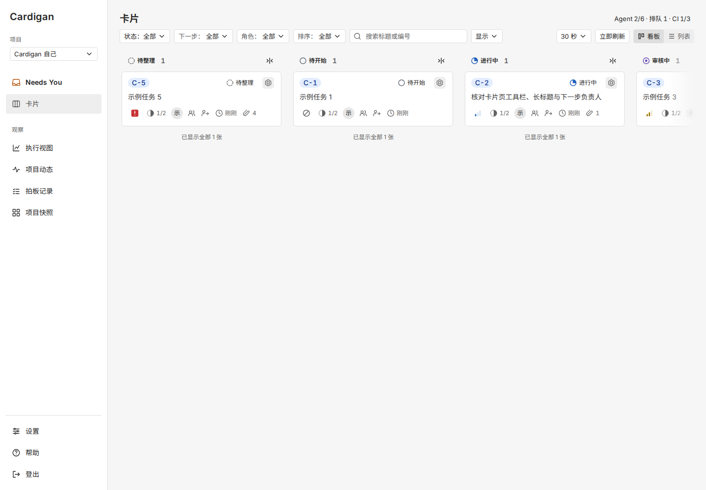

# Workbench 界面规范：以卡片页为基准

对应 [C-439 计划](../plans/C-439.md)。本规范记录卡片页和详情页的既定外观，不借组件化重新设计页面。原始基准为 `73c3a1ba2b26d976eca1fd1652f1bbced110e254`。后续界面卡必须说明复用的组件、差异与验证状态，不能只写“风格一致”。

## 基准图与测量条件

截图全部来自 `apps/web/test-support/page-skeleton-fixture.tsx`：7 张合成卡片、7 种卡片状态、1 名合成员工、1 个 Agent 容量记录和 1 个 CI 容量记录；固定时钟为 2026-01-01 00:00 UTC。详情用既有 `cardDetail` 样例的工作项和时间线。没有业务服务、生产库或真实员工资料，不代表生产规模验收。

运行命令使用 pnpm 锁定的 Node 24.22.2；浏览器为 Linux Chrome Headless Shell **157.0.8103.15**，固定软件栅格路径（`--run-all-compositor-stages-before-draw --disable-new-content-rendering-timeout --disable-threaded-animation --disable-threaded-scrolling --disable-partial-raster --disable-gpu --disable-skia-runtime-opts --force-color-profile=srgb --num-raster-threads=1`），DPR 1，视口 **1440×1000 / 390×1000**，亮/暗主题，字体来自锁文件中的 Inter Variable、Noto Sans SC Variable、JetBrains Mono Variable。等待字体加载及两帧布局稳定，截图未聚焦文本输入。各场景重新载入，清空本夹具的偏好；每个截图状态明确设置。截图是视口截图，不声称验证屏幕外全部内容。

| 图号 | 标准内容 | 对应截图 |
|---|---|---|
| 图 1 | 页面结构、工具栏、图标、看板 | [看板·亮·1440](../../apps/web/test-support/page-skeleton-snapshots/board-1440-light.png) / [暗](../../apps/web/test-support/page-skeleton-snapshots/board-1440-dark.png) |
| 图 2 | 表格、编号、状态、下一步头像 | [列表·亮·1440](../../apps/web/test-support/page-skeleton-snapshots/list-1440-light.png) / [暗](../../apps/web/test-support/page-skeleton-snapshots/list-1440-dark.png) |
| 图 3 | 窄屏换行、右操作组、列表 | [列表·亮·390](../../apps/web/test-support/page-skeleton-snapshots/list-390-light.png) / [暗](../../apps/web/test-support/page-skeleton-snapshots/list-390-dark.png) |
| 图 4 | 详情标题、正文、侧栏和头像 | [详情·亮·1440](../../apps/web/test-support/page-skeleton-snapshots/detail-1440-light.png) / [窄屏](../../apps/web/test-support/page-skeleton-snapshots/detail-390-light.png) |
| 图 5 | 下拉菜单、选项与键盘焦点 | [下一步筛选](../../apps/web/test-support/page-skeleton-snapshots/filter-1440-light.png) / [窄屏](../../apps/web/test-support/page-skeleton-snapshots/filter-390-dark.png) |
| 图 6 | 页头摘要和容量浮层 | [容量详情](../../apps/web/test-support/page-skeleton-snapshots/capacity-1440-light.png) / [窄屏](../../apps/web/test-support/page-skeleton-snapshots/capacity-390-dark.png) |
| 图 7 | 分组与字段显示 | [状态分组](../../apps/web/test-support/page-skeleton-snapshots/grouped-1440-light.png) / [关闭显示字段](../../apps/web/test-support/page-skeleton-snapshots/minimal-1440-light.png) |



## 页面结构和骨架

| 规则 | 唯一入口与实测要求 | 标准图 |
|---|---|---|
| 页头 | `PageTitle` → `PageHeader`；左标题、可选计数，右侧 `PageSummary` / `CapacitySummary`；摘要无边框，不塞进工具栏 | 图 1、6 |
| 工具栏左组 | `PageToolbar.fields`，顺序为状态、下一步、角色、排序、搜索、显示。由字段节点直接参与 flex，不能多包一层改变折行 | 图 1、3 |
| 工具栏右组 | `PageToolbar` 的 children 顺序为 `RefreshGroup`、`CardsViewSwitch`。整组右对齐，组内不折行；宽窄屏保持相同顺序 | 图 1、3 |
| 内容区 | 看板/列表共用 `ui-workspace`，页头和工具栏不能随视图切换跳动。宽屏内容内边距 24px，≤760px 为 12px；工具栏下间距 12px | 图 1、2、3 |
| 搜索 | `SearchInput`，上限 240px、最小 min(140px,100%)，宽度不足时自然换行；不能用绝对定位挤进工具栏 | 图 1、3 |
| 详情 | `CardDetailLayout`；独立详情最大宽 1088px，正文 14px/20px，标题 20px/28px；详情及抽屉继续使用现有布局组件 | 图 4 |

`PageToolbar` 只组合布局和筛选芯片；页面拥有路由、请求和持久化。`RefreshGroup` 是受控展示，不启动定时器。`CapacitySummary` 沿用 `CapacityProvider` 的共享读取，不因页头抽取新增请求。

```tsx
<PageToolbar fields={fields} values={filters} onChange={setFilters}>
  <RefreshGroup interval={interval} onIntervalChange={setInterval}
    pending={pending} onRefresh={reload} />
  <CardsViewSwitch value={view} onChange={setView} />
</PageToolbar>
```

## 控件和文案

| 控件 | 固定用法 | 标准图 |
|---|---|---|
| 单选筛选 | `FilterSelect`；可见文案为“标签：值”，全角冒号，空值“全部”；可访问名称包含标签和当前值。不要手拼 `SelectControl prefix` | 图 1、5 |
| 多选筛选 | `MultiSelect`；卡片状态保留既有多选和清除行为；不是另造一种单选按钮 | 图 1、5 |
| 显示菜单 | `DisplayMenu`；触发文字“显示”，菜单标题/可访问名称“显示字段”，复选项保持打开。列表另有“分组字段：状态” | 图 1、7 |
| 刷新 | 默认 **30 秒**；选项顺序 **10 秒、30 秒、60 秒、5 分钟、关闭**；按钮“立即刷新”。pending 时 `aria-disabled=true`，仍可聚焦，不能触发第二个请求 | 图 1、6；[刷新选项参考](../../apps/web/test-support/page-skeleton-snapshots/reference-refresh-1440-light.png) |
| 视图 | `CardsViewSwitch` 固定“看板 / 列表”、既定图标、可见文字和 `aria-pressed`；不能改成“卡片 / 表格”。其它数据模型的模式须在共享组件定义专用预设 | 图 1、2 |
| 尺寸 | 默认/sm 控件 28px；regular 32px；icon 命中区 28×28px，icon-regular 32×32px。工具栏不改 regular；横向内边距 8px，图标文字间距 4px | 图 1、3、5 |
| 空值与空态 | 缺失字段沿用组件的“—”；无卡片“没有卡片”，筛选无结果“没有匹配的卡片”；时间非法用“时间未知”，不能把未知当作 0 | 图 2、7；[空状态参考](../../apps/web/test-support/page-skeleton-snapshots/reference-1440-light.png) |

卡片页默认排序的未显式选择态仍显示“排序：全部”，请求端沿用更新时间排序。本次不借规范改变既有行为。业务表单仍可用 `SelectControl`；旧 `FilterBar` 的历史字段兼容分支仅供迁移，不作为新页面的筛选写法。

## 图标、字号和 token

| 项目 | 标准 | 标准图 |
|---|---|---|
| 图标来源 | 一套共享入口：基础操作用 `components/ui/icons.tsx` 导出的 Lucide 图标，业务状态用现有 `StatusIcon` / `PriorityBadge` / `TemplateMarker`。看板、列表图标已移入 icons 入口，保留原 SVG 路径和 16×16 尺寸，不能为“统一”替换成另一幅近似图形 | 图 1、2、4 |
| 图标大小 | 普通图标 16px (`--ui-icon`)，排序箭头 12px (`--ui-arrow`)；模板按钮命中区 28px。装饰图标 `aria-hidden`，操作必须有名称和 tooltip | 图 1、2、5 |
| 字体 | 页面基础 14px，控件/表格 13px，辅助元数据 12px；行高分别引用 20px/20px/18px。页标题 20px/28px，区段标题 16px/24px | 图 1、2、4 |
| 间距 | `--ui-space-1/2/3/4/6` = 4/8/12/16/24px；工具栏组内 8px；图标文字 4px。页面不再写像素覆盖 | 图 1、3 |
| 圆角和边框 | 控件 4px，面板 6px，编号胶囊 999px；边框 1px，焦点外轮廓 1px、外偏移 1px | 图 1、2、5 |
| 亮/暗颜色 | 使用 `--bg`、`--surface`、`--surface-muted`、`--text`、`--text-muted`、`--border`、`--ui-selected`、`--ui-focus`，定义在 `ui/theme.css`；状态、优先级和编号各用既有语义 token，不在页面写色值 | 图 1、2、3 的亮/暗版本 |

旧页面已有的业务语义 SVG 不属于第二套可任选图标库；新页面不得内联 SVG，新增业务图形先进入共享组件并补齐状态和截图。图标、状态颜色不能用 emoji 代替。

## 表格、看板与身份信息

| 项目 | 可测规则 | 标准图 |
|---|---|---|
| 表格入口 | 使用 `ui/table`；表头 32px、13px/20px、字重 600，左对齐/垂直居中；单元格内边距 8px，左对齐/顶对齐、底部 1px 分隔线。内容决定行高，不强制压到单行 | 图 2 |
| 列宽与窄屏 | 卡片表宽 100%，宽屏最小 48rem，现有自适应列宽保留；窄屏沿用现有纵向记录布局。新表格须在共享布局中定义列宽策略，不在页面散写 width | 图 2、3 |
| 排序 | 仅可排序表头传 `sort` / `onSort`，使用 `aria-sort` 与共用升/降/未排序箭头。卡片页现有排序由工具栏控制，不能凭空给每列加箭头 | 图 2、图 1 的排序筛选 |
| 看板 | 展开列沿用 334px（卡片外框 326px），列间距 16px；窄屏沿用可用宽度减 64px。卡片标题自然换行，列独立滚动，页面不能横向溢出 | 图 1；[窄屏看板](../../apps/web/test-support/page-skeleton-snapshots/board-390-light.png) |
| 状态 | `StatusTag` / `CardStatusTip`：图形、文字、颜色共同表达；卡片状态使用既定七种，暂停/阻塞原因使用既有提示，不新造卡片状态值 | 图 1、2、4 |
| 编号 | `IdTag` / `IdBadge`；保留 C/W/A/R/D/V/Q/MB 等前缀，用类型色胶囊。详情链接和被动提示沿用组件，不能只展示裸数字 | 图 1、2、4 |
| 头像行 | `EmployeeIdentity` / `NextOwners`；常规 32px，看板/紧凑行 24px；头像不重叠，名称和元信息自然折行，空头像沿用首字/系统图形 | 图 1、3、4 |
| Tooltip | `Tooltip` / 状态与容量专用组件；鼠标悬停和键盘聚焦均可达，Escape 关闭，深底浅字。完整标题/原因不能只靠省略号丢失；长状态详情使用既有可滚动提示 | 图 5、6；[键盘焦点参考](../../apps/web/test-support/page-skeleton-snapshots/reference-focus-1440-light.png) |

## 禁止项与防回退

以下禁令均以图 1～7 中已有的页面内容和控件为基准：不新增说明小字；不增加页面专用 CSS、inline style 或尺寸/颜色 utility；不手拼工具栏左右组、刷新组或单选筛选；不重新绘制同用途图标；不把容量放入筛选组；不把整个页面变成横向滚动区。必须说明的行为放帮助页、tooltip 或文档。

`pnpm lint` 的 `check-ui` 检查 `views/` 中底层 `FilterBar` / `FilterBarLayout` / `ViewSwitch`、手写骨架 class、刷新按钮、筛选前缀、工具栏内原始 `SelectControl` 和内联 SVG，也识别命名导入别名、命名空间、变量别名、属性展开和 `createElement` 的常见写法。表单 select 不受误伤。

既有其它页面只准保留固定 Git 基线 `c7766300101592172f9d872d654092f332ce5473` 中的相同路径、相同节点散列和出现次数（包含并行合入、已审核的 C-438 执行视图按钮重叠修复；卡片页视觉基准仍为文首原始版本），修改/复制即失效；不允许编辑 JSON 扩大例外。CardListPage 没有骨架例外。执行视图由 C-440 迁移，活动页等历史页面保留原状。这是迁移边界，不是新页面的豁免。

## 视觉回归和基准更新

开发样式参考页为 `test-support/style-reference-fixture.tsx`，由截图脚本的临时 Vite 路由 `/__skeleton` 加载，`--reference` 选择该入口；不加入产品导航。它覆盖默认/已选择筛选、刷新关闭/刷新中、选中视图、禁用按钮、状态/编号、空态、展开筛选/周期选项、键盘焦点。

```sh
# CHROMIUM_PATH 指向上述版本的 chrome-headless-shell；不得使用生产浏览器配置。
pnpm exec tsc -b apps/web
pnpm --filter @cardigan/web test:ui-snapshots
# 有意改变组件外观时，先核对 *.actual.png，取得界面卡授权后更新并逐张审核：
pnpm --filter @cardigan/web test:ui-snapshots --update
```

本卡的原始卡片页基准用 `UI_BASELINE_REF=73c3a1ba2b26d976eca1fd1652f1bbced110e254 pnpm exec node apps/web/test-support/page-skeleton-screenshots.mjs --update` 生成：Vite 只覆盖本次变更的原有 CardListPage、PageHeader、Capacity 模块为历史源码；样式、字体、合成数据和浏览器相同，新增共享组件不参与历史页渲染。当前页面必须在不更新图片时通过全部比较。

卡片页/详情 28 图：看板、列表、状态分组、关闭显示字段、详情、筛选展开、容量浮层 × 两个宽度 × 两种主题。参考页 16 图：默认、筛选展开、周期展开、键盘焦点 × 两宽度 × 两主题。每张解码为 RGBA，逐像素比较，阈值 **0**；尺寸变化也失败。没有用抗锯齿容差掩盖差异。脚本同时检查页面无横向溢出、菜单可通过 Enter 打开、Escape 关闭并返回焦点。

全部图片及原始测量 JSON 在 `page-skeleton-snapshots/`。`UiVisualBaseline.test.ts` 比较共用源码和全部 44 张 PNG 的散列清单；源码变更后须运行完整视觉脚本生成新清单，像素差异需逐张审核再更新基准。常规本地/远程 Vitest 都执行这一防陈旧检查；实际浏览器比较单独使用固定版本运行，不把另一版本的渲染结果冒充同环境比较。

## 界面验收清单

每条记录“通过 / 不通过 / 未核”、截图名、测量值或差异像素数；设计验收绑定当前交付与完整提交。

- [ ] 图 1～7 对应同一合成数据与浏览器，记录版本、字体、DPR、宽高及主题；未使用生产数据。
- [ ] 1440/390、亮/暗的看板、列表、分组、隐藏字段、详情与浮层，抽取前后差异像素均为 0；明确视口外未核范围。
- [ ] 页标题/摘要基线一致，工具栏左组顺序正确；右组边缘与内容区右边缘对齐，宽窄屏不拆开刷新和视图。
- [ ] 常规工具栏控件实测 28px；图标 16px、间隔 4px、组间隔 8px；无按钮重叠或点击区遮挡。
- [ ] 刷新默认 30 秒，五个选项顺序与文案正确；pending 时聚焦保留且重复点击不再发请求。
- [ ] 筛选文案“标签：值”、视图“看板/列表”、搜索占位和显示菜单均与图一致；键盘 Enter/方向键/Escape 可用。
- [ ] 标题 20/28、正文 14/20、控件 13/20；所有尺寸与颜色来自指定 token，亮暗皆可辨识。
- [ ] 表头/单元格对齐、间距、缺省值、行高、窄屏记录布局与图 2/3 一致；排序仅出现在有实际能力的控件上。
- [ ] 状态图形/文字、编号前缀/类型色、头像大小/折行、tooltip 全文与焦点行为符合图 1/2/4/5/6。
- [ ] 样式参考 16 图覆盖对应状态，新增源码或图片能使陈旧基准测试失败；无授权的像素差异不能直接更新图片。
- [ ] `pnpm lint`（含 check-ui）、相关 Vitest、Web 增量构建、`pnpm check:deps` 通过；远程预检绑定交付 SHA。
- [ ] 没有新增说明小字、页面 CSS、手写骨架、近似替换图标或第二套样式；历史例外没有扩张。
