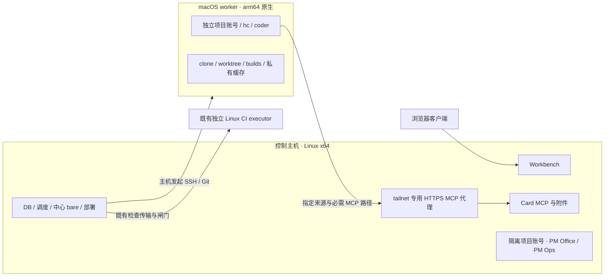

# Cardigan · 多 Agent 协作开发系统开发方案

- 版本：v0.10.0（2026-11-09）
  - v0.10.0：**Phase 1.5 Workbench UI/UX 完成**（#179–#201，计划见 `docs/plans/phase-1.5-ui.md`，用户两轮走查通过）。§8.1 前端：左侧导航加页面框架，统一颜色、字号变量和公共组件（时间、编号标签、状态标签、空状态、筛选栏、长内容折叠）；看板和列表合成 `#/p/<项目>/cards?view=list|board`，旧路由跳转；卡片可用 `card=<编号>` 在右侧抽屉打开；交互组件用 Radix 无样式单独包，不引带样式的组件库；随站点打包 Inter、思源黑体（Noto Sans SC）、JetBrains Mono 三套 OFL 字体，由 Workbench 自己提供，正文开启 `text-autospace`。§8.3 快照顶部加五项概览，空分区不显示，最近交付改为表格。§8.4 卡片详情：来源和相关卡片、固定区块导航和写评论入口、最近结论、附件网格和大图预览（显示上传者和真实上传时间）；时间线按天分组、左侧竖线和类型图标、评论卡片默认完整显示、交付审核拍板的状态固定在卡片右上角、只用三档字号。§8.7 看板只排一行、永不折行，放不下时在看板区域内横向滚动。Needs You 拍板卡片、列表、项目动态和执行视图的改造（#182、#183）没有改正文，设计见计划 §4.2–§4.5。
  - v0.9.1（2026-11-08）
  - v0.9.1：**M5.S 真实冒烟通过，Phase 1 完成**（#157–#178）。M2.S、M3.S、M4.S（含另一个游戏项目（Godot 大仓库））、M5.S 全部通过，发现的 S1–S25 除 S22 外全部修复（S22 和项目之间的文件隔离列入 Phase 2）。§10.2 预置 Agent 的目录信任和 Claude 首次初始化，关闭 Claude 自动记忆；§12.2、§12.4 只读审核方在当前交付版本上启动和刷新；§9.2、§9.3 验证目标参数和诊断，coder 交付摘要限 160 字，新卡默认用项目登记的仓库；§6.4、§7.2 常驻 PM Run 不得自我唤醒、ACK 按流推进、经 MCP 指派的工作项由 Router 通知后启动、提交审核也算 Run 有产出、规则能确定下一步的事件不再升级给 PM Ops；§4.3、§4.4、§10.4 PM 验收只针对完成申请；§12.3、§13.1 统一数据目录默认值，未创建的仓库不备份；§12.6 回收已释放的终端和空 worktree 目录；§12.5 合并计划包含所有 Git 交付；§4.4、§6.6 手动停止的常驻 PM 保持暂停；§8.1 卡片页内定位走路由参数；§10.4 补 designer、tester Core Prompt。附录 A 第一条通过标准改为"只因产品口径和合并确认打断你"（用户拍板）。
  - v0.9.0（2026-11-06）
  - v0.9.0：**M5 完成**（#121–#156）。§8.2 Workbench 写接口（评论、指令、附件、拍板、人工动作）及 §9.2 人和常驻 PM Ops 的指令、引用解析；§8.3–§8.6 项目快照、执行视图、项目动态和可续传的 SSE 实时刷新；§14 Workbench 只监听回环地址、登录和 JSON/Origin 防护在监听器上强制执行；§4.4 没有验证项指向的产出工作项，交付即完成；§7.1、§10.4 常驻 PM 的 Token 按持久化的模式限定工具；§10.2 每个 Assignment 隔离 Claude 配置目录；§13.9 两次 Run 之间运行时丢失时自动替换 Session，失败立即升级；§11.2 运行时诊断信息。§15 新增 D10–D12（PM 规则来自各项目 PM 实战经验并定期提炼、常驻授权代拍板和高风险拍板只在 Workbench 确认留到 Phase 2），§10.3 写入定期提炼流程。附录 A 按开发卡模板和拍板规则对齐，在真实 server、hc 和 Git 上端到端运行。
  - v0.8.0（2026-11-06）
  - v0.8.0：**M4 完成**（#88–#120）。§12.1 中心仓库改为数据目录下主机独占的 bare 仓库，登记源只读、只快进同步、分叉不动；§12.2 基础 clone 改从中心取基线，agent-ssh 下首次建空仓库、之后由主机经 Agent 执行入口增量推送（不再每次打整仓 bundle），查询和传输两档超时；§12.3 交付在事务前按数据库记录的分支校验 commit 和祖先关系，提交后固定 `refs/cardigan/deliveries/<id>`（只创建不覆盖），定期备份 `agent/*`；§12.5 在 bare 仓库里用 merge-tree + commit-tree + 比较后更新合并，不检出文件，冲突不动任何 ref；§12.6 release、清理决策（保留 / 强制清理前先存补丁）、只报告不删除的对账；§4.4 卡片新增 `awaiting_merge`，合并成功才 done，合并确认按模板策略进 Needs You（用户确认）；§7.1 / §10.4 常驻 PM 的前台/后台模式持久化为 `standing_mode`，Token 范围由模式决定；§9.1 MCP 认证拒绝非 active 的 Assignment；§14 主机 Git 只在中心仓库执行，从 Agent 仓库拉取经 Agent 执行入口跑 upload-pack 并开启 fsck。
  - v0.7.0（2026-11-05）
  - v0.7.0：**M3 完成**（#61–#87、#91、#94、#101、#103、#104）。§6.4 路由规则表、§6.5 @提及、§7.2 升级、§6.7 合并门铃全部实现；通知状态机 `pending → belled → acked` 及 `delivery_failed`、`needs_attention` 写入 §4.4；Dispatcher 以 MCP 为准判断忙闲，按指数退避重发、wake 失败不静默重试、看门狗、运行时失联 unknown → lost；按流（每张卡、项目级）的事件序号和 Router 游标；PM Office / Ops 共用 pm 角色、分工和打断规则（§7.1–§7.3）；§20.1 / §20.2 新增 `packages/host`，CLI 和 Dispatcher 共用同一份启动和失败补偿流程。
  - v0.6.23（2026-11-05）
  - v0.6.23：**M2 完成**（#43–#72）。一键启动、Runtime 适配器（herdr-core 0.1.18）、worktree、启动编译和首条提示；M2.7 Agent 专用账号模式接入一键启动；start 哨兵在 dispatchRun 提交之后才写入，并使用安全写入。
  - v0.6.22（2026-11-05）
  - v0.6.22：M2.7 补充共享 Git 的账号边界：主机仅读取登记源并生成只读 bundle，共享 clone/worktree 的 Git 操作均在 agent 账号执行。
  - v0.6.21（2026-11-05）
  - v0.6.21：M2.7 实际写入共享运行目录与凭据权限；固定目录描述符防止共享目录链接覆盖主机文件；server 打开数据库前验证私有数据目录。
  - v0.6.20（2026-11-05）
  - v0.6.20：M2.7 确定 agent 专用账号、主机私有数据、cardigan-share 两账号共享组和专用 loopback SSH 入口；安装器先做只读 preflight，提供 --check，后续运行时接线分批交付；见 ADR 0002。
  - v0.6.19（2026-11-05）
  - v0.6.19：M2.5 实现本地独立 clone、worktree 创建/复用和脏文件查询，明确 detached 目标和路径冲突的拒绝边界；Assignment 编号按项目分配，worktree 路径按项目分层，project_id 入路径前校验为安全片段。
  - v0.6.18（2026-11-05）
  - v0.6.18：M2.3 第一部分接入 hc 0.1.18，明确独立 session/socket、子进程超时、事件序号、替换和释放边界；共用真实/内存契约套件单独提交。
  - v0.6.17（2026-11-05）
  - v0.6.17：M2.1 第二部分补齐 acknowledgeRun / abortDispatch，复用 activeWork 推进首次 MCP 确认，明确取消和重复调用边界。
  - v0.6.16（2026-11-05）
  - v0.6.16：M2.1 第一部分定义 Role、Runtime 端口和主机侧 queueRun / dispatchRun，明确快照、互斥和派发元数据边界。
  - v0.6.15（2026-11-05）
  - v0.6.15：M2 开工前复核 D9，维持 herdr-core 并锁定 0.1.18；多机实测更新到 §11.3；§10.4 明确 PM 验收由每张卡单独的工作项级 pm Assignment 完成（用户确认）。M2 任务计划见 `docs/plans/phase-1-m2.md`。
  - v0.6.14（2026-11-04）
  - v0.6.14：M1.6c 接入附件、Run 和项目查询；明确 base64/摘要校验、内容寻址落盘、事务失败保留文件及只读快照边界。
  - v0.6.13（2026-11-04）
  - v0.6.13：M1.6b 安全修订：MCP 只登记 Assignment，不签发或返回 Token；签发与 Assignment 校验由主机在同一事务完成。
  - v0.6.12（2026-11-04）
  - v0.6.12：M1.6b 接入协作和 PM 工具，增加 store 的事务内 Token 签发能力；MCP 凭据边界由 v0.6.13 修订。
  - v0.6.11（2026-11-04）
  - v0.6.11：报告的阻塞保存为 WorkItem.reported_blocker；PM／人确认与实际恢复分开，支持与 Decision / HumanAction 独立解除，避免相互等待。
  - v0.6.10（2026-11-04）
  - v0.6.10：M1.6a 明确 MCP 命令的一致快照、缓存优先预检、幂等事务及失败回滚边界；后续工具分依赖 PR 接入。
  - v0.6.9（2026-11-04）
  - v0.6.9：§4.4 验证型工作项补上 `in_progress → blocked / waiting_decision` 和 `blocked → in_progress`（报阻塞、发起阻塞拍板、解除阻塞；`waiting_decision` 仍回到 `ready`）；M1.T1 审核时发现规格漏写，实现早已支持。
  - v0.6.8（2026-11-04）
  - v0.6.8：M1.3 二轮审核：暂停自身工作项前复用交付/审核的启动校验；明确 delivered / accepted 的等待行为；新交付到达时检查累计审核预算，用尽则转上限拍板。
  - v0.6.7（2026-11-04）
  - v0.6.7：M1.3 审核修订：PM 受控解除普通阻塞；阻塞拍板包含请求者工作项；审核上限的暂停/放宽与恢复条件分离；四个 M1.5 只读工具由 mcp-server 单独维护。
  - v0.6.6（2026-11-04）
  - v0.6.6：M1.3 协作命令：明确敏感决策分类、Run 心跳/上限审计、阻塞后新建 queued Run、PM Office 权限来源及 Token 签发意图；不启动运行时。
  - v0.6.5（2026-11-04）
  - v0.6.5：M1.3 审核修订：最后一轮 reject / conditional 均转阻塞拍板；完成申请目标失效后验证项回到 todo；supersedes 只指向同类上一版，审核事件先于拍板请求。
  - v0.6.4（2026-11-04）
  - v0.6.4：M1.3 交付命令：完成申请前置检查排除本次完成审核工作项（用户确认），区分产出与完成申请版本，明确事务外校验/事务内归约和结构化遗留依据。
  - v0.6.3（2026-11-04）
  - v0.6.3：按 M1.2 审核意见补齐 §4.4 的新交付重开、在审版本失效、验证项取消及 unknown 重连迁移；§13.9 明确暂时失联后的恢复路径。
  - v0.6.2（2026-11-04）
  - v0.6.2：§20.4 合并规则改为常规 PR 由 Claude 合并并给出 brief；§10.4 改正 PM 角色的写法（前台、后台是同一个角色的两个 Assignment）。
  - v0.6.1（2026-11-04）
  - v0.6.1：§10.2 新增"接入点 + 启动配置"两层设计，以及供人手动启动的 `cardigan launch`。
  - v0.6（2026-11-04）
  - v0.6：Phase 0 完成。D3–D9 全部敲定（§15）；按 `docs/research/` 中各份预研报告修订 §2.1、§4.3–§4.5、§5.2、§6、§8.2、§8.4、§8.7、§9、§10、§11（重写）、§12、§13、§14、§16–§18 和附录 A、B；新增 ADR 0001（运行时基线）。
  - v0.5.1：新增 D9（运行时基线），0.3 增加 Herdr 换代评估，0.6 改为敲定 D3–D9。
  - v0.5：§16 Phase 0 新增 0.7（代码骨架）和 0.8（同类产品对比、名字检查），0.6 改为敲定 D3–D8；0.2 从"试行评论模板"改为"回溯现有看板项目"，0.1 是否试行看 0.2 的结论；新增任务级计划 `docs/plans/phase-0.md`。
  - v0.4：D2 决定技术栈：TypeScript（Node 24 LTS）+ pnpm workspace + SQLite（WAL）+ React（Vite，纯 SPA）；§20.4 明确 DeepSeek 通过 Pi 实现，并记录项目级 Pi 插件。
  - v0.3：项目定名 Cardigan；D1 决定自研看板，不依赖 Gitea 等外部看板；Git 改为"主机发起"模型（§12）；新增 §8.7 看板第一版范围和 §20 仓库规划。
  - v0.2：新增附录 C（看板工具评估）。
- 用途：后续开发的指导文档。Phase 0、Phase 1（M1–M5）和 Phase 1.5（Workbench UI/UX）已完成，决策 D1–D12 已敲定（§15），各项预研结论见 `docs/research/`。
- 来源：本目录下三份讨论记录（见附录 B）。凡是"已核实"的外部能力，均来自 2026-10-24 查阅的官方文档或源码。

---

## 0. 一页摘要

**这是什么**：一个由"人 + 核心 Agent"驱动的多岗位协作系统。你主要和 PM Agent 讨论需求、看进展、拍板；PM 负责分配任务、监控进度；产品、设计、开发、测试等岗位 Agent 负责执行。所有协作围绕"卡片 + 时间线"展开。

**架构一句话**：

> 自研控制面（唯一事实来源，含自研看板） + Herdr（Agent 运行时和人工接管层，基线为 herdr-core，见 D9） + 可插拔 Agent CLI（Claude Code / OpenCode / Pi / Codex 等）。Agent 通过 Card MCP 读写事实；Herdr 只负责"按门铃"；所有 Git 网络操作都由主机发起。

**模型一句话**：

> Card 管目标；Work Item 管岗位责任；Assignment 管持续责任（持有 Session 和 worktree）；Run 管一次执行；Timeline 管协作过程；Delivery / Review / Decision 让关键交流变得可计算。

**最重要的几条原则**：

1. 先持久化事件，再按门铃；门铃只带 ID，内容由 Agent 通过 MCP 读取。
2. 通知路由到 Assignment，不按角色广播，也不按 worktree 寻址。
3. 业务完成以 Delivery / Review 为准，不以 Herdr 的 `done` / `idle` 为准。
4. Worktree 属于 Assignment，不属于角色；Session 可替换，Assignment 不替换。
5. 只有"需要你拍板"和"重大风险"才打断你与 PM 的主对话。
6. 交付只引用 commit SHA，由主机拉取进中心仓库后才生效，不引用本地路径；从第一天起就按多机约定设计。

**路线与工作量**（1 名有经验的开发者，AI 辅助）：

| 阶段 | 内容 | 粗估 |
|---|---|---|
| Phase 0 | 预研 + 在现有实践中做零代码验证 | 1–2 周 |
| Phase 1 | 单机 MVP 闭环 | 4–8 周 |
| Phase 2 | 多机部署 | 3–5 周 |
| Phase 3 | 加固（按需） | 4–8 周以上 |

---

## 1. 背景与目标

### 1.1 使用场景

- 你和少数核心 Agent 长期讨论，PM Agent 是主要对话对象。
- PM Agent 负责任务分配和进度监控。
- 岗位 Agent 负责执行：产品、设计、开发、测试、审核等。
- 一张卡往往需要多个岗位协作，例如同时涉及产品调整、设计修改、代码和测试。
- Agent 之间需要通信，或者通过钩子从看板获得消息。

### 1.2 原始需求（六项）

1. 给 Agent 单独定义角色：core memo、能力，例如 PM Agent、设计 Agent、Coding Agent。
2. 每个 Agent 可以指定 Provider / 模型。
3. 集成看板（卡片）系统：给 Agent 指定任务，Agent 通过 MCP 读取、交付和讨论。
4. 需要你拍板的问题提交成卡片或其他持久形式，而不是只出现在对话窗口里。
5. 每个 Agent（尤其是 Coding Agent）有独立的 worktree。
6. 能管控 worktree。

### 1.3 当前实践与痛点

当前实践：

- 使用 Herdr 多窗口终端运行多个 Agent，Agent 之间用 Herdr Prompt 按门铃。
- PM Agent 名为 zhangliang，是你的主要对话 Agent。
- 卡片下的评论时间线承载交付汇报、反馈和拍板。

痛点：

| 痛点 | 根因 |
|---|---|
| 门铃不断打断你与 PM 的对话和拍板 | "人与 PM 的对话"和"机器向 PM 汇报"在同一个 Session 里 |
| 系统只能从自然语言猜"现在该谁做什么" | 评论同时承担讨论、分配、交付、审核、拍板、推进 |
| 拍板被时间线淹没，被阻塞的 Agent 不知道何时恢复 | 决定不是结构化对象 |
| PM 变成人工消息路由器 | 缺少确定性的事件路由 |
| 漏处理、重复处理 | 没有事件序号、处理游标和业务 ACK |

### 1.4 设计目标

- **可操作**：每个状态旁边都有可执行的动作，而不是只显示 working / idle / done。
- **容易理解**：主界面只暴露 4 个概念（任务、评论、交付、待拍板）；Assignment、Run、Session 放在执行视图里。
- **可恢复**：任何 Agent、Herdr 或机器重启后，任务都能从控制面恢复。
- **执行层可替换**：今天用 Herdr + CLI，明天可以加直连 SDK 适配器，而不重写业务系统。
- **人只提需求**（2026-11-09 用户确认的最终形态）：人提出需求，只做少量审核和拍板。怎么做（用哪些角色、卡片走什么流程、拆成哪些工作项）逐步交给 PM 等角色按任务的实际情况决定；人设定边界，越界的事才进 Needs You。Phase 2 先让人能在 Workbench 上定义角色和卡片模板，Phase 3 再让 PM 等角色在边界内自己创建和修改流程。

### 1.5 第一版明确不做

- 多租户云托管服务
- 自研 Agent Harness，或 fork OpenCode / Pi 作为产品主体
- 分布式消息队列、Agent 间直接通信协议
- 进程或 worktree 的跨机实时迁移、自动故障迁移
- 自研 worker 守护进程、k8s
- 无授权的自动合并到主干。合并确认默认由 PM Ops 在合并闸门检查、全部验证通过且无未处理 must_fix 时代为确认，人只在 Needs You 的知会区收到摘要；涉及 D12 四类或需求范围变化的卡片、以及人标为“敏感”的卡片仍由人确认，人可在设置中关闭 PM 代确认，也可在 PM 持有确认期间直接处理（2026-11-10 用户决定，C-49，取代“合并确认不交 PM”的口径；敏感标记和人直接处理见 C-65，Q-95）。超时自动合并（代批）默认关闭，可由人在偏好设置中开启，作为人确认模式下的兜底（2026-11-10 用户决定）

---

## 2. 选型结论

### 2.1 调研过的项目

| 项目 | 定位 | 许可证 | 结论 |
|---|---|---|---|
| aaif-goose/goose | 通用 AI Agent 平台（Rust），Recipes、Subagents、MCP | Apache-2.0 | 成熟，但看板驱动、worktree、Git 管控没有优势；不作为底座 |
| OpenCode (sst/opencode) | 产品化的多模型 Coding Agent；Custom Agents、Server/SDK、worktree API | MIT | 执行层候选；可作为岗位 Agent 运行，或作为将来直连 SDK 适配器的对象 |
| Pi (earendil-works/pi) | 极简可改造 Harness；会话树、TS SDK、内置 MCP | MIT | 执行层候选；适合深度定制的岗位 Agent |
| DeepSeek Harness | 全插件化 Agent Runtime（Cordis） | MIT | Developer Preview，官方明确未经安全审计；只跟踪，不押注 |
| **Herdr**（herdrdev/herdr、herdr-core、herdr-app） | Agent 终端运行时。0.9.x 是带界面的终端工具：Server/Client、Pane、Socket API、worktree、SSH 多机。herdr-core 是 2026-10 新出的无界面运行时，提供带兼容承诺的 API 和事件推送；herdr-app 是它的桌面客户端 | Apache-2.0 | **采用为运行时和人工接管层**；基线为 herdr-core，Herdr 0.9.x 作为回退（D9） |
| herdr-projects（现名 Shepherdr） | 先后做过 Herdr 插件、独立 Web 应用、herdr-app 布局三种形态：本地看板、Coordinator、每任务 worktree、Review、人工批准合并 | MIT | 与本方案高度相似。已评估（0.5a）：**不 fork，借鉴设计**；它让工作机自己 push，我们不采用 |
| herdr-mesh | 把 Herdr 的 Agent/Pane 操作包装成 MCP | — | 仍是终端 Prompt 注入；不提供持久消息，不采用 |
| block/buzz、berd、builderbot | 协作工作区 / 企业桌面壳 / 审查工作台（ACP 生态） | Apache-2.0 / MIT | 背景参考；Staged 的 diff 审查交互可作为 UI 参考 |

### 2.2 最终路线

> 第一版采用：自研控制面 + Herdr Runtime Adapter + 可插拔 Agent CLI。

为什么不 fork OpenCode / Pi：

- 你的核心是"异构 Agent 围绕卡片持续协作"，而不是"一个更好的 Coding Agent"。
- 每种 Harness 都要写适配器；Herdr 已经能运行大量 Agent CLI。
- 把看板和编排写进某个 Harness 内部，会被它的上游变动绑死。

为什么不把 Herdr 当作整个底座：

- Herdr 的 Prompt 不是持久消息：没有收件箱、重放、ACK 和去重。
- Herdr 的 `done` 不等于业务完成。
- 重启后恢复 Session 不等于恢复任务。

以上缺口全部由控制面补足。

### 2.3 什么时候改为直连 OpenCode / Pi SDK

出现以下需求时，新增一个 Direct SDK Runtime Adapter（控制面不变）：

- 产品变成无终端、多租户的托管服务；
- 需要大量并发 Run，终端进程成为负担；
- 需要细粒度的 Token、工具调用和成本事件；
- 需要严格的容器隔离和按租户授权；
- Herdr 的 Prompt 和状态语义成为实际稳定性瓶颈。

### 2.4 许可证注意

- Herdr 为 Apache-2.0：保留 LICENSE / NOTICE；修改过的文件要注明；不得使用其商标。
- OpenCode、Pi 为 MIT：保留版权声明即可。
- herdr-projects（MIT）不 fork；如果参照其文档措辞或代码片段，保留其版权声明，不使用其名称和标识。

---

## 3. 总体架构

### 3.1 分层

```
+-------------------------------------------------------------+
|  Human: Herdr client (PM Office chat, takeover)             |
|         Browser: Workbench (Needs You / Snapshot / Cards)   |
+-------------------------------------------------------------+
|  CONTROL PLANE (source of truth)                            |
|   Role Registry | Card / WorkItem / Timeline | Decision     |
|   Assignment / Run | Event Store + Cursors                  |
|   Event Router / Dispatcher | Git Service | Attachments     |
|   Card MCP (Streamable HTTP, per-assignment token)          |
|   Workbench Web API                                         |
+---------------------------+---------------------------------+
|  RUNTIME ADAPTER          |  (future) Direct SDK Adapter    |
|  Herdr: provision / wake / status / release / takeover      |
+---------------------------+---------------------------------+
|  AGENT HARNESSES: Claude Code | OpenCode | Pi | Codex ...   |
|  each runs in a Herdr pane, talks to Card MCP over HTTP     |
+-------------------------------------------------------------+
|  GIT: central bare repo on hub (hub-initiated fetch/push)    |
+-------------------------------------------------------------+
```

### 3.2 各层职责

| 层 | 负责 | 不负责 |
|---|---|---|
| 控制面 | 角色、卡片、工作项、时间线、交付、审核、拍板、事件路由、游标与 ACK、Git 交付校验、审计 | 运行进程、渲染终端 |
| Runtime Adapter（Herdr） | 启动、恢复、停止 Agent；Workspace / Pane；创建和删除 worktree；按门铃；运行状态；人工接管 | 持久消息、业务状态、任务完成判断 |
| Agent Harness | 具体岗位的推理与工具执行 | 决定自己的业务状态（必须通过 MCP 上报） |
| Card MCP | Agent 读写控制面的唯一入口 | — |
| Git（主机上的中心 bare 仓库） | 跨机器共享代码历史；拉取和推送都由主机发起 | 接受 Agent 推送 |

### 3.3 一条事件的完整流转（示例：测试驳回）

1. 测试 Agent 调用 `submit_review(delivery=D-9, verdict=reject, issues=[...])`。
2. 控制面在同一事务中完成：
   - 写入 Review；
   - 写入 Event（card=C-123，seq=31，type=`review_rejected`）；
   - 开发工作项状态变为 `changes_requested`；
   - D-9 状态变为 `rejected`。
3. Event Router 命中规则"驳回 → 被审核交付的 Assignment"，为 A-17 创建 Run R-5（trigger=E31，状态 `queued`）。A-17 当前空闲，且没有正在执行的写入型 Run，于是派发 R-5。
4. Runtime Adapter 执行 `herdr agent prompt` 发送门铃：
   `[bell] card=C-123 wi=W-4 asg=A-17 run=R-5 seq=31 kind=review_rejected`
5. 开发 Agent 依次：
   - 调用 `get_updates` 读到驳回意见，再调用 `ack_events(seq=31)`；
   - 在原 worktree 修复并 commit（不 push）；
   - 调用 `submit_delivery` 生成 D-10，最后调用 `finish_run`。
6. 主机从该工作机拉取 D-10 的 commit，按 §12.3 校验后固定到中心仓库，然后：
   - D-9 标记为 `superseded`；
   - 设计走查和测试验收两个工作项回到 `ready`，并分别唤醒它们的 Assignment。
7. 整个过程完全由规则处理：PM Ops 不被唤醒，你与 PM Office 的对话不受打扰。

---

### 3.5 合并检查与确认

C-325（Flow v2 D1）：检查编排经 `CheckExecutor` 的 dispatch/poll/cancel/fetchFailureLog 接口调用现有 SSH 监督器；请求区分 `merge_check` 与 `precheck`。本阶段仅合并检查接入，预检调度及 GitHub 调用由后续任务实现，完成申请、确认和发布前绑定规则不变。

P2a-1 的合并闸门按项目启用。主机准备当前完成申请的合并候选，检查记录绑定 `(completion_id, tree_sha)`，可以先检查、后确认；人提前确认只记录意愿，不免除检查。`prepareMergePlan` 允许当前完成申请的合并确认尚未通过，仍检查完成审核、交付集合和其他阻塞；真正完成合并继续使用要求确认的 `mergePlan`。尚未配置闸门的项目保留原流程。

P2a-13（计划 `docs/plans/p2a-13-merge-queue.md`，ADR 0004）：A+C 组先把检查分层：按候选的改动文件算出 `docs_only／affected／full` 范围，只改文档的卡跳过 test 和 e2e，test 只跑受影响包，旧配置缺省仍为全量，不变量不变。B 组合入后，启用合并队列的项目改为两级检查：卡片进入待合并先跑卡级快速检查（`level=card`，不跑 e2e，基线前进后不重跑），作为确认前给人看的信息和 PM 代确认的前置条件；合并确认的含义改为“同意合并，以批次全量检查通过为准”。已确认的卡进入项目合并队列，按顺序叠加成批次 MB-n（每张卡仍各自一个合并提交），在批次最终 tree 上跑一次全量检查，通过后基线一次快进到批次最终提交；失败时按前缀二分定位，失败原因卡停在 `awaiting_merge`，按现有失败处理，同批其余卡自动回到队列。未启用队列的项目保留本节原流程。

主机通过项目命令快照的 `project_settings.merge_gate_enabled` 告知 domain 是否启用，domain 不读配置或访问 Git。`recordMergeCheck` 仅允许 system，按 queued → running → passed / failed / timed_out / interrupted 记录事件；排队尚未开始时也可标为 interrupted。重复同一状态／结果无新事件，已经结束的结果不可覆写。失败或超时的同一棵树不能自动重试，唯一例外是 C-116 的超时自动重跑（见下）；人通过 `recheckMerge`、PM Ops 按 §4.4 的授权请求新 attempt。中断可自动新建 attempt；新的 tree 或完成申请分别取得自己的结果。`recordMergeResult(merged)` 还必须有当前完成申请、匹配 tree 的 passed 记录；经主机验证的 noop 以显式标记和相同的新旧基线 SHA 收尾，不伪造 passed。C-115：主机在准备阶段通过仅 system 可调用的 `recordMergePreparation` 记录 `merge_preparation_recorded`（当前 completion_id、base_sha、noop）。验证为 noop 时人工确认立即可见；新候选、重新排队或新完成申请不能沿用此可见性例外。它只影响展示，不授权合并；实际收尾仍重新准备并校验原确认条件。

C-116：检查失败且失败原因全部是超时时，同一事务内自动重新排队一次。是否"全部是超时"只由检查监督进程（主机）根据每项命令的完整保留输出判定，以结构化字段 `timeout_only` 交给 `recordMergeCheck`（仅 system，`true` 只允许出现在失败或超时结果上）；domain 只在 `timeout_only === true` 时重排，不再用逐项状态兜底，因为只有主机能分辨“干净的超时”和“先失败再挂起直到步骤超时”。主机判定条件：结果为 `failed` 或 `timed_out`，至少一项命令未通过；每项未通过的命令要么是步骤整体超时（`timed_out`）且输出中没有任何其它失败信号，要么是 `failed` 且输出只含 vitest 的 `Test timed out` / `Hook timed out`（含 Failed Suites 下的套件级 Hook 超时）。判定采用白名单：输出中凡是像失败信号的行（error、fail、assert 等）都必须是 vitest 超时报告的已知格式，每个 FAIL 块的错误都必须是超时；断言失败、TypeScript／lint 诊断、未处理错误、测试自己打印的错误文本、输出被截断都不算超时。命中时 `merge_check_finished` 带 `auto_rerun: true`，随后记 `merge_check_requeued`（`via: timeout_auto_rerun`，时间线“因超时自动重跑”），主机在下一轮用新 attempt 检查同一棵树，重跑通过前仍不能合并；路由不因带 `auto_rerun` 的结果通知 PM。每个完成申请最多自动重跑一次（以已持久化的 `via: timeout_auto_rerun` 重新排队事件为准，重启后不重复）；第二次仍失败，或失败中含非超时错误，按原流程交给 PM／人。人或 PM 手动重新检查不计入、也不恢复这一次额度。`executor_unreachable` 不是失败结果，不参与本规则。`timeout_only` 只驱动自动重跑，不改变 C-115 中 PM 对仅人确认卡片的超时重查授权（后者仍只看逐项结构化结果）。

## 4. 领域模型

### 4.1 概念与命名

| 概念 | 中文名 | 含义 | 主界面可见 |
|---|---|---|---|
| Card | 目标卡 | 一个阶段性目标或要解决的问题 | 是 |
| Work Item | 工作项 | 为完成目标，某个岗位要承担的一项工作；分产出型（produce）和验证型（verify） | 是（"任务"） |
| Assignment | 责任上下文 | 某角色对某工作项的持续责任，持有 Session、worktree 和所在机器 | 否（执行视图） |
| Run | 执行 | 因某个触发而产生的一次有限执行 | 否（执行视图） |
| Agent Session | 会话 | Harness 中的一个会话，可以被替换 | 否 |
| Timeline Entry | 时间线条目 | 评论、指令、交付、审核、拍板、状态变化的统一展示形式 | 是 |
| Delivery | 交付 | 结构化的产出记录 | 是 |
| Review | 审核结论 | 针对某个交付的结构化结论 | 是 |
| Decision | 待拍板 / 决定 | 持久、可审计的业务决策 | 是 |
| Event | 事件 | 按卡片单调递增编号的事实变化，用于路由、游标和 ACK | 否 |
| Role | 角色 | 岗位说明书：Core Prompt、能力、Harness、模型、权限 | 配置页 |
| CardTemplate | 卡片模板 | 按项目和版本定义仓库要求、工作项、合并与完成方式 | CLI（Workbench 后续实现） |
| Member | 成员 | 全局真人身份，当前为唯一在职所有者；登录与历史 human 作者均解析为该成员 | CLI（成员管理界面留后续） |
| Employee | 员工 | 全局团队成员：名字、职位、简介及角色编号，一支团队服务所有项目 | CLI（团队页后续实现） |
| Machine | 机器 | 运行 Agent 的主机 | 执行视图 |

记忆口诀：

> Role 是岗位说明书，Assignment 是工单负责人，Session 是当班执行者，Worktree 是工位。评论寄给工单负责人，不寄到工位，也不广播给同岗位的所有人。

### 4.2 实体关系

```
Role (versioned) ----------------------------+
                                             |
Card 1---* WorkItem 1---0..1 Assignment *---1 (Role@version)
  |            |                 |  \
  |            |                 |   +-- 0..1 Worktree (on Machine)
  |            |                 |   +-- 0..1 current Session (RuntimeRef)
  |            |                 +--* Run (1 trigger Event each)
  |            +--* Delivery *---* Review
  |
  +--* Decision ---* affects WorkItem
  +--* TimelineEntry (links: WorkItem? Delivery? Run? Decision?)
  +--* Event (seq per card) --- Cursor(Assignment, Card, acked_seq)

Member (global, M-n) 1---* WebSession (member_id; legacy rows backfill on read)
Employee (global, E-n) 1---* Assignment (employee_id optional, immutable) ---* Run (employee/profile snapshot)
Standing Assignment (scope=project): PM Office, PM Ops — not tied to a WorkItem
```

### 4.3 实体字段（初版，实现时可调整）

C-328（Flow v2 D3）：合并检查记录可带主机选定的 executor（名称、ssh/github 类型）；GitHub 的 external_run 只包含平台、运行编号、尝试次数、公开链接与 workflow 提交。旧 SSH 记录继续兼容。网络调用意图另由 host 使用既有 system 事件保存，不存配置路径、私钥或令牌，不新增数据库迁移。

C-325：`MergeCheckView` 与检查更新预留 `failure_excerpt?: string`、`external_run?: {provider: "github", run_id, run_attempt, html_url, workflow_sha}`，仅 system 可写。运行编号和次数为正安全整数，链接须为对应 GitHub Actions 运行页（可带对应次数），workflow 为完整 40 位小写提交。外部绑定一经记录，同 attempt 不能更换或移除，终态证据不能覆盖；重查清除旧摘要和外部绑定。这里仅校验格式，不将外部元数据当作通过来源或新增合并授权。

**P2b 设计状态（2026-11-14）**：[多机细化计划](plans/p2b-multi-machine.md)已定，01–11 的实现与现场验收待对应卡交付。以下标注 P2b 的正文是目标合同，不表示字段、命令或远程启动已可用；未配置 remote 时现有 local 行为不变。

以下 `?` 表示可空，`[]` 表示列表。

**ProjectPreferences（C-29、C-37，P2c 常驻授权）**

C-324（Flow v2 F0）：`flow_version` 决定之后新建卡片的流程版本，缺省为 1，只有 human 可写；只接受 1 到代码常量 `FLOW_VERSION_MAX` 的整数，非法值返回 `validation_failed`。当前上限保持 **1**，后续级别须等对应任务全部合入后再开放，不提前启用检查失败直退、预检、系统合并或自动加轮。沿用 `set_project_preferences` 的人类鉴权和同事务变更审计；CLI 为 `cardigan preference get/set flow-version`，同值保存不写事件，不批量改写项目或历史卡片。

- 按项目存储 `auto_merge_after_minutes`：`null` 表示关闭，开启时为 1–1440 的整数分钟；未保存偏好的新旧项目均默认关闭。
- 只有 human 可以修改，不开放 MCP 写工具。偏好和项目级 `project_preferences_updated` 事件同事务提交；事件记录 human 操作者、时间、字段名、旧值和新值，重复保存相同值不增加事件。迁移 0012 新增 `project_preferences`，不改已有项目的授权。
- `auto_merge_after_minutes` 只授权合并确认，不授予其他业务拍板权限。每轮读取当前偏好；关闭立即停止尚未发生的代批，改分钟数按原确认发起时间重新计算到期时间。确认在发起后又转给人（PM Ops 暂停或释放、关闭 PM 代确认等，均写新的 `decision_requested`）时，计时起点改为最后一次转交的时间（C-154）。已记录的确认不因之后关闭而撤回。

- C-37 增加 `decision_delegation`，按类别保存布尔授权，缺失项采用默认值：流程 `general`、功能细节 `feature_detail` 开启，需求范围变化 `scope_change` 关闭；`spending/account/permission/data_deletion` 固定关闭，服务端拒绝修改这四项。复用已有 JSON 偏好表，新旧项目同样采用默认值，不重写旧角色或已解决的拍板。
- 只有人能从设置页、CLI 或拍板操作修改授权。修改与 `project_preferences_updated` 审计同事务，保存旧值、新值、操作者和时间；拍板时勾选授权还记录 `decision_id`。拍板失败不留下授权。关闭授权立即把该类别未决的 PM 拍板转回人；开启只影响之后新建的拍板，不把已升级给人的事项自动收回。
- C-64 增加 `board_collapsed_lanes`：看板泳道的人工折叠设置，键为卡片状态，`true` 表示人手动折叠，`false` 表示人手动展开；没有条目的列按“空列默认收起”。写入是按列的补丁（`POST /preferences` 的 `{board_collapsed_lanes: {<状态>: true|false|null}}`，`null` 清除该列设置），不同设备各改各列不会互相覆盖；只接受七个卡片状态和布尔值，只有 human 可写。它是界面偏好，不写 `project_preferences_updated` 事件，不进活动流；沿用 JSON 偏好表，不需要迁移。

C-200：增加 `context_handoff_remaining_pct`（默认 20）和 `context_restart_remaining_pct`（默认 15），均为大于 0、小于 100 的有限百分比，且换会话比例必须小于交接提醒比例。比较的是 **剩余比例 `100 − used_percentage`**，到边界即触发。旧项目按默认值读取，CLI `preference get/set context-handoff-remaining`、`context-restart-remaining` 使用既有偏好存储；只有 human 可改，两个字段与 `project_preferences_updated` 的旧值／新值审计在同一事务保存，非法组合整体拒绝。同值保存不产生事件，不新增表或 Agent 工具权限。

C-237（ADR 0008 第一批）：新增 `system_auto_assign_verifiers`、`system_reminders` 两个独立布尔偏好，未设置即关闭；人通过设置页保存，Agent 无写权限。`system_reminder_policy` 是可清除的整体配置，包含人填写的分钟范围 `min_minutes/max_minutes`、次数范围 `min_count/max_count`、就绪未指派和核对 pending 两类分钟阈值（null 单独关闭）、重复开关、重复间隔和最多次数。均不代填数值；保存时校验范围、正整数与安全运算、重复开关和间隔的一致性，拒绝非法配置，变更与 human 审计同事务。没有完整配置则不催办。设置页独立开关和工作项手动标记不改变任何合并授权。

C-239（ADR 0008 决定 4a）：`system_review_limit_raise` 未设置即关闭；`system_review_limit_max_raises` 为同一验证项累计自动加轮次数上限 N，只接受安全正整数或 null；`role_rule_paths` 为仓库相对路径数组，支持精确文件和末尾 `/**` 子目录规则，拒绝绝对路径、父级跳转和其它通配语法。N 与路径均无默认，缺失、null 或空清单不执行。人通过 CLI `preference get/set system-review-limit-raise <on|off>`、`system-review-limit-max-raises <次数|off>`、`role-rule-paths <JSON数组|off>` 配置，off 清除后两项。沿用 JSON 偏好与 human 审计同事务，不迁移或修改实际项目设置，不开放 Agent 写入。

**Card**

C-324（Flow v2 F0）：`flow_version` 在建卡时从当时的项目偏好固定，与 `template_version` 独立；缺字段的旧卡读取为 1，既有 JSON 只做读取兼容，不批量迁移。`flowAtLeast(card, n)` 只读取卡片版本，不读取当前项目偏好；偏好变化不改变在途卡适用的规则。

- 基本信息：`id`、`project_id`、`title`、`goal`、`acceptance_criteria`（由卡片模板强制）
- 来龙去脉：`source`（起因：用户原话，或指向某个 Decision）、`out_of_scope`、`deadline?`、`related_cards[]`
- 代码基线：`repo?`、`base_branch?`；模板要求仓库时两者必填，无仓库卡片省略两者。
- 管理字段：`priority`（C-144：固定五档 `0=None/无`、`1=Low/低`、`2=Medium/中`、`3=High/高`、`4=Urgent/紧急`，默认无，越大越先执行）、`status`（见 §4.4：中间状态由工作项推导，`done` 按模板规定的完成方式产生）、`resolution?`（`done | superseded | duplicate | wontdo`）、`superseded_by?`（取代本卡的同项目卡片编号，同时保存在 `related_cards[]` 中）、`template`、`template_version`（固定建卡时的模板版本，决定默认工作项、必需项与完成方式；老卡按 v1 读取）、`merge_policy`（从模板的 `merge` 固定，`none | confirm | auto`）、`sensitive?`（人标记的敏感卡片，只有人能设置或取消；合并确认一律由人亲自处理，见 §4.4 C-65）、`pre_merge_checks?`（C-160 合并前核对项 `{label, status: pending|passed|failed, note?, updated_by, updated_at}[]`，普通项参与人的确认前置判断，固定名称“独立复核”为审核投影，见 §4.4 C-160、C-187、C-264）
- 审计：`created_by`、`created_at`
- P2a-14 ④：`risk_tags?: readonly RiskTag[]`，`RiskTag` 只含 `security | permission | numeric_rule`，用于代码风险分类，与 D12 业务拍板类别独立。PM（Office/Ops）或 human 经 `updateCard` 写入，MCP `update_card` 和 Workbench 卡片更新 API 共用领域校验；产出和复核角色不能写。数组替换旧值、重复标签去重，`[]` 清空，省略保持原值；旧卡缺少字段视同未标记，无需迁移。`card_updated` 记录修改前后标签及操作者；不与 `pre_merge_check` 混用。C-197：CLI `card update --risk-tags` 同样走 `updateCard`（逗号分隔三个枚举值，`none` 清空），Token 模式下非 PM 角色被同一领域闸门拒绝；Workbench 卡片详情只读显示，见 §8.4。
- 派生字段（不存储，实时计算）：`waiting_on[]`、`next_owners[]`、`open_decisions[]`、`review_matrix`（每个交付 × 审核它的验证方 → 对当前 SHA 的结论；产出交付只列以该工作项为目标的验证项，完成申请只列它请求的 PM 验收项）、`why`（一句话原因，≤40 字，见 §8.2）
- `next_owners[]` 中，处于 `ready`、`in_progress`、`changes_requested` 的工作项若关联的 Assignment 已 `released`，退回 `{kind: "role", ref: 工作项的 role_id}`，表示需要重新指派；`active` 和 `suspended` 仍指向该 Assignment。同一角色去重，其他派生字段规则不变。
- 负责人和审核人不写进描述正文；改派作为事件进时间线。

C-144：迁移 0019 在 C-132 的编号格式迁移 0018 之后，将旧数字一次性映射为五档，只改卡片当前字段，不改历史事件。**按 q(227) 选 b**：旧值 0→None、1→Low、2→Medium、3 及以上→High，不自动产生 Urgent；原先默认的 3～4→High、5 及以上→Urgent 已撤换。原有负数仍归 None，小数沿上界规则分档（≤0→无、(0,1]→低、(1,2]→中、>2→高）。首次升级前可用主机环境变量 `CARDIGAN_PRIORITY_MIGRATION_THRESHOLDS` 配置低／中／高的上界，默认 **`1,2,unbounded`**；前两项必须是递增的有限正数，第三项可为更大的有限正数，或关键字 `unbounded`，表示 High 无上界、准确禁止自动产生 Urgent，不使用极大阈值近似。显式的三个有限阈值配置仍兼容（如 `1,2,4`），超过第三个上界时映射为 Urgent；非法配置回滚本次迁移，升级完成后改配置不再重映射。CLI `card update --priority` 与 MCP `create_card/update_card` 接受英文档名或中文档名，不接受任意数字；领域命令和 Workbench 的固定数值编码只允许 0–4 整数。优先级修改沿用卡片更新权限与审计。

C-327 / Flow v2 D6：项目偏好 `auto_security_paths` 仅由人修改，缺省为 `.github/**`、`packages/store/migrations/**`、`packages/host/src/deployment*`、`apps/cli/src/self-deploy.ts`；`.github/**` 固定包含、不可删除，其余默认路径可增删。本机 CLI `preference get|set auto-security-paths` 读取或写入 JSON 路径数组，修改保留项目偏好审计。共用路径规则支持精确相对路径、目录 `/**`，以及最后一段非空文件名前缀加一个末尾 `*`；前缀通配不跨目录，不接受其它 glob。卡片可读 `flow_version`，缺省仍按 1 处理；本卡不提供建卡、升版或系统合并入口。

**CardTemplate（P2-V V10a）**

- 按项目有版本存储，表为 `card_templates(project_id, template_id, version, doc)`；编号只含小写字母、数字、短横线，字段为 `id`、`title`、`description`、`requires_repo`、`merge`（`none | confirm | auto`）、`require_acceptance_criteria`、`work_items[]`、`primary_work_item_key`（可为 null）、`completion`（`{mode: review, reviewer: Decider}` 或 `{mode: human_mark_done}`）。元数据为递增 `version`、`builtin` 和 `status=active|inactive`。
- 迁移 0011 为每个已有项目写入三个内置模板 v1，并为旧卡补 `template_version=1`；新项目在创建事务中写入同样的模板。dev 要求仓库和验收标准，默认开发、代码审核、PM 验收，合并需确认；general 不要求仓库或验收标准，无默认工作项，由人标记完成；artifact 不要求仓库，要求验收标准，默认 designer 产出和 PM 验收，非 Git 交付审核后完成。
- P2v-12 V12a：新增内置模板 design（设计稿）v1：不要求仓库、不合并、要求验收标准，主产出 `design_production`（produce，`ui_ux_designer`）→ `design_review`（verify，`design_director`，目标为 `design_production`），完成方式 `{mode: review, reviewer: human}`，即设计总监通过后由主产出提交完成申请、由人拍板。模板不含 `pm_acceptance`：完成审核者是 human 时，没有目标的必需验证项既审不了产出、也审不了完成申请，会让完成申请永远卡住；人拍板本身就是验收。内置 artifact 模板 v1 的默认产出角色改为 `ui_ux_designer`（默认包的 `designer` 是验证型，不能产出）；这只影响之后新写入的模板，已有项目库里保存的 artifact v1 仍用原来的 designer，登记了产出型 designer 的老项目照常建卡。迁移 0021 为每个已有项目补写 design v1（`INSERT OR IGNORE`，不改已有的 artifact 等模板版本）；新项目在创建事务中写入四个内置模板。
- 内置模板不能直接更新、停用或回退，必须先复制成新编号。自定义模板的更新、停用、恢复和回退均追加新版本；回退复制所选历史版本的内容，保留当前启停状态。SQLite 拒绝覆盖既有版本。已有卡片始终解析固定版本；停用只阻止新建卡片，不影响旧卡。
- domain 校验：工作项 key 唯一；验证目标必须是同模板的产出项；主产出 key 必须指向产出项；review 完成方式必须有主产出；需要合并必须要求仓库。模板引用角色必须已在项目登记且最新版本未停用；能力检查遵守 §4.5 第 19 条的老角色兼容规则。角色审核者还必须对应一个不指向产出项的必需验收项；这些验收项审核完成申请。创建和启用模板、建卡时检查角色，停用模板无需角色仍可用。
- `createCard` 接受 `template_id`（缺省 dev，旧 `template` 参数兼容但两者不得冲突），按当前启用版本生成工作项并固定版本。只有人能管理模板；权限由独立的 `canManageCardTemplates` 判断，MCP 不开放模板写工具。

**WorkItem**

- `id`、`card_id`、`title`
- `kind`：`produce` | `verify`
- `role_id`
- `required`：是否是卡片 Done 的必要条件
- `depends_on[]`
- `target_work_item_id?`：仅 verify 类型，表示验证哪个产出型工作项
- `completion_criteria`、`status`、`assignment_id?`
- `manual_assign?`（C-237）：PM 或 human 可通过工作项更新设置和清除，true 时系统自动指派与催办都跳过；非 PM Agent 和 system 不能经此管理入口修改。Workbench 在工作项处提供人工开关和标记。
- `template_key?`：模板生成工作项的稳定键，用来识别主产出和本次完成申请的审核项。
- `replaced_by_work_item_id?`（C-110）：已被替换的验证项指向新项；旧项保留模板 key、目标和 Assignment 归属，置为 cancelled、required=false，仅用于历史追溯。
- `reported_blocker?`：`{reason, needs: role | human, reported_by, reported_at}`。报告者来自 Actor，时间来自 Clock；它是独立阻塞原因，其他阻塞解除不能清除它。重复上报更新当前报告，历史保留在时间线。

**Role（P2-V V9a）**

- 按项目存储，键为 `(project_id, role_id, version)`；沿用 `roles` 表的 JSON 文档和镜像字段 `role_version`。岗位说明、能力、工具、worktree 策略和机器标签属于角色，路径和 Session 不属于角色。
- 新格式使用 `kind=produce | verify | standing`、可编辑的 `instructions`、`status=active | inactive`。旧 `kind=work` 继续可读，保存时根据 `submit_review` 或验证能力标记转成 verify，否则转成 produce；旧记录没有 status 时视为 active。字段具体约束见 §10.1、§14。
- 新建、复制、修改、停用、恢复、回退都是仅同项目 human 可调用的 domain 命令，权限判断集中在 `canManageRoles`，Phase 3 再扩展。每次保存追加版本，回退复制指定历史版本的内容但保留当前启停状态；重复停用或恢复不写新版本。没有删除入口。
- 角色版本与 `role_created / role_copied / role_updated / role_deactivated / role_activated / role_rolled_back` 项目级事件在同一事务内保存，事件记录操作者和角色快照。复制是一次性的，源项目后续修改不影响副本。新指派默认取最新版，停用检查始终看最新版，显式指定旧版也不能绕过停用；已有 Assignment 继续使用其固定角色版本。
- 角色升级与常驻 PM 换版本（C-55）：`cardigan role upgrade <角色> --from-default [--dry-run]` 为项目里已有的默认角色（pm、coder、reviewer、designer、ui_ux_designer、design_director、tester）追加一个版本，`instructions`、`allowed_tools`、`capabilities`、`kind`、`worktree` 取当前默认角色包，`harness`、`launch_profile_ref`、`display_name`、`abilities`、`required_machine_tags` 保留项目自己的。写入前打印新增和移除的工具、能力及其他字段差异（`--dry-run` 只在只读事务里用 `previewRoleUpgrade` 计算，不消耗任何编号或事件序号），新增工具、新增能力、worktree 放宽和类型改变单独醒目列出；与最新版内容相同（工具和能力不计顺序）时不追加版本，提示“已是默认包内容”。domain 入口 `upgradeRole` 只计算差异，写入复用 `updateRole`（同一 `canManageRoles` 和 `validateRole`），事件仍为 `role_updated`；不是默认角色或项目里还没有该角色时用中文拒绝。升级角色不改变已有 Assignment 的固定版本；常驻 PM 换到新版本用 `cardigan pm rotate`（§7.1）。C-201 的自举部署例外见 §12.9：只有主机能自动升级角色包发生变化且不放宽权限的角色，普通管理入口仍仅人可用。
- 存储采用加字段兼容，不改表结构，不批量改写旧 core_prompt，也不自动转换旧角色。旧库升级测试确认旧 JSON 文档逐字保留；新字段在下一次角色保存时写入。
- 工具白名单和类型边界只约束新建、更新等保存新版本的操作，不对已有数据库文档在读取、指派或启动时补做校验。即使旧版本曾允许两类工作项动作或使用旧 kind=work，也继续按历史快照启动；Token 的既有作用域规则仍然生效。host 兼容回归从旧 schema 的 roles 行升级，覆盖 coder/reviewer/pm 经三种 Harness 的读取、指派、编译与派发，确认旧文档不变。

**Member（P2-V V11a）**

- 全局真人实体，不含 `project_id`；`id` 为独立全局计数的 `M-n`，递增且不复用。字段为 `name`、`title`、可空 `avatar`、`role`、`status=active|inactive`、`created_at`、`updated_at`。名字和职位复用 `employeeTextError` 的 40 字上限和控制字符检查；头像复用员工的 `library:` / `upload:` 引用、CLI 上传及 Workbench 展示规则。
- `role` 保留 `owner | approver | observer` 枚举，当前只支持 owner，创建其他角色返回 `validation_failed` 和“暂不支持，等以后版本”。只有 human 可创建、修改、停用、恢复；不开放 MCP 写工具，不允许修改编号、角色、状态或审计字段来绕过专用命令。
- 迁移 0015 新增全局 `members` 表，复用 `global_counters` 与 `global_events`。事务内创建名为“所有者”、职位“所有者”的 active owner，记录 system 的 `member_created`；不写入具体真人姓名。后续成员命令的 `member_created / member_updated / member_deactivated / member_activated` 与成员、计数同事务写入。SQLite 唯一索引防止第二个在职 owner，触发器防止停用或删除唯一在职 owner。
- `Actor` / `Author` 类型和原始事件不变：human 仍表示真人操作；读取时由 `authorView` 从当前在职 owner 解析 `member: {id, name, title, avatar}` 和 `author_display`，缺失时显示“所有者”。姓名修改同样作用于历史 human 作者，不能据此区分历史上的多个人；多人登录与事件写入 member_id 留后续版本。

**Employee（P2-V V1）**

- 全局实体，不含 `project_id`；`id` 为全局递增、不复用的 `E-n`，一支团队服务所有项目。
- `name`、`title`、`bio`：名字、职位、简介，分别最多 40 / 40 / 200 个 Unicode 字符；去掉首尾空白，名字和职位必填，简介默认空字符串。拒绝控制字符、格式控制字符及 Unicode 行／段分隔符。在职员工名字全局唯一，比较时全角空格转半角空格、去掉首尾空白，再用 Unicode `toLowerCase()` 转为小写（与 locale 无关）；显示名保留大小写。创建、改名和恢复在职均使用这一规则。
- `avatar`：可空的头像引用字符串，不存图片。V4a 约定 `library:<人物 id>` 和 `upload:<sha256>`；内置素材清单含 60 位人物（第一期 59 位加 2026-11-10 增补张良），原始 WebP 和 manifest 随 Workbench 放在 `apps/web/public/avatars/v1/`，NOTICE 标明“AI 生成、Cardigan 自有”，测试核对文件 SHA-256。CLI 选择内置头像时校验人物编号；未知或旧引用保留在存储中，Workbench 读取时按无头像处理。
- 上传头像是全局资源：CLI 的 `--avatar-file` 只接受按内容识别的 PNG、WebP、JPEG，最大 2 MiB；不重新编码，按摘要存到数据目录 `avatars/<sha256>.<png|webp|jpg>`，员工仅存引用。读取接口把内置引用解析为 `/avatars/v1/<id>/head-64.webp`，上传引用解析为 `/api/avatars/<sha256>`；前端仍仅接受同源根相对路径。上传路由要求有效登录会话，严格按 64 位小写摘要及固定扩展名查找、拒绝符号链接、核对内容摘要，返回正确 MIME、nosniff、私有缓存与 ETag，每次重验证均先检查登录。
- C-161：内置人物引用在全局员工之间互斥，在职和离职员工都占用；创建和修改共用 domain 校验，存储 `employees.put` 同样拒绝另一员工已有的 `library:` 引用。读取全部员工、校验、写员工及全局审计在既有 `BEGIN IMMEDIATE` 事务中执行，跨连接串行写入；无需新增字段、索引或迁移。上传头像不受人物库互斥约束，成员头像不占用员工人物库。
- `EmployeeIdentity` 按显示大小使用 64 或 128 素材，并以 `srcset` 提供 2 倍图；员工悬停卡片使用 256 素材，缺失或加载失败回退名字首字色块。CLI 选头像和全站显示属于 V4a；C-161 将新建员工接入设置页，完整员工管理仍留到 V6。
- `role_id`：角色编号，创建后不可通过员工修改命令改变；`launch_profile_ref`：可空，设置时必须是主机 `launch.yaml` 中存在的配置名，不因选配置而改角色。指派时检查该角色已在目标项目登记，且与工作项要求一致。
- `status`：`active | inactive`；`created_at`、`updated_at` 记录审计时间。只有人可创建、修改、停用和恢复，不提供删除。
- 存储新增无项目键的 `employees`、`global_counters`、`global_events`。员工命令使用独立全局事件流，事件类型为 `employee_created / employee_updated / employee_deactivated / employee_activated`，保存 human 操作者和变更后的员工快照。选择全局流是为了让团队管理不依赖项目选择，避免把全局审计绑定某个项目；全局序号与原有项目／卡片流分别递增。员工、编号及事件在同一事务中提交或回滚；SQLite 部分唯一索引约束在职姓名。
- V1b 的迁移 0010 在事务中重算所有 `name_key`，重建在职姓名唯一索引。若旧库已有大小写不同的同名在职员工，编号最小者保留原名，其余在名字末尾追加 ` (E-n)`，必要时截短原名以保持 40 字上限；若后缀与任何原有在职名碰撞，再追加序号（如 ` (E-2-1)`），直到唯一。保留员工编号、角色、在职状态和所有历史归属；每次自动改名写全局 `employee_updated`，操作者为 system，记录原名和 `case_insensitive_name_migration` 原因。停用员工可重名，恢复时仍检查唯一性；迁移重跑无变化。没有员工的旧 Assignment / Run 不补造身份。
- 员工指派选择在与写入相同的事务中读取全局员工和跨项目负载：先按角色筛选在职员工并排除审核冲突，再优先无未结束 Run（queued / unknown 也算未结束）者，最后选最近一次指派时间最早者。从未指派优先于曾指派；同一时间按员工数字编号排序。没有该角色在职员工时保持不带员工的旧行为；有员工但都不符合隔离规则时拒绝，不退回匿名身份。一个员工可同时持有多个 Assignment。
- C-107：员工在任一项目绑定了尚未 released 的外接常驻 Assignment（`scope=standing, external=true`，包括 suspended）时，视为外接员工。判定复用现有绑定，在指派事务内随全局员工负载一起读取，不另增员工标记或迁移；所有绑定都释放后不再按外接员工排除。工作项 `assign` 的编号／姓名显式选择和自动选择均排除外接员工，中文说明“不由 Cardigan 启动”；该角色仅有外接员工时拒绝，不退回匿名身份。既有错误工作项绑定不自动迁移或修改，但再次 `assign` 同样拒绝；既有 Run 不在本次改动范围内。`pm rotate --office --external --employee` 仍可绑定该员工。

**Assignment**

- 标识：`id`、`scope`（`work_item` | `standing`）、`work_item_id?`
- 常驻模式（M4.5）：`standing_mode?`（`office` | `ops`），仅常驻 `pm` Assignment 使用，由 `cardigan pm create --office|--ops` 写入，之后不能修改；工作项级 Assignment 没有这个字段。旧的常驻行没有它时，按最新 Token 的工具范围推断一次并写回
- 角色：`role_id`、`role_version`；员工：`employee_id?`，创建后不可修改，domain 复用校验和 SQLite 更新触发器共同约束（包括旧匿名 Assignment）。重复指派复用原员工，停用不妨碍原 Assignment 继续工作。
- 外接身份（V11b）：`external?: boolean`，创建后不可修改，缺省按非外接处理。`true` 只允许 `scope=standing` 且 `standing_mode=office`；domain 写入校验和迁移 `0016_external_assignment` 的 SQLite 触发器共同约束，旧 JSON 不批量改写。外接身份不拥有 Cardigan 管理的终端或 Session。
- 状态：`status`（业务状态）、`runtime_state`（运行状态）
- 运行位置：`machine_id`、`runtime_ref`（JSON，见 §11.1）、`session_ref?`（Agent CLI 的会话 ID，由控制面记录，恢复时使用，见 D5）、`eta?`
- 代码：`worktree_path?`、`branch?`、`base_sha?`
- 凭据：`mcp_token_id`
- 时间：`created_at`、`released_at?`

**Run**

- `id`、`assignment_id`、`trigger_event_id`
- `kind`：`initial` | `rework` | `decision_resumed` | `followup` | `fix`
- `status`、`model`、`role_version`、`agent_cli_version`、`employee_id?`、实际使用的 `launch_profile_ref?`（旧记录可缺省，启动选择见 §10.2）
- `harness?`、`effort?`（C-106）：会话启动时实际使用的 Harness（claude-code/codex/pi）和推理强度，和 `model` 同时记录快照。effort 只从编译后的启动参数里取：claude-code 取 `--` 之前最后一个 `--effort`；codex 取最后一个 `-c`/`--config model_reasoning_effort=…`，结构化 `config` 先展开，`args` 里后面的覆盖它；pi 不记。参数缺值或解析不了就不记，不回退到更早的值。新终端的 `launch_snapshot` 整体替换这两项；沿用现有终端派发的 Run 取同一会话上一个已开始 Run 的值；拍板或阻塞解除后的恢复 Run、派发恢复的替换 Run 照抄原 Run 的值。旧记录缺省时显示“—”。
- `started_at?`、`finished_at?`、`outcome`、`summary`
- `heartbeat_at?`、`heartbeat_note?`：仅更新运行记录，不生成时间线巡检消息。
- `review_limit_changes[]?`：记录 `event_id`、新上限、操作者和时间；存在历史 Run 时，放宽动作记在该 Assignment 最近的 Run 上。
- 约束：`UNIQUE(assignment_id, trigger_event_id)`，用于幂等

**TimelineEntry**

- `id`、`short_id`（人类可读、可引用，例如 `C-12#7`）、`card_id`、`event_seq`
- `type`：`comment` | `instruction` | `delivery` | `review` | `decision_request` | `decision_resolved` | `human_action` | `handoff` | `status_change` | `system`
- `author`：`human` | `assignment:<id>` | `system`。由身份决定，不信正文里的署名；需要时记 `on_behalf_of`（例如 PM 转述你的话）
- 关联：`work_item_id?`、`delivery_id?`、`decision_id?`、`human_action_id?`、`run_id?`
- 引用：`reply_to?`、`refs[]`（可以跨卡，指向条目、拍板、卡片、PR）、`supersedes?`、`retracted`。正文里出现的编号由服务端识别并写入 `refs[]`
- 内容：`body`（Markdown）、`mentions[]`、`created_at`
- 作者相关读取视图增加 `employee: {id, name, title, avatar} | null`、`author_role` 和 `author_display`，不改写原有 `author` / `uploaded_by`。员工来自持久化 Assignment；交付和审核从自己的 Run 查原 Assignment，不从当前负责人猜测。停用后仍显示名字，无员工时显示“未命名的 <角色>”；human 作者增加并列的 `member` 字段，解析当前在职所有者的名字、职位与头像，无成员时回退“所有者”；系统仍显示“系统”。Workbench 在现有时间线、附件、动态及执行视图显示名字；V4a 通过上述引用解析显示头像，团队页留到 V6。
- 一条 Agent 消息同时包含多种结构化内容时（例如交付里附带请求拍板），由 MCP 拆成同一事件下的多个条目。
- 巡检、签收、ETA、等待说明不进时间线，改由运行状态和派生视图表达（0.2 回溯：这类内容约占普通评论的 58%）。

**Delivery**

- `id`、`work_item_id`、`run_id`
- `kind`：`code` | `design` | `doc` | `test_report` | `card_completion` | `other`。`card_completion` 即卡片的完成申请（§4.4）
- `summary`：面向人，≤160 字，超长拒绝；细节放附件或正文
- `subject`（必填）：`{kind: git_head | artifact_sha256 | doc_version, value}`。代码交付以 commit SHA 定位，`branch?`、`pr_url?` 只作参考；`pr_url` 若提供必须是 http/https 的绝对 URL，其他协议、相对地址或无效 URL 返回 validation_failed
- `evidence[]`：由控制面生成（commit、diff 统计、测试命令与结果、附件 id），和 Agent 的自述分开
- `test_results?`、`attachments[]`、`known_gaps[]`
- 完成申请的遗留项以 `precondition`（`work_item:<id>` 或 `decision:<id>`）对应未满足的检查，必须带非空说明和 `followup_card_id`；检查结果由控制面写入 evidence。
- `requested_verifiers[]`（必填，由服务端校验，不接受"A 或 B"）
- `supersedes?`：指向同一工作项、同类版本流（产出或完成申请）的上一版；显式传入时也必须满足此条件。同一工作项的新产出交付让旧产出及旧完成申请失效；完成申请只替代旧完成申请，不使其依据的产出和代码审核失效。完成申请的 subject 必须匹配当前产出版本。
- `status`：`submitted` | `accepted` | `rejected` | `superseded`。合并（含 merge SHA）和部署（含环境）作为事件记录，不是交付状态

**Review**

- `id`、`delivery_id`、`target_sha`（必填，必须等于交付的 `subject`）、`work_item_id`（验证型工作项）、`run_id`
- `kind`：`code` | `design` | `test` | `replay` | `product` | `user`
- `issues[]`：每项 `{severity, description, must_fix, pre_existing, proof?}`，`must_fix` 必填
- `verdict`（`pass` | `reject` | `conditional`）和 `blocking` 由服务端按规则计算，审核者只描述问题（0.5a §9.2）：
  - 有 `must_fix` 的问题就是驳回；
  - `critical` 没有 `proof` 时按 `major` 处理；
  - `pre_existing` 的问题不触发返工，只列出。
- `recheck_required`：有条件通过时是否需要复审
- `stale`（派生）：目标交付有了新版本时为真，旧结论不再算数；C-307 的有效沿用绑定例外，仍引用原 Review。
- C-307：主机 commit 证据增加 `tree_sha`；Review 保存控制面生成的 `reuse_basis`（需求、必需验证项、当前及历史身份、返工代次；完成验收另绑定当前产出集合），变化后记 `reuse_invalidated_at`，恢复旧值也不复活。新 Delivery 的 `reused_reviews` 只引用原 Review 编号，不接受 Agent 参数；审核矩阵同时返回原 Review 和原交付编号 `reused_from`。旧数据缺少树或资格证明时保持完整重审，不补造历史证据。
- 第二轮起只复查上一轮的问题是否修好、修复有没有引入新问题；要新开问题，必须是 `critical` 并带 `proof`
- `attachments[]`

**Decision**

- `id`、`key`（人类可读的编号，例如 `Q-280`。由 Cardigan 生成，项目内唯一、不复用；文档里引用这个编号）、`card_id?`（为空表示项目级决定）、`raised_by`
  - 编号格式（C-132，2026-11-12 用户拍板）：拍板用 `Q-n`，待你执行的事项（HumanAction）用 `H-n`，与 `C-n`、`W-n`、`D-n` 等一样都是“字母加短横线”。计数沿用原来的计数器，不重新编号。旧写法 `q(n)`、`h(n)` 继续兼容：`parseId` 接受旧写法，并规范成新格式返回，所以 MCP、Web 写接口和 CLI 的入参都能定位到同一条记录；正文引用识别也同时认新旧两种写法，Workbench 会把历史评论里的 `q(n)`/`h(n)` 渲染成指向新编号的链接，旧链接 `?at=decision-q(n)` 也能定位。存量数据由 store 迁移 0018 改写：只改引用位置，即 `id`、`*_id` 列里整个值是旧编号的情况，以及 JSON 文档里 `id`、`*_id(s)`、`amends`、`superseded_by`、`basis`、`ref`、`decisions`、`open_decisions`、`human_actions` 等引用字段；`key` 只有与同一对象的 `id` 相同时才改。只解析 Cardigan 自己写入的 JSON 文档列（`doc`、`response`）；幂等键等其他文本列不透明，即使内容像 JSON 也不解析。评论正文、原话、选项 key、幂等键等其他字段，即使恰好是 `q(n)` 也保留原样。快照簿记表和模板历史不处理。迁移和 schema_version 在同一个事务里提交，只执行一次；改写本身是幂等的。迁移按文件名 `readable_id_format` 识别，重新编号不需要改代码。迁移前，`Store.open` 用 `VACUUM INTO` 把数据库自动备份成同目录下的 `<db>.pre-<迁移号>-<时间戳>.bak`；备份失败时不迁移。幂等记录：迁移之前写入的记录，请求哈希是按旧写法算的；同一请求升级后重试时，store 只把各接口按编号解析过的参数（`decision_id`、`human_action_id`、`basis` 和 `{kind, id}` 引用）换回旧写法，再算一次哈希来匹配并重放；原话、正文等自由文本保持原样参与比较，所以只有自由文本不同的请求仍然报冲突。回滚步骤：停服务，用备份覆盖数据库文件，删除残留的 `-wal`/`-shm`，再运行旧版本。
- `kind`：`choose`（在选项中选择）| `approve`（批准某个对象，绑定到交付或 SHA）
- `category`：`general`（流程，兼容旧名称）、`feature_detail`（功能细节）、`scope_change`（需求范围变化）、`spending | account | permission | data_deletion`（四类高风险）。Agent 创建命令要求显式分类，服务端拒绝缺失或未知类别；不从自由文本猜测分类。系统按来源赋值：审核上限和合并确认用 general，完成验收用 feature_detail；强制 worktree 清理涉及未保存数据，继续使用 data_deletion。旧文档缺字段仍可读，但不自动授权。PM 代拍的范围（C-166，Q-279 用户选定）：界面文字、提示语、按钮样式等交互细节由 PM 代拍，结论和理由写在卡片上并注明依据 Q-279；会改变系统行为的数值和规则（例如上限、超时、自动合并分钟数）、花钱、账号、权限、删除数据、安全、对外发布、需求范围变化仍由人来定，拿不准时交人。这是角色规则的口径，服务端的类别授权不变：`feature_detail` 仍默认授权，发起数值、行为、角色规则等须交人的问题时填 `human_required_reason`（C-304）；PM Ops 遇到已转派到自己的数值或规则问题，或涉及安全的事项时，仍用 `escalate=true` 交人。合并确认的授权和超时代批规则不受影响。
- `trigger?`：控制面生成的 `review_limit | merge_confirmation | worktree_cleanup | completion_review`；review_limit 标识专用的 pause / raise_limit 处理；普通 `request_decision` 不接受该字段，不按问题正文或选项名称猜测来源。
- 内容：`question`、`context`、`options[]`（每项 `{key, description, impact}`）、`recommended`、`latest_by?`、`preconditions?`
- 影响：`affected_cards[]`（可以跨卡）、`affected_work_items[]`、`blocking`
- `decider`（必填）：`human` | `role:<id>`。新拍板若类别已授权且有活跃、持有相应工具的 PM Ops，服务端转为 `role:pm` 并保存 `delegation_authority`。合并确认不走类别授权，而按 C-49 的“合并由 PM 代确认”偏好分派（见下方“合并确认由 PM 推进”）。无可处理的后台时回退 human。四类高风险只能由人确认（Workbench 或本机 CLI），PM Office、PM Ops 和其他 Agent 不能代拍；需求范围变化没有类别授权时仍须由人在 Workbench 处理，Office 不得转录解决。
- `human_required_reason?`（C-304）：发起方可显式填写非空的强制交人理由，仅与 `decider=human` 一起使用；去除首尾空白后保存。适用于 AGENTS.md 要求人决定的数值规则、行为规则、角色规则、需求范围等事项。此理由优先于类别常驻授权，不论创建者是 PM Office、PM Ops、产出方还是人，PM 都不能代批或转录，也没有清空理由重新取得代批权的入口。沿用既有项目、卡片、工作项与工具权限；不改旧拍板或风险标签含义。
- `doc_refs[]`：拍板记录在哪份文档的哪个位置（路径、commit、锚点）
- `status`：见 §4.4
- `resolution?`：`{option, rationale, resolved_by, via: needs_you | pm_office_chat | external | delegated, raw_quote, via_chain[], external_ref?, batch?, proxy_authority?, notice?, taken_over_from?, at}`。`taken_over_from=role:pm` 表示人直接处理了 PM 持有的合并确认（C-65）。由人拍板时 `raw_quote` 必填；在 Needs You 里作答时自动记录原文
- `amends?`、`superseded_by?`

**HumanAction**（待你执行的操作）

- `id`、`key`、`card_id?`、`requested_by`
- 内容：`instructions`（要执行的命令或操作，写完整）、`why_human`（为什么只能你做：权限、账号、实体设备等）、`expected_return`（做完回传什么）、`due?`
- 影响：`blocked_work_items[]`、`blocks_merge?`
- 是否挡合并（C-112）：只有 open 且满足下面任一条件的事项才挡卡片合并——`blocked_work_items` 含该卡的工作项，或 `card_id` 是该卡且请求时显式传了 `blocks_merge=true`。只挂在卡片上、不阻塞工作项也没标 `blocks_merge` 的事项（查日志、排查诊断等只读升级，以及系统建的派发卡住、主机退出确认等事项）只进 Needs You 和 `waiting_on`，不挡 `prepareMergePlan`/`mergePlan`。旧记录没有该字段时按 false 处理，所以存量里只挂卡片的 open 事项升级后不再挡合并。默认角色包的各角色提示词用同一句话写明何时必须传 `blocks_merge=true`（事项不完成就不应该合并，例如凭据、安全或权限取舍、仓库外前置操作），只请人看看、知会或可事后补做的不设（C-162）。
- `triage?`：`pm_ops | host | human`。新请求先交有分拣工具的活跃 PM Ops，否则直接交人；旧记录缺失视为 human。`triage_rationale?` 保存分拣依据。`handoff?` 保存 PM 的白话交接内容：`title`（单行、最多 80 字）、`summary`（这是什么）、`why_human`（为什么必须由人做）、`instructions`（点哪里或执行什么命令）、`expected_outcome`（做完会怎样）、`expected_return`（回传什么），以及服务端生成的 `rewritten_by/rewritten_at`。原始请求的 instructions/why_human/expected_return 不覆盖；旧记录缺少 handoff 时仍可读。C-212：handoff 增加可选 `todo`（单行、最多 80 字，“你要做什么”）；`host_operator?`：`external | host_ops`，只在 triage=host 时存在，分拣为 host 未填时记 host_ops；`ready_when?`（就绪条件）与 `ready_released?`（PM 手动放行的时间、作者和理由），见“人工待办的时机、主机操作员分档与简短展示（C-212）”。Decision 同样有可选 `ready_when`（仅 decider=human）。
- `status`：`open` | `done` | `cancelled`；`result?`：`{text, attachments[], at}`
- 来源：0.2 回溯中，需要你介入的门铃有一半是只有你能做的操作，而不是拍板

**Event**

- `id`（ULID）
- `card_id?`：项目级事件为空
- `seq`：在同一卡片内单调递增
- `type`、`actor`、`payload`、`created_at`

**Cursor**

- `assignment_id`、`card_id`、`acked_seq`

**Machine**

- `id`、`label`、`herdr_machine`（Herdr 中保存的机器名）
- `os`、`arch`、`tags[]`（如 `android-device`、`gpu`）
- `max_assignments`、`status`、`last_seen`

P2b-01（C-275）：`machines(project_id,id,doc)` 是项目可用机器的登记投影，进入命令快照及跨连接增量失效。机器编号代表物理机器，同编号跨项目的 `os/arch/label` 必须一致，已使用的物理标签和同项目运行时别名不能登记成另一编号；各项目的运行时别名可不同。表内仅保存描述信息，不保存 SSH endpoint、执行账号或密钥。人通过 CLI 登记、更新与 drain，写入同事务的项目审计事件；PM 只能选项目已有机器。修改共享物理描述 `label/os/arch` 时，在一个写事务中同步所有已登记项目并分别审计；各项目的 tags、status、运行时别名、last_seen 和兼容上限保留，当前项目显式提交的 tags/status 只应用于当前项目。同步不会新增项目授权；任一投影或审计失败全部回滚。`last_seen` 在本步骤表示登记时刻／已有观测时刻，手动更新不伪造新的探测成功；分项健康探测由 P2b-08 接入。`max_assignments` 仅兼容展示，CLI 读取时投影现有有效 Run 上限，不参与选机或派发决策。

**P2b Machine、接管与资源记录（01 登记已实现；08、09、11 待实现）**

- `machines(project_id,id,doc)` 保留项目登记/授权投影；可信主机清单以物理 machine_id 统一 endpoint、os/arch/label 与项目账号映射。跨项目使用同一物理编号，不因账号别名增加容量桶。SSH 密钥和真实部署路径不入机器表；登记/更新/drain/check 仅人可操作。
- 行政 draining 与 SSH/hc、工具链、worker→MCP 健康分开，online 观测不覆盖 drain，MCP 活跃不证明 SSH/hc 可控。`max_assignments` 仅展示/兼容既有 Run 上限，实际并发仍由 `run_capacity_limits` 与可信配置决定。
- Assignment 的 machine_id 创建后不可改，存储列与 JSON 一致；旧 local 只幂等补登记，不重写历史。接管增加已退出并释放的历史后继链和唯一当前身份；意图、完整旧 RuntimeRef、目标绑定代次、boot/UID/PID+启动时间及子进程关联、两来源退出证据、最终固定恢复 SHA/时间、待补核/清理记录须持久关联。
- 卡 11 再加入资源申请/租约，以 `(physical_machine_id, resource_key)` 保证跨项目物理唯一占用；记录工作项/Run、holder 代次、资源集合、排队次序、心跳/到期和进程/端口/设备释放证据。资源授权来自可信配置，不能由标签推导。

**Attachment**

- `id`、`sha256`、`mime`、`size`、`card_id`、`uploaded_by`、`storage_path`
- `original_filename?`、`note?`：原文件名和一句说明，各最多 200 个 Unicode 字符，拒绝控制字符、格式控制字符及 Unicode 行／段分隔符。原文件名去掉 `/`、`\` 分隔的目录部分后校验长度，仅用于显示；存储路径仍按 `sha256` 生成，不使用文件名拼接路径。两字段可省略，老附件继续回退显示附件编号；说明显示在文件名下方。字段随附件 JSON 存储，无需迁移旧记录。
- Workbench 从浏览器文件读取原文件名，可逐附件填写说明；CLI `attachment add` 和 `comment add --file` 自动取本地文件名，`--note` 适用于本次全部附件；MCP `upload_attachment` 接受可选的 `original_filename` 和 `note`。三者共用领域校验。
- `attach_to`：具体的时间线条目或交付，不只挂在卡上
- `kind`：`artifact`（设计稿、规格、导出文档、构建产物）| `evidence`（测试截图、日志等）
- `basis?`：所依据或所等待的 Decision `key`。`artifact` 必填，服务端拒绝缺少 `basis` 的上传
- `approval_status`（派生）：`pending | approved | revoked`，由 `basis` 指向的拍板状态推导
- `supersedes?`：取代旧附件时，旧附件显示为"已取代"

C-238（ADR 0008 第二批，Q-389/391/392/395/397）：新增 `system_merge_shadow`（未设置即关闭）和 `system_merge_shadow_policy`（缺省 null）；仅 human 可写，CLI 使用 `preference get/set system-merge-shadow` 与 `system-merge-shadow-policy`。配置须显式包含 `role_rule_paths`、`release_paths` 两个清单，不提供初始路径；支持仓库相对字面路径和 `目录/**`（目录及所有后代），不接受其它通配符、绝对路径、空白/控制字符或 `..`。清单可为空，但判定视为不确定；非法配置拒绝保存。此批不提供真实系统代确认开关、撤回窗口或自动合并动作，也不选择任何新时长、次数或数值默认值。

Card 的 `merge_classification` 保存当前产出版本集、六项布尔结论、风险标签、人亲自拍板的数值规则编号、已读时间线序号及服务端确认人/时间/事件序号。常驻 PM Office/Ops 或 human 通过既有 `update_card.merge_classification` 独立更新；工作项 PM、produce/verify、system 均不能写。输入必须带 `checked_versions: [{work_item_id, delivery_id, subject}]`，逐项匹配当前每个产出项最新交付编号和 SHA；同 SHA 新交付也使旧确认失效。`risk_tags` 须先补齐并与当前卡一致；`risk_reviewed`、`is_ui`、`numeric_rules_approved`、`not_external_release`、`no_role_changes`、`timeline_reviewed` 全须明确填写，否定结论可存档但不能通过影子判定。`numeric_decision_ids` 只能引用人已亲自解决的拍板，数值规则与实现是否相符仍由确认人判断；第一版数值规则卡一律不代确认。`read_through_seq` 必须覆盖卡上全部既有非系统评论且不超过当前事件序号；确认后任何人或 Agent 评论（包括同一时间戳、之后撤回的评论）都使条件 14 不满足，以卡内 seq 判断先后。版本或风险标签变化后，读取分类记录标为 stale；历史事件仍保留。

### 4.4 状态机

C-330（Flow v2 D4）：GitHub 检查重启继续原 attempt 和已绑定运行，不重新 dispatch。正常主机 stop/SIGTERM 只停止监督与轮询，不取消远端、不写 interrupted；业务作废／中断仍取消对应运行。已绑定恢复读取遇限额保留原身份与在途记录，按 retryAt 续接。等待开始超过配置上限记 executor_unreachable 并请求取消；本地超时、取消请求或 API 不可用都不等于远端结束，持久在途占用保留到可信运行终态。运行取消记 interrupted。远端终态与业务结果写入之间崩溃时，允许重读同一已结束绑定并补齐结果，不创建新运行。

C-332（Flow v2 A1a）：仅卡片 `flow_version ≥ 2` 时，当前完成申请的可信检查以 `failed` / `timed_out` 结束且未触发 C-116 自动重跑，`recordMergeCheck` 在同一事务调用系统退回：卡片回到 `in_progress`、主产出项回到 `changes_requested`、完成申请作废、完成验收项按 `target_withdrawn` 复位。绑定的未决确认按 C-47 作废，已确认合并按 C-46 标为 `superseded`，原解决人、授权和原话不改写。系统退回前已有显式强制交人原因时，后续完成申请从该系统退回事件绑定的旧确认继承原因，并以 `amends` 保存来源；再次系统退回继续传递，不能因自动返工恢复 PM 或超时代批资格。敏感与 D12 卡同样退回，后续合并仍适用原强制交人条件。`interrupted` / `executor_unreachable` 不退回；自动重跑优先，候选、尝试和当前申请绑定检查不变，重复或迟到回执不能再次退回。版本上限仍为 1，等待 A1 全部落地后开放。

C-328（Flow v2 D3）：主机为 GitHub 检查排队时固定执行器名称和类型；同一 attempt 不得切换。进入 running 前必须完成可信 run 绑定，运行中及终态须保留同一个 external_run。绑定尚未建立时，只允许从 queued 以空步骤的 executor_unreachable 或 interrupted 结束，不能伪造 run 证据或记 passed。此处不提前启用后续自动退回或系统合并规则。

C-324（Flow v2 F0）：`upgrade_card_flow` 仅接受 human，不开放 Agent 工具；本机 CLI 为 `cardigan card flow-upgrade <C-n…> --to <N>`。在同一新鲜写事务校验目标版本在已开放范围、卡片不是 done/cancelled/awaiting_merge、没有未作废（非 superseded）的完成申请、没有 queued/running 检查；只有 backlog/todo 可降级，其余状态只能升级。拒绝给中文原因且不留部分效果。每次实际变化与 `card_flow_upgraded` 事件、时间线原子提交，记录前后版本与人类操作者；同值不写事件，仍须满足上述安全边界。CLI 多卡操作同事务，任一卡片拒绝即整批回滚。检查按各完成申请的最新事件序号判断：同一申请的检查由既有命令串行化，重查请求沿用已结束的旧 attempt 编号，随后新 attempt 的事件接替该请求；不同完成申请仍分别核验，历史重查请求不能在重跑结束后永久阻塞版本调整。未来升至 ≥5 所需的 B2 普通验证加轮及拍板取代逻辑由 B2 实现；F0 的上限 1 保证该分支不可达，独立复核规则不变。

C-318：检查移交是主机运行事实，不改变 Card/Delivery 状态机。原 Store 持久保存项目＋执行目标＋代次的 `draining → leased → held → open`，先提交围栏再排空；异常保持 `held`，成功也须显式恢复。控制进程重启递增代次、清空旧持有者；不使用租期自动释放。容量预留与准入校验共用写事务，恢复在原资源精确核验后重查当前对象，详见 [检查移交操作单](check-handoff.md)。

**Member**：`active --deactivate--> inactive --activate--> active`；命令在迁移前后校验恰好一个 active owner。创建第二个、停用最后一个或恢复会形成第二个在职 owner 的操作均拒绝；重复启停为无事件的幂等操作。V11a 不提供更换 owner 的路径。

**Card**：`backlog → todo → in_progress → review → awaiting_merge → done`；除 `done` 和 `cancelled` 外的状态都可以转为 `cancelled`。已完成卡片不能再取消，有问题或需要修改时建新卡（例如回滚卡）。

C-217：取消卡片时，在同一事务取消该卡所有工作项 Assignment 的 `queued` Run（包括容量／运行环境等待），保存失败结果、取消原因及结束时间，`card_updated.cancelled_run_ids` 留下逐个 Run 的审计编号。保留已派发、已启动或失联的 Run、原终端引用与容量占用；它们由主机运维显式取消，沿用先记意图、确认终端退出、清理凭据再收尾的流程。选择不在取消卡片时自动结束这些 Run，避免未经退出证明就释放容量或丢失终端清理目标。收尾后 PM Ops 可按原规则释放工作项 Assignment；常驻 Assignment 的释放权限不变。取消与派发并发时，以事务内新鲜状态为准：先取消则后续派发拒绝，先派发则保留 Run 待确认退出；关闭后禁止新排或重新派发 Run。

- 人可通过 `supersedeCard({card_id, superseded_by})` 将 `done` 或 `cancelled` 卡片标记为被同项目另一张卡片取代：状态和工作项不变，`resolution=superseded`，`superseded_by` 明确当前取代者，`related_cards` 去重加入该编号。拒绝自身、不存在、跨项目目标和未结束的原卡；目标卡片无需已完成。写入 `card_superseded` 事件（含 `card_id`、`superseded_by`）及带新卡引用的时间线。重复指定同一取代者不写新事件；更正取代者时保留已有相关卡片和历史事件。看板和列表使用现有样式变量淡化这些卡片，显示“已被 C-m 取代”，详情可跳到新卡；旧数据缺少取代编号时只显示“已被取代”，不从普通关联卡片猜测目标。

- `backlog`、`todo` 属于规划，由 PM 设置；`in_progress`、`review` 由工作项推导，规则自动更新（D4）。
- **人显式完成的例外**：只有 `completion.mode=human_mark_done` 的卡片允许人调用 `markCardDone`。必须提供非空结果；可引用同卡证据附件；所有必需工作项须为 `accepted`／`passed`，无工作项直接允许。`backlog/todo/in_progress/review --human_mark_done--> done`，同时写 `resolution=done`、`card_marked_done` 事件（含结果及附件编号）和时间线；已 done/cancelled 的卡片拒绝。权限由独立的 `canMarkCardDone` 判断，不向 Agent 开放，也不允许 `updateCard` 绕过。

- **`done` 不由规则自动触发**：主产出工作项的负责人提交完成申请（`kind=card_completion` 的交付），写明逐条验收标准的对照、证据和已知遗留；卡片模板指定的审核者（默认 PM，可以配置为你）审核通过后，经 `completion_review_passed` 进入 `awaiting_merge`；没有 Git 提交形式的交付（`subject.kind=git_head`）时同命令经 `merge_not_required` 到 `done`，否则仅合并成功经 `merge_succeeded` 到 `done`。
- 完成申请按卡片固定版本识别主产出和验收角色，不再写死开发工作项或 PM 的 key。模板 `merge=none` 只允许 `artifact_sha256`／`doc_version` 交付，审核通过走 `merge_not_required`；无仓库卡和 `worktree=none` 角色不创建 worktree。`reviewer=human` 时完成申请不请求 Agent 验证项，由系统生成绑定交付的 `completion_review` Decision，人按已有拍板入口验收；通过后走同一完成／合并路径，驳回回执行阶段并通过 `completion_reviewed` 事件通知主产出返工，新交付使旧申请及未决验收失效。
- P2v-12 V12a（C-104 安全审核）：`reviewer=human` 模板的完成申请不经过任何完成验证项，因此卡上所有必需验证项（如 design 模板的 `design_review`）必须先通过，不能用“已知缺口 + 后续卡”豁免；系统生成的 `completion_review` Decision 带 `human_required_reason`，不受 `decision_delegation` 偏好影响、不改派给 PM Ops，PM Ops 也不能用 `resolve_delegated_decision` 代答，PM Office 也不能用 `record_decision` 转录（只接受 human Actor）；它不是合并确认，不适用超时自动合并。完成申请先检查不可豁免的必需验证项，再处理普通前置条件的已知遗留；不因工作项读取或更新顺序不同而优先返回普通遗留提示。

- 规则只做两件事：除本次完成审核项以外的必需工作项都通过后，提醒负责人可以申请；收到申请时校验前置条件（排除本次完成审核项，其余 `required` 工作项处于成功终态；没有 open 且 `blocking` 的 Decision），并把结果展示给审核者。未满足的条件必须列为已知遗留，并关联后续卡片。本次完成审核项（开发卡中的 PM 验收）在审核通过后才置为 passed，卡片再进入合并阶段，避免前置条件循环（2026-11-04 用户确认）。

- P2a-14 ④：`risk_tags` 非空且模板完成审核者不是 human 时，完成申请的预检和事务内提交均要求同卡存在必需、未取消、未被替换的 `independent_reviewer` 验证项；缺项时以中文说明拒绝，不能用已知遗留豁免，也不自动建项。存在该项后，继续检查原有必需项完成条件。普通产出交付、未标记卡片和 human 验收模板不受此新增门槛影响。

P2a-14 ⑤：风险标签卡的合并确认增加独立复核资格检查，见 §4.5 不变量 23。创建或重建确认、PM Ops 代确认合并时均读取当前工作项与 Review；C-198 要求逐个覆盖本卡所有未取消产出项（含可选产出项），任一产出项缺少当前交付或有效独立复核通过都视为不合格。已取消产出项不要求覆盖，无未取消产出项时也不授予代确认资格；不合格时交人，PM 已持有的未决确认也不能继续代答。更新风险标签、修改独立复核项的必需属性或撤回复核时，在同一事务内将已不具备代确认资格的未决 PM 确认转给人（含暂缓项），写转交事件；已由 PM、Office 或超时代批确认但尚未发布的确认则标为 superseded，保留原 resolution 和授权依据，生成关联旧记录的新人工确认并写失效事件。资格恢复不复活旧确认，人亲自作出的确认保持有效。发布前再次校验风险复核资格，旧代理确认不能绕过；不合格卡片的新确认只能由人亲自处理，PM Office 不可转录。遗留的未决 PM 确认即使已不具备代答资格，PM Ops 仍可安全升级交人，不能借此确认合并。超时代批同样检查复核资格，不能绕过这道门槛。普通核对项名称或状态不能替代真实 Review；固定名称“独立复核”仍是展示投影，不作为独立授权开关。

`awaiting_merge --merge_conflicted--> in_progress`，`awaiting_merge --request_changes--> in_progress`，`awaiting_merge --cancel--> cancelled`。派生计算保留待合并状态，`resolution=done` 只在真正 done 时写入。待合并期间拒绝新交付和审核；合并确认增加 `request_changes`（退回修改），必须填写非空原因。退回与冲突复用同一套迁移：相应产出 accepted → changes_requested、旧完成申请 supersede、验收项 target_withdrawn 回 todo；退回修改定位完成申请所属的主产出项。原因写入时间线与 `merge_changes_requested` 事件，Router / Dispatcher 为原产出 Assignment 排 `fix` Run，其触发事件保留原因。返回执行阶段后再按原流程交付、审核、申请完成和确认合并，避免修改已确认的合并集合。

C-46：已确认合并（人工确认或超时代批）的当前完成申请，最新检查为 `failed` 或 `timed_out` 时，人仍可通过 CLI 与 Workbench 共用的 `recordDecision(request_changes)` 退回。沿用上述迁移和 `merge_changes_requested` 通知；旧确认经 supersede 标记为被取代，保留原合并授权及代批依据，退回理由单独记录事件与时间线。重新交付、审核和申请完成后生成新确认。已确认项若检查通过、排队、运行、缺失或中断则拒绝退回并给中文说明；只看当前申请的最新检查，重新检查的 queued 状态立即阻止退回。

C-66（试行发现 43）：当前完成申请的最新检查为 `failed` 或 `timed_out` 时，PM Ops 也可经 `resolve_delegated_decision` 处理，范围为交给 PM 的 open 确认和任何已确认为 `merge` 的确认（人确认、PM 代确认或超时代批，不论 `decider`）。选 `request_changes` 时与人走同一迁移：open 确认按普通退回修改解决，已确认的确认调用与人相同的退回函数（`merge_changes_requested`、旧完成申请 supersede、确认标记为 `superseded` 并保留原授权）；选 `recheck` 时调用与人相同的重新排队逻辑写 `merge_check_requeued`。两者 `rationale`（失败用例、真实问题或偶发的判断）和 `notice` 均必填，事件带 `via=delegated`、`notice` 和 `proxy_authority=project:<id>/pm-ops-merge-check-failure`。C-115 / Q-158 选项 A：卡片涉及 D12 四类或需求范围变化、被人标为敏感（C-65），或确认已交人（`human_required_reason`，含安全相关、对外发布的升级）时，PM 不能退回或代确认合并；只允许对明确的超时失败 `recheck`，判断复用 `mergeRequiresHuman`，适用于 open/provisional 和已确认合并。超时规则只认系统检查的结构化结果：总状态为 `timed_out`，或总状态为 `failed` 且至少一步为 `timed_out`；所有步骤必须为 `passed/timed_out/not_run`，混有 `failed/interrupted` 一律拒绝。总超时允许无步骤结果；摘要或日志中的 timeout 文本不构成授权（包括测试框架内部的 5 秒超时，若步骤仅记录 failed，仍不授权）。不新增自动重试或改变调度。已确认项检查失败时 PM 只能 `request_changes`、`recheck` 或 `escalate`；检查通过、排队、运行、缺失或中断时同样拒绝。

C-79：上述失败检查的 PM 处理也受当前 `pm_merge_confirmation` 偏好约束。关闭时，已确认合并不进入 `pm_queue.failed_merge_checks`，不因检查失败或随后确认而通知 PM 接手，PM 的退回和重查命令同样拒绝；人可在卡片详情处理该确认，保留“退回修改”和“重新检查”；启用闸门时，Needs You 按 C-171 列出检查已结束未通过的确认。覆盖人确认、PM 代确认和超时代批，不以历史 `decider` 排除记录；切换偏好不改写原合并授权。开启时沿用 C-66，既有敏感／高风险／需求范围变化及主动交人规则、超时自动合并授权不变。

C-47：完成申请经冲突、退回修改、新完成申请或新产出交付取代而作废时，在同一事务内将所有绑定该申请且仍为 `open` 的 `merge_confirmation` 标记为 `superseded`；不代填 merge、hold 或 request_changes，也不改写已经 resolved 的历史决定。人主动选择退回所记录的决定及 C-46 的显式撤回规则仍按原流程处理。每个自动关闭的确认写入 `decision_superseded` 事件（关联确认及完成申请）和系统时间线说明，Needs You 随状态更新移除。新版完成申请在旧版本及其未决确认作废后校验前置条件；校验失败时全部回滚，其他阻塞照常生效。新申请验收通过后生成自己的新确认，旧确认不再阻塞它。

P2a-1 的检查排队、运行、失败、超时及中断均不改变 Card 状态。新增 `merge_check_queued`、`merge_check_started`、`merge_check_finished`、`merge_check_requeued` 事件与系统时间线；卡片视图的可选 `merge_check` 从当前未被取代的完成申请最新检查事件派生，包含 attempt、候选／tree SHA、状态、逐项结果、摘要与安全日志引用。人可对 awaiting_merge 且当前完成申请已有失败／超时结果的卡片请求重新检查（`recheck_merge` 接受 human 或持有 `host_ops_recheck_merge` 许可的本项目 active 常驻 host_ops；PM Ops 按 C-66 经 `resolve_delegated_decision(option=recheck)` 发起同一重新排队）；返回执行阶段或形成新完成申请后，旧检查不得授权新合并。

P2a-13 A3：配置启用范围裁剪时，单卡检查事件增加可选 `scope: {kind: docs_only | affected | full, packages?: string[]}`；同一 attempt 的范围保持不变。主机依据候选相对基线的变更和候选 workspace 计算范围，domain 只校验格式。“被测试读取的文档”显式清单中的 `docs/research/pm-practice-distillation.md` 是 full 例外，以确保 `pm-lessons.test.ts` 继续核对文档与角色规则一致；相邻普通文档仍按 docs_only 处理。`docs_only` 时标记 `skip_docs_only` 的步骤记为 `skipped`（`reason=docs_only`），不执行；`scope: affected` 步骤通过独立受控字段注入 `CARDIGAN_AFFECTED_PATHS`，只含合法包目录，full 时为空字符串。跳过项可以与成功项共同形成 passed，不改变完成申请和 tree 的绑定。旧配置不增加 scope，所有步骤照旧执行；tiers 仍待 B 组生效。Workbench 显示范围和跳过原因。

P2a-12 E：远程执行目标在候选分发或检查监督进程通道中 SSH 不可达时，检查 attempt 进入终止状态 `executor_unreachable`，随后用新 attempt 保持候选 `queued`。此状态不代表代码失败，不授权合并，也不要求人手动重查；同完成申请／同树可自动重新检查。退避与项目级人工事项见 §12.5。

P2a-13 B 组（计划 §3.8）：批次 MB-n、合并队列、二分和失败定位都不改变 Card 状态，卡片仍为 `awaiting_merge → done`。卡片视图增加从批次事件派生的 `merge_stage`：`awaiting_confirmation`（附卡级检查结果）、`queued`（第 n 位）、`batch_checking`（MB-n）、`bisecting`、`culprit`（定位为失败原因，退出队列）、`merged_in_batch`（随批次合并，卡片已 done）。只有整批发布时为每个成员写的 `card_merged` 让卡片进入 `done`；失败原因卡写一条 `level=batch` 的 `merge_check_finished`，所以 C-66／C-79 的退回修改和重新检查规则原样适用。

**WorkItem（produce，产出型）**

```
todo --deps met--> ready --run starts--> in_progress --submit_delivery--> delivered
delivered --all required verifiers pass--> accepted
delivered / accepted --submit_delivery (new version)--> delivered
delivered --any reject--> changes_requested --rework run--> in_progress
accepted --merge_conflicted / request_changes--> changes_requested
in_progress <--> blocked / waiting_decision
any --> cancelled
```

**没有验证项指向的产出工作项，交付即完成**（2026-11-06 用户拍板）：卡片上没有任何 `verify` 工作项以该工作项为 `target` 时，`submit_delivery` 直接把交付记为 `accepted`、工作项经 `verifiers_passed` 到 `accepted`，时间线额外记一条"无需审核"。下游依赖项仍按懒激活处理：依赖全部完成时才允许它自己的 Run 经 `dependencies_met` 推进到 `ready`（和其它路径一致）。该交付的 `requested_verifiers` 必须为空；有验证项时规则不变，仍须显式请求全部必需验证项。

普通 `report_blocker` 将原因记入 `reported_blocker`，由 PM（或人）调用 `update_work_item(status=in_progress)` 确认解除。确认先清掉这一标记；若还有关联的 open / provisional 阻塞 Decision、open HumanAction 或审核轮次用尽，确认仍成功，工作项保持原暂停状态，不排 Run。反过来先解除 Decision / HumanAction 时，未确认的报告仍阻止恢复。只有最后一个阻塞解除、且审核预算允许，才按当前暂停状态经 `resume` 或 `decision_resolved` 恢复，并输出实际 `resume_work_items`；确认事件另记 `reported_blocker_cleared=true`。已有 Run 尚未结束时继续复用，已结束则按现有快照规则排一个新 Run。没有报告标记时，此入口仍只接受既有 blocked → in_progress 的受控恢复，不得直接设置其他进度或完成状态。

M1 的外层启动只推进 Run。`report_blocker`、阻塞 `request_decision` 和包含自身工作项的 `request_human_action` 在暂停调用者自身工作项前，复用交付/审核的启动校验：必须有当前 running Run；produce 的 todo 在依赖成功后经 dependencies_met 到 ready，再经 run_started 到 in_progress，ready / changes_requested 直接经 run_started；verify 的 ready 仅在审核预算未用尽时经 run_started 到 in_progress。其他人的工作项不会被代为启动，不能暂停时错误包含编号、类型和当前状态。

工作项级 Assignment 请求 `blocking=true` 的 Decision 时，自身仍可执行的工作项去重并入 `affected_work_items`，进入 `waiting_decision` 后再结束 Run；解决最后一个阻塞后才能创建新的恢复 Run。produce 已处于 delivered / accepted 时不自动并入，也不因此结束请求者的 Run；显式要求暂停、report_blocker 或将其加入 HumanAction 阻塞列表时拒绝，并说明该工作项当前状态。新版本交付仍可按既有 delivery_submitted 迁移处理。

**WorkItem（verify，验证型）**

```
todo --target delivered--> ready --> in_progress --pass--> passed
passed --withdraw_pass (owner withdraws a current pass)--> ready
in_progress --reject--> failed
in_progress / failed --review_limit_exceeded (non-pass at last allowed round)--> waiting_decision
ready --next review round exceeds limit--> waiting_decision
in_progress / passed / failed --target redelivered--> ready
ready / in_progress / failed / passed --target_withdrawn--> todo
waiting_decision --decision resolved + review budget available + no other blocker--> ready
in_progress --report_blocker / blocking request_decision--> blocked / waiting_decision
blocked --resume--> in_progress
todo / ready / in_progress / failed / blocked / waiting_decision --cancel--> cancelled
```

C-300：自动验证指派开关开启时，交付、解除阻塞、恢复自动处理或撤回审核等命令使验证项就绪后，在同一事务追加系统指派。先完成该命令的目标及审核预算检查，再从最终草稿选人；原命令、Assignment、工作项绑定、Token 请求和系统事件一起提交或回滚。已有当前或历史 Assignment 的项保留原身份，新交付只刷新其审核目标，不重新绑定。

批准绑定到交付版本：产出项已交付或已验收后仍可提交新版本，回到 `delivered`；正在审核、已通过或已驳回的验证项遇到新版本时回到 `ready`。C-307 的有效沿用项保持 `passed`；请求的验证项全部沿用时，新产出交付直接接受；新增请求的验证项仍须有可审目标。新产出使旧完成申请失效时，PM 验收尚无新目标，通过 `target_withdrawn` 回到 `todo`，等待新的完成申请后才进入 `ready`，避免误列为下一处理人。该迁移不解除 `blocked` / `waiting_decision`，也不重开 `cancelled`。旧交付的 supersede 和旧审核失效由命令层更新。验证项只有非终态可取消，`passed` / `cancelled` 不接受 cancel；`passed` 可因新版本、目标撤回或本人撤回已通过审核重新打开。

C-307：同卡、同一产出项、同类被审交付、同一验证项的当前有效 `pass`，在新交付完整小写 SHA 和主机读取的 tree SHA 均相同、审核依据未变化时可沿用。沿用只从当前未失效的前一交付取得，也可继续引用其已沿用的原 Review；旧交付在本次重交中被标为 superseded 不等于原审核撤回，其他真实失效不能恢复。`reject`、`conditional`、撤回、旧版本已过期、风险标签或当前/历史员工隔离变化、必需验证项或需求变化均不沿用。正文附件、已知遗留、测试说明变化也保守重审；完成申请还须逐项比较摘要、人话说明、请求验收项和前置检查证据，PM 验收不能使用产出审核。合并冲突和退回修改开始新的审核代次，不能以同 SHA 绕过。

沿用在交付事务的新鲜快照内决定，写 `review_reused` 事件和“沿用自 V-n（同一 SHA）”系统时间线，不新建 Review、不改原 Run、作者或时间、不消耗轮数、不发审核 Run、不触发上限拍板。独立复核投影按产出项逐个重绑匹配的交付编号，各版本记录沿用来源；多产出卡片沿用较早通过的审核时，不要求它是最后写入卡级投影的审核，保留投影原作者、时间和其他产出版本。截图投影仍只沿用其真实来源审核；直接重置的 pending 核对项不自动恢复。本人撤回沿用审核时仍在原 Review 上写 withdrawn，所有沿用绑定随即失效。资格变化（含完成申请事务中新自动指派的身份）在同一事务写失效审计，作废依赖该沿用的交付及相关当前完成申请、验收或合并确认；验证项经 target_withdrawn 回 todo，已接受产出退回 changes_requested，待合并卡退回执行阶段，通知产出负责人重新交付走完整审核流程。仅完成验收沿用失效时保留已接受产出，重新申请验收。事务返回的交付状态与持久化的最终状态一致。逐产出沿用来源的撤回或失效同样令对应卡级核对项回 pending。并发重交、撤回与重交竞争依赖同一写事务串行化，事务外 Git 预检不冻结审核资格；幂等重放不生成新来源记录。

P2a-11 卡 1：`withdraw_review({work_item_id, rationale})` 只允许当前持有普通验证项的 Assignment 本人撤回当前有效的最新 `pass`，`rationale` 必填且非空。同一事务将验证项经 `withdraw_pass` 从 `passed` 退回 `ready`，在原 Review 上增加 `withdrawn?: { at: string; rationale: string }`，保留原结论、问题、Run 和附件；写 `review_withdrawn` 事件（review_id、work_item_id、rationale）及中文系统时间线。审核矩阵、卡片待审核提示（waiting_on/why）及 Needs You 合并确认摘要统一按 isReviewStale 判断审核有效性，忽略已撤回记录；撤回记录仍保留在审核历史中。普通验证项始终以当前产出交付为目标，即使已有完成申请，也不能把完成申请当作普通验证项的待审核交付。已过期或已撤回审核、done/cancelled 卡片、当前未失效完成申请的合并检查为 running、已记录合并成功时均拒绝，且无部分效果；queued 或已结束的检查不阻止撤回。卡 1 仅落地原语：产出项连带回退及轮次上限复用由卡 2 补齐，完成申请和合并确认级联由卡 3 补齐；完成验收项在级联实现前拒绝撤回。

角色保存时，`allowed_tools` 含 `submit_review` 就自动补入 `withdraw_review`，并按既有白名单校验、保存到新角色版本；不改历史角色版本和 Token。默认 reviewer、designer、tester 和工作项 PM 的角色工具包含撤回，produce 与 host_ops 禁止配置；PM Office Token 过滤该工具，常驻 PM 也不能代撤他人的验证项。

审核轮次上限是控制面字段，直接修改只允许 PM Ops 或你；PM Office 代记审核上限拍板的 `raise_limit` 时由 domain 按你的确认增加一轮，放宽动作记在 Run 上。最后一轮仍未通过（`reject` 或 `conditional`）时，在下一轮开始前让工作项进入 `waiting_decision`，生成阻塞 Decision，并以 `blocked` 结束当前审核 Run（0.5a §9.3）。先记录 `review_submitted`（`rework_allowed=false`），再记录 `decision_requested`；换新 Run 不能绕过轮次上限。最后一轮 `pass` 仍正常通过。

C-239：系统仅对已委托 PM Ops、仍 open 且无 resolution / human_required_reason 的普通 `review_limit` 拍板加一轮。候选领取和结算都重查开关、N、角色路径、活跃 Ops 与类别授权、卡片及当前目标、上一轮未撤回的 pass 和未处理 must_fix；敏感卡、含 D12 四类或范围变化内容拍板的卡片（含来源、卡片自身及关联拍板）、独立复核全部排除；人已正式回答这些拍板也不授予自动加轮权限。该排除不适用 C-309 的合并代确认例外，不受 `pm_confirm_human_decided_merges` 开启、关闭或未设置影响；来源及与合并无关、撤回拍板的归属判断沿用既有内容筛选。主机证明新交付是上一轮已审版本干净合入中心可信基线后的同一棵树，且确实包含新基线；新增代码或手工冲突解决不符合。只增加审核预算，仍须对新交付重审通过，不能沿用旧结论。PM 先 pause（provisional）、交人或解决的拍板系统不碰；证明期间这些状态变化同样阻止加轮。累计次数按持久 system 成功事件计算，不因重启或人工调整上限清零。

P2a-14 ①：`createWorkItem` 和 `createCard` 从模板生成验证项共用按角色取初始审核上限的规则：`independent_reviewer` 默认 2，其它角色默认 3；`createWorkItem` 显式传入独立复核上限只允许 1 或 2。自定义模板包含独立复核项时也遵守两轮上限，内置模板的工作项内容不变。PM 不能通过 `updateWorkItem` 把独立复核上限放宽到 2 以上。达到上限仍未通过时复用 `review_limit_exceeded` 迁移与阻塞拍板，但增加 `human_required_reason`，即使有活跃 PM Ops 和流程代拍授权也必须交人；人确认增加轮数后沿用既有恢复流程。最后一轮通过仍正常完成，之后新交付需要超额复核时同样交人。

C-253（2026-11-14 改为项目偏好，默认普通 5、独立复核 3）：初始审核上限不再写死，改为 `ProjectPreferences.review_max_rounds`（普通验证项，未设置为 5）和 `independent_review_max_rounds`（`independent_reviewer`，未设置为 3），取值为 1 到 20 的整数（上限依据 Q-420，2026-11-14 人选“最多填 20”；只在 domain 的 `REVIEW_MAX_ROUNDS_CEILING` 定义，服务端校验、CLI 提示和设置页输入上限都引用它，设置页从偏好接口读取，接口未返回时不显示这两项设置），超出返回 `validation_failed`；沿用 `set_project_preferences` 的权限，只有人能改（Workbench 设置页“偏好”和本机 `cardigan preference get|set review-max-rounds|independent-review-max-rounds`），每次修改记 `project_preferences_updated`。`createWorkItem` 和模板建卡在未显式传 `max_review_rounds` 时按当时的偏好取值；非验证项审核（如完成申请）的轮数比较也读普通偏好值。偏好只影响之后新建的工作项，已有工作项保留创建时记录的上限，不做迁移。放宽规则只把比较基准换成偏好值：PM 创建或修改独立复核项时上限不得超过独立复核偏好值，人可以放宽；普通项超过普通偏好值仍只允许人或 PM Ops。上段的“默认 2／默认 3”“只允许 1 或 2”均按此读作当前偏好值。C-239 的自动加轮以工作项上记录的上限为准，不受影响。

C-301（Q-507，人选择每项累计最多 3 次）：新增人专属的 `independent_review_limit_delegation` 授权，缺省关闭；`independent_review_limit_delegation_max` 只接受已批准的 3，未设置、空或非法值不允许代批。Workbench 设置页“授权”显示三次边界，开启时同存授权及上限；人类 CLI `preference set independent-review-limit-delegation on|off` 同样办理，Agent／PM Token 不可改。已有普通和独立审核的初始轮数默认值不变。上述“独立复核超限始终交人”仅增加本段所述例外。

仅系统生成的独立复核 `review_limit` 可适用：当前交付编号或 SHA 必须不同于最近一次复核的版本，且该版本尚未使用过本授权、该工作项历史代批加轮累计少于三次。满足时交活跃 PM Ops，复用 `raise_limit | pause | escalate`；加轮计数只计算已持久化的 `delegated + raise_limit` 决定，暂停不消耗次数。每次处理在同一写事务重核授权、版本、额度和决定状态，加轮、版本证据、`proxy_authority`、审计事件与恢复一起提交；失败全部回滚，重复请求、关开授权、换会话和重启均不重置累计数。时间线和 Needs You 知会明确标注“按常驻授权代批”，保留交付编号、SHA 和授权审计来源。

同版本重复复核、授权关闭／缺配置、达到三次、没有活跃后台、敏感卡片、卡片关联或来源的未撤回 D12 四类及需求范围变化拍板（未决或已决）、已有 `human_required_reason` 或已升级／接手给人的决定，均保留交人路径。关闭开关时，尚未处理的 `open/provisional` 代批决定同事务转人并补强制交人原因；之后再开不接回已有交人决定。新增敏感标记或上述高风险拍板同样立即转人。人可直接接手独立复核的待办，Office 不可转录或代批。只授权增加一轮，不改变必需复核、员工隔离、交付版本绑定、审核通过及合并确认条件；默认角色正文不在本卡修改，操作说明另按 Q-279 审批。交人页按验证工作项的真实角色展示专属授权说明，不提供不适用的通用类别代拍勾选；单次加轮不打开常驻授权，链接直达设置的“授权”分栏，仍明确累计三次和强制交人边界。授权保存被拒时，前端根据错误码区分权限不足和请求来源校验失败，并保留未保存的草稿。

预算按验证工作项累计，最后一轮 pass 不会重置预算。新交付使验证项重新 ready 后，若下一轮将超限，同一命令立即经 review_limit_exceeded 进入 waiting_decision 并生成 trigger=review_limit 的阻塞 Decision：先记 delivery_submitted，再记 decision_requested。仅结束该验证 Assignment 尚在 running 的 Run，已结束 Run 和产出者 Run 不被改写。已有 open / provisional 上限 Decision 时保留等待，后续交付复用该 Decision。放宽后恢复可沿用最近已完成审核 Run 的快照，即使该 Run 原本正常完成，仍只创建新 Run。

合并冲突修复的例外（C-36）：控制面只根据同卡、同产出项的 `merge_conflicted` 事件及其触发的 `fix` Run，给该事件后的首份产出交付写入 `merge_conflict_event_id`；调用者不能自行传入此字段。对应当前产出的首次完成申请继承该标记，即使完成申请由后续 Run 提交。每个验证项对同一冲突事件只豁免一次审核，历史预算不重置，代码审核和完成验收分别计算；重复交付、同一版本的后续复审、普通返工仍计数。旧交付缺少标记时沿用计数规则，不追溯修改历史。自由文本退回原因无法可靠证明只有合入基线或解决冲突，`merge_changes_requested` 暂不豁免。已用尽预算时允许这一次冲突复核；若复核仍为 `reject` / `conditional`，仍按最后一轮规则阻塞、记 `rework_allowed=false` 并请求拍板；`pass` 正常通过。已有阻塞拍板不因豁免而自动解除。豁免只按冲突来源识别，不分析修复内容；审核方仍须检查该交付中的所有改动，留意同时夹带的其他修改。

`review_limit` 的推荐由当前审核目标及该验证项最近一次结论决定：目标带冲突修复标记，或上一轮没有非历史遗留的 `must_fix` 问题时，推荐 `raise_limit`；否则推荐 `pause`。背景用中文说明已达到的上限、上一轮通过／驳回／有条件通过的结论、是否还有必须修复的问题及推荐理由。推荐只是建议，不改变放宽权限、暂停行为或恢复条件。

审核上限是流程问题：项目存在 `active`、`scope=standing`、`standing_mode=ops` 的 PM 时，系统生成的上限拍板默认 `decider=role:pm`，Router 只交 PM Ops，不进入 Needs You 或打断 PM Office；没有活跃 PM Ops（包括仅有前台、后台已暂停或释放）时才退回 `human`。PM Ops 经现有 `update_work_item` 的专用参数 `review_limit_decision={decision_id, option, rationale}` 处理，`option` 为 `raise_limit | pause | escalate`，理由必填，不能与其他工作项修改混用。只允许该后台处理交给 PM 的同一验证项上限拍板，不授予通用 `record_decision` 权限。`raise_limit` 在同一事务内将上限加一、记录操作者和 Run 放宽记录、解决拍板，并在没有其他阻塞时恢复和排新 Run；`pause` 保留临时决定和阻塞，两者记录来源为 `delegated`，并写入当前项目类别授权依据。只有后台判断涉及功能或结果（例如必须修复的问题反复争执、需求有疑问）时选 `escalate`，原 Decision 的决策人转为 `human`，保留暂停状态、额度和审计记录，背景追加理由并重发 `decision_requested`，此时才进入 Needs You。前台或人不能直接代结尚交给后台的普通审核上限拍板；C-301 的独立复核授权允许人本人接手，前台仍不可代记。

没有活跃后台的判断同样覆盖拍板创建后的生命周期：最后一个活跃 PM Ops 被暂停或释放时，在同一事务内将项目内仍交给 `role:pm` 的 `open/provisional` 审核上限拍板转为 `human`，追加转交原因并重发 `decision_requested`，立即进入 Needs You。保留原编号、暂停状态、历史决定与审核额度；人确认放宽后沿用既有恢复路径。还有其他活跃后台时不转交，已解决拍板不变；C-37 将同样的转交规则推广到其他已授权类别；重复暂停／释放不重复发事件。活跃以 Assignment 的业务状态为准，会话退出仍走原有调度恢复流程。转交操作者和时间沿用事件的 `actor/created_at` 审计字段。

审核上限 Decision 的 `pause` 记录为 `provisional`（保留原话，发出 `decision_provisionally_resolved`），继续阻塞，不恢复工作项或排 Run；以后可在同一 Decision 上确认 `raise_limit`。`raise_limit` 的加轮、审计、解决拍板和恢复统一在 domain 的决定处理路径实现：Workbench、CLI、MCP `record_decision`（含 PM Office 代记人的确认）和 PM Ops 的 `update_work_item.review_limit_decision` / `resolve_delegated_decision` 都调用同一领域处理，在同一幂等事务内将受影响验证项的当前上限加 1，写 `work_item_updated` 事件和最近 Run 的放宽记录，再解决 Decision；任一步失败全部回滚，重复解决拒绝，不会再次加轮。HTTP 路由不自行更新额度。普通解决与委托解决共用 `recordDecisionResolution`，保留 `via`、`proxy_authority` 及事件中的选项说明、影响、理由和发起人，委托入口仍独立校验授权与身份。代记仍保留人的原话、`via=pm_office_chat` 和实际操作者；它只允许解决已有上限拍板，不授予 PM Office 任意修改 `max_review_rounds` 的权限。只有剩余轮次大于零且无其他 open / provisional 阻塞 Decision、open HumanAction 或未确认的 `reported_blocker`，才经 `decision_resolved` 回到 ready，并创建新的 queued / decision_resumed Run。先放宽、后拍板也遵守同一条件；多个阻塞由最后解除者触发恢复，事件的 `resume_work_items` 只列出实际恢复的项。已 rejected 的交付仍需产出方提交新版本后再审核；conditional 可继续审核同一版本。

审核恢复一致性检查（C-45）：最近的 `review_limit` 拍板已 `resolved` 且选择 `raise_limit`，但受影响验证项仍为 `waiting_decision`，从 `resolution.at` 起超过 10 分钟时列为 `review_limit_not_resumed` attention。检查是 domain 纯函数，兼容旧服务留下的卡住状态；已关闭卡片、已恢复工作项、已有成功恢复事件后再次等待的旧拍板不报告，后续新的上限拍板取代旧拍板的检查。即使仍有其他阻塞也提示核查，不自动改额度或解除阻塞。Dispatcher 每轮维护时检查，不依赖 Git 配置或运行中的 Run；同一拍板／工作项只持久化一次事件、`needs_attention` 通知及 PM Ops 收件箱升级，重启不重复。`cardigan attention` 和 Workbench Needs You 共用这一检查，展示卡片、工作项、拍板编号和等待时长；恢复后当前异常消失，历史升级记录保留。

**类别代拍与人工操作分拣（C-37）**

- PM Ops 用 `resolve_delegated_decision({decision_id, option, rationale, escalate?})` 处理尚交给后台的 open/provisional 拍板。每次重查当前授权、类别、身份与状态；非空理由必填，服务端生成 `resolution.via=delegated`、`resolved_by`、`proxy_authority`（项目、类别、默认规则或授权事件）。审核上限复用原专用状态迁移和额度逻辑；其他拍板复用解决、解除阻塞和排恢复 Run 的路径。完成验收仍检查绑定版本，拒绝作者自审。
- `escalate=true` 保留原拍板编号与阻塞，追加理由并转回 human。后台暂停或释放后，若没有其他有能力处理该事项的活跃后台，同事务转交剩余拍板和待分拣操作；不把旧角色自动升级或扩大 Token 权限。
- HumanAction 仍使用 open/done/cancelled 状态机，分拣是独立字段。PM Ops 用 `triage_human_action`：在自身已有权限内实际完成的记 done 和结果，沿用最后一个阻塞解除后的恢复逻辑；需要主机权限的记 host，需要人亲自操作的记 human，两者必须一次性给出完整白话标题、事项说明、人必须参与的原因、具体步骤、完成后的影响、回传要求和分拣理由；缺项或空白由 domain 拒绝，写入 handoff 及审计事件。PM 可以补充或改写仍 open 的交接（包括旧记录），不会覆盖请求字段；已交给人的事项不允许 PM 再自行标完成，done/cancelled 不得改写。纯流程工作在现有权限内实际做完后可直接记 done 和结果，无需给人编写交接说明。分拣本身不授予 Git、凭据或主机执行权限；按 Q-70，过期合并确认由 C-47 的系统作废流程负责，PM 仍不代拍合并确认。

C-304：请求时带 `human_required_reason` 的拍板直接保留给人；未填写且类别已授权、有可处理的 PM Ops 时沿用默认转派。`request_decision` 的转派返回在原 Decision 字段外增加 `routed_to=role:pm` 和 `routing_reason`（复用持久的 `delegation_authority`，例如 `project:<项目>/default-decision-delegation/general`；显式偏好沿用偏好事件依据）；同一创建事务的 `decision_requested` 事件带相同路由字段，时间线追加“已按常驻授权转给 PM”。这些返回字段不回写历史拍板，不额外发门铃。强制交人的请求直接返回已保存的理由，不产生 PM 授权依据；失败不留拍板、事件或幂等成功记录。

**人工待办的时机、主机操作员分档与简短展示（C-212）**

- 就绪条件 `ready_when`：`card_delivery(card_id)`（该卡在发起时最新交付之后出现新交付，服务端记下当时最新交付编号 `after`）、`card_merged(card_id)`（该卡 done）、`manual`（只用于人工待办，且须有可分拣的活跃 PM Ops；PM Ops 用 `triage_human_action(disposition=release, rationale)` 放行，写 `ready_released` 和一条 `human_action_requested(released=true)` 事件）。`request_human_action`、`request_decision`（仅 decider=human）和分拣改写都可带；改写不带时沿用原条件和放行记录，带新条件时清掉旧放行。引用不存在或已结束的卡片被拒绝（已结束说明条件已满足，直接发起即可）。
- 是否就绪由当前状态推导（domain `needsYouItemReady`），不另设后台任务。未就绪的事项不进人的“待你执行”“待拍板”，只在 `list_needs_you.later` 列出（编号、卡片、标题、等什么），网页折叠为“稍后（N）”，不计入待处理总数；PM Ops 的待分拣队列不受影响。被等的卡取消也算就绪，避免永远藏着。
- 就绪条件只推迟显示，不改变事项是否存在、是否挡工作或挡合并：合并闸门、卡片 waiting_on/why/next_owners 仍读事项本身。挡卡片的事项（人工待办 `blocks_merge` 或有 `blocked_work_items`；交人的拍板对其 card_id 与 affected_cards）在该卡已提交、未被取代的完成申请时立即显示；挡本卡的事项不能等本卡合并，暂停某卡工作的事项（有 `blocked_work_items` 的人工待办、blocking 拍板所暂停工作项所在的卡）也不能等该卡的新交付（互相等待，服务端拒绝）。最后一位能分拣的 PM Ops 暂停或释放时（`handoffWithoutOps`），所有仍在等 manual 放行的人工待办——不论待分拣还是已分拣为 human/host——同一事务记为放行（理由同转交理由）并发 `human_action_requested(released=true)`，不会因无人放行而一直留在“稍后”。
- 通知：未就绪时，请求事件不响 Needs You 和 PM Office。派发器路由每条事件时，用 domain `readyNotices` 找出这条事件使之就绪的事项（被等卡的第一条新交付；被等卡结束：`card_merged`、`card_marked_done`、卡片取消，或非 Git 卡完成审核后直接 done 的 `review_submitted`/`completion_reviewed`；挡卡事项所在卡的完成申请），在事项自己的卡上写一条 `needs_you_item_ready` 事件和系统时间线（payload 含 H/Q 编号、条件、来源卡与来源事件、等待原因；同一事项同一条件只写一次）。Router 按这条事件以规则 `6.4/needs you item ready` 通知，host_ops 档同时叫醒 host_ops，所以门铃、`get_updates` 和 ACK 都指向事项所在卡和这条事件，每个事项一条。手动放行沿用 `6.4/human action requested`。
- host 分两档：`host_operator=external` 由外接操作员（例如在主机上操作的外接 PM Office）执行，不叫醒 host_ops；`host_ops` 照旧通知本项目 active 常驻 host_ops。两档都不响人的 Needs You 铃，只通知 PM Office；网页把它们放在单独折叠的“待主机操作”分组，不计入“待你执行”和导航计数。
- 展示：人工待办卡片默认只显示标题、`todo`、编号步骤（instructions）和“确认已完成”；“这是什么”“为什么需要你”“做完会怎样”“回传要求”折叠在“说明与回传要求”，改写前的内容单独折叠。完成和回传流程不变。
- 四类高风险确认按 Actor 身份校验：只接受 `human`，Workbench 与本机 CLI 同等有效；PM Office、PM Ops、其他 Agent 及 system 不能代拍，客户端参数不能伪造 human 身份。未授权的需求范围变化仍要求 human 身份及可信 Workbench 来源。人可在非高风险、非合并确认拍板上勾选 `delegate_future`，在同一事务记录选择和该类别授权。

**合并确认由 PM 推进（C-49，2026-11-10 用户决定，取代上文 C-37 中“PM 不代拍合并确认”的口径）**

- 项目偏好 `pm_merge_confirmation`（缺省为开）。卡片进入 `awaiting_merge` 创建合并确认时，若偏好开启、有持有 `resolve_delegated_decision` 的活跃 PM Ops，且卡片不敏感，`decider` 为 `role:pm`，`delegation_authority` 为 `project:<id>/default-pm-merge-confirmation` 或指向最近一次偏好修改事件；否则为 `human`。hold 后 `request_merge` 重新发起的确认按同一规则分派。
- 敏感卡片：卡片（`card_id` 或 `affected_cards`）上存在未撤回的 `spending/account/permission/data_deletion` 或 `scope_change` 拍板，或卡片来源（`source.kind=decision`）指向这类拍板；系统生成的合并确认与工作区清理不计入。此时合并确认直接交人，背景里写明原因；确认已交 PM 后才出现此类拍板的，在创建该拍板的同一事务内转交给人。
- PM Ops 用 `resolve_delegated_decision` 处理。domain 在解决事务内重算 `pmMergeBlockers`：当前完成申请的最新合并检查为 `passed`（未开启闸门的项目没有检查记录，PM 不能选 merge，须交人）；卡片所有未取消的验证项为 `passed`（不论 `required`，因为后加工作项的 `required` 可由 PM 修改，豁免验证须交人）；所有必需产出项的最新交付已 accepted；这些交付和完成申请上每个验证项最新的有效审核都没有非 `pre_existing` 的 `must_fix`。有阻塞时只能选 `hold`、`request_changes`（复用退回修改路径）或 `escalate`。选 `merge` 时 `notice` 必填。`list_needs_you.pm_queue.merge_blockers` 给出每条待处理合并确认的阻塞说明；检查结束（`merge_check_finished`）时 Router 通知 PM Ops。
- 检查失败或超时（C-66）：`list_needs_you.pm_queue.failed_merge_checks` 列出 PM 可处理的确认（含已确认合并），PM 选 `request_changes`（退回）或 `recheck`（重新检查），规则见 §4.4 C-66。已确认合并的检查以 `failed`／`timed_out` 结束，或检查先失败、之后才由人或超时代批确认 merge（`decision_resolved` 时当前申请最新检查为失败／超时）时，只要当前授权允许处理，Router 都通知 PM Ops；敏感卡和已交人确认仅对结构化超时通知重查（C-115）。启用闸门时，失败项按 §8.2 隐藏于人的待拍板列表，仅显示等待数量；卡片详情仍按 C-46 保留人的处理入口。
- PM 主动交人（`escalate=true`，理由必填）时，合并确认写入 `human_required_reason`，此后不适用超时自动合并；人在 Workbench 或本机 CLI 确认。敏感卡片或 PM 交人的合并确认只接受 human Actor，`record_decision` 拒绝 PM Office 代记。
- 人关闭偏好时，同一事务把仍交给 PM 的 open 合并确认转回人（不写 `human_required_reason`），之后新确认直接交人；PM Ops 暂停或释放时同样转交。重新开启不回收已交人的确认。C-154：转交后的确认从转交时刻重新计时（见 §4.4 Decision），不会因原确认早已超过 `auto_merge_after_minutes` 而在转交后几秒内被代批；Needs You 对从 PM 转来的确认（最后一次 `decision_requested` 的 `previous_decider=role:pm`）显示“由 PM 转交”，倒计时按服务端给出的 `auto_merge.remaining_ms` 计算。敏感卡片、D12 四类、需求范围变化和 PM 主动交人的确认经任何路径转给人都不进入超时代批（`mergeRequiresHuman`），契约测试覆盖暂停、重复暂停、释放、主机运维重启、关闭代确认和直接交人六条路径，以及 PM 主动交人后再经这些路径时仍保留 `human_required_reason`、不被代批。重启常驻 PM 不暂停、不转交，见 §7.1“重开常驻 PM 会话”。C-29 超时自动合并只处理 `decider=human` 的确认，作为人确认模式下的兜底；敏感卡片和 PM 主动交人的确认不自动合并。
- 卡上新建拍板引起的转交（C-167，试行发现 68）：只有属于本卡合并内容的 D12 四类或需求范围变化拍板，才把该拍板 `card_id` 与 `affected_cards` 所列卡片的合并确认转给人；其他卡片的确认、项目级拍板（无卡片）和非高风险类别都不改动合并确认。“和合并无关”只能由人显式标注：human 发起 `request_decision` 时传 `merge_related=false`，只接受花钱、账号、权限、删除数据四类，且不得列出产出（produce）工作项、不得绑定审批对象（`target`），否则以 `validation_failed` 拒绝；需求范围变化总是算本卡内容。Agent（含 PM）传该标注一律以 `unauthorized` 拒绝，MCP `request_decision` 不提供此参数：Agent 的自报不是人的授权，人回答该拍板（无论选哪项）也不等于授权跳过人工合并确认（审核 V-540、V-543）。Agent 要问与卡片无关的全局问题，应不填 `card_id`、`affected_cards` 发起项目级拍板。标注写入 Decision 的 `merge_related: false`，并在 `context` 末尾追加“发起人标注：此拍板与 … 的合并内容无关”；只有 `merge_related=false` 且 `raised_by=human` 的拍板不计入 `mergeNeedsHuman`（卡片来源拍板除外），没有 human 发起者的标注记录照常计入。没有标注一律按“和合并有关”处理（拿不准时偏保守）：同一事务内把这些卡片仍 open／provisional、尚无 `human_required_reason` 的合并确认转给人（`decision_requested`），并写入 `human_required_reason`（“Q-n 涉及……，须由人亲自确认，不适用超时自动合并”）；已在人手上的确认同样补写该标记。此后即使引起转交的拍板被撤回，确认仍须人亲自回答，不进入超时代批，PM Office 也不能代记。
- 卡片敏感标记（C-65，Q-95 选 both）：Card 新增 `sensitive?`，只有 human Actor 能经 `set_card_sensitive` 设置或取消（Workbench 卡片详情 `POST /api/projects/:id/cards/:card/sensitive`，`{sensitive}`；本机 CLI `cardigan card sensitive <C-n> on|off`），PM Office、PM Ops 和其他 Agent 一律被 domain 拒绝，`create_card`/`update_card` 不接受该字段。每次变更写 `card_sensitivity_changed` 事件和时间线条目（作者 human、时间为事件时间），值不变时不写。被标记的卡片按敏感卡片处理且优先于类别判断：合并确认 decider 为人，`resolve_delegated_decision` 仅允许 C-115 授权的超时重查，拒绝退回和代确认，PM Office 不能代记，不适用超时自动合并；改拍板类别或切换 `pm_merge_confirmation` 都不能把它交回 PM。标记时该卡仍由 PM 持有的 open 合并确认在同一事务内转给人（`decision_requested`，`previous_decider=role:pm`）。敏感卡片不论模板 `merge` 策略都要合并确认：`merge_policy=auto` 的卡被标记后进入待合并时照样创建交人的确认。卡片已在 awaiting_merge 时打标记，若当前完成申请的确认已由 PM Ops、PM Office 或超时代批选了 merge（未由人亲自确认），或 auto 卡尚无确认，同一事务把旧确认标为 superseded（原解决记录保留）并新建一条交人的确认（`amends` 指向旧确认）。发布前 `mergePlan` 再按当前标记校验：敏感卡片的确认必须 `resolved_by=human` 且 `via=needs_you`，否则拒绝，`recordMergeResult` 也因此拒绝。人已亲自确认的 merge 不受影响。取消标记不回收已交人的确认，之后新建的确认按偏好分派；该确认若已开启超时自动合并，恢复计时资格，计时从最后一次取消标记（发起之后最后一个 `card_sensitivity_changed(sensitive=false)` 事件的时间，早于发起时间时取发起时间）重新开始，保证人至少还有一整段 `auto_merge_after_minutes`，取消前已到期的确认不会立即被代批（C-69，Q-104 选 b）；起点只由持久化事件推出，重启后结果相同。Workbench 和本机 CLI 取消标记的提示在项目开启超时自动合并时补一句“如有等你处理的合并确认，从现在起重新计时，N 分钟内无人处理将按项目设置自动合并”，未开启时不显示；auto 卡取消标记时，仍 open 的合并确认标为 superseded，恢复模板的自动合并。
- 人直接处理 PM 持有的合并确认（C-65）：`decider=role:pm`、仍为 open 的合并确认，human Actor 可直接 `record_decision` 选 merge、hold 或 request_changes，无须先关闭偏好。同一事务把 `decider` 改为 human，`resolution` 记 `resolved_by=human`、`via=needs_you`、`taken_over_from=role:pm`，事件载荷同样带 `taken_over_from`；不产生知会。之后 PM Ops 再处理同一条会因状态不再 open 被拒绝。选 merge 后仍走原合并流程，开启闸门时发布前必须有当前树通过的检查（不变量 21），闸门规则不变。`list_needs_you` 对 human 返回 `pm_held_merges`，列出这些确认，不计入待办。
- 合并前核对项（C-160）：PM 经 `update_card` 的专用参数 `pre_merge_check={label, status, note?}` 新增或更新一项（以 `label` 识别，一行、不超过 40 字；备注不超过 500 字；每卡最多 8 个普通项，固定名称“独立复核”另有一个名额；不能与其他卡片字段混用；卡片 done/cancelled 后拒绝）。除下述 C-187 固定项的审核投影外，只有 standing PM（Office、Ops）和 human Actor 可写，工作项上的 PM 和其他 Agent 一律拒绝；PM Ops 只能写 `pending`（新增，或把 `passed` 降回 `pending`；不能撤销 `failed`，C-160#25），`passed`/`failed` 及撤销 `failed` 只接受 `standing_mode=office` 的 PM Office 或 human——核对结论（独立安全审核、截图核对）由人在对话里告诉 PM Office，再由它用自己的 Token 记录，避免执行方或后台自证通过。`passed`/`failed` 只对所核对的版本有效：写入时在同一事务记录 `checked_versions`（卡上每个产出工作项最新未被取代的非完成申请交付的 `work_item_id/delivery_id/subject`），尚无交付时拒绝；读取时（`effectivePreMergeChecks`）若当前版本与记录不一致（退回修改、重新交付后），该项按 `pending` 显示并标 `stale`，需 PM Office 对新版本重新记录结论，同状态重记也算一次变更。每次实际变更写 `pre_merge_check_updated` 事件（`label/status/previous_status/note/checked_versions`）和时间线条目（含核对版本），值和版本都不变时不写；不产生通知。C-264 更新确认交互：核对项参与人的普通合并确认前置判断，未通过时不能直接确认；不改变核对项由谁写入、版本有效性、PM 代确认和实际发布闸门规则，详见下段。

- 人的合并确认前置条件（C-264，Q-440）：`packages/domain` 的 `humanMergeBlockers` 统一计算所有未取消验证项（包括独立复核、可选项）是否对目标最新交付有有效 pass、合并前核对项是否均 passed、当前完成申请的最新合并检查是否 passed、是否有未处理的 must_fix、相关未决阻塞拍板或挡合并人工事项。审核同时核对工作项状态、交付编号与 SHA，已撤回或过期的结论不能放行；新交付或新检查尝试立即按新状态重新判断。未启用合并闸门的项目，以及主机已证明交付均在基线中的无需合并情况，保持原有无需检查记录的例外，其余条件照查。PM Ops 代确认的既有前置条件与强制交人规则不变。
- Needs You 不再把正在检查的人工确认藏在等待汇总里，和卡片详情共用合并确认组件：普通“确认合并”在条件未满足时置灰，旁边显示“等待中：”并逐条列出领域返回的缺项；全部满足时显示“检查都已通过”。建议的“一键确认合并”受同一限制；“暂缓”“退回修改”不受新前置条件限制。既有事件刷新机制更新两处界面；服务端和 CLI 在写事务的新鲜快照里重算，不能绕过前端直接调用普通确认接口。`cardigan merge confirm` 返回相同缺项并拒绝记录普通确认。
- Q-440 保留人的强行确认出口：在置灰的普通按钮旁单独点“仍要合并”，弹出二次确认并填写非空理由，焦点默认放在“先不确认”；CLI 必须同时传 `--yes --reason <理由>`。领域层只接受 human Actor，不接受 PM Office 代记、PM Ops 代确认或 Agent Token；过期完成申请仍拒绝。理由和事务中实际观察到的缺项保存在确认记录、事件与卡片时间线中，不信任客户端自报的缺项。强行确认只记录人的合并授权，不跳过实际发布时原有的检查、阻塞拍板及人工事项闸门。

- C-271 / Q-458：强行合并理由沿用首尾 `trim()`，按 Unicode 码点计数，上限集中在领域层 `MERGE_OVERRIDE_REASON_MAX_CODE_POINTS=500`；网页、HTTP 写入和本机 CLI 共用校验，空白或超限拒绝，不截断，审计保存完整的去首尾空白理由。超限提示“理由最多500个字符，请缩短后再提交。”。Needs You 与卡片详情的状态条复用服务端缺项中的合并检查说法，无记录显示“尚无结果”；缺项列表独立成块，避免撑高按钮。强行确认弹窗声明 `aria-modal=true`，保留现有暗化遮罩、焦点圈定、Esc 关闭和返回触发按钮，不改变前置判断或权限。
- 这条系统规则替代“等张良说可以点了”：上线后 `human-merge-wait-for-go` 的对话口头放行做法作废。

  C-187（P2a-14 ③、ADR 0006）：固定名称“独立复核”的 `passed`／`failed` 只由 `independent_reviewer` 的 `submit_review` 投影生成；PM Office、PM Ops 和人经 `update_card` 或直接调用领域函数均不得写这两个状态，仅保留原权限内的 `pending` 打回（PM Ops 仍不能撤销 `failed`）。审核结论为 `pass` 且不含任何 `must_fix` 时投影为 `passed`，其余为 `failed`；同一事务写入 Review、核对项、操作者、审核编号、`checked_versions` 和审计事件，并复用 C-179 的通过提醒。版本集合由 `currentPreMergeVersions` 读取；这一固定项同时比较交付编号和提交 SHA，因此同一 SHA 重新交付也使旧结论按 `pending/stale` 读取，与 Review 的版本失效一致；其他核对项仍按原有工作项与 SHA 判断。普通项仍限 8 个，固定名称“独立复核”不占普通项名额：即使已有 8 个普通项，审核投影和手工 `pending` 占位也能写入；不删除或改写已有普通项。复核员本人经 `withdraw_review` 撤回有效通过结论时，在同一事务把由该 Assignment 写入的固定项重置为 `pending`，清除核对版本并记录撤回审核编号及核对项更新事件；其他复核员后来写入的投影或人／PM 的 `pending` 打回保留原作者与说明。不扩展产出、完成申请等撤回级联。审核或投影失败仍整个命令回滚。普通项仍只作提示；独立复核是 ADR 0006 代确认资格规则使用的审核投影，本卡不接入代确认分支。MCP 共用领域校验；Workbench HTTP 和本机 CLI 尚无核对项编辑参数，非法字段／选项直接拒绝。
  C-199（P2a-14 ⑧、Q-336 选 a）：固定名称“截图核对”标记界面卡。项目偏好 `enable_reviewer_browser` 打开时，它的 `passed`／`failed` 只能由 `independent_reviewer` 在 `submit_review` 里给出的 `screenshot_check`（`passed | failed`，与 issues 推导出的代码结论分开）投影，写入审核编号和核对版本。此时它和“独立复核”一样，不占普通项名额，PM 在普通项已满时也能加 `pending` 标记；展示时同时比较交付编号和 SHA，与代确认判定一致。PM Office、PM Ops 和人只能设 `pending`。其他角色传 `screenshot_check` 被拒。开关关闭时结论只记在 Review 上、不投影，“截图核对”仍是普通核对项（C-86 不变）。复核员本人撤回审核时，只重置由这次审核写入的截图投影。代确认资格见 §4.5 不变量 23。截图核对资格变化时（核对项被重置或撤回、开关在代确认之后才打开），已由 PM 或超时代批、尚未发布的合并确认在同一事务内作废，保留原授权作历史，并生成一条带 `human_required_reason` 的新确认交给人，人可以合并或退回。资格恢复也不复活旧确认；人亲自作出的确认保持有效。
- 知会：每条 `via=delegated` 的解决事件（PM 代确认合并、C-37 类别代拍、审核上限代判、系统超时代批），以及 C-66 中 PM 对已确认合并的退回（`merge_changes_requested`，选项记为 `request_changes`）和重新检查（`merge_check_requeued`，选项记为 `recheck`）派生一条知会，正文取 `resolution.notice`，没有时用“选项说明。理由：rationale”。知会按解决时间（同一时刻再按事件编号）倒序，不用各卡片流内的 seq 比较先后；知会不阻塞、不计入待办，人可在 Needs You 标为已读；已读状态记为项目级 `notices_read` 事件（`notice_ids` 为解决事件编号），只由 human 写入，重复标记不产生事件。

**Assignment**

- 业务状态：`active` | `suspended` | `released`。S24：人停止常驻 PM 时经 suspend 到 suspended；只有显式 `pm start`／`assignment start` 能经 resume 恢复，恢复与排首个 Run 同事务，不改变工作项 Assignment 的 stop 语义。
- 运行状态：`not_provisioned → provisioning → idle ⇄ running`；异常时 `→ unknown → lost`；确认重新连通时 `unknown --reconnected--> idle`；最终 `→ released`。`lost` / `released` 不通过 reconnected 恢复。

常驻 PM 的 stop 先持久化暂停、经 cancel 结束未完成 Run 并作废 Token，再关闭终端；运行时不可用也不撤回暂停。原 RuntimeRef 保留供关闭重试，清理循环也补查已暂停的常驻 PM。恢复前确认旧终端关闭，再清除旧引用并排新 Run；未知／失联运行状态按 session_replaced 迁移恢复，新启动失败则保持暂停。项目事件保存暂停／恢复及交接信息，attention 显示暂停状态与恢复命令。

C-211：工作项 Assignment 的 `assignment stop` 不改业务状态（仍为 active），只接受 human，有待处理的主机运维操作时拒绝（与主机运维互不卡死）。domain `stopWorkItemAssignment` 分两步：释放终端前先写卡片事件 `assignment_stopped` 并取消已排队的 Run（它们不占终端和名额）；主机释放终端成功后，再带 `released_runtime_ref` 调用一次，取消其余未结束的 Run，运行状态 running 迁到 idle、unknown／lost 按 session_replaced 迁到 idle，并清除这条 RuntimeRef（停止已不成立或会话已换过时不做任何改动）。释放失败时正在运行的 Run 继续占用并发名额，RuntimeRef 保留，可以直接重试。从 `assignment_stopped` 起到下一次该 Assignment 的 `run_dispatched` 为止（`stoppedByHuman`），Dispatcher 把它当作忙碌：不唤醒、不替换、不新起会话，门铃留在 Inbox；主机运维的重启也拒绝（取消 Run 不受影响）。只有人显式 `assignment start` 才恢复。

**Run**：`queued → dispatched → acked → running → completed | failed | cancelled`；运行环境失联时进入 `unknown`；确认重新连通时 `unknown --reconnected--> running`。重连不表示业务完成，已结束的 Run 不通过 reconnected 恢复。

C-219：`finish_run` 在 `unknown` 窗口校验所属 Assignment、角色快照、结果和摘要后，接受并持久化 `Run.pending_finish`（结果、摘要、原 RuntimeRef、实际认证的 Token 记录编号），返回仍为 unknown 的 Run；不提前写 finished_at 或业务完成事件。相同请求幂等，不同结果／摘要不能覆盖。主机收到原终端明确 alive 的新观察后，先经 reconnected 恢复，再由仅 system 可调用的内部结算命令复用 complete／fail 和 run_finished；核对当前 Run、active Assignment、角色版本、实际 Token 记录、完整 RuntimeRef，并检查派发、失活回收和 host_ops 停止栅栏。Token 证据只能由服务端认证上下文通过命令端口传入，不接受工具参数自报，也不使用不会随真实签发更新的 Assignment.mcp_token_id 占位字段。MCP 写事务内重查认证有效性；重连结算在同一事务按保存的 Token 编号读取当前记录，要求记录存在、未撤销，且项目、Assignment、角色版本和 finish_run 权限均匹配，缺失证据时不结算。只保存记录编号，不保存 Token 明文。已取消／结束、已释放、换会话或换 Token 的旧请求不结算；停止栅栏暂时阻止结算时，撤回后须有新的 alive 观察才能重试。请求随 Run JSON 持久化，server 重启可接续，不新增状态或数据库迁移。选择保存请求而非重连提醒，是因为 Agent 已表达结束意图，上述校验通过时的自动结算不依赖对活跃 Run 再按门铃，也不依赖 15 分钟失活兜底。终端确实失联则仍按 unknown → lost 交原运维流程，不能凭请求证明存活。

C-219 已知边界（见 C-219#36）：在断开的 `unknown` 窗口内已接受 `finish_run` 并保存 `Run.pending_finish` 后，若 Token 被轮换，旧请求不结算且仍保留；即使原终端重连、Run 恢复为 running，这条旧请求也会挡住新 Token 再发的 `finish_run`（结果和摘要相同也会被拒绝）。此时不能靠新 Token 重试结束，只能等既有的 `run_inactive`（默认 15 分钟失活告警）兜底，按 §6.1 交原告警处理流程；告警本身不代表 Run 已完成。

P2a-9：`queued` 也表示等待全机并发名额，不新增状态。Dispatcher 为达到上限的候选保留原 Run、kind、触发事件和待投递通知，不调用 `dispatchRun`、不按铃。可选调度元数据 `queue_reason=concurrency_limit` 标识这一等待原因，派发时清除；只在 queued 时参与位次计算。运行环境暂不可确认的候选改记 `queue_reason=runtime_unavailable`，仍是 queued，但不占容量队列的位次；定期探测恢复后再按原触发事件时间参与派发。上限、计数和排队顺序见 §13.8（C-315 的四档收尾优先只影响排序，不改变状态机和运行资格）。Q-86 的失活回收复用 cancel 迁移；可选 inactivity_stop 只保存主机停止意图，不增加 Run 状态。只有确认原运行环境退出后才自动取消，业务成功仍由交付／审核决定。

M5.6：显式 finish_run（completed / blocked / failed）、阻塞 Decision 和审核轮次上限结束 Run 时，Assignment 的 running 经 run_finished 回到 idle，保留 RuntimeRef；这只表示没有在途业务 Run，不代表终端在线。系统在两个 Run 之间替换 Session 后，dispatchRun 校验旧 RuntimeRef 未变化、没有其他未结束 Run，若旧环境为 unknown/lost，只在原在途 Run 已明确结束后才允许经 session_replaced 回 idle，再将原 queued Run 派发与交接事件原子提交；卡片流记录系统 handoff（原因、旧 RuntimeRef、最近 Run/outcome、新 Session 先读卡片和 get_updates），常驻 PM 无卡片时间线时把同一交接正文保存在项目事件中。

C-255：显式结束、重连后的待结算结束、阻塞拍板和审核轮数用尽共用结束记录入口，每次实际结束恰写一条 `run_finished`。后两种隐式结束在原命令事务内附 `finished_by=system`、原因（`blocking_decision`／`review_limit`）、Assignment 和拍板编号；事件 Actor 保留真实发起者。工作项 Run 写入所属卡片流和系统时间线，常驻 Run 写入项目流，载荷保留系统说明。阻塞拍板结束的是当时 running 的受影响 Run（含常驻调用者），后续派发只读取已结束结果。迟到的 `finish_run` 不覆盖原结果、摘要或结束时间：既有 blocked→blocked 空操作仍成功、无新事件，并在返回值的 `finish_notice` 明确说明本次摘要未另存；其他终态调用仍报 `illegal_transition`，附原结束记录并说明本次结果和摘要未保存，可另发评论补充。保持原幂等规则，不补改历史事件，不改变派发顺序或并发限制。

**Notification（M3.2）**：一条 `(event, recipient)` 一条通知（store 唯一约束，M3.3），生命周期：

```
pending --bell--> belled --ack--> acked
pending --ack--> acked
belled --retry--> pending          （指数退避重发，§3.3）
pending / belled / delivery_failed --ack--> acked     （失败也可能已送达，§6.8）
pending / belled / delivery_failed --deliver_failed--> delivery_failed  （wake 失败，按 §6.1 退避重试）
pending / belled / delivery_failed --needs_attention--> needs_attention
delivery_failed --retry--> pending
delivery_failed --bell--> belled
pending / belled / delivery_failed / needs_attention --resolve--> resolved
```

- `acked`、`needs_attention`、`resolved` 都不再按铃；`needs_attention` 仍可由主机经 `resolve` 清除。`resolved` 保留原通知与时间，不推进 Agent ACK 游标。
- `delivery_failed` 可按 §6.1 在同一未启动 Run 上重试；真实 MCP 启动和 ACK 优先，不能把调用失败当成未送达。
- 通知在 Assignment 对该卡的 ACK 游标 ≥ 通知的 `seq` 时也视为已确认（§3.2），此时同样经 `ack` 进入 `acked`。
- `delivery_failed` 先进入退避恢复流程；重试和一次自动恢复仍失败才升级，交给 PM Ops，无可接手后台时进入 Needs You。恢复预算按 Assignment 持久化，不因新 Run 或服务重启重置。

M2.1 的 queueRun / dispatchRun 是主机内部命令，只接受同项目 human/system Actor，不加入 MCP 工具清单。queueRun 创建 initial/queued Run，以自身 run_queued 事件作为 trigger_event_id，固定 Assignment 的 Role 版本及主机提供的 model / agent_cli_version；同 Assignment 已有任何未结束 Run（含 unknown）则拒绝。dispatchRun 只允许 queued → dispatched，验证 machine_id=local 和工作目录/分支/基线元数据，Assignment 经 provision、provisioned、run_started 到 running。已结束旧 Run 遗留的 runtime.running 先经 run_finished 到 idle；unknown/lost/released 不因新派发自动恢复。已登记的 worktree/branch 必须复用；同机器同路径被其他未结束 Run 占用时拒绝（当前快照只有 RoleReference，保守串行所有共享路径）。派发不推进工作项，首次 MCP 确认时才推进。M5.S 起另一条入口是 MCP 的 `assign`：Router 的 `assignment` 通知让 Dispatcher 用同一对命令排 `initial` Run，`launchRun` 负责建 worktree 和启动（`worktree=write` 的角色由主机准备分支，`readonly` 取当前有效交付 SHA），因此人不必再执行 `assignment start`。

acknowledgeRun 只接受 Run 所属 Assignment 的 Actor，由 MCP 认证后在内部调用，不增加工具许可名称。它经 acknowledge/start 将 dispatched（也兼容已 acked）推进到 running，写 started_at 和 run_started 事件，再复用 activeWork：todo 产出先检查依赖，ready 或返工项开始执行；ready 验证项检查剩余审核预算。等待目标、已交付、终态和暂停项保持原工作状态，不把启动当作解除阻塞；失败返回无部分效果。已 running 的同一 Run 在身份/快照校验后无操作，即使卡片后来已取消也不重新激活工作项。

abortDispatch、pauseStandingAssignment 只接受同项目 human/system，对所有 assignment actor（含持有 `host_ops_cancel_run`／`host_ops_restart_standing_pm` 许可的常驻 host_ops）一律拒绝（与 §14.1 一致）；host_ops 只能经专用运维流程落地：`beginHostOpsAction` 前置核对目标并写意图，主机确认退出后由 `finishHostOpsAction`（`manage_host_ops_action`，actor=system）收尾。abortDispatch 须带非空 reason，将未结束 Run 经 cancel 标为 cancelled、outcome=failed，保存 summary/finished_at 并发 run_dispatch_aborted；已 cancelled 重复调用无操作，正常结束的 Run 不可再取消。运行状态为 running 时经 run_finished 到 idle 并清空 runtime_ref，保留 worktree/branch/base_sha/Session 元数据，不倒退已确认的工作项。真实终端 release、撤销 Token 和失败补偿顺序由 M2.6 负责；命令不执行或证明外部清理成功。

P2a-10 B2（C-85）：运维重启／取消先在同一事务按 Assignment／Run 编号核对目标、项目、状态、角色版本和执行快照，拒绝外接身份、其他自动停止意图、在途投递及工作目录冲突。成功受理写 `host_ops_action_taken`（tool、target_id、reason、actor），保存所要停止的准确 RuntimeRef 和必要的启动快照（包含 C-106 的 harness／effort，未知时保持缺省，写意图前校验，重排时完整保留）；MCP 返回 pending。Dispatcher 在既有循环消费这些持久意图，以 60 秒租约安排失败重试，服务重启可接续。主机在领取租约前另取得按数据库、项目及 Assignment 定位的执行互斥（进程内共享，Linux 追加主机 locks 目录的 flock），一直持有到终端停止、凭据清理和事务收尾全部结束；租约过期不能抢走仍在执行外部清理的互斥，竞争者跳过本轮，避免迟到清理删除替代 Run 的文件。意图期间禁止该目标启动、ACK／结束 Run、另行停止／释放，也阻止同目录启动；原 Run 因其他业务动作结束时仍保留实际终端的容量占用。

主机只关闭记录的终端，并独立查询确认 exited／runtime_not_found；无法证明退出时保留意图、原 Run 与凭据，租约到期后重试。确认退出后清理该 Assignment 运行目录中的凭据，再同事务撤销目标 Token、复用取消及排队迁移并写 `host_ops_action_finished`；重启产生 queued Run 和定向通知，继续经过普通 Dispatcher 的容量限制和启动流程。普通 Assignment 保留原 worktree、分支及会话恢复信息；常驻 PM 重启只接受 `role_id=pm` 的 standing 目标，复用暂停／恢复迁移并清掉旧 Session 引用，以加载最新工具。已关闭卡片或已释放目标不重新启动。C-88 的当前审核目标检查同样用于运维重启：验证工作项无当前目标时，在写意图前拒绝重启，显式取消仍允许；意图受理后若目标被撤回，确认退出、凭据清理、旧 Run 取消及审计照常收尾，不创建替代 Run，待新交付到来后由普通派发恢复。合并重查只重排当前失败／超时检查，并记录同一审计事件，不改变合并授权。重启产生的新 Run 绑定 `host_ops_action_finished`，该系统事件记录原 Run 及原触发事件；审核逻辑验证每一段 Run／Assignment 绑定并追溯混合的运维重启与自动恢复链，保留 C-36 的冲突修复免费复核。同一冲突仍只豁免一次，不因反复重启而重置审核额度。

C-152：意图记录的 RuntimeRef 不属于 server 当前运行时（`machine_id` 或 `runtime_machine` 与 server 的 local／agent-ssh 机器不一致，例如未加载 runtime.env 时以本机模式启动的终端，而 server 是 agent-ssh）时，server 无法查询或关闭它，不再调用运行时、也不无限以 `terminal_exit_unconfirmed` 推迟。主机以 system 身份调用 `requestHostOpsExitConfirmation` 创建一条 HumanAction（payload 带 `host_ops_action_id`，进入 Needs You），写 `host_ops_action_deferred`（reason=`terminal_exit_confirmation_requested`）；说明带编号步骤：在启动该终端的主机账号下用 `hc get` 查看状态、仍在运行则 `hc kill`、再次确认已退出、确认后标记完成。请求在打开期间幂等；只有 human 完成才算确认（PM 分拣完成不算，会重新请求）。人确认后，下一次租约内按原流程收尾：清理运行目录凭据（本机终端额外清理数据目录下的本机运行目录）、同事务取消旧 Run、撤销 Token、写 `host_ops_action_finished` 并按原动作重建。动作以其他方式结束时，仍打开的确认请求自动取消。lost 状态下 `assignment stop`／`start` 被待处理的运维动作拦住时，以这一流程恢复。

**P2b 接管状态约束（09/10 待实现，Q2=C）**：lost 后人的请求仅建立停止/恢复栅栏与接管意图，不创建后继 Assignment/Run/worktree/Session。旧进程及登记子进程退出须由可信系统定向核实，或专门 human-only HumanAction 的实际 human 完成记录证明，绑定准确目标、代次、方法、时间和证据。断网、超时、逻辑取消、撤销 Token、普通“同意接管”和 PM 代结均不能替代。确认后，在新鲜事务中撤旧 Token、封存 pending_finish、按原失败/取消规则结算旧 Run、释放旧身份并创建唯一后继与 queued Run，固定退出确认后主机最后拉取的 SHA。保持角色版本、权限上限、作者/员工历史与审核预算。正常 Dispatcher 再创建工作区并启动；旧机恢复必须补核，仍运行则冻结进一步启动/唤醒并交人。详见 §13.9。

**Delivery**：`submitted → accepted | rejected | superseded`。

**Decision**：`open → resolved | provisional | snoozed | withdrawn | superseded`；`provisional → resolved | revoked`；`resolved → revoked | superseded`。合并确认支持 `open --暂缓--> snoozed --到期放回--> open`（C-180，见 §7.4、§8.2）；暂缓不解决确认，也不写合并授权，只限制发布，不阻止候选检查。代批属于 `resolved`，由 `resolution.proxy_authority` 记录授权来源。C-29 的 `autoConfirmMerge` 仅接受同项目 system：当前偏好开启、卡片为 awaiting_merge、当前已接受完成申请的最新 `trigger=merge_confirmation` 决策仍 open 且无人回答、创建已达到设定分钟数，且无其他 open/provisional 阻塞 Decision、无挡合并的 open HumanAction（§4.3 规则：阻塞本卡工作项或显式 `blocks_merge`，C-112）时，才允许 open → resolved（merge）。创建时间取持久化 `decision_requested` 事件；没有记录或时钟无效时拒绝。卡片在确认发起后被取消过敏感标记的，计时起点改为最后一次取消标记的事件时间（C-69）；确认发起后又被转给人（同一 decision 的后续 `decision_requested`）的，计时起点改为最后一次转交的事件时间（C-154）；两者都有时取较晚者，代批的 `proxy_authority.waiting_since/due_at` 按此记录。因本卡合并相关的高风险或需求范围变化拍板而转交的确认带 `human_required_reason`，不进入代批；人发起并标为与合并无关（`merge_related=false`）的拍板不转交确认、不重置计时，Agent 不能做此标注（C-167，见本节“卡上新建拍板引起的转交”）。选择 hold 后进入 snoozed，暂缓期不会被代批；到期由系统将仍属于当前完成申请的确认恢复 open，重新请求确认并从恢复时间计时。选择 request_changes 后须按已有流程重新发起确认；旧库已 resolved 的 hold 不自动恢复，仍可重新发起确认。

代批固定写 `resolved_by=system`、`via=delegated`、`via_chain=[system]`，`proxy_authority` 是含偏好来源、项目编号、当时分钟数、等待开始和到期时间的 JSON 文本，`raw_quote` 为“超过 N 分钟无人处理，按偏好设置自动确认合并”。写入既有 `decision_resolved` 事件和明确标注“自动合并（代批）”的时间线；实际 Git 合并仍由现有合并循环完成，只有合并成功才能进入 done。普通 `recordDecision` 不因此允许 system 任意拍板。

**HumanAction**：`open → done | cancelled`。

**Employee**：`active --deactivate--> inactive --activate--> active`。创建时在职；停用保留身份和历史，不改动已有 Assignment。恢复时重新检查全局在职名字唯一性；已处于目标状态的重复停用／恢复无新事件。普通修改不能直接设置状态或角色，不提供删除迁移。

**Role**：`active --deactivate--> inactive --activate--> active`，缺少状态的旧角色按 active 处理；每次状态变化追加角色版本，不更改历史版本或已有 Assignment。

**Machine**：`online | degraded | offline | draining`。P2b-01 新登记默认 `offline`，人核对后可更新状态；`offline/draining` 不接受新指派。drain 是行政操作，登记检查不写健康状态，不能把 draining 自动覆盖成 online。

C-289／C-290 外部提醒发件箱：`pending → sent | failed | skipped`，终态不重开。可重试失败留在 pending，持久尝试次数和下次时间；发送前领取的尝试即占预算。免打扰分组只添加标识，不产生第二套状态机或重试预算。成功、失败、跳过均与结果审计同事务，详见 §6.9。现有 Notification 状态机与 Needs You 的处理状态不受该发件箱影响。

C-310（Q-542/Q-546/Q-558）：项目偏好 `pm_confirm_role_rule_implementations` 缺省 true（含已有项目），只接受 human 修改。只落实人已拍板且属于§12.3语言指引子集的角色正文允许 PM Ops 提交结构化 `role_rule_basis` 后确认合并；一般角色正文仍交人。依据绑定当前已验收完成申请及每项当前交付的完整提交、树和固定基线，逐个正文差异编号映射人正式决定、原文片段和语义说明。领域核验人的实际 resolution、needs_you/单段 human 来源链及对应 human 事件，不把 PM 建卡的 `source.quote` 或普通转述当授权。现阶段未证明的原话来源继续交人，不增加可由 Agent 填写的可信标记。PM 在卡片和 rationale 中逐处说明，系统把完整结构化依据一并写入确认审计。缺项、重复、错误版本、失效来源、缺必需独立复核均失败关闭；工具、能力、员工隔离、审核/代确认权限及 PM 自我授权变化始终交人。本机制修改本身由人确认，不自批。

关闭偏好恢复 Q-279 的逐卡人工确认；未发布的代理确认作废并重新请人，恢复偏好不复活旧确认。发布前（包括主机同步等待之后）再读取当前资格，人与其它强制交人条件、C-309 的独立偏好互不覆盖。同一卡同时涉及角色语言指引与范围／权限拍板时，两项偏好均须开启，且同时提交逐处语言指引映射和逐条拍板与当前交付的对应依据；任一条件缺失均交人。

### 4.5 不变量（实现和测试都要守住）

C-330（Flow v2 D4）：已绑定运行每次采信结果仍核验原始身份；只接受单个 check job，运行编号、尝试次数、workflow 提交和可信步骤名称、顺序均须相符。未知、缺失、多余或乱序步骤不得通过。六项检查必须全部成功且准备／收尾步骤成功，才可记录 passed；GitHub 因前序失败跳过的步骤记 not_run，不冒充本机 docs_only 的 skipped。失败日志和摘要不参与权限判断。

C-328（Flow v2 D3）：GitHub 外部检查只接受主机绑定的可信运行：workflow 路径、workflow_dispatch 事件、基线分支、中心仓库基线历史中的 head_sha、配置的 App 机器人身份、run_attempt=1 和六字段精确 run-name 全部相符。候选 tree 仍由主机读取；候选不能改变本次检查使用的 workflow。

1. Role 只定义能力和配置，不拥有 worktree 或 Session。
2. 每个需要改代码的工作项，有且只有一个当前 Coding Assignment；P2b 后继链中的已退出历史身份不具有执行资格。需要两个开发 Agent 并行修改时，拆成两个工作项或子卡，各自独立分支。
3. 通知路由到 Assignment，再解析到它当前的 Session；不按角色广播。
4. 一个 worktree 同一时刻最多只有一个写入型 Run。
5. Assignment 可以跨多个 Run 复用 Session 和 worktree；普通会话替换不替换 Assignment。P2b 09/10 待实现的跨机接管仅在已确认旧进程退出后创建新的后继 Assignment，保留旧身份历史。
6. Assignment 固定在一台机器上。P2b 跨机只能按 Q2=C 先确认旧进程退出，再新建后继 Assignment、worktree 和 Session；原 machine_id 不改。一个工作项始终只有一个当前执行身份，普通 assign 不借后继链重派已释放身份。P2b-01：重复 assign 保留原机器，显式换机拒绝；存储触发器同时约束机器列和 JSON 一致、创建后不可改。普通 assign 仍不能重派已释放身份。新指派只使用可信项目机器快照，缺登记、能力不符或不可用即拒绝；自动验证指派遇到零候选／多候选沿用系统待处理事件交 PM，不硬写 local。
7. 先持久化事件，再按门铃；门铃内容只有 ID。
8. 业务完成以 Delivery / Review、完成验收 Decision 或人显式记录的完成事件为准，不以 Herdr 的状态为准。
9. Git 交付只引用 commit SHA，由主机拉取进中心仓库后才生效；非 Git 交付引用 `artifact_sha256` 或 `doc_version`。附件必须上传，不能写本地路径。
10. 不是每条评论都是 Run。Run 是有限执行：遇到 Decision 就结束，拍板后再创建新 Run。
11. 状态迁移和权限由服务端校验，不依赖 Agent 自觉遵守。
12. Run 记录所用的 Role 版本、模型、Agent CLI 版本、员工编号和实际启动配置引用，保证可复现。
13. review 模板的 `done` 必须经过完成申请和审核；human_mark_done 模板只接受人显式记录结果且必需项全部成功的完成命令。规则不能自动把卡片置为 `done`。
14. 交付和审核绑定到版本（SHA）：交付有新版本后，针对旧版本的审核结论自动失效；仅 §4.4 C-307 的同卡、同产出项、同类交付、同验证项、同完整 SHA 和树的有效通过可沿用原 Review，不新增审核或消耗轮次。产物类附件必须带 `basis`（对应的拍板编号）。
15. 审核者不能是作者：验证工作项不能使用其目标产出项当前或曾经的 Assignment；产出项也不能使用已经验证过它的 Assignment。完成申请的 PM 验收项与模板指定的主产出项同样必须使用不同 Assignment。当前 `assign` 不接受既有 `assignment_id`，只为新工作项分配新身份，或复用该工作项唯一且仍 active 的原身份；Assignment 的 `work_item_id` 不可改派，释放后也保留归属，因此现有规则已阻止上述身份复用。归属不一致或试图复用已释放身份时返回 `invariant_violation`，产出方调用 `submitReview` 自审返回 `unauthorized`。CLI `cardigan assign` 与 MCP `assign` 共用这条 domain 路径；即使两个工作项使用同一 Role，也必须分配不同身份。本条的员工级补充见第 16 条。
   C-110 的换人路径不改变第 15 条：`replace_verification_work_item({work_item_id, card_id, template_key, reason})` 只向常驻 PM Ops 开放 MCP 工具（domain 同时允许 human），在同一事务内核对原项属于指定卡片和固定模板验证 key，且原项已取消或其 Assignment 已释放；不能替换产出项、跨卡或跨 key。服务端生成新编号，继承角色、template_key、target_work_item_id、required、依赖、验收标准和审核上限，不继承 Assignment、审核或阻塞报告；新项从 todo 开始，仍须经 assign 和正常交付／审核。旧项保留绑定及历史，撤回旧目标后经 cancel 取消，写入替代编号并置 required=false，从必需验证人和完成前置条件中移除；已替换项不能再次修改、指派或审核。仅取消、未替换的必需项仍然阻塞完成。依赖旧项的同卡工作项转为依赖新项。替换作废同卡当前完成申请，以及请求旧项审核的当前产出交付；旧审核失效，未决确认按原规则关闭，必须重提受影响交付和完成申请，不修改旧交付的 requested_verifiers。待合并卡须先走既有退回修改流程，已结束卡拒绝替换。替换关系、原因、作废交付及操作者写入审计事件和时间线；任何校验或持久化失败全部回滚。

16. 员工级审核隔离：验证工作项的员工不得出现在目标产出项任何当前或曾经（包括已释放）的 Assignment 上；完成申请验收项与模板主产出项同样隔离。反向先指派验证方、再指派产出方也检查；提交交付／审核时重查。不带员工的一方不凭角色推断身份，双方均无员工继续沿用第 15 条。
17. 新指派的员工必须在职，员工角色、工作项角色和目标项目登记的角色一致；绑定尚未 released 的外接常驻 Assignment 的员工不能被指派到工作项（包括跨项目和重复指派）。员工编号在 Assignment 创建后不可修改。停用只阻止新指派，不取消既有责任和 Run。
    C-161：同一个内置人物不能同时属于两个员工，离职员工也保留占用；Web 与 CLI 的创建、修改均在全局写事务中校验，不仅由界面禁选。
18. 模板按项目、编号和版本隔离；已有卡片固定模板版本，修改／停用不改旧卡。内置模板只能复制；所有模板写操作和人标记完成都由 domain 校验 human 身份。需要 Git 合并的卡片必须有仓库和基线，非 Git 模板不能用 Git 交付绕过完成方式。
19. 模板引用的角色（含完成审核者）必须在目标项目登记，且最新版本未停用；没有 `status` 的老角色按启用处理，未登记仍拒绝，与 V1b 指派的项目角色登记要求一致。`capabilities=[]` 表示老角色未声明工作项能力，兼容其承担模板指定的产出／验证，不以工具列表阻止模板创建、启用或建卡；非空时仍严格要求产出允许 `submit_delivery`、验证及完成审核允许 `submit_review`。这只是模板适配规则，不扩充角色、Assignment 或 Token 的 `allowed_tools`，实际交付／审核仍须通过原有工具权限校验。

20. 超时自动合并必须有当前项目的 human 偏好授权，等待时间、确认版本和所有阻塞条件由 domain 在同一新鲜事务快照中校验；Agent 不能设置偏好或伪造代批依据。自动确认不绕过合并闸门：启用闸门的项目仍须通过检查才能发布基线。
21. 项目启用合并闸门时，记录 merged 必须满足下面两种之一（ADR 0004，2026-11-11 用户拍板改写）：（a）单卡合并（项目未启用合并队列）：记录 merged 的 tree 必须有同一完成申请的单卡检查（`level=single`，旧事件视同 single）passed 记录；不同候选提交可复用同树的通过记录，不同 tree／完成申请不可复用。（b）批次合并（P2a-13 B 组合入后，启用合并队列的项目）：本卡属于批次 MB-n，MB-n 的最终 tree 有一条 passed 记录，其绑定的完成申请集合与 MB-n 成员集合完全相等，且都是各卡的当前完成申请；本卡合并提交在 MB-n 的叠加链上；本批全部成员在同一事务内记录 merged，基线以一次比较更新从批次 `base_sha` 前进到 `final_sha`；批次中间的 tree 不要求单独检查记录。两种情况下，卡级快速检查（`level=card`）的通过记录都不能作为 merged 的依据。主机负责从实际候选提交读取 tree，验证其 Git 身份、叠加链和祖先关系；domain 校验记录绑定和集合相等。唯一例外是主机已证明所有计划交付均为当前基线祖先的 noop，结果必须显式标记 noop，且 merge_sha == previous_sha；不需要也不伪造检查通过。


21. 角色的普通管理入口只能由人调用；C-201 另设同项目 system 专用的部署升级入口，只能采用当前已部署默认包且差异没有新增工具、能力、worktree 放宽或角色类型改变。发现放宽则不写新版本，生成交人的差异核对事项。写入时仍必须满足按类型的工具白名单和验证型 worktree 边界。停用角色不能被新指派；历史版本、已有 Assignment 和 Run 不被停用操作改写。

22. PM 代拍必须在解决事务内重查项目类别授权、PM Ops 身份和目标状态，记录理由与授权依据；四类高风险不可纳入此授权。独立复核加轮仅按 C-301 的专属人授权、当前新版本及每项累计三次边界办理，不受普通 general 类授权替代，强制交人条件优先。PM 分拣人工操作不增加执行权限。

23. 合并确认由 PM Ops 选择 `merge` 时，domain 必须在同一事务内校验当前完成申请的合并检查已通过、所有未取消的验证项通过（不论是否必需）、无未处理的 must_fix，并要求知会正文；不满足时只能 hold、退回修改或交人。卡片涉及花钱、账号、删除数据，或范围／权限拍板未满足 §7.4 C-309 的人已正式回答与逐项依据例外（含卡片来源拍板），或偏好关闭、没有活跃 PM Ops 时，合并确认由人确认。`risk_tags` 非空的卡片还须满足：标签是 `{security, permission, numeric_rule}` 的子集，同卡每个未取消产出项（不论是否必需）均有当前产出交付，并有必需、未取消、未被替换且状态为 passed 的 `independent_reviewer` 验证项以该产出项为目标，其对该项最新交付的 Review 在审核矩阵中为 pass（未撤回、未过期，且交付编号与 SHA 均匹配，或当前编号有 §4.4 C-307 的同 SHA、同树有效沿用绑定，保留原 Review 来源）。不能用一个产出项的通过覆盖另一个，也不能用完成申请代替产出交付；已取消产出项不要求覆盖，无未取消产出项时不授予资格（C-198）；任一条件不满足则交人。核对项文字、旧 Review 或只有工作项 passed 状态均不能授予代确认资格。项目开启 `enable_reviewer_browser` 且卡片带固定核对项“截图核对”（界面卡）时，PM Ops 代确认和超时自动合并还须满足：该核对项为 passed，由 `independent_reviewer` 的审核投影写入，且核对版本的交付编号与 SHA 均与当前产出交付一致；开关打开前由 PM Office 或人写入的结论不算。不满足时只能 hold、退回修改或交人；C-264 人的普通确认也须通过当前核对项，强行确认仅按 Q-440 的理由与审计路径办理。这个开关只增加限制，不能让强制交人的卡变成可代确认（C-199 / Q-336）。上述资格须在确认时及发布前重查；标签或复核资格变化后，未决确认转交人，未发布的旧代理确认失效并重新请人确认（§4.4）。风险标签和复核通过不能覆盖既有强制交人条件；敏感卡片（含人标记的敏感卡片）和 PM 主动交人的确认只接受 human Actor，不适用超时自动合并，也不接受 PM Office 代记。敏感标记只能由 human Actor 设置或取消。当前检查失败或超时后，`pm_merge_confirmation` 开启时 PM Ops 可退回修改或重新检查（含已确认合并），理由和知会必填，敏感卡片（含人标记的敏感卡片）和已交人的确认只允许按 §4.4 的结构化超时规则重新检查，不能退回或代确认合并；理由、知会和当前偏好仍须校验（C-115 / Q-158）。P2a-13 B 组合入后，在启用合并队列的项目里，PM Ops 选 `merge` 的检查前置条件改为“当前完成申请的卡级快速检查已通过”（基线前进后不要求重跑），合并本身仍以批次全量检查通过为准（第 21 条 (b)）；批次失败定位到本卡时，按本条的失败处理规则处理。

   ADR 0006：P2a-14 ⑤ 已实现上述风险标签代确认条件，`risk_tags` 与 D12 的 Decision `category` 相互独立，同卡同时有 D12 `permission` 类拍板时业务拍板优先；仅 §7.4 C-309 规定的人已拍板合并例外可由 PM 核对后确认，其余仍交人。字段和缺复核项的完成申请硬门见 §4.3、§4.4 和第 29 条；独立复核与实现者、其它验证项的员工隔离按 P2a-14 ② 实现，本次不改第 15／16 条。

24. 全局恰好一个 `role=owner` 且 `status=active` 的成员。迁移为新旧库初始化占位 owner；成员命令只接受 human，并与全局审计及编号同事务。成员身份只影响读取与展示，不增加任何 Agent 权限，不改变已有 Actor / Author 或 D12 的 human 检查。

25. `Assignment.external` 是调度约束：不由 Cardigan 启动终端，其绑定员工也不能被指派到工作项（C-107，见第 17 条）；不参与身份或权限判断。外接 Token 仍是 assignment Actor，工具范围与同配置的普通 Office 一致，不能转录或代拍四类高风险。

26. 撤回通过结论只接受持有该验证工作项的 Assignment 本人，不能由 PM、host_ops、人或 system 代撤；要求工作项为 passed 且对应的最新 Review 当前有效。理由必填，原审核仅追加 withdrawn 审计标记，不能删除原记录或改写原结论；已撤回记录不再作为有效审核参与衍生计算。
27. done/cancelled 卡片、当前完成申请的合并检查为 running，或已经记录合并成功时禁止撤回审核。身份、目标有效性和时机必须在同一新鲜事务快照内校验，拒绝不留部分效果。P2a-13 B 组合入后，本卡所在批次（含二分探测）的检查为 running，或批次已进入 `publishing`（发布边界已持久化）时，同样禁止撤回审核。
28. 模板规定由人验收（`completion.reviewer=human`）的完成决定只接受 human：带 `human_required_reason` 的 Decision 一律不委托给 PM Ops、不进入超时代批；其完成申请提交前，卡上所有必需验证项必须已对当前版本通过，不能以已知缺口豁免。
29. 卡片 `risk_tags` 非空且模板完成审核者不是 human 时，提交完成申请前必须存在同卡必需、未取消、未被替换的 `role_id=independent_reviewer` 验证型工作项；可选项、产出项、其他卡片的项和已知遗留都不能替代这项检查（P2a-14 ④）。C-327：system 根据可信交付改动文件只能追加 `security`，不删除标签，不自动建复核项；PM/human 仍可按现有权限维护或删除并留审计。缺复核项的完成申请硬门保持。

---

C-324 流程版本不变量：卡片建卡固定版本，只有 human 能在 §4.4 的安全边界显式调整；同一张卡任何时刻只适用一个版本的规则。旧卡缺省为 1，项目偏好不能追溯改变既有卡，未发布级别不能由偏好或 CLI 进入。

C-237 系统规则补充：自动指派和催办只由内部 system 命令执行，不开放 Agent 工具或伪造 Actor 的参数；每次在同一新鲜事务中重查开关、目标、手动标记和隔离条件。两类开关默认关闭，无合格员工交回 PM Ops/人；不改上述合并确认、独立复核和业务拍板边界。

C-239 系统加轮补充：仅内部 system 命令可领取和结算，MCP、CLI 和 Web 不开放证明或 system Actor 参数。每个拍板持久领取一次，Git 失败或领取后崩溃均留给 PM Ops，不自动重试；成功的审核上限、拍板解决、恢复 Run、两次交付 SHA／可信基线 SHA／树与路径证据、时间线和审计同事务提交。既有独立复核和人确认边界不变。

C-238 影子不变量：内部 `recordMergeShadow` 仅能由 system 调用，在新鲜写事务内逐条重查 ADR 0008 的 16 条条件，并保留现行 PM 合并门禁作为额外限制；主机验证的 noop 沿用 ADR 例外。敏感、D12/来源、范围、已交人、角色规则、对外发布和 numeric_rule 边界均不放宽。输出仅有 `system_merge_shadow_recorded` 事件和系统时间线，不写合并确认、卡片状态、Run、通知、调度窗口或合并任务。没有分类、未配置/非法/空路径或证据不可读时不能判“会代确认”；相同判定及证据重启后不重复写。条件 15 按同一完成申请追溯全部合并确认的暂缓历史，包含真实 `merge_confirmation_snoozed` 事件；到期恢复 open、重启或重新填写分类确认均不能清除此历史，被暂缓过的完成申请继续由 PM 或人处理。

P2b 不变量补充（09–11 待实现）：接管不重置历史作者/员工隔离、独立复核资格或审核轮次；新 SHA 仍使旧审核失效，旧 Token、ACK、pending_finish 与迟到 alive/finish 均不能复活旧身份或结算后继。未确认退出时不建立任何后继执行资源；卡 11 的资源在匹配 holder 代次的可信释放证明落库前不再授予，TTL 到期、Run 结束或人工退出确认均不代替旧机资源补核。

## 5. 时间线与结构化条目

### 5.1 原则

> 保留时间线作为统一界面；用结构化条目承载指令、交付、审核和拍板；Run 在背后完成实际工作。

一次 Run 可以产生多条时间线条目（进度、交付、拍板请求）。一条评论也不一定触发执行。

系统生成的拍板标题、背景模板、选项说明和影响说明使用中文，包括审核上限、合并确认和工作区清理；引用的交付摘要、清理原因等原始内容保留原文，选项 key 保持稳定供协议使用。审核上限标题为“审核轮数已用完：W-n”，界面将 `pause` / `raise_limit` 显示为“暂停”／“增加轮数”，推荐标记随领域层结果显示；背景与推荐规则见 §4.4。已保存的历史拍板正文不批量改写。

审核上限的后台判断也保存在同一条结构化 Decision 中，理由、操作者和额度变化都进入时间线。后台升级给人时沿用拍板编号，追加升级原因和 `decision_requested`，不另造重复阻塞；只有人决策的未决／临时决定进入 Needs You。

### 5.2 条目类型

| 类型 | 谁创建 | 结构化对象 | 触发 |
|---|---|---|---|
| comment | 任何人 | — | 关联工作项时，通知该工作项的 Assignment |
| instruction | PM / 人 | 关联 WorkItem | 创建或唤醒对应 Assignment 的 Run |
| delivery | 产出型 Assignment | Delivery | 唤醒对应的验证型工作项；`card_completion` 唤醒卡片的审核者 |
| review | 验证型 Assignment | Review | 驳回时为产出方创建返工 Run |
| decision_request | 任何 Agent | Decision | 人决策的进入 Needs You；审核上限默认交 PM Ops；阻塞拍板使受影响工作项变为 `waiting_decision` |
| decision_resolved | 人（或 PM Office 代为记录） | Decision.resolution | 为受阻 Assignment 创建新 Run |
| human_action | 任何 Agent | HumanAction | 进入 Needs You 的"待你执行"；受影响的工作项变为 `blocked`；你完成后为受阻的 Assignment 创建新 Run |
| handoff | 系统或交接的 Assignment | — | 记录换会话、换模型时的交接内容和遗留项；新 Session 必须先确认遗留项（D5） |
| status_change / system | 系统 | Event | 按规则处理 |

### 5.3 业务拍板与工具审批的区别

- **工具审批**：是否允许 `git push`、删除文件等。由 Harness 或 Herdr 的权限机制处理，不进 Decision。
- **业务拍板**：选方案 A 还是 B、是否改需求、是否接受降级交付。一律走 Decision。

只有阻塞性问题才创建 Decision；不阻塞的建议写成普通评论，避免 Decision 泛滥。

---

## 6. 消息、路由与门铃协议

P2b-02：门铃、状态与事件订阅经 host 的 `RuntimeTargets` 解析；新 ref 持久保存项目、物理机器、hc session、配置代次和目标摘要。每次操作及订阅产出时重查绑定，配置改绑拒绝继续操作并保留旧 ref。事件仍只更新原 Assignment 的运行事实；本卡不改变 seq、ACK、宽限或重试数值。

P2b 多目标扩展（02 路由已实现；03/08–11 待实现）仍先持久化事件再按铃，seq/ACK 语义不变。门铃、事件订阅、beforeWake 和停止均从持久 Assignment/RuntimeRef 经可信 project+machine 映射路由，单机不可达不阻塞其它目标。启动顺序为投递意图 → Git/材料准备 → 等哨兵的包装进程 → 重查目标/机器/租约 → dispatch 与 ref 落库 → 本 Run/代次的 start；C-88 目标撤回时未放行的 Run 返回等待。接管意图的栅栏禁止旧身份再唤醒，晚到 MCP 或 alive 不解除；两来源退出确认及旧机补核按 §13.9，沿用既有 unknown/lost 时序。卡 11 接入后，所需资源集合未全授予也不能放行 start，不用内部投递租约代替设备租约。

### 6.1 投递流程

P2b-03 将远程发布事实保存在现有 Run 的 `launch_publication` 中：启动代次、目标指纹、完整 SHA、投递租期、已知终端/进程、日志 offset 和非敏感材料摘要随阶段持久化。材料完成、包装进程等待、重新核对目标/机器/租期、dispatch 与 ref 落库后才提交本代 start。目标在 start 前撤回时，确认包装进程退出后复用原 queued Run 与通知；失败先同事务记录停止并撤销身份，再撤回本代 start/凭据和确认准确终端退出。回执丢失只按完整项目、Assignment、Run、代次标签找回终端；找不到不等于退出。未证实退出保留记录与容量，主机恢复只续做本代补偿，不重放启动；恢复失败与退出未确认通过既有派发错误通道报告项目、Run、代次、操作和固定失败类别，不输出原始异常、SSH 输出、路径或凭据，停止栅栏与容量保留；worker 可写的进程记录只作观测，不能单独授权释放容量。旧 local 启动路径不变，生产远程启动仍须后续前置验证与放行。

1. 控制面持久化条目和 Event，分配卡片内序号 `seq`。
2. Router 计算受影响的 Assignment，必要时创建 Run（`UNIQUE(assignment_id, trigger_event_id)` 保证幂等）。
   - M1 的阻塞拍板会结束受影响的 running Run；解决最后一个阻塞原因时，可从最近的 blocked Run 快照生成新的 `decision_resumed` / queued 记录，沿用同一 Assignment 的 Role、模型和 CLI 版本。Router 复用已有的 `(assignment_id, trigger_event_id)`，不重复创建；没有历史执行快照时由后续调度器提供初始配置。
3. Dispatcher 通过 Runtime Adapter 发送门铃。
4. Agent 调用 `get_updates` 读取完整内容，再调用 `ack_events` 推进游标。
5. 没有 ACK 时：
   - 先查运行状态：Agent 正在工作就不重发，它在本次 Run 结束前会自己拉取更新；
   - Agent 空闲就重发门铃，并按指数退避控制间隔；
   - 超过阈值仍无 ACK，标记 `needs_attention` 交给 PM Ops。

M3.4 的持久化边界见 [ADR 0003](adr/0003-dispatch-delivery-boundary.md)：复用 M3.3 的 `(project_id, stream)` 游标，卡片流以卡片 ID 标识，项目级流用 PROJECT_EVENT_STREAM；每条流只消费自身游标之后的事件并按流内 seq 串行处理，不要求跨卡片的全局顺序。通知、门铃和 ACK 继续使用流内 seq。每次外部投递前先把 Assignment、Run、通知集合及租期写成持久意图，同一 Assignment 最多一个未结束意图。重启后不抢占未过租期的意图；过期且结果不确定时结算为 delivery_failed，进入下述 C-56 退避恢复流程。迟到 ACK 仍可确认失败通知，已结算意图不被迟到调用结果覆盖。

C-319：Workbench Needs You 也复用下述增量源快照；服务端完整读取仍实时投影，Web 复用结果前逐次验证源与计时条件修订，见 §8.2。

C-126 / C-131：调度器（含运维巡检）、RuntimeMonitor、merge、merge-checks、merge-push、cleanup 以及 MCP 共用 Store 的按项目命令状态缓存，跨轮保留。迁移 0017 为命令状态涉及的表安装事务内修订触发器，按项目／表记录版本、按实体主键保留最后一次变更；本项目相关表或全局员工、成员、员工活动变化才失效，通知、Token、幂等记录和其他项目的普通写入不触发重载。timeline、runs 等实体集合只解码发生变化的行，删除保留主键墓碑；员工活动按 Assignment 增量维护贡献，Run 变化只刷新所属 Assignment，汇总仍覆盖所有项目。每次消费都在原事务里核对版本，领取 Run、停止与收尾的重查规则不变；写后读取可见，跨连接提交在下一事务可见，事务内固定的 WAL 快照保持一致。缓存仅在 COMMIT 后发布，回滚丢弃待发布快照，重启从数据库重建；旧 schema 或不支持缓存的后端沿用原读取路径。Store 的事件历史继续按 rowid 高水位增量解码，事件按项目流、卡片列表顺序及流内 seq 组装，持久 ACK／Router 游标保持独立。所有主机周期循环使用默认 1000ms 的慢轮阈值，日志包含循环名称和耗时；调度轮统计包含前后两次 RuntimeMonitor reconcile。

M3.4 重发策略：首次成功投递之外最多再重发 4 次，等待间隔默认 1、2、4、8 分钟（retryBaseMs / maxRetries 可配置）；最后一次重发再等待最后一档间隔仍无 ACK 才标记 needs_attention。到期时存在任何未结束 Run 或投递意图则等待，ACK 优先；重发沿用原 Run，不重开已结束 Run、不创建第二个 Run。项目级通知仍只首次投递；项目级 ACK 使用独立的空流键，与卡片流同样结算 pending / belled / delivery_failed。逻辑 PM 收件人已投递的通知以实际 Run 或在途投递的 Assignment 为准，不能由新 PM 的游标代确认。

C-120：每轮派发前检查已有显式 Assignment 通知的卡片读取范围。工作项 Assignment 的所属工作项不在通知卡片时，将 `pending / belled / delivery_failed / needs_attention` 经既有 `resolve` 收尾，同事务记录 `notification_resolved` 事件和原卡系统时间线，原因 `recipient_cannot_read_card`，保留原通知、来源事件、接收者和旧状态；不推进 ACK 游标。重复 tick、重启及迟到投递结果不会重开该通知。常驻 Assignment、项目级流及已 ACK 通知保持原规则。

关联 Run 的取消与重排由 domain 校验：仅针对源于无权读取卡片的 `comment_posted` 的执行，沿匹配 Assignment／Run 的 `run_dispatch_recovered` 记录追溯原评论，不影响跨卡依赖等业务触发。尚未派发的 queued Run（含容量／运行环境等待）在同事务确认没有在途投递意图后，经 cancel 置为 cancelled、outcome=failed，保留已有空闲会话、凭据及工作项；候选选择和 claim 也阻止它通过空通知门铃派发。已 dispatched 且未 MCP 启动的 Run 不再重试门铃；到既有超时／失败阈值后沿用停止租约、原终端引用与独立退出确认流程，无法确认退出时保留凭据和容量并升级。确认退出后取消旧 Run、撤销旧 Token 并清除停止栅栏，但不创建替换 Run、不消耗自动恢复预算。取消原因写入 `run_unreadable_trigger_cancelled` 事件和原评论卡时间线。外接身份不由主机停止或取消；MCP 已启动的 Run 及合法业务 Run 保留原流程，不代 ACK、不伪造业务完成。

C-56 失败恢复：外接 Assignment 跳过失败重试、派发超时恢复及遗留停止记录的续跑，不查询／停止终端、不撤销凭据、不自动取消或重排 Run。其他 Assignment 的每个 `dispatched` 且没有 `run_started` 的 Run，从持久化投递意图读取结果。失败后默认等待 30 秒、1、2、4 分钟，各重试一次（`deliveryRetryBaseMs` / `maxRetries` 可配置）；重试前查询终端，只在明确存活时按铃，沿用原 Run、通知和 worktree，不根据画面 idle/working 推断业务状态。每次重试先取得同一 Assignment 的投递租约，事务内重查 Run 尚未启动、引用未变、没有在途意图；等待查询或 Git 准备期间发生的 MCP 启动优先。显式 CLI 启动没有通知时，也使用其持久投递意图重试。

连续失败达到首次加重试次数上限，或派发默认 10 分钟仍未启动（`dispatchTimeoutMs` / `CARDIGAN_DISPATCH_TIMEOUT_MS`，正整数毫秒），先持久化独立的 `Run.dispatch_stop`（原终端引用、原因、attempt、租期、stopping），复核没有 MCP 启动并提交 stopping 后停止旧终端；只有独立状态查询确认 exited／runtime_not_found，才在同一事务取消旧 Run、撤销其 Assignment 的旧 Token、按原 kind 和执行快照排一个新的 queued Run，以 `run_dispatch_recovered` 记录旧新编号、原始触发事件和原因，并由 Router 通知原 Assignment。保留 worktree 和 Session 恢复信息，清除旧终端引用，由既有启动路径重新 provision／签发 Token。无法证明终端退出时保留原 Run、凭据和 stopping 栅栏并升级；停止前查询期间出现 MCP 启动则撤回本次停止，stopping 提交后拒绝该 Run 的 acknowledge、finish、heartbeat 及交付等 Agent 写操作。停止租期独立于 BellAttempt，过期后可接管同一原终端，包含 monitor 已改为 unknown 的 Run；确认退出后取消、清除栅栏、撤销 Token 与重排在同一事务内提交。旧 attempt 的迟到结果不能覆盖新持有者；回写失败保留栅栏，重启可再次确认退出并结算。每个 Assignment 终身只自动重排一次，持久事件控制预算；已启动、暂停、释放或卡片关闭不恢复，在途投递租期内也不抢占。恢复 Run 若排队后仍无法派发，按相同超时升级；C-54 的 `queue_reason=concurrency_limit` 正常容量等待不计入此超时。自动重排使用 system Actor，只写 queued 与通知，不直接派发；继续由 Dispatcher 的统一 claim 路径接受跨项目容量与先后顺序限制，不走 human 启动豁免。停止栅栏存在时无论 Run 是否转为 unknown／cancelled，都继续计占用；确认退出、撤销 Token 和取消重排的事务成功后才让出名额。再次失败／超时写 `run_dispatch_stalled`：卡片时间线和事件都带卡号、Assignment、等待分钟数及 stop/start 建议，交活跃 PM Ops；没有可接手的 PM Ops（含后台自身失败）则创建实际的 HumanAction，进入 Needs You，沿用人工事项路由提示 Office。只发一次，不递归唤醒失败后台。自动恢复 Run 在主机启动补偿中被取消／失败（没有 started_at，且有 run_dispatch_aborted）也进入此升级路径，reason=recovery_startup_failed，不再依赖 dispatched 状态。

C-247 重启窗口：server 进入关闭流程（SIGTERM／SIGINT 或监督器 stop）时，派发循环同步置 Dispatcher 为关闭态，当前 tick 不再领取后续候选，也不发起失败重试按铃；已领取但尚未按铃或放行新终端的投递撤回 BellAttempt 预留，Run 保持 queued、通知保持待投递，交下一进程派发；领取时已转为 dispatched 的复用会话（产出项及常驻任务的原有时序）继续完成本次按铃，不留“dispatched 却无投递”的中间态；已进入主机启动流程的新终端按原补偿规则完成或回滚。关闭期由 `shutdownGraceMs`（缺省 10 秒）加 2 秒退出余量限定，监督器的 `stop_timeout_ms` 应不小于该时长，否则 KILL 可能截断正在启动的终端，由下一进程的启动核对和派发超时兜底。新进程第一轮 tick 先收集 `dispatched` 或已被 RuntimeMonitor 抢先标为 `unknown`、且没有 `run_started`、没有停止栅栏的 Run（只有原因为 `server_restart` 的新停止栅栏可以领取未启动的 unknown Run，派发超时的领取范围不变），逐个查询终端：独立确认 exited／runtime_not_found 时立即走上述同一停止栅栏 → 确认退出 → 取消（`run_dispatch_aborted`）→ 重排（`run_dispatch_recovered`）流程，原因记为 `server_restart`；`server_restart` 停止从不强制关闭终端：领取栅栏后停止前的复查若未再次确认退出（例如终端仍在启动），不提交 stopping、不调用 release，以 `run_dispatch_stop_withdrawn`（reason=`runtime_not_exited`）撤回栅栏，下轮重新观察；已提交 stopping 的栅栏只由退出证明结算，不撤回；进程中断或收尾失败后续办同样不强制关闭：未确认退出时保留栅栏与凭据，租期到后再查，超过派发超时仍未确认退出则按停止未确认升级（`run_dispatch_stalled`，只发一次），之后观察到退出仍可结算重排。终端存活视为可能仍在启动，不处理，交派发超时；状态未知、运行时不可达或该 Assignment 有在途投递租期时，下轮再查。已启动、暂停、释放、外接、有 host_ops 待办（`recovery_owner=host_ops`）或已升级的 Run 不处理；停止栅栏使 host_ops 巡检把它视为 automatic，多进程并发时由同一 attempt 栅栏保证只结算一次。`server_restart` 重排不占用 Assignment 终身一次的自动恢复预算（`dispatchRecoveryUsed` 排除该原因），之后的派发超时仍按原规则恢复一次后升级；派发超时与恢复次数的数值不变。

C-63 的等待时长口径：`run_dispatch_stalled.waited_ms` 与升级通知的“派发后已等待 N 分钟”均从本轮原 Run 首次派发计时，包含原 Run、自动恢复后的排队与启动等待；通过 `run_dispatch_recovered` 的旧新 Run 关联和持久化 `run_dispatched` 时间计算，重启后口径一致。只关联当前替换 Run，不把同一 Assignment 后续独立 Run 算入旧一轮；没有关联时沿用当前 Run 的派发／恢复排队时间。超时判定仍按当前 Run 原有起点与阈值执行，重试、恢复预算和升级接收方不变。

MCP 看门狗观察 running Run，按本次 started_at、heartbeat_at 与 Assignment 最近任意 MCP 调用时间的较晚者计算，默认 15 分钟（inactivityGraceMs 可配置）；先产生 needs_attention 通知并交 PM Ops，每个 Run 用持久事件去重。C-54 Q-86 授权在更长的可配置宽限期后自动终止失活执行：默认距最近活动 60 分钟（Q-88 按人的补充原话调整），沿用 §13.8 的主机配置且不热加载。领取停止意图和发出 Runtime.release 前各重新读取 MCP 活动；期间恢复活动则撤回尚未发出的停止，不用 Harness idle/done 推断业务完成。PM Ops 自身的投递失败、重发用尽、活跃度或回收告警转交 Needs You，并给 PM Office 一条简短提示；PM Office 自身的人工升级只进入 Needs You，避免自我唤醒循环。两者另按下述 C-220 通知主机运维。

C-220：上述常驻 PM 自身的告警另通知本项目当前 active 常驻 `host_ops`，包括托管 PM Office／PM Ops 的 `run_inactive`、运行时丢失以及派发超时在既有恢复流程中产生的 `run_dispatch_stalled`；不提前升级单次重试失败、不改变失活阈值和恢复预算。收件人使用具体 Assignment 编号，事件与通知同事务提交，同一事件同一收件人只保存一条；由既有 Dispatcher 按铃，忙碌时留在 Inbox，处理后按该流的 `ack_events` 关闭，主机运维按现有 `host_ops_restart_standing_pm` 流程核实和恢复。未配置、暂停或释放的主机运维不接收补发；外接 PM 不纳入托管失活监控。`host_ops` 自身的失活和运行时丢失告警交 Needs You 与 PM Office，不向自己派发恢复门铃；自身 `needs_attention` 诊断标记仍保留。普通工作项的告警收件人不变，不增加角色工具或读取权限。

恢复启动失败（`recovery_startup_failed`）时，已结束的源 Run 只使源 Assignment 自己的诊断标记过期；发给主机运维等其他收件人的恢复通知仍须投递并等待 ACK。未 ACK 的通知沿用既有升级收尾条件：源 Assignment 的后续 Run 真正开始执行，或源 Assignment 已释放，才自动关闭，不能仅因启动补偿取消了源 Run 就提前清理。

自动回收先持久化绑定 Run 与 RuntimeRef 的停止意图，取得 60 秒处理租约，再停止该终端并独立查询确认 exited 或 runtime_not_found。release 返回成功本身不构成退出证明；unknown、runtime_unavailable、超时和调用失败均保留名额与凭据，一次告警后等待后续 tick 重试。租约到期仅允许下一处理者接续同一终端，不能直接释放名额；迟到结果须匹配当前意图编号，重启后同样先确认退出。停止意图存在时，即使监控把 Run 改为 unknown、或 Agent 在停止调用期间提交了结束，也继续预留一个名额并阻止该 Assignment／worktree 再次启动，直到停止收尾完成。

确认退出后，在同一事务中将仍未结束的 Run 经 cancel 标为 cancelled、outcome=failed，撤销该 Assignment 的有效 Token，写明系统取消原因并释放停止意图。不接受 Agent 自报的退出证明，不伪造业务成功，不改工作项结果、不删除 worktree／分支／基线。停止调用期间已完成的 Run 保留原业务结果；已经发出的外部停止无法撤回，后续只收尾原 Run 和原 RuntimeRef，不触碰替换后的会话。取消及收尾写审计事件和系统时间线，并通知 PM／人。用户已接受无 MCP 心跳的合法长任务可能被打断的取舍。

唤醒前准备与失败原因（C-68）：已有会话的投递在唤醒前先执行 beforeWake（准备 worktree、同步基线，见 §12.2、§12.8）。锁竞争（`repository_lock_timeout`、`git_lock_conflict`）和网络瞬时错误（`git_network`）在同一次投递内短暂重试 3 次，间隔 1、2、4 秒；其他错误不重试。仍失败时不唤醒 Agent，按以下 reason 结算：`before_wake_failed`（唤醒前准备失败）、`wake_failed`（Runtime.wake 返回失败或抛出）、`delivery_call_failed`（启动回调等其他投递调用失败）。首次投递和 C-56 的退避重试（dispatch-retry）共用这套归类和同一个结算入口。Run 仍为 dispatched、由上述 C-56 重试和超时恢复负责时，不逐次升级告警，只写审计事件 `bell_delivery_attempt_failed`（不产生通知）；其他失败照旧写会升级的 `bell_delivery_failed`。两种事件的 payload.error 都记录错误类别、Git 退出码（有时）和脱敏后的消息首行：只取 stderr 首个非空行，不取带完整 argv 的 `Command failed` 行；URL 中的用户信息、Bearer/Basic、名称含 token/secret/password/auth/key/header/cookie 的键值（含前缀、引号、JSON 和带空白的引号值）、私钥块、敏感环境变量的值和常见 Token 前缀替换为 `***`，保留路径，截断到 300 字符；Git 没有输出时只写“退出码 N、无诊断输出”，不回退到命令行。主机侧 Git 以 `LC_ALL=C` 运行，保证按英文消息分类；agent-ssh 的 `hc exec` 失败保留 Git 退出码和 stderr（RuntimeFailure.detail → agentCommandError），中心仓库命令的失败也带退出码，两条路径与本地 Git 走同一分类。同一行写入 server 日志（Dispatcher.onError → dispatch_error），投递路径不再有吞掉错误的空 catch。重试分两层，不重复：beforeWake 只在同一次投递内做秒级短重试；投递之间的退避重试、用尽后的停止与重排、再次失败时的 `run_dispatch_stalled` 升级都由 C-56 负责。所以唤醒前准备持续失败时，Run 不会永久停在 dispatched。

M3.4 主机循环通过 startDispatchLoop 启动：默认每轮结束后等待 1 秒，串行执行 reconcile → Dispatcher.tick → reconcile，不堆积并发 tick。失败通过必填 onError 回调报告，下个间隔再试；回调抛出则停止并清理订阅。stop() 幂等，也可由 AbortSignal 触发：先停止调度和清除等待计时器，再等待本轮外部投递及意图结算，最后停止运行时订阅；done 返回相同的完成结果。M3.5 将它接到 server 的 SIGTERM／关闭流程，必须先 await stop() 再关闭 Store 等主机资源；本接口不注册全局信号、不关闭 Agent 终端。

**C-295 / Q-475（已由人选择 two_slots）**：调查确认基线 `4cf31e79e3708b9794e7b673324b799567170079` 的新会话准备失败直接取消，原 C-56 不接管首次准备失败。本次补齐这个入口：仅在目录准备阶段、尚未签发本次 Token 或 provision 时，在凭据清理之后，同一事务取消源 Run 并写 `run_preparation_recovered`、唯一的 queued 后继及 `preparation_retry { source_run_id, ready_at }`。默认五秒后重试一次；后继保留原 kind、角色、模型、CLI、员工和启动配置。调度 claim、显式启动和领域 dispatch 均检查退避；后继按原系统容量和审核目标规则派发，源 Run 永不复活。重放、重启和迟到结果按持久事件及后继字段去重，后续独立业务 Run 不继承本次预算。

恢复只接受系统侧证据：排队／仓库锁等待到期，或确已结束的 Git 锁冲突、瞬时网络失败、本地 Git 超时，且凭据清理成功。权限／路径错误优先判为不可重试；V-1039 修复后，任何 hc 客户端数字退出码、非 JSON 错误文本或客户端超时均不证明远端 Git 退出。agentCommandError 明确标记 executionExited=false；只有本次本地执行器产生的结构化退出证据或执行前排队／仓库锁超时可以授权准备恢复，数字退出码本身不再作为证据。本地工作区 Git 在独立进程组运行，超时结束该组；收到 close 且组已不存在时才附 `executionExited`，否则保持不确定。中央 Git/远端调用没有该证明的超时不自动恢复。已启动、卡片关闭、人工 stop、外接／释放身份、角色或 RuntimeRef 已变、存在更新的 Run、host_ops 操作或停止栅栏均阻止旧失败重排；C-292 的上下文轮换启动继续遵循其禁止自动重试的独立政策。

首次可恢复失败只记审计，不产生逐次告警；后继再次失败或原失败不满足安全重试条件时，持久化 `run_preparation_stalled` 和交人的 HumanAction，并通知 active 常驻 host_ops（不通知失败身份自身）。重复结算不重复建待办。上述取消和后继创建同事务提交，没有“旧 Run 已取消、后继尚未写入”的中断窗口。新会话、复用会话及门铃重试的实际启动／准备过程持有主机执行互斥；过期 BellAttempt 的回收先尝试同一互斥，仍在执行时不抢占。跨进程锁在 Linux 沿用主机 flock，其他平台沿用进程内保护。进程已死亡但结果不明的准备不推断为可重试，仍由原中断处理和主机核查接手。

beforeWake 的 C-68 秒级重试继续用于可信本地锁／网络故障；V-1039 同时收紧 hc 客户端失败，不再因其 stderr 提到锁／网络就短重试远端准备。C-56 投递恢复机制保持原政策。同一次 beforeWake 的全部锁等待共用本次准备预算，不因短重试重新获得五分钟。Q-475 的一次后继恢复只针对新会话的目录准备失败，不再叠加 C-68 短重试。正常 Run 并发上限、Git 网络主机独占及停止确认边界不变。

Q-500 的重启回归区分控制面执行者的两种生命周期：只重开同一数据库的 Store、旧 wake 仍活且持有 launch 互斥时，租期到期也不得接管或第二次 wake；由原执行者的实际结果结算。`dispatch.test.ts` 验证意图仍未结算、Run 身份未变、没有重复启动／停止，原调用结束后锁确已释放。`dispatch-process.test.ts` 则使用现有独立测试控制进程，在其真实进入 wake 后确认锁被持有，再 SIGKILL 并等待退出，验证锁可重新取得；新进程重开 Store 在租期内保留意图、到期后只结算一次，并将捕获的旧 attempt 成功结果送入实际 Dispatcher 结算入口，证明不能覆写失败结果或通知。这里的退出是测试控制进程退出，不是远端 Agent／Git 退出证明；过期投递结算不创建新的 Run、不消耗准备恢复预算，Q-475 的可信退出、一次预算及唯一后继继续由原契约验证。此修正只完善测试与说明，不变更生产互斥、恢复策略或超时。

Q-511：复用产出会话时，`run_dispatched` 与投递意图先在同一事务落库，之后才异步取得 launch 执行锁、准备工作区并调用 wake；`dispatched` 不是门铃已送达的证明。执行中的意图和互斥阻止另一调度器重发；准备成功、目标仍有效时原调用继续发送并结算意图，正常关闭等待已派出投递收尾，失败按既有退避／不确定结果规则处理，不承诺运行时不可达时仍能成功送达。发送前重新核对 Run、当前 Assignment 与 RuntimeRef、人工停止及运维停止栅栏；等待中被停止、完成或换会话的旧请求只撤回未发送意图，不向旧终端发门铃，也不复活已取消 Run。`dispatch-before-wake.test.ts` 用可控准备门闩覆盖过租期竞争、最终单次发送、准备中停止和发送后迟到成功；E03 按当前 fix Run 与终端等待真实门铃，并在后台排空后核对唯一发送及成功意图，沿用原超时。

V-1100 补齐同一取消边界的全部 wake 入口：`host.wakeIsCurrent` 共用当前 Assignment 身份、角色版本、机器、完整 RuntimeRef 与 Session 代次、Run 归属和停止栅栏检查。首次投递（`server/dispatch.ts`）、C-56 重试（`server/dispatch-retry.ts`）及显式复用（`host/launch.ts`）均在异步准备之后、实际 wake 之前读取新鲜状态；准备抛错时也先判断是否已失效。未发送即失效的意图撤回，不假记 sent/belled、不增加重试次数；CLI 复用返回明确的未发送错误，保留既有凭据。人的停止第一阶段即阻止重试，不能等终端释放后 Run 变为 cancelled 才生效；unknown 也不是已 ACK 或已送达的证据。已完成 Run 的未读提醒保留既有策略，实际发送后才到达的结果仍不得复活已取消 Run。

V-1153 将同一保护延伸至 hc 调用队列出队：Runtime.wake 接收同步 before_send 检查，适配器完成存活探测、进程内排队及跨进程槽位等待后，在调用底层 hc send 前立即检查，中间不再等待异步操作。首次投递、重试与显式复用都在该检查中读取新鲜状态，核对原有身份／完整引用／会话代次／Run 和停止边界。检查拒绝时返回明确的 withdrawn=true、sent=false，调用方撤回未发送意图，不记 sent/belled、不消耗失败重试次数；仅调用 Runtime.wake 不代表外部发送已开始。检查抛错、hc 超时或已实际调用 send 后的失败仍按不确定投递处理，不能用普通 sent=false 或迟到的停止推断未发送。

恢复／重启没有第四个独立 wake 入口：复用会话回到上述首次或重试路径；新建终端由 `launchRun` 的 queued 校验、目标复核、领域 dispatch 与 start 哨兵控制，沿用真实退出确认及迟到启动拒绝测试。`dispatch-retry-human-stop.review.test.ts` 保留审核原始反例及“不增加成功意图／通知发送”的断言；`dispatch-wake-guard.test.ts` 对三个实际入口逐一用假运行时、准备门闩和临时库验证正常单次发送、人工停止及释放、完整引用／Session 代次变化、未知 Run、运维停止、停止后准备失败以及发送后取消的迟到响应，不制造真实负载。

### 6.2 门铃格式

```
[bell] card=C-123 wi=W-4 asg=A-17 run=R-5 seq=31 kind=review_rejected
→ 请调用 card.get_updates 读取详情
```

门铃不带正文。它只是提示，可能丢失，可能重复；Agent 忙碌时，门铃还会并进它当前的回合（0.3 实测）。所以：

- 门铃里必须带 `seq`。Agent 收到后先查这个 `seq` 是否已经处理过，处理过就忽略。
- 同一 Assignment 的同一 `seq` 不重复按门铃；派生状态没有变化也不按门铃。
- PM Ops 没有新信息时保持静默，不发言。

### 6.3 Agent 侧协议（写进每个角色的 Core Prompt）

- 每次 Run 开始时调用 `get_updates`，结束前再调用一次。
- 读完后调用 `ack_events`。
- 产出必须通过 `submit_delivery` 或 `submit_review` 提交，不能只在终端里说"做完了"。
- 需要拍板时调用 `request_decision`，然后调用 `finish_run(outcome=blocked)` 结束本次 Run。需要人看图拍板时，用可选的 `attachment_ids` 引用本卡片或 `affected_cards` 上已有的附件（截图、设计稿），不另外上传（C-95）。
- 本次 Run 结束必须调用 `finish_run`。
- 空闲时即使没有收到门铃，也可以低频调用 `get_updates` 自查，防止漏铃。

### 6.4 路由规则

C-332（Flow v2 A1a）：版本 ≥2 的失败检查不再向 PM Ops 发处理失败检查的任务；同事务产生的 `merge_changes_requested` 记录 `via=system_rule`、`rule=flow-v2/A1` 和 `run_kind=fix`，复用既有原产出 Assignment 通知，没有活跃作者时转 PM Ops 异常处理。原因仅取可信检查步骤名和已脱敏的 `failure_excerpt`；没有摘录时复用主机既有的有界脱敏 `summary`，让现有执行器的首个 FAIL 或执行入口诊断进入作者通知，不读取原始日志、不伪造人的原话或选择。旧卡路由保持原状。

C-239：Dispatcher 在路由前领取普通审核加轮候选，事务外调用主机 Git 证明，然后在新鲜事务重验并结算。成功沿用 `decision_resolved` 的恢复与门铃路径，不再把已由系统解决的原 `decision_requested` 发给 PM Ops；未满足条件或证明失败时原拍板照常交 PM Ops。`project_snapshot.system_rules` 展示开关、上限与角色路径；系统未处理的项继续由 PM Ops 判断。

C-307：交付事件中已沿用有效通过的验证项不发通知、不排审核 Run；重放已经 superseded 的交付事件也不唤醒旧目标。其他验证项继续走原指派、审核预算和门铃路径；沿用事件记录原 Review 来源，不伪装为审核者提交。review_reuse_invalidated 为受影响产出负责人排 rework 通知，无活跃负责人时交 PM Ops；该系统派生恢复通知保留源事件的调用方身份作审计，即使产出负责人正是调用方也必须通知，派发器按该事件创建 rework Run。通知沿用事件与接收人的唯一键，重启或重放不重复创建 Run；已提交替代交付后重放该失效事件不再唤醒。

C-238：Dispatcher 在路由前运行影子观察器，开关关闭不读取 Git。主机从中心仓库读取当前基线到每个产出 SHA 的改动路径（重命名包含旧、新路径），携带完成申请、基线分支/SHA 和产出版本集；异步读取后再次检查基线，并在写事务内重查交付、评论、审核、偏好和确认状态。Git 失败只记录路径不确定，不输出原始诊断。路径按不可变 SHA 缓存，重启重新读取；去重依据持久事件。影子与分类事件只供审计，无路由动作，不唤醒 PM 或触发合并。`get_card.merge_shadow` 和本机 `cardigan card merge-shadow C-n` 按确认编号对照每条影子记录与实际 Decision 状态、解决人、选项及处理事件序号；实际处理历史按卡内序号排序，包含已确认后检查失败再退回的 `merge_changes_requested`，逐条返回可信事件作者及原始退回理由，同时保留原合并确认，不改写旧决定；首次观察已处理的确认时只记录当时状态，不能反推此前会通过。

C-237 / C-300：`system_auto_assign_verifiers` 未设置时关闭，新项目默认关闭，只能由人显式开启。开启后，验证项就绪的领域命令在同一事务立即尝试指派；Dispatcher 路由前的扫描保留作旧数据和候选资格变化的补偿。只处理当前可审交付请求的无负责人验证项（含完成申请的 PM 验收，human 验收模板排除），产出项仍由 PM 指派。仅当未取消、未替换、无手动标记且没有当前或历史 Assignment 时自动指派；复用 `assign` 的角色、在职、外接员工与隔离校验，包含当前/历史作者及独立复核三方隔离。

合入 P2b-01 后，即时指派与补偿扫描均复用已登记机器的选机校验，包含角色要求的能力标签；未登记、能力不足、机器不可用或候选不唯一时保留就绪项，并在系统失败说明中交 PM 处理，不回退本机。成功事件记录所选机器，既有 Assignment 的机器保持固定；远程启动仍受现有领域门禁限制。

自动选择按员工在所有项目中 `status=active` 的 Assignment 数从少到多、再按员工数字编号从小到大；暂停和已释放身份不计数，是否已有 Run 不影响此计数，同事务前面新建的身份立即计入下一次选择。人工 `assign` 未点名时保留原“空闲、最久未指派、编号”顺序。跨项目只读汇总计数，不把其它项目编号或正文放进审计；Store 复用 Assignment 修订版本使负载缓存随跨项目创建、暂停、释放和回滚正确刷新，不改数据库结构。

成功的 `work_item_assigned` 事件使用 system Actor，明确 `assigned_by=system`、目标交付、排序规则、所选员工负载和编号，时间线显示选择依据；后续 Run 仍经现有调度容量和启动准入。没有合格员工或角色不可用时，`system_assignment_deferred` 保存同角色候选的编号与各自排除理由，沿既有路由交 PM Ops；无活跃 Ops 时 Needs You 显示待处理事项。相同工作项、交付与原因去重，资格变化后扫描可恢复。不创建无员工身份、不放宽隔离，不重绑已释放身份；改派沿现行释放/取消重建或模板验证项替换流程。`project_snapshot.system_rules` 显示开关，PM Ops 开启后处理无人可派、合法改派及需判断事项，关闭后沿用原职责。

`system_reminders` 开启且完整配置后，在同一调度循环扫描就绪未指派项和 awaiting_merge 卡上对当前版本 pending 的核对项。等待按持久事实计时，开启后才起算，无可信时间的旧项从首次观察起算；周期开始、结束、发送次数均持久化，重启不重复。手动标记项跳过，自动指派失败已通知的同一交付不另催；由审核投影驱动的核对发给复核负责人，普通核对和就绪项发给 PM Ops，Ops 不在则进 Needs You。开关关闭即停止未来动作，历史指派和审计保留。

PM Ops 自身 Run 失活继续复用 C-220 看门狗和 `run_inactive` 去重：固定通知 Needs You、PM Office 与 active 常驻 host_ops，不发送给卡住的 PM Ops 自身。不新增失活计时器或阈值。

| 发生的事 | 默认通知对象 |
|---|---|
| 新建卡片（人或 Agent）、卡片转入 todo | 当前 PM Ops 安排工作；通过逻辑 pm_ops 收件人投递，轮换时沿用未确认通知的交接；在岗 Ops 自己建卡或改为 todo 不通知自己，已关闭卡片不再提醒 |
| 工作项下的新评论 | 该工作项的 Assignment（作者是它自己时不通知） |
| 卡片级普通评论，没有 @ | 作者是人时默认通知 PM Ops，按同一 Assignment 的待投递通知合并门铃；Agent 评论不通知，随下一次 `get_updates` 读取 |
| 指令（`instruction_issued`） | 人或常驻 PM Ops 下达；对应未结束工作项的 Assignment，未指派时交给 PM Ops 分配 |
| 工作项被指派（Agent 或 PM 经 MCP `assign`） | 该工作项的 Assignment，**前提是现在就能开工**（产出型无未完成依赖，或验证型的交付已到）；还不能开工的等依赖完成或交付门铃，人从 CLI `assign` 仍由自己显式启动 |
| Delivery 提交 | 验证这个工作项的各个验证型 Assignment；验证项没有负责人、需要指派时给 PM Ops 定向通知 |
| 自动路径风险标签新增且目标缺必需独立复核项 | PM Ops 补同卡、指向该产出项的必需验证项；已有标签不重复发事件，通知重放按原事件去重 |
| Review 通过 | `pass` 始终保留依赖完成通知及满足条件后的产出方完成申请提醒；`issues` 非空时另给 PM Ops 一条审核摘要（交付编号、问题数量），不产生返工 Run |
| Review 驳回 | 产生被审核 Delivery 的 Assignment（返工 Run） |
| Review 有条件通过（`conditional`） | 需要复查时通知被审 Delivery 的产出方 Assignment（`run_kind=rework`），无 active 负责人时交 PM Ops；无需复查时视同通过，保留依赖完成通知和完成申请提醒，另给 PM Ops 审核摘要，不产生返工 Run |
| Decision 请求 | 已授权类别和 PM 代确认的合并确认只交 PM Ops；人决策的进入 Needs You 并提示 Office |
| 合并检查结束（`merge_check_finished`） | 卡片有交给 PM 的 open 合并确认时通知 PM Ops；当前允许 PM 处理的失败／超时也通知（含已确认项，以及敏感卡和已交人确认的结构化超时重查），开关关闭或失败不符合授权时不通知 PM 接手 |
| Decision 已解决 | 被解除阻塞的 Assignment 与发起拍板的 Assignment；发起人无 active 身份时给 PM Ops 落实通知，无活跃 PM Ops 时进入 Needs You |
| 依赖完成 | 下游工作项的 Assignment；没有 Assignment 时交给 PM Ops |
| 所有必需工作项都已通过 | 提醒主产出工作项的负责人提交完成申请（不自动关卡） |
| 完成申请 | 卡片模板指定的审核者（默认 PM） |
| 请求你执行操作 | 先交 PM Ops 分拣；交人后才进 Needs You 并提示 Office；分拣为 host 时只提示 Office，`host_operator=host_ops` 时另通知本项目 active 常驻 host_ops，`external` 不通知（C-212）；带未满足就绪条件的事项等条件满足时才通知 |
| 主机运维巡检到期 | 每 30 分钟通过既有 Dispatcher 通知 host_ops；有未结束 Run 或待处理通知时合并等待，不因自己的 Run 结束而自我唤醒 |
| 托管常驻 PM 自身失活、运行时丢失或派发恢复失败 | 保留既有收件人，另通知本项目 active 常驻 host_ops 并按铃；host_ops 自身失活不向自己按铃，详见 §6.1 |
| 拍板解决 30 分钟仍无落实变化 | PM Ops，无活跃后台时进入 Needs You；按每次 resolution 去重提醒一次 |
| HumanAction 已完成 | 发起它的 active Assignment、实际恢复的工作项负责人，以及同卡仍在等待的其他 active Assignment；验证项须有当前有效的目标交付；发起方不可用时交项目 PM Ops，无活跃 PM Ops 时进入 Needs You |
| 门铃发送失败 | 标记 `delivery_failed`，按 §6.1 退避重试和一次恢复；仍失败交 PM Ops，无后台则进 Needs You |
| Run 结束但没有交付、审核、阻塞或决策 | PM Ops（异常） |
| Agent 空闲超过宽限期仍未调用 `finish_run` | PM Ops（`needs_attention`） |
| 运行环境失联超过宽限期 | Needs You（是否接管由你决定） |
| merge_conflicted / merge_changes_requested | 冲突产出或被退回的主产出工作项的 Assignment，run_kind=fix；退回原因随触发事件保留，无 active 负责人时交 PM Ops |
| card_merged | PM Ops 摘要 |
| merge_failed / reconcile_finding | PM Ops 升级 |

C-90：无提及的人类卡片评论沿用逻辑 `pm_ops` 收件箱。项目没有 active、standing、ops 模式的 PM（包括仅有前台，或后台已暂停／释放）时，Workbench 评论框旁显示“这张卡目前没有人负责”，不阻止发表评论；通知保留待接手，后台恢复后按现有规则投递。短时间连续评论合并投递，后台正在执行时留在收件箱供本轮读取和 ACK，不逐条新建 Run。工作项定向评论和已有 @ 路由保持不变。

C-37：拍板解决后，即使没有阻塞工作项，也通知 `raised_by` 的 Assignment 落实所选方案。投递给发起人的首条主机提示在 ID 门铃之后附上所选选项、说明、影响和“引用 Q-n 记录执行结果”的要求；相同接收者的恢复通知与落实通知去重，工作项仍有其他阻塞时通知留在收件箱，不提前排恢复 Run；更新事件也保存选项、影响与理由。当前执行者自己作出的决定沿用不自我按铃规则。Office 和 Ops 都必须执行所选方案，并在卡片时间线写一句执行结果。

Dispatcher 每轮先检查已解决 30 分钟的 Agent 发起拍板，持久化 `decision_followup_due` 后再按普通事件流通知 PM Ops；同一拍板的同一次解决只提醒一次，重启不重复。接收者复用 C-41 的 `requesterNotificationRecipient`；超时提醒跳过发起人优先交 Ops，无 Ops 时回退人。Needs You 和 CLI 将未被接手的已解决拍板显示为“拍板落实”，展示已选方案而不允许再次拍板；出现落实信号或 Ops 接手后提示消失。相关卡片的实质变更（涉及工作项时限定目标项），或发起人、人、PM Ops 在之后的时间线评论中引用该 Q-n 记录结果，视为已有落实信号；普通评论、ACK 和 Run/门铃事件不算。此检测用于提醒，不能证明方案语义上已完成，不自动关闭卡片。

`review_submitted` 触发事件保存 `recheck_required`、审核的 `issues[]` 和 `rework_allowed`；代码审核和 PM 完成验收使用同一规则。产出方可以修复后提交新版本，也可以在同一版本上说明处理结果并 @ 原验证方复查。最后一轮 `conditional` 仍按 §4.4 生成阻塞 Decision（`rework_allowed=false`），不唤醒产出方；放宽轮次及解除阻塞的流程不变。domain 的 verdict 计算不变：无需复查的非阻塞审核为 `pass`。Router 在 `pass` 且 `issues` 非空时实际触发 PM Ops 的 `review` 摘要，包含交付编号和问题数量；同时沿用正常通过的依赖完成通知，以及所有必需工作项通过后给产出方的完成申请提醒（`kind=completion`、规则 `6.4/all required work items passed`）。无需复查的“不唤醒产出方”仅指不发 `rework` 返工 Run，不取消正常推进流程的完成提醒。下游没有 active 负责人时，其待指派信息并入同一条 PM Ops 审核摘要，保持每个事件、每个接收者最多一条通知。事件未带 `issues` 时按 `review_id` 读取该次审核的问题，不累计历史审核。无问题的 `pass` 行为不变；兼容的 `conditional + recheck_required=false` 事件同样保留正常完成路由。

原则：

> 不是"卡片有更新就通知所有 Agent"，而是"这个事件改变了谁的下一步工作，就通知谁"。

HumanAction 完成的 CLI 与 Workbench 入口共用 `completeHumanAction`，先原子保存结果、`human_action_completed` 事件及时间线，再经 Router、持久收件箱和现有 Dispatcher 投递。通知摘要包含卡片编号、`H-n` 和人填写的执行结果；门铃仍只携带标识及种类计数，正文通过 `get_updates` 读取。同事件同接收者去重，忙碌时留在 Inbox，空闲时复用已排好的恢复 Run；ACK、重发和失败升级遵守 §6.1／§6.6，不另建通知通道。

发起方按 `requested_by` 解析，不用当前工作项负责人替换其身份；Assignment 已 suspended、released 或缺失时，交给项目 active、standing、ops 模式的 PM。没有此后台时生成 Needs You 通知；CLI、MCP 与 Workbench 的待执行列表同时投影该已完成结果为“待接手”提醒，保留 `done`，不再要求重复确认执行。恢复发起方、出现活跃 PM Ops 或卡片关闭后不再显示该提醒。发起人为 human／system 时不产生发起方兜底提醒。

其他等待方只选同卡当前工作项的 active Assignment：`blocked`、`waiting_decision`、等待审核的 `delivered`，以及尚未提交结论的验证项 `todo`／`ready`／`in_progress`。其他卡片、暂停或释放的 Assignment、已有结论的 `failed`／`passed`、已接受或取消的工作项不广播。通知本身不解除其他 Decision、HumanAction 或 reported_blocker；`resume_work_items` 仍只列真正恢复的项。发起方通知接收者解析集中在 domain 的 `requesterNotificationRecipient`，供后续 Decision 完成通知复用。

C-77：上述接收者若为验证工作项，须有同卡未被 supersede 的目标交付：普通审核按 `target_work_item_id` 匹配产出交付，完成验收只匹配 `requested_verifiers` 包含自身的完成申请。有目标时沿用原通知、恢复和派发路径；没有目标时只保留完成事件及时间线供 `get_updates` 读取，不创建该验证方的通知、Run 或门铃，等目标交付到来再唤醒。不能用其他工作项的交付、普通代码交付代替完成申请或已作废交付触发审核。此筛选在路由阶段完成，不改 §6.1 的 C-56／C-68 重试、恢复和失败归类。

C-88：所有验证型工作项的 Run 排队与派发都必须满足上述当前目标匹配条件，不以角色名或工作项的 ready 状态替代交付检查。PM 指派、工作项评论、@提及、指令、拍板解决等通知在无目标时留在持久收件箱，不分配 Run、不创建投递尝试；交付到来后合并待投递通知，沿用事件去重与 ACK 规则派发一次。领域层的显式启动及阻塞解除后的恢复排队使用同一检查，Dispatcher 在领取投递事务内再次检查，防止异步准备期间目标被取代。已有 queued Run 在目标撤回后保留等待，不因准备只读目录失败而取消，也不阻挡其他有目标的任务；新目标到来后复用该 Run。C-77 人工操作完成时不创建无目标验证方通知的规则、产出项派发与审核轮次规则保持原状。

C-88 异步准备与重试：领取投递意图后，在 `beforeWake` 返回、主机准备目录／编译完成及 provision 返回时重新检查目标；复用会话的验证 Run 在准备结束后、调用 wake 前才进入 dispatched，产出项及常驻任务保持原派发时序。确认尚未调用 wake、也未放行新终端 start 哨兵时，目标撤回按等待处理：同一事务撤回未结束的 BellAttempt 预留并写 `run_dispatch_deferred` 审计，保留 Run 和通知状态／次数，不记成功、失败或升级告警。新终端若已 provision，先确认包装进程退出、清理凭据并撤销本次 Token，再释放预留；真实清理失败仍沿用启动失败补偿。已经调用 wake 或放行哨兵的结果仍按原有不确定投递规则处理，不因目标后来撤回而抹掉尝试。失败重试在候选检查、领取事务和准备后都检查当前目标；无目标期间不重试、不因派发超时取消重排，Run JSON 保存等待起点和累计等待毫秒，并以 `run_target_wait_started/finished` 记录，恢复后只扣除实际等待时间，不重置真实失败次数或审核轮数。首次真正派发时清除排队阶段的等待计时。新交付到来后沿用原 Run；已 ACK 的通知仍以游标为准。

M3.4 按每条流自身的 seq 分页；每条流分别在事务内读取当前项目快照、路由、写通知并推进 `(project_id, stream)` 游标。该流的一页中任一写入失败时，通知与该流游标一起回滚；其他流已提交的进度不受影响，重放由通知唯一约束去重。无法解析的路由保留为 PM Ops 升级。完成申请按交付自身的 requested_verifiers 投递；成功工作项使用领域状态 accepted / passed，提醒主产出申请完成时排除本次 PM 完成审核项，已关闭的卡片不再提醒。卡片 ACK 可确认 pending / belled / delivery_failed，已升级的终态不回退。ACK 游标按流分开：`ack_events` 不带 `card_id` 时推进项目级流（流键为 `""`），项目级通知同样按该游标确认。

常驻 PM（Office / Ops）的 Run 是处理事件的一次工作回合，不是产出型执行：它照常 `finish_run`，`summary` 就是结论，没有交付不算异常，因此**正常结束（`completed`）不产生 `run_attention`**。§7.2 的例外只适用于工作项型 Run 结束却没有交付、审核、阻塞或拍板；验证型的 Run 以 `submit_review` 结束也算有产出（M5.S S25）。任何 Assignment 都不因自己的 Run 结束事件被唤醒（自己给自己写汇报会形成自我循环，M5.S S4）；PM Ops 自己的 Run 失败转交 Needs You，与它自身的投递失败处理一致。

M5.S 起，工作项被指派（Agent 或 PM 经 MCP 调用 `assign`）也走这条路由：Router 给新 Assignment 一条 `assignment` 通知，Dispatcher 用与 `cardigan assignment start` 相同的 `launchRun` 排队 `initial` Run、启动终端并按门铃，不再需要人再敲一条命令（附录 A 第 2 步）。人从 CLI 指派仍走显式启动（`assign --start` 或 `assignment start`），路由不为此按铃，因此不会出现第二个 Run；启动失败走 §6.1 的投递失败路径升级给 PM Ops。验证型工作项在目标交付出现之前不能开工（产出型则是依赖未完成），此时既不排 Run 也不按铃，等交付门铃或依赖完成门铃再启动。

### 6.5 @提及解析

人和 Agent 的评论都在服务端按在职员工名识别 `@<员工名>`，不依赖 Workbench 的自动补全或客户端 `mentions`。姓名比较沿用 V1：全角空格转半角空格、去首尾空白、Unicode `toLowerCase()`；显示保留员工原名。支持中文、含空格和标点的名字，按完整名字最长匹配，末尾须为文本结束、空白或标点，避免把名字前缀误认成人。邮箱中的 `@` 不解析。旧客户端将含空格姓名截成首段的提及会被完整姓名替代；不对应任何在职员工或已登记角色的名字按普通文字处理。

| 卡片情况 | 处理 |
|---|---|
| 本卡只有一个该员工的 active Assignment | 通知它；已停用员工名字不再解析 |
| 本卡没有该员工的 active Assignment | 交给 PM Ops 决定是否指派；不通知其他卡片或常驻 Assignment |
| 本卡有多个该员工的 active Assignment | 要求发言人明确指定工作项 `@W-n`；不广播 |
| 只有一个该角色的 Assignment | 通知它 |
| 没有该角色的 Assignment | 交给 PM Ops 决定是否创建 |
| 有多个该角色的 Assignment | 要求发言人明确指定工作项；不广播 |
| 明确指定了 @A-17 | active 且可读取本卡时直接通知；无权读取时转交 PM Ops，并在原卡提示评论者 |
| 明确指定了 @W-4 | 沿用工作项负责人通知规则 |

显式 Assignment／工作项编号优先；其他提及先匹配在职员工名，再匹配角色。同条评论可以同时提及员工和角色，沿用同一事件同一接收者去重及不通知作者自身的规则。角色的常驻 Assignment 规则保持原状。歧义沿用路由问题交 PM Ops 澄清的路径；Workbench 的 `@` 自动补全留到 V8。

C-120 的显式 `@A-n` 校验与 Card MCP 读取范围一致：工作项 Assignment 必须关联本卡的工作项，常驻 Assignment 可读取本项目卡片。无权限提及不授予访问权、不创建给该 Assignment 的通知；选择转交 PM Ops 是为了让需要协调的评论继续进入既有澄清流程。一条评论提及多个无权限 Assignment 时，PM Ops 只收一条通知；`comment_mention_redirected` 事件及原卡系统时间线列出未送达对象、转交结果和在所属卡片联系的建议，供评论者经 Workbench 或 `get_updates` 读取。提示、通知和路由游标同事务写入，提示本身不再触发门铃；不改无提及评论的路由。

### 6.6 Assignment 运行状态与投递策略

| 状态 | 策略 |
|---|---|
| 正在执行本卡 | 普通事件进入 Inbox，在本次 Run 结束前拉取；高优先级事件（取消、需求变更）由控制面决定插入、暂停或取消 |
| Session 空闲 | 优先派发该 Assignment 已有的 queued Run 并唤醒 Session；没有 queued Run 才创建新 Run |
| 外接 Assignment（external=true） | 通知留在 Inbox 的 pending 状态，由对接 Agent 拉取并 ACK；不排启动 Run、不按铃、不新建或替换 Session，也不纳入运行时失联监控。展示“外接身份，由对接的 Agent 自行拉取”，不记为暂停 |
| 常驻 PM 已暂停 | 门铃留在 Inbox，不自动启动或替换 Session；显式 start 的首条消息携带待处理卡片／项目和 seq，由 Agent 读取 get_updates 并 ack_events，不伪造 ACK |
| 工作项 Assignment 已被人 stop（C-211） | 排队的 Run 在 stop 时一并取消，运行中的 Run 在终端释放后取消；门铃留在 Inbox，不自动唤醒、替换或新建 Session，主机运维也不能重启；人执行 `assignment start` 后恢复（见 §4.4） |
| 进程已退出 | 按 `session_ref` 恢复；无法恢复则新建 Session，用卡片时间线生成交接摘要 |
| 已交付、尚未清理 | 复用原 Session 和 worktree，创建返工 Run |
| 卡片已关闭、worktree 已清理 | 创建后续工作项和新 Assignment，并引用历史 |

M3.4 的 Runtime 接线根据已派发的业务 Run（dispatched / acked / running / unknown）判断忙碌，不用 Harness 的 working/idle 画面状态。domain 预排的 queued Run（包括 decision_resumed、rework、fix）是本次待投递工作，不能阻塞自己；按 Assignment 复用它，不要求待投递通知的 event_id 与 trigger_event_id 相同（触发事件可能已经被读取和 ACK）。保留原 Run 的 ID、kind 和触发事件；事务内仍校验其他未结束 Run、共享 worktree 排他和持久投递意图，异常的多个 queued Run 不并发启动。已有会话派发后唤醒；进程已退出、没有会话或需要替换时，通过主机启动回调接收同一个 queued Run 和首条门铃，由回调完成凭据、provision 与 dispatch，不能再建一个 Run。首次 MCP 确认再将 dispatched 推进到 running。投递结果与通知在事务中结算；真实 ACK 优先于迟到失败，租期过期时，已派发的不确定意图保留原 Run，按 §6.1 退避重试并受一次恢复预算约束；仍为 queued 的启动则与意图结算同事务经 abortDispatch 取消，标记 outcome=failed。取消发生在启动哨兵之前，迟到的 provision 无法再通过 dispatchRun；不把取消当成业务完成。

### 6.7 合并与串行

- 同一卡片的事件串行处理，不同卡片可以并行。
- 同一 Assignment 短时间内的多条事件合并成一次门铃，例如"C-123 从 seq 17 更新到 25：1 个 Delivery、2 条 Review、5 条评论"。

### 6.8 Herdr 状态语义注意事项（已核实）

- `done` 只表示"进入空闲且尚未被查看"，不是卡片完成。
- `blocked` 来自界面识别，不覆盖所有业务阻塞。
- `agent.wait` 返回不代表业务成功。如果 Agent 原本就在工作，等到的可能是上一个回合结束。
- **任何调用方失败都不代表没送达**：超时、客户端被杀、SSH 断开、`agent_prompt_stalled`，prompt 都可能已经送达并执行（0.3 实测）。所以必须依靠 Run 幂等和门铃里的 `seq`。
- Agent 忙碌时再发 prompt，不会排成独立的回合，而是并进当前回合。
- `agent wait` 超时也不代表没完成：实测超时返回后，任务其实已经完成。
- CLI 退出码为 0 不代表 MCP 可用：Token 错误时，三个 Harness 都可能正常退出（0.4 实测）。连接是否可用，以 `whoami` 的调用结果为准。
- 状态来源因运行时而异：Herdr 0.9.x 对 Claude Code、Codex 主要靠画面检测，可能误判；herdr-core 只认程序主动上报（OSC 7501），Pi 原生支持，Claude Code、Codex 目前不支持。业务状态一律以 MCP 为准。

---

### 6.9 Needs You 外部提醒（C-289／C-290，Q-466）

外部提醒由主机独立循环消费持久事实，领域层只提供端口、Needs You 投影和消息构造纯函数。本卡采用**可重放投影补齐**：从拍板、人工事项及知会的来源事件恢复事项，写入迁移 0025 的 `ext_message_outbox`；每个项目／事项类型／事项编号／渠道最多一行，绑定来源事件，不保存消息正文、标题、链接或凭据。即使事件提交后主机崩溃，下次扫描仍可补齐；不依赖内存队列。暂缓展示的事项等待条件满足；后台持有的拍板、交后台分拣的人工事项不外发。发送前按新鲜事务快照重新检查处理状态、敏感标记和展示条件，已处理或已消失的待发事项记 skipped。

消息仅包含项目、卡号、事项编号、事项类型、白话标题、Workbench 直达链接。拍板用已有问题标题，人工事项优先使用交接标题，缺标题用固定提示；不使用人话概述、背景、操作正文、评论、附件或日志作替代。标题按 Unicode 码点截断，默认 120 字，链接单列。敏感卡及关联敏感卡的事项只保留项目、“有 1 条敏感事项待处理”和链接；关联卡缺失时同样隐藏标题。拍板／合并确认链接定位 `decision-Q-n`，人工事项定位 `human-action-H-n`，知会定位对应拍板；项目级事项进入该项目 Needs You。

主机启动时读取 `~/.config/cardigan/ext-message.yaml`，沿用 `CARDIGAN_CONFIG_DIR`／`XDG_CONFIG_HOME` 的私有配置目录约定。配置与被引用的秘密文件必须是当前主机用户拥有的普通文件、权限恰为 0600；打开时禁止末级符号链接并检查同一文件描述符。解析或权限失败记 invalid 并关闭该模块，错误不含输入、路径或 YAML 片段；未配置、总开关关闭或渠道关闭均不发送。配置只在 server 启动时读取，修改需重启；凭据只保留在主机内存，不写库、不传 Agent、不进日志。

```yaml
enabled: false
workbench_url: https://workbench.example.invalid
policy:
  timeout_ms: 10000
  max_attempts: 3
  retry_delays_ms: [30000, 60000]
  title_limit: 120
  digest_limit: 20
channels:
  lark:
    enabled: false
    credential_file: ext-message.secrets
quiet_hours:
  enabled: false
  # 启用时必须同时提供 timezone、start、end，例如 Asia/Shanghai、22:00、08:00。
```

渠道可以提供配置内的 `credential` 或相对配置目录／绝对路径的 `credential_file`，二者互斥；关闭时不读取凭据。数字均可配置，必须是正整数且可安全用于计时／计数；重试间隔数组长度必须等于总次数减一。免打扰默认关闭，显式时区和时段启用后保留待发记录。C-290 的 `lark` 渠道实现飞书自定义群机器人：凭据为 JSON 字符串 `{webhook, secret?}`，`secret` 是可选签名密钥。仅接受 `https://open.feishu.cn/open-apis/bot/v2/hook/<标识>`，不接受用户名、查询参数、片段、额外端口或跳转。签名以秒级 timestamp 加换行及 secret 为 HMAC-SHA256 密钥，对空消息计算并 Base64 编码；每次尝试重新签名。使用 post 富文本的 text／a 节点，标题文本转义并关闭 HTML 反转义，不生成群提及节点；链接单列。单条为“[Cardigan] <项目> <卡号> <类型>：<标题>”，敏感项为“[Cardigan] <项目> 有 1 条敏感事项待处理”。仅端口白名单字段进入适配器。Slack 仍由 C-291 实现。

免打扰按显式时区比较本地时分，包含起点、不含终点，支持跨午夜及该时区夏令时。迁移 0027（排在已发布的机器登记迁移 0026 后）仅给原发件箱增加 `digest_id`：空值表示立即发送，`queued` 表示待汇总，首次领取汇总时在同一写事务冻结随机分组标识及全部成员的尝试。分组按项目和渠道隔离，不保存标题或载荷。重启后扫描原分组；停机期间遗漏的事件按来源时间补入免打扰队列。醒后的下一轮在事务内重查处理状态、展示条件、敏感标记，只将当前可发送成员组成“免打扰期间 N 条待处理”。最多列配置条数（默认 20），末尾附 Needs You 总入口；被截断的成员也由该条汇总提醒覆盖。后来新增的事项不并入已尝试的分组，重试也不重置任何成员的预算。已处理成员 skipped，暂未就绪成员继续等待。每个原事项终态和结果审计仍原子提交。

适配器对 HTTP 408／429／5xx、业务码 11232／99991400／99991500 返回可重试，对重定向、其他非成功 HTTP 及其他非零业务码返回永久错误。2xx 响应缺少整数 code、JSON 损坏或超过 16 KiB 时按未知送达重试；不回显响应正文、异常信息或目标地址。超时由原发送器中止请求并计入 Q-466 预算，适配器内部不重试。

Q-466 选择优先送达、接受极少重复：每次发送前在写事务内领取唯一尝试标识，增加次数并保存超时和重试时刻，然后在事务外调用适配器。默认每次 10 秒，总共 3 次（含首次），失败后分别等待 30／60 秒；超时或远端成功后本地提交前崩溃的尝试也占预算。未到持久租期不接管，崩溃恢复按原尝试的超时加退避等待；迟到结果只能结算同一尝试，不能覆盖新尝试。已确认成功不再发送，永久错误立即终止；这保证本地唯一，**不保证远端恰好一次**。循环与派发／合并独立，渠道分别等待，关闭时停止领取并等待当前有界尝试结束。 任一渠道落库失败时，整轮仍等待所有已启动渠道及其结果事务结束，然后报告失败；多渠道失败一并返回，关闭流程不会在其他渠道仍写库时提前关库。

每次结果与 `ext_message_sent`／`ext_message_failed`／`ext_message_skipped` 审计同事务提交，仅含渠道、事项编号、类型、尝试次数及固定错误分类。最终失败每行只产生一条工作台知会，可标为已读，既不改变原事项也不再次外发。该类知会始终使用既有失败图形；阅读状态单独控制已读标记和操作按钮，标为已读不把发送失败显示为成功。`cardigan ext-message status` 查看 server 最近加载的安全元数据及各渠道最近结果，不重读秘密；`cardigan ext-message test --channel <名>` 由人在本机显式加载配置并发送固定测试提示，仍遵守总开关和渠道开关。两条 CLI 命令均映射为 human-only，入口再次拒绝 Token 模式；没有 MCP 工具、HTTP 发送接口或 Agent 配置读取入口。

## 7. PM 前后台与 Event Router

### 7.1 同一个 PM 角色，两个执行上下文

| | PM Office（前台） | PM Ops（后台） |
|---|---|---|
| 和谁打交道 | 你 | 事件、其他 Assignment |
| 职责 | 讨论需求、创建和修改卡片、回答进展、解释阻塞、呈现拍板、阶段总结 | 处理需要判断的事件、分配和重排工作项、处理返工规划、决定是否升级给你 |
| 收到的门铃 | 只有 Needs You 新增项和重大风险的简短提示 | Router 升级上来的事件（合并后） |
| Assignment 类型 | standing | standing |
| Session 生命周期 | 长期 | 可以定期重建（事实都在控制面，重建成本低） |

两者使用同一个 Role、同一套项目规则和同一个 Card MCP。

C-89：PM Ops 每轮开始和结束用 `project_snapshot` 检查 backlog、todo 与尚未指派的工作项，轮换后的首轮同样执行；收到新卡通知后先用 `get_card` 查当前状态，再为可开工的产出项指派执行者。backlog 保留待规划，不自动启动；未能派发的 todo 记录原因。这样此前未生成通知的旧卡也能由快照盘点发现，不把“在制卡片为空”当作“没有待安排工作”。

C-293：PM 不另设人工并发限制，以系统上限为准。工作项就绪且有合格员工时即指派，排队交给系统调度器；不得根据评论或口头约定另设并发数量限制。`project_snapshot.run_capacity` 只供读取和汇报容量，不作为压住就绪项的依据；需要降低并发时由人调整系统设置。

C-226：PM Ops 在 Claude Code（`claude-code`）下，一轮涉及 2 张及以上卡片，或单卡需核对多份交付／审核、员工隔离历史、附件时，优先按卡片或独立核对项委派只读子 Agent，并遵守主机并发上限。非 Claude Code harness 由本人核对；此规则不扩展到 Office 或工作项级 PM。每次委派明确只读工具白名单：`get_card`、`get_updates`、`read_attachment`、`project_snapshot`、`list_needs_you`，仅限当前身份已有工具；禁止白名单外工具以及借 CLI、HTTP、文件写入或再委派绕过，不得读取或打印凭据、环境变量值。子 Agent 只返回结论、可核对的证据和未核事项（交付编号与完整 SHA、审核绑定、时间线／seq、当前及历史 Assignment、附件原文等）；本人核对证据原文，写操作前重读当前卡片和更新。所有写操作，包括 ACK、心跳和结束 Run，仍由本人执行。子 Agent 超时、失败或工具不可用时本人接手，证据缺失不能跳过核对。只读约束的技术限制与人工确认要求见 §14 的 C-226 评估说明。

> 它们共享"项目事实"，不共享"对话噪声"。

两个 Assignment 靠 `standing_mode`（`office` | `ops`）区分，这是由 `cardigan pm create --office|--ops` 写入一次、之后不能修改的字段。Token 的工具范围由模式决定：office 去掉后台专用的 `issue_instruction`、`resolve_delegated_decision`、`triage_human_action`，ops 去掉 `record_decision`；`cardigan pm start`、Dispatcher 重开终端、`token issue` 都按模式签发，所以 Ops 无论换多少次 Token 都拿不到 `record_decision`。首条提示同时写明当前是前台还是后台。旧数据没有这个字段时，按最新一张 Token 推断一次并写回，之后只看字段。

**常驻 PM 换版本（C-55）。** Assignment 终身固定创建时的角色版本，`pm create` 只复用在岗的常驻 PM，所以 pm 角色追加新版本（例如 `role upgrade pm --from-default`）后，常驻 PM 要用 `cardigan pm rotate --ops|--office` 换人：只接受 human，domain 命令 `rotateStandingPm` 与主机侧步骤在同一个写事务里完成，中途失败全部回滚：

1. 新建同 `standing_mode`、固定 pm 最新版本的 standing Assignment（沿用旧的机器和员工），**先于**释放旧的写入，`hasActivePmOps` 全程为真；
2. 旧 Assignment 的 ACK 游标复制给新的；未结束的 Run 取消；旧 Assignment 标为 released，写 `assignment_released`（带 `replaced_by`）和 `standing_pm_rotated` 事件，后者列出转给新 Assignment 的拍板（`decider=role:pm` 的待决项）和待你执行（`triage=pm_ops`）；这些事项本来就按角色归属，不改写、不转回给人，换版本也不调用 `handoffWithoutOps`；
3. 主机作废旧 Assignment 的全部 Token；收件箱里发给旧 Assignment 的未结束通知改发给新的，钉在旧 Run 上的角色通知去掉 Run 绑定、由常驻解析器交给新 Assignment，已响铃的改回待投递；投递失败的通知状态机不能退回待投递，旧行以 `ack` 结束留作历史，再给新 Assignment 新建一条待投递通知；旧会话未结束的投递尝试记为失败。

写入前先检查新版本能否接住现有事项：Ops 有 `decider=role:pm` 的拍板时需要 `resolve_delegated_decision`（审核上限拍板需要 `update_work_item`），有 `triage=pm_ops` 的待你执行时需要 `triage_human_action`；缺任何一个就用中文拒绝、不做任何改动，旧 PM 继续在岗。未指定新员工或外接性质且最新版本与在岗版本相同时不做任何改动，提示“已是最新版本”。后台或前台已暂停、或没有在岗 PM 时拒绝。命令输出新 Assignment 编号和启动命令 `cardigan assignment start <A-n>`；旧会话终端由 server 清理循环按已释放 Assignment 的现有流程关闭（同时再次作废 Token），server 未运行时旧终端会保留，但 Token 已作废、MCP 拒绝非 active Assignment，无法再读写项目。版本没变时的提示同时指向 `cardigan pm restart`。

**重开常驻 PM 会话（C-154，试行发现 59、61）。** 只想清空上下文、换一个新会话时用 `cardigan pm restart --ops|--office [--project <p>]`，不再用 `assignment stop` + `pm start`（后者会暂停 PM，把事项转给人）。只接受 human，目标必须是在岗（active）的常驻 PM；已暂停的提示用 `pm start` 恢复，外接身份没有主机终端可重开，直接拒绝。整个流程持有与主机运维执行相同的按 Assignment 互斥锁（`tryHostOpsLock`），从读取当前会话到新会话启动完成；拿不到锁（另一个重开或主机运维正在处理）就不做任何改动并提示稍后再试。流程复用 `pm start` 的一键启动：先用主机运维重启同一个原语 `stopRunRuntime` 停止旧终端并独立确认退出（`exited` 或 `runtime_not_found`）；未确认退出或会话已变化时拒绝，Assignment、RuntimeRef、Run 和 Token 都不动，可直接重试。旧终端记录在另一台运行时机器上（`runtimeOwnsRef` 为假，C-152）时，从这里查不到它不等于它已退出，直接拒绝并指向 `host_ops_restart_standing_pm`，由主机运维按 Needs You 中的人工退出确认流程重启。`restartStandingSession` 只核对自身对 decisions 和 human_actions 没有改动（前后快照比较），主机运维收尾在同一事务里关闭退出确认不算事项转交。确认退出后，在同一写事务里经 `queueRun(restart_session=true, expected_runtime_ref=<已停止的引用>)` 调用 domain `restartStandingSession`，当前 `runtime_ref` 与已停止的引用不一致时以 `stale_target` 拒绝；随后——取消该 Assignment 未结束的 Run、清空 `session_ref` 和 `runtime_ref`、写 `standing_session_restarted`，并作废旧 Token、把旧会话未结束的投递尝试记为失败；随后签发新 Token、启动新会话，首条提示带上排队门铃。Assignment、角色版本、ACK 游标、拍板（`decider=role:pm`）和待你执行（`triage=pm_ops`）都不变，domain 断言本次改动不写 decisions 和 human_actions；`resume` 与 `restart_session` 互斥。不依赖角色版本变化。

**外接 Office（P2-V V11b）。** cardigan 项目计划由员工“张良”（平台负责人）接任 PM Office；员工由上线步骤使用已有 `employee add` 创建，不随程序初始化，其他项目及 PM Ops 不变。`cardigan pm rotate --office --external --employee <E-n 或名字>` 在上述同一事务里创建外接身份并指定在职、角色为 pm 的员工。名字解析复用指派规则。指定的员工或外接性质不同，即使角色版本相同也轮换；配置完全相同则无操作。转为外接前要求原身份没有未结束 Run（含 queued / unknown），否则中文拒绝并要求先收尾。未加新参数时沿用旧员工，仍按原换版本流程，新建 Assignment 不写 external。

外接轮换同步撤销旧 Token、迁移游标与未结束通知，并签发新 Office Token，只向主机 CLI 输出一次；不输出启动命令，改为提示查看 `cardigan inbox`。普通轮换仍由后续启动签发 Token。`assignment start`、显式 `pm start --office` 和复用已有外接身份的 `pm create --office` 在启动／重签前中文拒绝：“这是外接 Assignment，没有可以启动的终端，用 `cardigan inbox` 查看待处理通知”。不带模式的 `pm start`（或同时选两种模式）跳过外接 Office，提示从收件箱读取，继续启动普通 Ops；仅有外接身份时也正常返回。`assignment stop` 对外接身份在暂停、撤销 Token 或触碰运行时之前中文拒绝，Assignment 状态与凭据保持不变。不为外接身份扩充任何工具或跨项目权限。

流程和功能细节默认由 PM Ops 先审（功能细节只代拍界面文字和交互细节，数值和规则、安全类事项交人，见 §4.3 Decision 的 `category` 说明），合并确认默认由 PM Ops 在闸门、验证通过后代为确认（C-49），需要人决策的才进入 Needs You；PM 的代拍和代确认以知会同步给人。后台用 `list_needs_you.pm_queue` 读取包括项目级拍板在内的完整待办、选项和人工操作详情，用代拍与分拣专用工具处理；Office 不参与后台代拍。

项目开启 C-239 自动加轮且配置完整时，PM Ops 不与系统重复抢办；系统一次核验未处理的项、暂停后的恢复和功能判断仍由 PM Ops 接手。审核轮数上限由 PM Ops 作流程判断，使用 `update_work_item.review_limit_decision` 的限定入口（§4.4），不借用前台代记人的权限。后台在流程类别授权开启时可以附理由增加一轮或暂停；仅涉及功能、结果或需求疑问时，才将原拍板升级给人。没有活跃后台时由系统直接交人。

P2a-10 B1（C-84，Q-139）：主机运维是独立的常驻角色 `host_ops`，员工“大乔”的身份由 Employee 提供；它没有 PM 的 `standing_mode`，不参与 Office/Ops 的模式回填。只负责本项目、本机的会话健康，向 PM Ops 汇报；不派活、不建卡、不交付或审核、不确认合并、不代拍。口径和权限内处理不了的事项沿用评论与人工操作请求交给 PM Ops，高风险继续交人。C-85 接入五个专用 MCP 工具、主机执行、定时巡检及 host 分拣通知。诊断可读取项目 attention、Needs You、Run 状态和估算会话用量；投递失败的自动恢复仍由 C-56 负责，这些 Run 不进入巡检待处理列表。

### 7.2 Event Router：先规则，后 PM

能由规则确定处理的事件不调用 PM，见 §6.4。只有以下情况才升级给 PM Ops：

- 多个任务之间存在冲突，或者多张卡片争抢优先级；
- 同一交付被驳回两次及以上，需要重新规划；
- 交付与需求不一致，或者依赖关系发生变化；
- 需要判断是否暂停后续工作；
- 审核轮数用尽，需要决定增加一轮、暂停，还是因功能／结果问题升级给人；
- 规则无法处理的异常（Run 结束却没有产出、长时间无 ACK 等）。

规则能确定下一步的事件不升级给 PM Ops：交付提交只唤醒它请求的验证项，验证项没有负责人、需要指派时才给 PM Ops 定向通知；拍板完成同时通知发起人落实与被解除阻塞的 Assignment，发起人或恢复工作项没有活跃负责人时给 PM Ops 定向通知。`card_merged` 仍给 PM Ops 摘要，因为跨卡依赖需要 PM 判断；完成申请没有已指派的 PM 验收项时也保留定向通知（M5.S S25 后续裁定）。

### 7.3 信息分级与打断规则

| 信息 | 第一接收者 | 是否打断你与 PM Office |
|---|---|---|
| 普通评论、一般进度 | 时间线 | 否 |
| Delivery、Review 通过或驳回 | 相关 Assignment / PM Ops | 否 |
| Agent 执行失败、需要重新规划 | PM Ops | 否 |
| 需要你拍板 | Needs You + PM Office | 是，以决策卡形式 |
| 重大风险，例如需要停止发布 | Needs You + PM Office | 是 |
| 里程碑完成、阶段总结 | 项目动态 / PM Office | 可配置为定时摘要 |

规则：

> 只有"需要你做决定"或"继续执行可能造成明显损失"的信息，才允许打断主对话。

C-263：PM Office 没有终端门铃，靠轮询通知获知 @，所以 PM Ops 和主机运维 @ PM Office 也按打断处理。@ PM Office 只用于需要它动手或回答的事项（截图核对、向人转述或代记原话、需要 PM Office 拍板或补信息）；收尾记录、巡检结论、状态同步、已解决的更正写在卡片时间线上，不 @；同一事项已经 @ 过、之后没有新变化时不重复 @。主机运维对人工重启监督器等主机事项按 C-201#203 的判据处理：没有部署记录的监督器或 server 重启，先查 C-201 和相关卡有没有写明时间和停服时长的人工操作回帖，有就记为“已解释”、不 @ PM Office，找不到才在 C-201 回帖询问；已解释过的不再 @，真正需要人工说明时才 @。需要动手的 @ 第一行写清要做什么、对哪个版本，例如“请截图核对 D-xxx（sha）”。规则文本在 `packages/roles/src/role-pack.ts` 的 pm 与 host_ops 角色正文中。

0.2 回溯的数据：14 天里 PM 收到门铃 3918 条，你自己的消息只有 464 条；PM 因门铃往你的对话里写了 3853 段汇报。随机抽 300 条逐条判断，82.7% 属于 PM 内部调度或一般进展汇报，不需要你做任何事；需要立即提醒你的只有 6%。

### 7.4 新需求与拍板

**新需求**：你在 PM Office 中提出需求后，PM Office：

1. 查找相关的已有卡片；
2. 判断是修改原卡还是新建卡片；
3. 给出影响范围和优先级建议；
4. 简单需求直接创建，复杂需求先生成草稿让你确认；
5. 创建后交给 PM Ops 分配。

**拍板**：

1. 执行 Agent 创建 Decision；数值、行为、角色规则或需求范围等必须交人的事项，通过 `human_required_reason` 明确理由，不能仅依靠 `decider=human` 绕开类别默认转派（C-304）。Needs You、卡片拍板详情和 CLI 待办直接显示“须由你亲自决定”及理由，不藏在折叠背景中；旧拍板缺少理由保持原展示。PM 可用现有卡片评论补充建议，不能借建议修改决策人或清空理由。
2. 人决策的 Decision 才出现在 Needs You 里，PM Office 给出一句话摘要和建议；流程和功能细节默认由 PM Ops 按 §4.4 的类别授权处理，未授权类别、升级或没有可处理的后台时才交人。
3. 你可以在 Needs You 里操作，也可以在对话里说"选 A"。后一种情况由 PM Office 调用 `record_decision`，记录原话和来源。按 D12（2026-11-10 更新），花钱、账号、权限、删除数据四类只能由人确认（Workbench 或本机 CLI），PM Office、PM Ops 和其他 Agent 不能代拍或转录。
4. 系统唤醒受影响的 Assignment，并通知发起人执行所选方案、引用 Q-n 记录结果；30 分钟没有落实信号时提醒 PM Ops。

**合并确认**（C-49，2026-11-10 用户拍板：“大部分合并需要 PM 来推进，如果需要的话仅同步需要注意的内容，以及自动拍板的决策即可。”）：

1. 卡片进入待合并后，合并确认默认交给 PM Ops。PM 只有在合并闸门检查通过、所有验证项通过、没有未处理的 must_fix 时才能选 merge，这些条件由 domain 强制；否则只能 hold、退回修改或交人。
2. 交给人之前先等当前完成申请的闸门检查通过（主机验证为 noop、无需检查的申请除外），无结果、排队、运行中只在 Needs You 计入等待汇总；检查已结束未通过（失败、超时、中断、执行器不可达）时直接列进人的待拍板并标出检查结果（C-171）；人在卡片详情仍可处理；未启用闸门时行为不变（C-115）。卡片涉及花钱、账号、权限、删除数据或需求范围变化时必须由人确认；PM 也可以主动交人（例如项目未开启合并闸门），交人时写明理由。人的确认入口为 Workbench 和本机 CLI。
3. PM 每次代为确认合并后，在 Needs You 的“知会”区写一条摘要：常规合并一句话即可；确有需要注意的内容时写清改了什么、对人有什么影响、需要注意的风险或后续。C-37 的代拍也以知会同步，链接到拍板记录。知会不阻塞，可标为已读。
4. 设置页“授权”栏可关闭“合并由 PM 代确认”（默认开），关闭后回到人确认；C-29 超时自动合并保留为人确认模式下的兜底。
5. 人可以把卡片标为“敏感”（C-65，Q-95：“被标记的卡合并时一定由你确认”），入口为 Workbench 卡片详情和本机 CLI，Agent 不能设置或取消。被标记卡片的合并确认一律交人，PM 不能代确认，也不会超时自动合并；确认已在 PM 手上时打标记，立即转给人；PM 已代确认但还没合并时打标记，PM 的确认作废，重新交人确认。模板为自动合并的卡被标记后也要人确认。
6. PM 持有合并确认期间，人可以在 Needs You 的“PM 代确认中的合并”分组或本机 CLI（`cardigan merge confirm|hold|request-changes <C-n>`）直接处理，按人的拍板记录，PM 不能再处理同一条；选 merge 仍要通过合并闸门检查。
7. 合并闸门检查失败或超时（C-66，试行发现 43）：“合并由 PM 代确认”开启时，交给 PM 的未处理确认和已确认合并（包括超时代批）由 PM 处理；关闭时由人退回修改或重新检查（C-79）。PM 先看失败用例和本卡改动的关系：真实问题就退回修改并写清修复方向；偶发（超时、负载）先重新检查一次，再失败就退回。处理后在知会区同步一句话（哪张卡、检查失败的原因、已退回或已重新检查）。人标记为敏感的卡（第 5 条）、D12 四类（花钱、账号、权限、删除数据）、安全相关改动、对外发布和需求范围变化的卡片，PM 只能按 §4.4 的结构化超时规则重新检查，不能退回修改或代确认合并（C-115，Q-158 选项 A）；真实失败继续由人在卡片详情处理。
8. 界面卡同样由 PM Ops 最终确认（C-86，2026-11-11 用户拍板 Q-140 选 a：“常规卡和界面卡由 PM 最终确认；敏感卡、四类高风险和范围变化仍交给我”）：界面卡进入待合并时，PM Ops 先核实当前项目在职 PM Office 的 Assignment 编号，在卡上用 @A-n 提及它请其做截图核对，PM Office 把核对结论写进卡片后，PM Ops 据此确认或退回，不再因为“合并前核对界面”交人。仍交人的只有第 2 条（D12 四类：花钱、账号、权限、删除数据；以及需求范围变化）和第 5 条（人标记为敏感）的卡片，以及安全相关改动和对外发布（C-86 PM Ops 口径，C-86#14：Q-140 说明里把这两类列为交人，予以保留）。
9. 合并前核对项与挡合并的人工待办（C-179，用户 2026-11-13 拍板“核对项通过后只提醒，不自动关闭 H-n”）：截图核对、独立安全审核这类合并前的核对一律用合并前核对项（C-160；PM Ops 设 pending，普通项由 PM Office 或人设 passed／failed；固定名称“独立复核”按 §4.4 C-187 由审核投影），不再另开 `blocks_merge` 的人工待办；只有确实要人在系统外动手的事才用人工待办（C-112）。两条通道互不关闭：某个核对项新通过时（含返工后在新版本上重新通过；普通项版本按工作项与提交 SHA 判断，同一版本上只改备注、或同一 SHA 重新交付后改备注都不算；固定名称“独立复核”另按交付编号判断，新交付重新审核通过会提醒），domain 在同一事务里对本卡每个仍 open、挡合并的人工待办（复用 `mergeBlockingHumanActions`：`blocks_merge` 或阻塞本卡工作项）写一条 `pre_merge_check_reminded` 事件和系统时间线，记下核对项、H-n、标题、分拣方和直达链接 `#/p/<项目>/cards/<C-n>?at=human-action-<H-n>`。文案按 Q-279 由 PM 定：“合并前核对项「<label>」已通过，H-n「<标题>」仍在挡合并，请确认是否可以完成”，标题取分拣改写的 title，没有时取请求说明首行。Router 按这条事件给分拣方发门铃：分拣为 pm_ops 的发给 PM Ops（`get_updates` 可读到事件和时间线原文），其余（human、host）进 Needs You，Needs You 在该人工待办上显示最近一次提醒和直达链接（PM Ops 的 pm_queue 同样带上）；路由前已关闭的 H-n 不再提醒。提醒随核对项更新一次写入，Router 游标保证每条事件只处理一次，重启不会重复；系统不自动完成 H-n，也不改人工待办由谁完成的权限。

C-238：常驻 PM 做合并前分类确认前须读完全部卡片时间线，核对风险标签、界面属性、数值拍板、不是对外发布、未改角色规则及无未处理暂缓意见。可用 `update_card.merge_classification`，人也可用 `cardigan card update C-n --merge-classification '<JSON>'`；具体字段见 §4.3。影子记录只供一周观察对照，PM 继续按既有授权作实际决定，不能把“会代确认”当成人授权或自动合并。项目偏好由人填写，不自行填路径或启用开关；角色包仅描述上述已批准操作，不新增工具/能力，最终合并仍按 Q-279 交人。

ADR 0006 / P2a-14 ⑤（2026-11-13 用户拍板 1a）：第 2、7、8 条中“安全相关改动交人”的例外现已实现——卡片打了 `risk_tags`（安全、权限、数值规则三类），满足 §4.5 不变量 23 对每个未取消产出项的真实独立复核覆盖、合并检查、其它验证项和知会要求时，可由 PM Ops 代确认合并。花钱、账号、权限类 D12 拍板、删除数据、需求范围变化、敏感标记及已写入 `human_required_reason` 的升级（包括对外发布）仍优先交人；旧确认不会因补上标签或复核通过而撤销强制交人理由。第 9 条的固定 label“独立复核”仍由 C-187 经 `submit_review` 投影，PM Office 和人只能设 pending，代确认资格以真实 Review 和工作项为准。界面卡截图核对及其灰度仍属 P2a-14 ⑧，本次不改变第 8 条的截图流程。

P2a-14 ⑧ 跟进（C-199，Q-336 选 a）：第 8 条的截图流程在项目偏好 `enable_reviewer_browser` 打开后改为由独立复核员完成：PM 在界面卡上设合并前核对项“截图核对”为 pending，并补必需的 `independent_reviewer` 验证项；复核员用浏览器截图后，在 `submit_review` 的 `screenshot_check` 里给出结论，系统把它投影成该核对项。只有它对当前交付通过，PM Ops 才能代确认合并（§4.5 不变量 23）。开关默认关闭，关闭时第 8 条照旧。是否打开由人在 5 张界面卡试跑、张良逐张抽查都没有漏判后决定。CLI `cardigan preference get reviewer-browser` 的说明与此一致。上线需主机侧执行 `cardigan role upgrade pm --from-default` 和 `cardigan role upgrade independent_reviewer --from-default`，再轮换常驻 PM。

P2a-14 ⑦：PM Office/Ops 在发现安全、权限、数值规则改动时，经 `update_card` 设置 `risk_tags`（迁移、并发高风险路径归入 `security`），并用 `create_work_item` 添加同卡必需、指向被审产出项的 `independent_reviewer` 验证项，不传 `max_review_rounds`，按项目偏好取值（默认 3；2026-11-14 由固定 2 轮改为项目偏好，见 C-253）。员工隔离同时核对目标作者和同卡其它验证项的当前及历史 Assignment（含已释放）；不得为了绕开独立复核，把同一个改动拆成两张卡。固定名称“独立复核”只接受真实 Review 的结论投影，PM/human 只能直接设 pending，pending 本身不撤回 Review。PM 的数值规则过渡办法由 §4.5 不变量 23 的真实复核条件取代，不能只凭与人的数值拍板一致就代确认；新的数值或行为规则仍需人拍板，角色规则改动仍按 Q-279 交人确认合并。独立复核轮数用完仍未通过交人，PM 不自行加轮；C-301 仅为有新版本的情况新增默认关闭、每项累计三次的专属常驻授权（§4.4），角色操作说明仍须另按 Q-279 批准。操作规则同步于默认 pm 正文与 `AGENTS.md`；上线须由主机侧执行 `cardigan role upgrade pm --from-default`，再按 §7.1 用 `cardigan pm rotate --office` / `--ops` 轮换常驻 PM；已有 Assignment 固定角色版本，单纯重启不会升级，后续工作项 PM 按新版本指派。浏览器和截图灰度仍按卡⑧单独实施。

C-178：阻止合并候选准备的人工待办（`blocks_merge` 或阻塞本卡工作项）、阻塞拍板及其他前置条件，由主机扫描写入卡片系统时间线；首次记录编号、标题／说明和发现时间，同一持续原因不重复写，解除后再写“合并检查已解除阻挡：H-n”。只读查询类人工待办不写此类时间线。卡片合并区块和 `cardigan merge status` 显示“合并检查未开始：被 H-n 挡住（自 hh:mm 起）”及说明，时间沿用展示端本地时区；原始事件保留完整时间戳。等待当前完成申请的合并确认、暂缓合并只限制发布，不误标为检查启动阻挡；不改变任何合并判定或授权。

**人已拍板的合并确认（C-309，Q-542）**：项目偏好 `pm_confirm_human_decided_merges` 缺省为 true（包括已有项目），只有 human 可在 Workbench 设置页“授权”或 `cardigan preference set pm-confirm-human-decided-merges on|off` 修改；Agent／PM Token 均不能修改。关闭时范围和权限拍板的强制交人判断及提示保持原规则。上文第 2、7、8 条及风险标签补充中的范围／权限限制仅有以下例外；花钱、账号、删除数据、敏感标记、对外发布、不满足 §12.3 语言指引例外的角色规则改动及旧 `human_required_reason` 仍优先交人，风险卡的真实独立复核要求不放宽。

- 所有关联或来源的范围／权限拍板须为当前 resolved、未被取代，且正式 resolution 同时为 `resolved_by=human`、`via=needs_you`（控制面人的 Workbench／允许的人类 CLI 入口）。未答、暂定、代批、前台转录、撤回或撤销不授权；评论、原话或 PM 自述不作为正式批准证据。新范围或权限仍必须另请人拍板。
- 只有常驻 PM Ops 可使用此例外；选 merge 时在 `resolve_delegated_decision.decision_evidence` 中为每条拍板和每项当前未取消产出交付提交对应依据：`decision_id`、`option`、`completion_id`、`delivery_id`、`target_sha`（完整 40 位 SHA）、`evidence`（交付行为或文件如何符合所选方案）。缺项、重复、空说明、旧版本或选项不符均拒绝。PM 判断不一致或超出批准须交人；服务端核验正式状态与版本绑定，不能自动判定自然语言描述是否真实，仍依赖审核和 PM 的逐项核实。
- 正式合并确认的 resolution 保存逐项依据、来源决定版本和偏好审计版本；时间线展示对应关系，Needs You 向 PM 列出待核对拍板，人的页面说明 PM 仍须核对。总开关 `pm_merge_confirmation`、合并检查、全部验证、must_fix、风险独立复核等前置条件继续生效。超时代批和 PM Office 转录不能使用此例外。
- 确认事务和实际发布前都读取当前快照核验依据。主机取得发布锁后重查；Git 对象、祖先和路径等异步准备完成后，在同一个新鲜数据库写事务内重新校验当前计划与授权、同步比较更新基线并记录合并结果，不在这三步之间让出写锁。等待发布锁或 Git 准备期间发生的撤权会拒绝发布，未开启闸门的生产发布入口同样执行此保护；Git 比较更新失败不写合并成功记录。换完成申请或交付、新增／改选项／撤回拍板、偏好变化、PM 资格失效后旧代理确认不能授权发布；偏好更改和相关控制面决定变化在同一事务作废未发布的旧确认并重新交人，恢复偏好不复活旧确认，也不清除既有强制交人理由。人的既有合并确认不因本例外关闭而作废。
- 偏好和合并依据使用现有 JSON 存储与事务审计，不新增迁移。角色正文的上线升级仍由主机按现行流程执行；本卡自身含角色规则改动，仍由人最终确认合并，不能用本次例外自我豁免。

**PM 持有的合并确认停留告警**（C-177，2026-11-13 用户拍板“60 分钟做成能够 preference 配置”）：项目偏好 `merge_confirm_stall_after_minutes`（1–1440 的整数分钟，未设置时默认 60）。`decider=role:pm` 的合并确认处于 open、属于当前完成申请，且当前完成申请的最新检查已有结论（通过、失败、超时、中断、执行器不可达），或主机已验证为 noop，从这个时刻起超过阈值仍未处理，就算停留。没有检查结果、检查排队或运行中时不算 PM 停留。计时起点取检查出结论的时间和该确认最近一次状态事件（发起、转交等带 `decision_id` 的事件，不含告警自身）中较晚的一个，所以状态变化后重新计时。检查是 domain 纯函数 `pmMergeStallAttention`，写法同审核恢复检查（C-45），由 Dispatcher 每轮维护时执行，不启动 Run，不花 token；同一确认、同一计时起点只持久化一次 `pm_merge_confirmation_stalled` 事件，并写一条发给 PM Ops 的升级通知和一条人的 `needs_attention` 通知，重启后不重复。确认处理掉或重新计时后，旧通知自动标为 resolved。函数保留“是否抑制”扩展点（`suppressed`），显式暂缓（C-180）通过共享查询接入，暂缓期内的确认不告警。PM 收到告警后怎么处理写在 pm 规则里，不在代码中硬编码；本条不改变 `decider=human` 的超时代批规则。

**显式暂缓合并确认**（C-180）：扩展现有 `hold`，PM Ops 仍经 `resolve_delegated_decision`，人及既有授权范围内的 PM Office 经 `record_decision`；不新增 MCP 工具或权限。必须填非空原因（`rationale`），可选 `snooze_until` 为带时区的未来时间。项目偏好 `merge_confirm_snooze_default_minutes`（CLI 名 `merge-confirm-snooze-default`，1–1440 的整数分钟，默认 240）决定未填时间时的到期点；只有人能改，和 `project_preferences_updated` 审计同事务保存，相同值不重复记事件，修改只影响之后登记的暂缓。设置页提供该偏好。

C-193：项目偏好 `merge_confirm_snooze_max_minutes`（CLI 名 `merge-confirm-snooze-max`，60–10080 的整数分钟，默认 4320，即 72 小时）限制暂缓总时长。只有人能修改，保存及 `project_preferences_updated` 审计同事务完成，相同有效值不重复记事件，Workbench 设置页提供查看和修改。登记或续期时，到期点同时不得超过“当前时间＋上限”和“该合并确认首次暂缓时间＋上限”，恰好等于上限允许；首次时间从持久化 `merge_confirmation_snoozed` 事件读取，兼容已有记录，不因续期、到期恢复、重启或转交而重置。累计到达上限后不能再暂缓，应交人或处理确认。未填到期时间仍按默认暂缓时长计算，超过上限则明确拒绝，不静默截短。修改上限只在之后登记或续期时校验，不回写已有暂缓或改变到期后的处理；CLI、HTTP 和 Web 展示领域层的超限原因。

合并确认 `open → snoozed → open`：暂缓不写合并授权、不解决确认，保存原因、到期时间、操作者和登记时间，写 `merge_confirmation_snoozed` 事件和时间线。暂缓只限制发布，不阻止候选检查；C-177 的 `suppressed` 判定共用 `mergeConfirmationSnoozed`，暂缓期不告警。Dispatcher 每轮维护以 system 身份检查，到期后对仍属于当前完成申请的确认恢复 open，复用 `decision_requested` 路由，时间线和 PM 的 `pm_queue.expired_snoozes` 显示“暂缓已到期：<原因>（C-n）”。该事件重新开始停留计时，同一暂缓只恢复一次，重启不重复；失效或已结束的申请不恢复。PM 的 `pm_queue.snoozed_merges` 保留暂缓项，暂缓时不列入其待处理／检查失败队列。

暂缓保留决策人及人工确认限制；关闭 PM 代确认、暂停／释放 PM、敏感标记或高风险转交同样覆盖 snoozed。人直接暂缓 PM 持有的确认仍接管到 human，PM 无权再回答；到期不自动转回 PM。人在 Needs You／CLI 确认、PM 检查前置条件及超时代批资格不变；暂缓期不代批，到期重新请求后按现有偏好从恢复时间计算，敏感卡和明确交人的确认仍不代批。暂缓期间可以按原权限提前确认、退回或重新登记暂缓；旧库已 resolved 的 hold 不自动恢复，仍可用 `merge request` 重新发起。

P2a-13 B 组合入后（ADR 0004，用户 2026-11-11 拍板第 2 条），启用合并队列的项目里，合并确认的含义改为“同意合并，以批次全量检查通过为准”：第 1、2 条中的“闸门检查通过”指卡级快速检查通过（不跑 e2e，基线前进不重跑）；确认后卡片进入合并队列，与其他已确认的卡组成批次 MB-n 跑全量检查，通过才合并。批次失败定位到本卡时按第 7 条处理，确认不撤销，同批其他卡不需要重新确认。人和 PM Ops 可以给卡打“单独跑”标记，让它单独成批。敏感卡（第 5 条）仍只由人确认，人确认的含义同样变为以批次检查为准。

---

## 8. 用户界面（Workbench）

### 8.1 第一版形态

- **PM Office 对话**：仍在 Herdr 窗口里。终端里的 CLI Agent 很难桥接到 Web 聊天，第一版不做；Phase 3 再考虑通过 ACP 或直连 SDK 做 Web 聊天。
- **Web Workbench**：由控制面提供，负责其余所有功能，见 8.2–8.6。

M5.1 实现的骨架（实现细节见 `docs/plans/phase-1-m5.md` §3.1–§3.3）：

- **服务与监听**：`apps/server` 里一个独立于 MCP 的监听，默认 `127.0.0.1:7781`（`CARDIGAN_WEB_PORT` 只改端口）。同一个监听提供 `/api/*` 和 `apps/web` 的构建产物。仍只绑定回环地址，配置成非回环地址时拒绝启动；从别的设备可经本机 HTTPS 反向代理访问，必须显式配置 `CARDIGAN_WEB_PUBLIC_ORIGINS`，也可继续用 `ssh -L` 隧道。该变量是逗号分隔的 HTTPS 来源列表，例如 `https://workbench.example:8443`：每项以 `https://` 开头，包含主机名，可带端口，不得带路径（含末尾 `/`）、用户名密码、查询、片段或通配符；无效配置启动时用中文报错。未设置或为空时保留原有行为。代理必须保留外部 `Host` 和浏览器的 `Origin`，TLS 由代理终止，再转发到回环监听。
- **请求校验**：`Host` 接受 `127.0.0.1:<port>`、`localhost:<port>`、所绑定的回环地址及显式配置 HTTPS 来源的 `host:port`（HTTPS 默认端口省略），其他值仍为 421（防 DNS rebinding）；写请求的 `Origin` 接受对应回环 Host 的 HTTP 来源和显式配置的 HTTPS 来源，其他值仍为 403，GET/HEAD 保持原有豁免；JSON 接口要求 `application/json`。不根据 `X-Forwarded-*`、`Forwarded` 等请求头推断来源或协议。统一安全响应头：`default-src 'self'`、禁止内联脚本、`X-Frame-Options: DENY`、`frame-ancestors 'none'`。
- **登录**：`cardigan web set-password` 交互输入两次密码（不经命令行参数），用 scrypt 加盐哈希（`node:crypto`，不加依赖）。接口为 `POST /api/login`、`POST /api/logout`、`GET /api/me`，另有只读的 `GET /api/session` 供登录页判断是否已设密码。会话 Cookie 为 HttpOnly + SameSite=Strict + Path=/，默认 7 天；请求 Host 属于显式配置的 HTTPS 来源时，登录和登出 Cookie 都加 Secure，普通回环访问不加，其余属性不变。会话记录存数据库，只保存会话标识的哈希，登出和改密码立即失效。登录失败按来源计数并退避，密码最短 12 位。经本机 HTTPS 反向代理（例如 Tailscale Serve）访问时，所有请求的来源都是回环地址，退避实际上是全局计数：连续输错会让所有设备一起等待。单人使用可以接受；不信任 `X-Forwarded-For` 等转发头，因为同机的其他账号（包括 Agent 账号）也能直接连回环端口并伪造它们。
- **登录成员（V11a）**：单密码登录对应唯一在职 owner；`web_sessions` 增加可空 `member_id`，新登录保存编号，旧会话只在通过有效期及撤销检查后按当前 owner 补齐，保持既有过期、登出和改密码语义。`GET /api/me` 增加 `member: {id, name, title, avatar}`，头像返回与员工相同的同源地址，读取当前资料；不增加多人账号体系。
- **凭据隔离**：MCP Token 访问 Workbench API 一律 401（API 只认会话 Cookie），会话 Cookie 对 MCP 端点无效。
- **请求耗时**：Workbench 每个请求在响应结束或连接关闭时输出一条 JSON 日志，字段为 `event=web_http`、`method`、`route`（固定路由模板）、`code`、`status`、`duration_ms`。成功、校验拒绝和内部错误都记录；未知路径只记 `unmatched`，静态资源记 `/static/*`，不记录原始 URL、查询参数、请求体、Cookie 或认证头。耗时从 Node 收到请求回调起计，包含处理、序列化和响应写出，SSE 记录连接存续时间；不能反映回调执行前的 CPU 调度等待。
- **卡片读取**：卡片列表和详情在单个只读事务中加载视图所需实体，仍由 domain 计算状态、下一步和审核矩阵，不加载命令用的全项目事件、员工调度活动或游标。列表在 SQLite 中按卡聚合事件 `created_at` 的最大值；迁移 0013 增加按项目／卡片／时间的表达式索引和按项目／事件类型的索引，避免逐请求扫描、解析完整事件 JSON。详情只计算目标卡片的派生视图，读取本卡事件／时间线，并补跨卡时间线引用和附件上传事实。跨卡实体引用、历史作者、附件时间及定位较早时间线条目的行为保持一致。每次请求读取新快照，不用跨请求缓存或 TTL，写入后无需等待缓存过期。索引在迁移时为旧数据建立，后续事件写入由 SQLite 自动维护。
- **写请求幂等**：卡片编辑、取消、取代标记，以及评论、指令、附件、拍板和人工事项完成支持 `Idempotency-Key` 请求头（1–256 字符，不能全为空白）；未带键的旧请求保持原行为。复用 store 中 MCP 使用的 `idempotency` 表及事务机制，以“项目 + human + 键”隔离当前单人身份，`human` 占用旧列 `assignment_id` 的独立命名空间，不使用会话 Cookie 作身份。同键且路由、JSON 内容相同，返回第一次成功结果，不再产生业务变更或事件；同键不同内容返回 409 `idempotency_conflict` 和中文说明。认证、Origin 和 JSON 校验仍先执行。成功结果与业务变更同事务提交，失败不占用键；记录保留 24 小时，后续带键写请求清理该项目过期的人类记录，MCP 记录不受影响。
- **重试交互**：评论草稿开始编辑时用 `crypto.randomUUID()` 生成键，失败保留正文和键。评论、附件、卡片编辑／取消／取代、Needs You 拍板／补充信息／人工事项完成共用写请求错误说明：仅网络错误、超时或 5xx 提示“可能已经成功，重试不会重复提交”，400、409 和领域拒绝只显示中文原因。修改已提交草稿仍先沿用原键；收到评论的 `idempotency_conflict` 后明确提示“上一次的评论已经发表”，刷新最新时间线，保留编辑后的正文并释放原键，等待用户再次点击发表作为新评论，不自动补发。成功清空或用户清空正文后，下一条草稿使用新键。每张粘贴图片各有一个键，附件部分上传失败后重试沿用评论及附件的原键；开始新评论时保留的图片也换新键，避免关联到不同评论时冲突。附件冲突不按评论冲突处理。Needs You 的拍板、补充信息和人工事项完成按操作内容保留失败请求的键，成功后释放。重试保障限于当前页面保留的操作和服务端 24 小时保留期。
- **部署停服自动重试（C-250）**：Workbench 客户端遇到 502、503 或连接被拒（浏览器 `fetch` 抛 `TypeError`）时，只对读请求和带 `Idempotency-Key` 的写请求自动重试，每次重发完全相同的请求和键，靠服务端幂等保证只生效一次；没有键的写请求（登录、退出等）不自动重试。重试期间右上角提示“服务正在更新，几秒后自动重试…”，所有重试结束后提示消失。最终仍是 502/503 时，写请求提示“服务正在更新，暂时没有恢复，操作没有生效，请几秒后再点一次”，不再只显示状态码；但如果同一请求在之前的某次重试里连接中断、没拿到回复（服务器可能已经执行），最终就算是 502/503 也改为提示“可能已经成功，保留原内容重试不会重复提交”；连接被拒和“服务器已提交、回复丢失”在浏览器里分不出来，所以仍沿用“可能已经成功，重试不会重复提交”。500、504 等其他错误不自动重试。重试间隔集中在 `apps/web/src/service-retry.ts` 的 `SERVICE_RETRY_DELAYS_MS`（数组长度即重试次数），属于数值规则，已定，依据 Q-415：1、2、4、8 秒（共 4 次，约 15 秒）。
- **只读接口**：`GET /api/projects`；`GET /api/projects/:id/cards`（`filter=needs_me|agent`，每张卡带 domain 派生的 `status`、`waiting_on`、`next_owners`、`why`）；`GET /api/projects/:id/cards/:card`（工作项、时间线、交付、审核、决策、附件和 §8.4 的关联区）；`GET /api/projects/:id/needs-you`（含一句话原因和已等待时长）；`GET /api/projects/:id/snapshot`（§8.3）；`GET /api/projects/:id/execution`（§8.5 的 Assignment、Run、runtime、worktree、游标）；`GET /api/projects/:id/activity`（§8.6，按卡片、角色、类型过滤并分页）；`GET /api/projects/:id/preferences` 及 V9b 的 `roles` 读接口见 §8.8。全部以 `{ kind: "human" }` 身份复用 domain 已有的查询（`projectSnapshot`、`listNeedsYou`），只读事务，不推进任何 Agent 游标。
- **卡片模板设置（V10b）**：设置页提供“偏好”、“授权”、“角色”和“卡片模板”分栏；模板列表与详情展示版本、状态和流程定义，内置模板只读并提供复制入口，项目模板支持新建、编辑、停用／启用和回退（见 §8.8）。
- **新建员工（C-161）**：设置页增加“员工”分栏，新建角色成功后可继续为该角色新建员工。人物库复用 `cardigan avatar list` 数据，按出处分组，可搜索；在职和离职员工已占用的人物置灰并显示占用者。选中人物带出可编辑名字及头像；职位必填、简介可选，角色仅列本项目最新启用版本。自定义模式允许自行填名字、上传 PNG/JPEG/WebP（可选，最大 2 MiB）。`GET /api/projects/:id/employees/options` 返回人物、占用者公开资料及角色选项；`POST /api/projects/:id/employees` 接受名字、职位、角色、简介及内置头像引用或规范 base64 文件，要求 `Idempotency-Key`，复用 24 小时人类写入重试机制。员工仍为全局实体，创建和 `employee_created` 审计同事务；不暴露启动配置、不创建 Assignment。新增界面文字集中在 `apps/web/src/employee-copy.ts`，待定，由人确认。
  安全复核补充：HTTP 层同时限制名字、职位、简介为 40／40／200 个去首尾空白后的 Unicode 字符，原文本仍交 domain 检查控制字符。写头像前在只读事务中调用相同的员工领域命令预校验角色、重名、人物占用和文本，不消耗真实编号、不保存预览效果；无效表单在文件 IO 前被拒绝。异步文件 IO 后仍在 `BEGIN IMMEDIATE` 写事务重新检查当前状态，预校验不代替并发校验。
- **实时刷新**：`GET /api/projects/:id/stream?after=<流:seq,...>`（SSE，`project` 代表项目级流），心跳 15 秒，断线重连按流补发缺失的 seq；不带 `after` 时从当前最新事件开始，不重放历史。
- **关闭（C-117）**：server 收到 SIGTERM／SIGINT 后，Workbench 监听器先停止接受新连接，并立即给每条 SSE 连接发送 `event: shutdown` 后结束，不等浏览器断开；这一步和控制面停止同时开始，控制面仍按既有顺序等各循环当前一轮结束。进行中的普通请求有宽限期 `CARDIGAN_SHUTDOWN_GRACE_MS`（正整数毫秒，默认 10000），宽限期内正常完成，超时则断开连接。从收到信号起，进程最晚在宽限期再加 2 秒时退出：仍未关闭完（例如某个循环卡在当前一轮里）时记 `shutdown_forced` 并以退出码 1 退出，不关闭仍可能被使用的 Store；已经关闭完但仍有残留句柄（例如被截断的请求留下的定时器）时记 `shutdown_forced`、`after_close: true`，按已确定的退出码退出。这个计时器不阻止进程自然退出；被截断的合并检查由现有的启动规则记 interrupted 并重新排队。
- **请求状态提示（C-57）**：Workbench 的读取、同步、保存、提交结果及错误共用 `RequestFeedback`，在右上角脱离文档流的提示区排列；抽屉内的提示留在对话框内部，保持读屏及重试按钮可访问。后台刷新和 SSE 引发的读取默认静默，连续等待 1 秒才显示进度；用户提交、保存和手动重试立即反馈。刷新及失败保留已有内容，错误醒目且不挤动页面。提示使用 `aria-live="polite"`，空闲时保留空的播报节点。用 `hidden` 保留表单的设置分栏同时通过 `RequestFeedbackScope` 控制其 Portal 提示：隐藏时不渲染提示或播报节点，迟到的操作结果也不串到当前分栏；表单及请求继续保留，切回后恢复对应反馈和草稿。组件测试用受控 Promise 和计时器，比较刷新前、等待中、完成或失败后的文档流布局结构，避免把 jsdom 恒为零的 `offsetTop` 当作浏览器布局证据。

- **附件下载**：`GET /api/projects/:id/attachments/:id`；只有已知位图类型（png/jpeg/gif/webp/avif）可以内联，SVG、HTML 等一律 `Content-Disposition: attachment`，并附 `default-src 'none'; sandbox` 的 CSP，避免 Agent 写的文档在本站执行脚本。
- **前端**：`apps/web` 是纯 SPA，不引带样式的组件库、状态管理库和路由库；抽屉、菜单、弹出层、提示框等交互组件用 Radix 的无样式单独包（版本写死，不引 Radix Themes、Tailwind 或其他样式库），外观由自己的 CSS 变量控制（Phase 1.5 U.S-1，2026-11-08 用户拍板）。三个界面用哈希路由（`#/p/<项目>/cards?view=list|board`、`#/p/<项目>/cards/<编号>`，约 40 行解析；旧的 `board`/`list` 路由重定向到 `cards` 并保留筛选），状态放在页面组件的局部 state 里。卡片页内定位用卡片路由的 `?at=<元素 id>` 参数（例如 `#/p/<项目>/cards/<编号>?at=decision-Q-2`），不用额外的 `#fragment`：哈希本身就是路由，额外片段会替换路由并让 Workbench 回退到别的项目；解析失败时保留当前页面，不静默切换项目。Markdown 用 `markdown-it`（`html: false`，`validateLink` 只放行 http、https 和站内路径，外链自动加 `rel="noopener noreferrer"`）。样式是一份 CSS 变量表，跟随 `prefers-color-scheme` 切换深色；状态一律“形状 + 颜色 + 文字”，不只靠颜色。

C-203：保留登录与默认卡片页在入口包，详情（含抽屉）、Needs You、执行视图、项目动态、拍板记录、快照和设置按需下载；等待复用 RequestFeedback，分块加载失败时提供重新加载入口，以恢复部署后失效的旧分块链接。卡片列表请求 `GET /api/projects/:id/cards?filter=all&view=summary`，省略列表不用的 `goal`、`acceptance_criteria`、`source`、`out_of_scope` 正文，保留全部筛选、计数、参与者与派生状态；不传 `view=summary` 的旧请求和详情接口继续返回完整内容。字体、样式、缓存头与 SSE 重连/刷新语义不变。测量脚本、合成数据规模和修前修后证据见 [Workbench 加载测量](research/workbench-load-c203.md)。

C-150：人物卡片与说明性 Tooltip 统一在鼠标连续停留满 1000ms 后显示，提前移开或卸载即取消；再次悬停仍须等待，不提供延迟设置。人物卡片点击立即打开，键盘操作保持可用；全页面最多一张悬停打开的人物卡片，新悬停卡片打开时立即关闭旧卡片，点击固定的卡片不参与互斥。说明性原生 `title` 改用 Tooltip，截断全文、完整时间等辅助补全可保留原生提示；不改变人物卡片内容或样式。

C-305：普通说明性 Tooltip 的内容、箭头及定位外层不接收鼠标或触控命中，窄屏执行卡片的卡片链接提示按卡片实际顶边增加上方间距，显示在员工头像及姓名上方；上方空间不足时沿用视口碰撞翻转。每次打开重新测量，保留桌面与其他提示的位置。键盘聚焦卡片链接出现提示后，仍可直接点击可见的员工按钮重新打开人物卡片。保留原提示延迟、悬停阅读、键盘描述和 Esc 关闭；提交版本提示保留可选取文字，以支持复制失败时手动复制完整提交编号。

C-48 用统一的 `StatusIcon`（自绘内联 SVG）及带中文标签的 `StatusTag` 替换状态圆点。看板列头／卡片、列表、详情、工作项、交付／审核／拍板、Run 状态与结果、Assignment、机器及实时连接提示共用映射。独立图标提供中文 `aria-label`；旁边已有文字时图标对读屏隐藏，避免重复播报。未知值回退到带问号的菱形及“状态未知”。不新增图标库或接口。

| 形状类别 | 状态（领域值） | 浅色／深色图标颜色 |
|---|---|---|
| 虚线圆 | `backlog` 待整理 | 灰 `#64716b`／`#acb8b1` |
| 空心圆 | `todo`、`ready`、`queued`、`pending`、`not_provisioned` | 蓝 `#2563a8`／`#94bde9` |
| 点线圆环 | `dispatched`、`acked`、`belled` | 靛 `#4f46bd`／`#b6b0ff` |
| 四分之一填充圆 | `in_progress`、`running`、`provisioning` | 青 `#087e8b`／`#65d3e0` |
| 圆环套实心小圆 | `review`、`submitted`、`delivered`、`conditional`、`waiting_decision`、`open`、`provisional` | 紫 `#6b4fb3`／`#c5b0f1` |
| 圆内分支汇合箭头 | `awaiting_merge` 待合并 | 青绿 `#0f766e`／`#6dd9b7` |
| 实心圆加对勾 | `done`、`completed`、`accepted`、`passed`、`pass`、`approve`、`resolved`、`active`、`online` | 绿 `#2e7d4f`／`#91cda5` |
| 实心圆加感叹号 | `blocked`、`failed`、`timed_out`、`changes_requested`、`rejected`、`reject`、`lost`、`offline`、`degraded`、`delivery_failed` | 红 `#b42318`／`#ff9c91` |
| 空心圆加斜线 | `cancelled`、`superseded`、`withdrawn`、`revoked`、`released`、`inactive`（角色／模板已停用）、`not_run` | 褐灰 `#78645e`／`#d1b4a6` |
| 较小的细空心圆 | `idle` 空闲 | 浅灰 `#737e77`／`#95a39b` |
| 圆内暂停双竖线 | `suspended`、`draining`、`interrupted` | 琥珀 `#b45309`／`#edb96d` |
| 菱形加问号 | `unknown`、`needs_attention`、未识别状态 | 橙 `#9b5520`／`#f6b486` |

两套主题分别定义颜色；图标对页面、面板、次要面板、时间线及其状态标签浅底色均至少 3:1，实心圆内的对勾／感叹号也至少 3:1。状态测试从实际 CSS 变量计算对比度。撤回记录用次要文字色弱化，不再对整条记录降透明度，以保留状态图标对比度。C-43 合并检查界面合入后，Needs You 和时间线复用的 `MergeCheck` 也统一使用 `StatusTag`；检查单项显示名称与同一套状态标签。整体检查、单项检查均保留中文可访问文本，旁边的 SVG 为装饰图标；分组与列表提供中文 aria 名称。用时、失败摘要、日志链接、未通过说明、失败／超时的重新检查，以及已确认后隐藏确认／暂不合并而保留退回修改的逻辑继续沿用 C-43／C-32。

| 合并检查状态 | 显示文字 | 形状 | 用于 |
|---|---|---|---|
| `queued` | 排队中 | 蓝色空心圆 | 整体 |
| `running` | 运行中 | 青色四分之一填充圆 | 整体 |
| `passed` | 已通过 | 绿色实心圆加对勾 | 整体、单项 |
| `failed` | 失败 | 红色实心圆加感叹号 | 整体、单项 |
| `timed_out` | 超时 | 红色实心圆加感叹号 | 整体、单项 |
| `interrupted` | 已中断 | 琥珀色圆内暂停双竖线 | 整体、单项 |
| `not_run` | 未运行 | 褐灰色空心圆加斜线 | 单项 |

Phase 1.5 U5a 把看板和列表合并为一个“卡片”页：标题显示卡片总数，右侧用带文字的列表/看板切换；筛选栏使用“名称：当前值”下拉按钮、可拉伸搜索框和“显示”菜单（默认勾选编号、等待标记、负责角色、进度、更新时间和下一步，“原因”默认不勾选，其余字段仍全开；已经存在浏览器里的选择保持不变，2026-11-09 用户拍板），点卡片从右侧抽屉打开同一份卡片详情组件（`card=<编号>` 写进卡片页路由，刷新/后退可恢复或关闭）。看板空列收成竖排窄条，列表使用浅色表头、行尾箭头和总数行；抽屉顶部右侧依次为在完整页面打开、复制链接、分隔线和关闭图标。完整的视觉细节以 `docs/plans/phase-1.5-ui.md` §8.2 为准。

C-156：卡片列表在浏览器中先对全部卡片做状态、概览、下一步、角色、搜索和排序，再分页；默认按更新时间倒序，每页 10 张，可选 20、50 张。底部复用时间线的条数菜单与控件样式，提供上一页、下一页、当前页／总页数、筛选后的总张数；标题计数也使用筛选后的总数。页码 `page` 和条数 `count` 保存在卡片页 URL，缺省分别为 1、10，切换筛选／搜索／排序或条数回到第 1 页；详情抽屉与浏览器返回保留分页参数。非法参数使用默认值，页码超过当前总页数时显示末页，空列表显示第 1 / 1 页且禁用翻页。看板的列内加载、计数和布局保持原规则，不增加服务端分页。

Phase 1.5 U1 的展示规范见 `docs/plans/phase-1.5-ui.md` §3：220px 左侧导航将 Needs You（带待处理数量）置顶，再按工作／运行分组；浅深主题使用同一套语义颜色和字号变量。页面共用标题、带说明的编号标签、中文状态词、相对／本地时间（悬停显示完整时间和时区）、空状态、筛选栏和超过六行的长内容折叠。筛选与翻页放进当前视图的哈希路由参数，复制链接、刷新和前进后退可恢复；卡片页内定位仍用 S23 的 `?at=`。项目动态使用统一中文事件名，原始类型与负载仅在展开详情中显示。Needs You 左栏数量与页面共用读结果，随现有 SSE 刷新，写操作后同时更新；各页面内部区块和交互的重新布局留给 U2–U4b，不改变 API 或安全边界。

C-204（设计定稿 D-708 / V-686，卡片 #49 §1–3）：编号前缀、中文含义及颜色 token 集中在 Web 的 `id-types.ts`，供 `IdTag`、正文中已有的编号链接和帮助页复用；亮暗颜色只定义于 `styles.css` 的 `--id-<token>-fg/-bg`，编号本体按类型着色，说明保持正文色。C/W/Q/A/R/D/V/H/E/M/MB、时间线 C-n#n 和未知前缀保留完整文字，UUID、SHA、项目名不按编号着色；不新增链接目标或改变历史编号解析。`IdentityRow` 统一头像、姓名、编号、状态、提交号与链接的居中和整组换行，行内头像 24px，姓名 14px/20px、500 字重，标签 13px/20px、500 字重，提交号 12px/20px；大头像资料卡与人物交互沿用原实现。拍板、执行视图、卡片记录、时间线与项目动态复用这套组件。暗色配色对应 C-208 中性主题，发布顺序为 C-208 先行或同批合入。

C-206：侧栏底部“帮助”紧挨“登出”上方，宽屏和窄屏抽屉共用入口。`#/p/<project>/help?doc=<slug>` 展示只读 Markdown 帮助，首篇为“编号和标记”；`apps/web/src/help/` 内直接放置以小写字母、数字、连字符命名的 `.md` 文件（建议数字排序前缀），首个一级标题作为目录名。Vite 构建时自动收集并按文件名排序，新增文章只需增加文档并重新构建，不需维护代码清单。URL 只精确匹配构建期文档列表，不拼接文件路径、不新增服务端读取路由；缺失文章保留目录并提示重新选择。正文用 markdown-it 关闭原始 HTML，解析为白名单 React 元素，文本由 React 转义；链接仅允许 http、https 和站内路径，拒绝控制字符、协议相对地址及反斜杠，不加载文档中的图片。行内代码中的编号样例复用 `IdTag`（链接内部用 `IdBadge`），`status:blocked` 等已登记状态复用 `StatusTag`；其他行内代码和代码块原样展示，不自行定义标签颜色。首篇解释全部登记前缀及时间线编号的含义、创建来源、出现位置和常见状态；第二篇说明现有导航。帮助只含随代码发布的公开说明，不含业务或鉴权数据，不做搜索和在线编辑。

C-242：Workbench 所有页面左右撑满侧栏以外的可用宽度，主内容区和页面容器不再设页面级最大宽度（去掉原主内容区 1664px、卡片详情 1144px、Needs You 980px、执行视图 1600px、帮助正文列 900px、设置面板 40rem 的上限），左右内边距沿用原值。看板按可用宽度排开更多列，只在列真放不下时于看板区域内横向滚动。卡片详情侧栏固定 360px（1360px 及以下仍为 240px，760px 及以下单栏），主列弹性撑满；阅读行宽只在内容块内部限制，沿用正文、Markdown 和摘要的 680px 上限，设置页表单保持 40rem，其余区块随页面加宽。宽屏下请求进度、结果和错误提示放在页面头部右侧、操作按钮下方（距顶 68px，与内容右缘对齐，最大高度同步扣除该偏移并保留底部 16px，长错误堆叠滚到底仍能看全末个重试按钮），不再遮住视图切换等头部按钮；对话框内和 760px 以下仍在右上角。390px 窄屏布局不变。

C-254：帮助正文的段落、列表、标题与引用块沿用卡片详情正文的 680px 阅读上限；只约束内容块，页面容器、帮助目录和正文列继续撑满可用宽度。表格和代码块不设此上限，代码超长时在块内滚动；窄屏沿用现有的单栏和表格布局。

C-208 暗色配色按 [设计说明](design/c208/design.md) 落实：页面、面板、次级区块采用三档纯灰，长段正文采用 #cccccc、次要文字采用 #a4a4a4，标题和正文用字号与字重区分；装饰分隔线与控件边界分别使用主题变量；状态保留原有形状、文字及语义色。C-204 编号标签的暗色在同一背景上联合校验正文对比度和类型色差。实现保持亮色、布局和业务规则不变。

C-260：2026-11-14 用户改为 #2f2f2f / #313131，分别用于暗色 `--border`（分隔线、卡片边框）和 `--control-border`（输入框、下拉、文本框、按钮、筛选器边框）。当前暗色入口为跟随系统的 `prefers-color-scheme: dark`，控件继续统一引用变量；亮色、背景、文字、强调色、焦点环及错误状态保持原样。旧设计原型与对比度报告保留历史取值，控件边框原有的 3:1 对比度结论不适用于此次用户指定的新值；Tooltip 边框继续使用独立的 `--tooltip-border: #777777`。

C-151：沿用看板现有的 760px 窄屏断点，将导航移到页面上方并允许入口换行，主内容占满宽度，覆盖卡片详情、Needs You、执行视图、拍板记录、项目快照和设置。卡片详情在窄屏改为单栏，概况接在正文之后；时间线身份与结论分行，筛选标签和控件一起换行；时间线筛选、计数和分页按钮也允许换行，超过默认 20 条记录时仍可完整操作。快照最近交付表格在自身区域内横向滚动，执行表格沿用现有内部滚动；不让表格撑宽页面。768px 及以上保留原布局，不改变页面内容、组件或导航交互。

**C-209 侧栏导航设计（W-638，晴雯；W-635 已实现）**

依据 C-209 验收标准、C-209#9 的“增加可读性、弱化样式装饰”方向及 C-209#10 的跨卡约定。独立原型为 [c209-sidebar.html](design/c209-sidebar.html)，只演示布局、入口状态与导航抽屉，不接 API。W-635 已按本方案实现：`apps/web/src/components/SidebarNav.tsx` 同时用于宽屏侧栏和 760px 以下的 Radix Dialog 抽屉，顶栏只在窄屏渲染；抽屉替代 C-151 的顶部入口换行展示，其余页面响应式规则保持原样。暗色沿用同名主题变量，C-208 合并后自动换成定稿值；项目选择器边框暂用 `--border`，`--control-border` 随 C-208 落地后对齐。帮助入口仅预留图标与位置，由 C-206 加路由。

| 区域 | 顺序 / 图标 | 理由 |
|---|---|---|
| 顶部，无标题 | Needs You / 收件托盘；卡片 / 三列面板 | 人先处理待办，再查看工作；取消仅含“卡片”的“工作”标题 |
| 观察 | 执行视图 / 趋势折线；项目动态 / 脉冲线；拍板记录 / 勾选清单；项目快照 / 四格概览 | 按查看执行、动态与历史记录的用途归组；顶部保留高频待办和卡片操作，不以项目归属划分层级 |
| 底部工具区，无标题 | 设置 / 调节滑杆；帮助 / 问号圆；登出 / 退出箭头 | 低频工具下沉，取消仅含“设置”的标题；帮助紧挨登出上方，符合 C-206 |

入口及既有路由保留。“项目”仅作为选择器标签保留；中部用用途名称“观察”区分，是不可点击的分组标题，无折叠箭头。底部使用一个轻分隔线。原有连接、重连、登出反馈在工具区前按现有条件显示，不变成导航项；登出仍为按钮，保留进行中禁用状态。

| 尺寸 / 状态 | 设计值 |
|---|---|
| 侧栏 | 宽 220px；左右内边距 12px、上 20px、下 12px；品牌和项目选择器另缩进 8px |
| 分组标题 | 12px / 18px，400，`--text-muted`；左缩进 12px，下方 8px（含行间 gap） |
| 普通入口 | 14px / 20px，400；行高 40px，左右内边距 12px；图标与文字相隔 10px，行间 4px |
| 对齐 | 图标距侧栏左边 24px，文字 52px；分组标题与图标起点对齐，全部入口共享缩进 |
| 分组间距 | 顶部入口组与观察组间隔 24px；工具区 `margin-top:auto`，分隔线下留 12px |
| 普通 / 悬停 | 普通透明底、`--text`；悬停 `--surface-muted`，无阴影 |
| 当前项 | `--surface-muted` 底、`--accent` 文字与图标，400（Needs You 保持 600）；左侧 3×20px 标记；4px 圆角；`aria-current=page`，不用颜色作为唯一线索 |
| 键盘焦点 | 2px `--accent` 轮廓、偏移 2px，与选中/悬停同时存在 |
| Needs You | 始终第一项，600；图标、计数用 `--status-wait`。计数 12px / 22px、最小宽 24px、左右各 6px、`--surface` 底、无描边（亮色计数对比度 5.02:1）。0 隐藏数量，大数完整显示，不改计数口径 |
| 图标 | 自绘内联 SVG，24×24 viewBox，显示 18×18px，线宽 1.75、圆端点/转角，`currentColor`，无大型图标库 |

仅品牌与 Needs You 加粗；普通当前项保持 400，通过底色、左侧标记和强调色辨认。Needs You 成为当前项时仍保持 600。带文字的图标 `aria-hidden=true`；纯图标按钮有可访问名称。页面入口保持链接和修饰键打开行为，登出保持按钮语义。帮助沿用同样的当前态，C-206 提供路由和 Markdown 页面，本卡不实现帮助内容。

**390px 抽屉**

- 保持现有 `max-width:760px` 断点。收起时只有 56px 顶栏：左侧 44×44px 菜单按钮和品牌；右侧为 Needs You 图标与数量快捷入口，最小触控区 44px。正文占满宽度，不引入新功能入口。
- 左侧覆盖抽屉宽 `min(280px, 100vw - 56px)`、高 `100dvh`；390px 时留 110px 遮罩。使用 `--surface`、`--border`、`--overlay`，不推挤正文，无进入动画。
- 入口与项目选择器高 44px（入口上下各 12px），其余缩进、图标、分组间距同宽屏。抽屉自身可纵向滚动，低矮视口仍可到达帮助和登出，底部兼顾 safe area。
- 打开后锁背景滚动、背景不可交互，焦点移到“关闭导航”，Tab / Shift+Tab 限制在模态内。Escape、遮罩和关闭按钮关闭，焦点返回菜单按钮；同步 `aria-expanded`。
- 激活入口后关闭抽屉、更新当前项，焦点移到主内容；视口变宽时关闭抽屉、解锁背景、恢复侧栏。开发可复用已有 Radix Dialog；原型用原生 dialog 演示。
- 宽屏图标窄栏为可选项，本版暂不做：额外涉及项目切换、图标提示和折叠持久化，先保持 220px。没有无效的折叠按钮。

**主题与跨卡约定**

组件消费语义主题变量，暗色使用 C-208 的定稿表：交付 D-704（`9c5fcc19ebe00e04dbcc618694ee95681297ae3e`）、审核 V-679；由 PM 在 C-209#40 原样转贴。第三版替换 D-700 的临时灰阶，结构仍沿用 V-674 已通过的“观察”分组及字重规则。以下值集中定义在原型暗色主题块，组件内不写死颜色；浅色沿用现有值。

| 暗色变量 | C-208 定稿值 / 使用 |
|---|---|
| `--bg` | `#181818`，页面底色 |
| `--surface` | `#222222`，侧栏、抽屉、选择器、计数底色 |
| `--surface-muted` / `--timeline-card` | `#2c2c2c`，当前项与悬停底色 |
| `--border` | `#2f2f2f`，只作侧栏边界、工具区分隔和示意列表分隔（C-260：2026-11-14 用户改为 #2f2f2f / #313131） |
| `--control-border` | `#313131`，项目选择器与示意筛选控件边框；不用于装饰分隔（C-260 同上，原型保留历史值） |
| `--text` / `--text-muted` | `#cccccc` / `#a4a4a4`，普通入口 / 分组标题及选择器标签 |
| `--accent` / `--accent-contrast` | `#8dcac3` / `#181818`，当前文字、左标记和焦点；焦点轮廓 2px、偏移 2px |
| `--tooltip-bg` / `--tooltip-text` / `--tooltip-border` | `#222222` / `#f5f5f5` / `#777777` |
| `--status-muted` / `--status-backlog` / `--status-idle` | `#a4a4a4` |

选中项只有中性次级灰底加品牌色文字和左标记，悬停用同一灰底；没有绿色背景。Needs You 的等待色 `--status-wait` 为 `#edb96d`，继承原型引用的 `apps/web/src/styles.css` 暗色主题（基线 `80dbfa11c0807864a3c9f06fdf69a302fb53c2c1`），不属于 C-209#40 转贴的灰阶覆盖项；在 `--surface:#222222` 上对比度为 **8.91:1**，满足计数文字 AA 4.5:1，也满足图标 3:1。图标、计数都使用这个变量，沿用现有状态语义；抽屉遮罩 `--overlay` 也沿用现有主题值。彩色限于当前项、焦点与待处理提示，正文不用纯白。正式实现沿用随包字体；无依赖原型使用本机 Noto Sans CJK SC / sans-serif，字体像素差异不构成产品字体改动。

本轮针对 V-674 遗留核对 1440×900、390×844 的暗色正常态、悬停/焦点及抽屉，检查实际计算变量与 C-209#40 一致。文字按 AA 4.5:1、控件边框与焦点按 3:1 检查；`--border` 只作装饰，不将它当作控件边界。暗色复审通过后由 PM 安排 W-635，本设计交付不代替产品实现验收。

**证据口径**

用当前工作树自建静态服务器预览。`?mode=before` 按基线 `80dbfa11c0807864a3c9f06fdf69a302fb53c2c1` 的 `App.tsx` 导航顺序与 `styles.css` 重建旧侧栏，`?mode=after` 为提案；正文均为同一份静态示意数据。“改前”不是生产截图，也不包含尚未开发的 C-206 帮助入口。`?count=0` / `?count=128` 为数量样例。

比较截图覆盖 1440×900、390×844、亮/暗主题；另核对悬停、键盘焦点、390×568 抽屉滚动、Escape/遮罩/选项关闭及焦点返回。证据随本卡设计交付上传，不代表产品实现或真实路由已经验收。浏览器 MCP 因 crashpad 启动失败，使用本机已安装 Playwright/Chromium 及独立临时浏览器目录，仅访问自己的静态服务完成检查。

U6c 随 Workbench 打包 Inter Variable（英文和数字）、Noto Sans SC Variable（中文）和 JetBrains Mono Variable（代码），采用固定版本的 Fontsource 包，均为 SIL OFL 1.1 授权。入口引入本地 CSS，由 Vite 输出同源 WOFF2 资产，中文保留 `unicode-range` 切片按需加载；不走外部 CDN、不将字体内联为 data URL，继续使用既有 `font-src 'self'` 和 `font/woff2` 响应。三份 OFL 原文保存在 `apps/web/public/licenses/` 并随 dist 发布。字体栈先用上述字体，再回退系统字体；正文 `text-autospace: normal` 自动处理中文与西文／数字间距，不支持的浏览器忽略；`tabular-nums` 仅用于表格、时间和计数。行内代码按所在文字的 0.92 倍，代码块 13px；字号统一取 CSS 变量，字重只用 400 与 600。

P2-V V5 在 Workbench 统一使用员工身份组件：圆形头像、名字和可按场景隐藏的职位。时间线（含评论、交付、审核）、交付审核记录、附件上传者、项目动态、Needs You 发起人／异常 Assignment、执行视图及下一步负责人均复用它；人和系统保留原身份。看板的参与员工展示所有工作项（含验证项）当前未释放 Assignment 的负责人，按员工去重，最多三个头像叠放，超出显示 `+n` 并提示其余名字；匿名 Assignment 保留角色占位。原有产出负责人字段仍保留其产出项语义。头像用 `` 加载 Web 读取层给出的站内根相对路径，外部 URL、不透明素材引用、缺省或加载失败均显示名字首字占位，颜色由员工编号稳定映射到现有主题变量；没有员工显示“未命名的 <角色>”和角色占位标。悬停或点击头像展示名字、职位、简介及担任角色，支持键盘、Esc 和点外部关闭；本期不链接团队页。Web 读取层仅补公开简介、角色及负责人／发起人身份，不暴露启动配置，不写入数据或改变领域规则；历史作者仍从原始 Assignment／Run 解析，不从当前负责人推测。

### 8.2 Needs You（常驻）

C-319：Needs You 读取复用 Store 的按项目增量命令快照（§6.1），不再为每次请求重新执行活跃卡片的历史依赖查询。服务端缓存保存源数据；完整列表请求仍经 Workbench 会话鉴权，再按当前时间、主机设置和项目偏好运行领域投影，写操作继续独立读取新鲜事务并授权。领域按不可变事件数组建立拍板事件索引，知会仅排序候选事件；受影响卡片摘要直接调用原有状态推导；启用合并闸门时，仅对合并确认读取当前完成申请的检查，不为逐条拍板重建完整看板。增量快照按旧 SQL 读取器的来源拍板、依赖卡片闭包和项目候选顺序排列，保持阻塞级别和等待时间相同时的稳定顺序。冷启动需解码历史，热读只解码变更行；不新增持久读模型、迁移或运行时性能门槛。

计数与列表继续使用同一页面资源和既有 SSE 合并更新通知。隐藏页面暂停 Needs You 读取，恢复时读取最新状态，丢弃隐藏前、旧项目或旧更新的迟到响应。每次自动读取先访问已认证的 `/needs-you/version`：服务端在同一读快照中读取源修订，并按原领域规则计算会随时钟改变的待办成员条件，结合服务器启动代次、闸门和展示配置生成不透明版本，同时返回当前会话命名摘要与服务器时间。此标识不由页面的订阅历史或本地 ready 计数决定，不能用于鉴权；没有源修订能力的后端每次产生新标识，避免错误复用。

支持 Web Locks 与 BroadcastChannel 的浏览器按已验证会话、项目和服务端版本共享读取，并在当前页面内存只保留当前版本的一份样本，供晚开页面和先后到达的刷新使用；不落磁盘、不新增有效期或定时轮询。每次复用都重新验证上述版本，时间边界沿用运行异常宽限期、审核催办与系统提醒原规则；等待时长/倒计时按样本时刻与服务器当前时间校正，不冻结动态显示。完整响应带会话摘要，和预检身份不一致时拒绝发布。新源修订、计时条件、主机设置、服务器重启、项目/会话变化均不能沿用旧版本。显式重试与写后刷新强制新读；登出、预检失败及隐藏/退出释放页面持有的样本和交接锁，其他页面可接管。缺少浏览器能力时走普通已认证读取。既有 SSE 合并、重连、重试与业务数值不变；完整界面验收及部署后生产复测仍按本卡独立记录。

C-205 设计候选（W-625，待设计审核与 PM 定稿；实施依赖 C-202）：合并确认标题下用同一可换行状态条汇总阻塞后续、暂缓到期时间、当前处理方和合并检查结果。正文先展示 C-202 的“改了什么 / 对你的影响 / 风险”，再放建议和操作；默认收起标准操作教程、交付详情、审核列表、原文和补充说明。已知遗留只按完整性与条数判断：明确空数组时默认收起并显示“0 项”；非空时默认展开全部原文并显示“N 项”，即使与 risk 相同也不自动收起；字段缺失、null 或资料未取得时默认展开“遗留资料未提供，不能视为无遗留”，摘要显示“资料未提供”。不解析自由文本的重要性，不用“非关键”或“可靠概述”作为折叠条件；人手动收起后仍保留项数。关键风险、未完成核对、必须修复问题、阻塞前置事项及非标准动作独立保留在顶部。归属与可用操作沿用现有读模型，不从 PM 自由文本推断转交；不改变本节的分组、权限和检查规则。原型、状态表与复刻高度比较见 [C-205 设计说明](design/c205/design.md)。

C-133：普通拍板和合并确认（含检查失败后列出的确认）保留所属卡片，另以“影响：”展示 `affected_cards` 中除所属卡片之外的卡片。编号链接到卡片详情，标题单行省略、悬停显示全文，附当前状态；多卡自动换行，支持亮暗主题及 390px 窄屏。空列表或只有所属卡片时不增加这一行。Web 只读模型补充 `affected_card_views`（编号、标题、派生状态），来自同一项目快照，保留原始编号列表，不修改拍板的归属或状态机；不存在的编号不生成链接。

C-115 / C-264：Needs You 和卡片详情显示当前完成申请的可操作合并确认（open/provisional/snoozed，或已确认 merge 且最新检查失败/超时）；历史、被取代的申请不提供控件。C-264 取消人侧“等检查结束才列出”的汇总规则：无结果、排队或运行中同样列出，普通确认按钮依据领域返回的前置条件置灰，全部满足才亮起；新申请或新候选不能复用旧通过结果。卡片详情“合并处理”复用同一确认、暂缓、退回和重新检查表单。退回理由必填；重查携带 completion_id，成功刷新，过期请求显示服务端错误。PM Ops 的等待检查队列保持原口径；失败检查队列只列实际授权的操作，敏感或已交人的超时仅列重新检查。此变化不改变确认的 decider 和 PM 授权。

C-171 的失败提示保留：当前检查已结束但没有通过时，列出确认及检查结果；失败或超时另有“重新检查”，并提示检查不会自己变成通过，中断或执行机不可达则提示主机恢复后会自动重新排队。C-264 的普通确认置灰与 Q-440 的独立强行确认入口适用于这些状态；“退回修改”“暂不合并”不受新增前置条件限制。CLI 同步列出状态及退回／重查命令。已确认但检查失败且不由 PM Ops 接手的记录仍进入 Needs You。

P2a-13 B 组合入后，启用合并队列的项目：交人的合并确认在当前完成申请的**卡级**快速检查通过（或主机已验证 noop）后进入待拍板，附卡级检查结果（检查范围、逐项结果，并说明卡级检查不跑 e2e）；按钮文字为“确认合并（批次检查通过后生效）”。确认后从待拍板移出；批次失败定位到本卡时，按已确认失败的规则作为新事项重新出现，提供退回修改和重新检查。

V11a 的时间线、动态、附件上传者、拍板记录（含决策人和实际记录人）、人工事项发起人及知会统一解析存储的作者身份。human 显示当前所有者成员的名字、职位和头像，复用 `EmployeeIdentity`，不再以“你”或裸的“人”作为作者标签；身份缺失时显示“所有者”。原始 `author`、`decider`、`resolved_by`、`requested_by`、`uploaded_by` 保留用于审计；角色分类筛选使用“所有者”。

C-71：Workbench 作者展示优先使用绑定的员工名；没有员工的常驻 PM 按存储的 `standing_mode` 显示“PM 后台（PM Ops）”或“PM 前台（PM Office）”。其他匿名 Assignment 仍显示“未命名的 <角色>”，身份记录缺失时显示“未命名的 未知角色”，不猜测常驻模式。仅调整展示，不改变作者审计字段或权限。本机 `member`、`employee` 的 `update/activate/deactivate` 缺少位置编号时，中文提示缺少成员／员工编号，并附当前子命令的完整示例及 `list` 查询编号的提示。

- 待你拍板的 Decision、**待你执行的操作（HumanAction）**、待你验收的交付（包括由你审核的完成申请）、高风险操作确认、需要你决定是否接管的失联 Assignment。待你执行的操作和待拍板分开显示。
  - "待你验收的交付"在第一版不会出现：唯一的开发卡模板由 PM 审核完成申请（D4），验证项也不指派给你。模板允许由你担任审核者时，再补人工审核的命令、接口和这一类的显示。
- 每一项只显示一句原因（≤40 字，来自标准原因或 Agent 原问题的裁剪），全文留在卡片页（0.5a §9.1）。
- 不紧急的拍板合并成批次呈现；阻塞性的拍板和风险立即提醒（0.2 回溯：需要你介入的事项中，72% 可以合并或延后）。
- 在 Needs You 里作答时，系统自动记录你的原话。
- C-95：拍板引用了卡片附件时，Needs You 和卡片时间线里的拍板卡在背景下方按引用顺序展示：白名单位图显示缩略图，点击用公共 Lightbox 看大图；其他类型显示文件名和下载链接。全部走现有附件下载接口和登录鉴权，不新开公开链接；颜色用主题变量，亮暗两套主题一致。合并确认（含 PM 转交给人的合并确认）的卡片同样展示，显示条件不变。不引用附件的拍板显示不变。读取接口在拍板视图上补 `attachments`（与卡片附件同结构，未引用时为空数组）。
- C-192：拍板可以带发起方的建议（`suggestion`：建议选项、一句理由；建议退回修改时附预填的退回原因）。Needs You 的拍板卡和合并确认、卡片详情的合并处理区，以及卡片详情新增的“待你拍板”区（交给人、未解决、带建议的其他拍板）显示“建议：<选项>（理由）”和“按建议处理”按钮；建议退回时退回原因输入框预先填好、可以修改，页面不刷新时新到的建议也会填入，但不覆盖人已经改过的内容。已确认合并、之后检查失败的确认，PM 交人时可以建议退回，人可一键退回（保留原合并记录，`merge_changes_requested` 事件带 `via_suggestion`，时间线写“按建议处理，退回修改：<原因>”）。建议写下之后，相关卡片（拍板的卡片、受影响工作项的卡片、批准目标交付所在的卡片）的交付（新增任何版本）、批准目标交付的状态（例如被取代）、当前完成申请的合并检查（尝试或结果）或合并前核对（任一项的状态或更新时间）有变化，建议标为“已过期”，不显示按钮；没有建议时界面不变。按钮只提交建议的选项，服务端校验调用方是人（Agent、PM Office 和 MCP 都会被拒绝，`forbidden_tool`）、建议存在且未过期（过期返回 `stale_target`）；记录仍是人的拍板，`resolution.via_suggestion=true`，原话记为“按建议处理：<选项>”加补充说明，`decision_resolved` 事件同时带 `via_suggestion`。C-264：未满足合并前置条件时，一键合并同样置灰；人的强行确认须走单独的理由确认入口（§4.4，Q-440）。界面文字集中在 `apps/web/src/suggestion-copy.ts`，待 PM 按 Q-279 定稿。
- C-303（Q-514）：建议写入时在同一事务记录本卡和 `affected_cards` 各自的事件序号基线；旧建议缺少基线时不显示新进展提示。基线后只计人工/Agent 评论、合并检查 passed/failed、新交付、审核结论和人工待办完成；按事件编号去重，不计心跳、运行或排队状态、系统评论及建议刷新本身。Needs You 和拍板详情实时显示“建议生成后有 N 条新进展”，可展开作者、时间和原时间线摘要；不读取原始日志或附件，敏感卡只显示固定提示，不增加正文暴露。分页和筛选不影响新进展计数。
  原本有效的“按建议处理”遇到新进展须再次确认；所有按建议处理请求（含无新进展时）携带用户所见建议版本；建议每次生成或刷新均递增版本，旧数据读取为零版。服务端在同一写事务核对版本及已确认的证据集合；同选项新理由、软证据或硬过期后刷新都使旧请求失效，不把用户未见的新理由写入确认。卡片详情订阅所展示拍板的发起卡及全部受影响卡，跨卡新证据与建议刷新均实时更新计数和确认状态。已有硬过期判断先执行，二次确认不能绕过。首次新进展在主机下一轮立即通知活跃 PM Ops，同一拍板后续至少间隔五分钟；窗口结束仅有尚未通知的新证据才再次提醒，计数始终实时。提醒时间和证据集合保存在建议中，重启不重置，刷新建议也不重置间隔；没有活跃 Ops 时不消耗提醒预算。
  PM Ops 可沿用 `resolve_delegated_decision` 的 `escalate=true + suggestion` 对交给人的未决拍板复核建议；此分支只更新建议、推荐选项和证据基线，记录作者及时间审计，保留处理人、选项、强制交人原因和原决定。此时不接受附件、概述、暂缓或知会改写；已解决拍板不走刷新分支，既有失败合并确认处理规则继续适用。无新工具、角色或代拍权限。

- C-202：交给人的拍板带结构化的人话概述 `plain_summary = {changed, impact, risk}`（改了什么 / 对你的影响 / 风险，没有风险写“无”），三项必填、去掉首尾空白后按字数计长度上限（`PLAIN_SUMMARY_LIMITS`：changed 150、impact 150、risk 100，数值待人定），不能含看不见的控制字符或格式字符（零宽字符、文字方向覆盖符等，换行和制表符除外），不能出现内部编号（W/A/R/D/V/Q/H-n 与 q(n)、h(n)，卡片号 C-n 允许）、提交号、反引号、下划线或驼峰接口名、`key=` 参数写法，不合格返回白话的 validation_failed 且不写入。服务端强制的路径：`request_decision` 的 `decider=human`；`resolve_delegated_decision` 的 `escalate`（拍板已有概述时可不传，传入即改写，`decision_handed_off` 事件记 `plain_summary_rewrite{previous, next, by}`，`by` 取自 Token）；完成申请（`card_completion`）必须带人话改动说明，系统生成的合并确认和人工验收拍板原样带入。给角色的拍板可以带，带了同样校验；但按最终决策人判断：给 `role:pm` 的拍板因没有活跃 PM Ops 直接回退给人时，同样必须带。系统自己生成并交给人的拍板写好固定的白话概述：审核轮数用完的拍板、工作区清理拍板（风险写明会删除本地文件）；PM 拍板因 PM Ops 暂停、释放或撤销授权等被系统转交给人而没有概述时，系统按阻塞与否和类别补一段（花钱、账号、权限、删除数据、范围变化标在风险里），事件记 `plain_summary_source=system`。MCP 层只声明概述的结构，缺字段、类型不对、多余字段都交给领域层返回同样的白话错误。已开着的旧拍板不回填，系统照常把旧完成申请的合并确认交给人；Workbench 的 Needs You 拍板卡、合并确认和卡片详情的拍板区把人话概述放在最上面，原 `context` 折叠为“详细信息”，风险不是“无”时标“请留意”；没有人话概述的旧拍板照原样显示。界面文字集中在 `apps/web/src/plain-summary-copy.ts`。
- 当前完成申请的合并确认已解决为 `merge`，但最新检查失败／超时时，当前未由 PM 接手时，Needs You 重新展示该确认并说明可退回修改或重新检查；退回入口先填写原因，重查沿用合并检查入口，不重复提供确认合并。沿用已有 `/decisions/:decision/resolve` 与领域校验；退回后从列表消失，原授权保留为被取代的决定，退回原因与原话写入事件。
- `review_limit` 选择 `pause` 后保留在此处，明确显示“已暂停（临时决定）”，只保留 `raise_limit` 操作；按钮旁说明上限加 1、额度可用且无其他阻塞时自动恢复审核。直接选择或暂停后再选择 `raise_limit` 都按 §4.4 在同一事务中更新额度和记录决定，重试不会重复加额度。已确认增加轮数但超过 10 分钟仍未恢复的项显示在“审核恢复异常”中，供核查额度与其他阻塞。
- 显示已等待多久。
- Decision 的 opened_at 从对应 decision_requested 事件的 created_at 取得，项目级拍板使用项目事件流；缺少事件的旧卡片数据可回退到时间线。Web 与 MCP list_needs_you 共用领域查询，由适配层注入当前时间计算非负 waited_ms；只有缺少起始事实时才返回未知，不因为没有卡片时间线而丢失等待时间。
- 可以直接操作：选方案、批准 / 驳回、要求补充信息、查看关联卡片、让 PM 解释后果。

M5.2 的人的写入口（均为 `/api/projects/:project` 下的 POST，Cookie 会话 + 同源 Origin + JSON）：

| 路径 | 操作 |
|---|---|
| `/cards/:card/update` | 标题、目标、验收标准数组、优先级的非空补丁，复用 updateCard；不开放手动设置进度 |
| `/cards/:card/cancel` | 可选 reason；同一事务内调用 updateCard 取消卡片，并以 human 评论写入非空原因 |
| `/cards/:card/supersede` | superseded_by 同项目卡片编号，复用 supersedeCard |
| `/cards/:card/comments` | Markdown 评论与 mentions，可带 work_item_id/reply_to/supersedes；身份固定为 human |
| `/cards/:card/instructions` | work_item_id + body，复用 issueInstruction |
| `/decisions/:decision/resolve` | option + 可选 raw_quote/rationale；空原话记为“在 Needs You 选择了 X”，合并确认和 keep/force_clean 都走同一路径 |
| `/decisions/:decision/comments` | action=request_information/explain，可带 body；分别 @ 发起 Assignment / 常驻 PM Office |
| `/human-actions/:action/complete` | text + 可选 attachments，复用 completeHumanAction |
| `/cards/:card/attachments` | base64 file + mime/kind/attach_to，复用 prepareAttachment/uploadAttachment；可带 sha256/basis/supersedes，单个 ≤10MiB |

写处理器读取请求体之前检查登录会话，读取之后及写事务内再次验证；写事务加载同一份项目快照；domain 拒绝时实体、事件和编号一起回滚。评论先创建条目，再把附件绑定到返回的条目编号；附件文件在事务外写入主机数据目录，后续事务拒绝时保留内容寻址文件，避免删掉共享 blob，沿用 §9.3 的清理约定。项目级决策没有卡片时间线，当前补充信息/解释评论拒绝，需在卡片上讨论；不存在可 @ 的发起方或 Office 时也明确拒绝。普通决策回答不受此限制。

Needs You 的只读接口同时提供决策 category、清理 assignment_id，以及 active 且 runtime_state 为 unknown/lost 的运行异常项，供界面排序、检查终端与定位工作树；同时返回首次失联时间、宣告 lost 时间和最近 Run，Web 与 MCP list_needs_you 共用领域查询，页面只补充展示，不增加接管操作；不由前端猜测或改业务状态。

卡片详情的 `card.references` 和每条 `timeline[].references` 返回 domain 的结构化编号引用；同一响应只构建一次引用索引，不为每条时间线重新遍历项目历史。不存在的编号 `exists=false` 且没有 card_id，前端保留原文。

M5.4 的 Needs You 使用 `#/p/<项目>/needs-you`：运行异常、阻塞/风险事项优先，普通拍板合在可折叠的一组，待执行操作独立显示。每项显示一句原因和已等待时间（页面内每分钟更新）；操作原话和结果草稿在刷新或失败后保留。拍板、补充/解释评论、完成操作调用上述 Web API；清理的 Diff、失联的终端/attention 入口提供 shell 引用后的可复制命令。项目级决策无卡片时间线时禁用补充/解释并提示到 PM 对话中说明，普通拍板仍可完成。

C-29：合并确认满足除超时以外的全部代批条件时，Needs You 和卡片时间线的确认条目显示“将于 HH:MM 自动合并（偏好设置：N 分钟）”；Needs You 每分钟刷新剩余分钟数。到期只是允许系统尝试，阻塞或检查仍可能延后实际合并。自动确认后的条目显示“自动合并（代批）”，与 human 确认区分，事件与决策保留授权依据。

C-37：交给人的普通拍板增加“此类问题以后由 PM 代拍”勾选，选择和授权一次提交；四类高风险及合并确认不提供勾选，服务端同样拒绝。等待 PM 分拣的操作不进 Needs You；PM 转交的 host 操作显示“主机操作”。交人的事项使用 PM 写的一句话标题，展开显示“这是什么、为什么需要你、怎么做、做完会怎样”和回传要求，标记“项目经理已改写”及时间；不再用截断的技术原因作新交接的标题。改写前的内容在折叠区可查看，原始请求字段和历史时间线均保留；旧记录没有 handoff 时沿用原展示。CLI needs-you 同样展示白话交接与改写标记。看板中的 PM 待办不计入“需要我”，分别显示“等待 PM 代拍／分拣”。授权、分拣、改写完成及代拍状态统一使用 C-48 的 StatusTag，以形状和文字共同表达；拍板记录的决策人与类别仍作为文字元数据。

C-49：Needs You 末尾新增“知会”区，列出 PM 代确认的合并、C-37 代拍、审核上限代判和超时自动合并。C-71 将 Workbench 的固定 50 条改为服务端分页：未读始终全部置顶，已读默认最近 10 条，两组各按时间倒序、同一时间按事件编号倒序；首屏 `/needs-you` 返回 `notices` 和 `notices_next_cursor`，“显示更多”经 `GET /api/projects/:id/notices?before=<游标>` 每次追加 10 条已读，游标为上一页末条的事件编号，响应 `next_cursor=null` 时隐藏按钮。新增记录不改变游标边界；非法或不属于本项目的游标拒绝。刷新保留已展开历史，加载及失败沿用 `RequestFeedback`，不占据内容布局。标题显示“知会（未读 N）”，每条显示类型（PM 代确认合并／PM 退回修改／PM 重新检查／超时自动合并／PM 代拍；C-79 按实际操作区分）、拍板编号、卡片、时间和知会正文，链接到按卡片筛选的拍板记录页。知会不计入待处理总数，不阻塞；可逐条或全部经 `POST /api/projects/:id/notices/read`（`notice_ids`）标为已读，已读条目保留并去掉按钮。交给 PM 的合并确认不进待处理列表，PM 交人或偏好关闭后按原合并确认展示。本机 `cardigan needs-you` 用同一份 domain `notices()` 数据在末尾列出知会（倒序，最多 50 条，标出已读／未读、知会编号、类型、拍板编号、卡片、时间和正文）；`cardigan needs-you read <知会编号...>` 或 `--all` 以 human 身份调用与 Workbench 相同的 `markNoticesRead`。C-65：Needs You 在“合并确认”后显示“PM 代确认中的合并（N）”分组（数据来自 `pm_held_merges`，不计入待处理总数），每条与合并确认相同的展示和按钮，并提示“PM 正在代确认，你可以直接处理”；卡片详情的操作区提供“标为敏感／取消敏感标记”按钮，被标记时显示“敏感卡片：合并确认由你亲自处理”。

C-177：PM 持有的合并确认停留超过 `merge_confirm_stall_after_minutes`（见 §7.4）时，“知会”区出现一条系统知会“PM 持有的合并确认已停留 N 分钟（C-n）”，标签为“PM 合并确认停留”，链接到卡片和拍板记录。知会只提醒，不阻塞，也不提供操作；同一确认、同一计时起点只出现一次。`cardigan attention` 和主机运维的 `host_ops_read_diagnostics` 在 `merge_stalls` 中列出当前停留项，包括卡号、拍板编号、停留时长和阈值。

C-180：卡片详情、`cardigan merge status`、Needs You（包括交人的确认和“PM 代确认中的合并”）显示“已暂缓：<原因>（到 hh:mm）”，时间按展示端本地时区显示，数据保留完整时间戳；暂缓的人持有项即使检查仍排队也可见。Workbench 点“暂不合并”展开原因必填、到期时间可选的表单，未填原因不能登记；CLI 为 `cardigan merge hold <C-n> --reason <原因> [--until <带时区时间>]`。设置页标签“合并确认默认暂缓时长（分钟）”，说明“PM 或人暂缓一条合并确认时，没有填到期时间就用这个时长，到期后自动放回待处理”；默认 240 分钟。到期后恢复待处理，卡片时间线和 PM 队列显示“暂缓已到期”及原因、卡号。 C-193：设置页另提供“合并确认最长暂缓时长（分钟）”，默认 4320（72 小时），范围 60–10080，说明同一确认从首次暂缓起累计计时、续期及到期后再次暂缓都不能越过上限。超限登记在表单内显示错误，保留填写内容供修改。

侧栏增加 `#/p/<项目>/decision-history` 拍板记录页，查询已解决的拍板，包含后来被取代或撤回但有已解决事件的历史决定，不提供撤销。`GET /api/projects/:id/decision-history` 支持决策人 `human | pm | system`、类别、卡片及起止时间筛选，按解决时间倒序显示选项、影响、理由、记录人和授权依据；Office 转录计为人，`resolved_by=system` 的超时自动合并计为系统代批。筛选同步到 URL，沿用 Workbench 登录与项目隔离。C-134：接口改为分页，`limit` 默认 10、最大 100，`cursor` 为上一页末条的（解决时间，拍板编号）编码，响应附 `next_cursor`，末页为 null；筛选先作用于全部记录再分页，新解决的拍板不改变游标边界，非法 `limit` 或游标返回 400。页面默认显示最近 10 条，底部“加载更多”每次追加 10 条，改筛选后从最近 10 条重新开始，刷新保留已加载的页。每条记录压缩为三行：编号、问题（单行截断）、卡片、决策人、类别和时间；所选方案和记录人（小头像加姓名，不显示职位）；影响和理由的一行摘要，展开后显示完整问题、影响、理由和授权依据。

P2a-1c（C-115 调整展示时机）：启用合并闸门的项目，卡片详情中的合并确认显示当前完成申请的 `merge_check` 徽标（排队中、运行中、已通过、失败、超时、已中断）、检查用时、失败摘要及日志链接。首个检查事件尚未写入时显示排队；运行用时从开始事件计算，结束后汇总逐项用时。C-264：Needs You 和卡片详情均列出当前确认，普通确认须全部前置条件满足才可用；noop 显示“交付均在基线中，无需合并检查”，不伪装为排队或通过。仅失败或超时提供“重新检查”，以 human 身份经 `POST /cards/:card/recheck-merge` 调用与 CLI 相同的 `recheckMerge`；请求携带 completion_id 和幂等键，事务内核对当前完成申请，过期或不满足重试条件时用中文说明。未配置闸门时保持原界面。配置无效时，人工确认照常列出，卡片详情和 `cardigan needs-you` 显示固定提示“合并闸门配置无效，请查看 server 启动日志”；只读接口只传递无效状态，不回显配置内容或具体解析错误，也不显示排队或提供重新检查。时间线从对应 `merge_check_*` 事件展示当次检查徽标，不解析正文或另存状态；`cardigan needs-you` 的合并项同步显示检查状态。

日志只读接口为 `GET /api/projects/:project/merge-checks/:attempt`：要求有效 Workbench 登录，attempt 仅接受主机生成格式的小写 UUID，并反查当前项目的 `merge_check_*` 事件确认 attempt 归属；只有日志文件而没有本项目检查记录时也返回 404。路径固定为数据目录内 `merge-gate/logs/<当前项目>/<attempt>.log`；拒绝目录和文件符号链接，不接受外部日志路径。返回 `text/plain; charset=utf-8`、`X-Content-Type-Options: nosniff`、私有不缓存及禁脚本 CSP；处理器在查询归属及访问文件系统前检查会话，文件读取后再次检查会话。响应总量最多 8 MiB（含截断提示）；按文件大小快照有界读取，超过上限时只读取首尾（首段额外读取一个前瞻字节判断 UTF-8 边界），将两处切点收缩到完整字符边界；中间提示“日志已截断”，写明原文件大小（字节）及中间内容已省略，提示后接日志尾部。按动态提示的实际字节长度扣除正文预算，读取期间追加的内容留待下次请求。前端日志链接同样只接受小写 UUID。日志缺失或已被保留策略清理返回中文 404。

C-205（D-725 定稿）：合并确认标题下用一条状态条汇总阻塞属性、暂缓日期与时分、处理方、检查结果及既有自动合并时间；不从暂缓原因的自由文本推断转交。C-202 概述是首个正文区块，默认保留风险、建议和按钮；建议按钮写明“按建议：确认合并 / 退回修改”。补充说明、交付、审核与验收、检查详情、上下文和标准操作说明默认折叠；缺概述的旧记录明确提示风险未说明，并展开交付原文。已知遗留只按完整性与条数判断：明确空数组折叠并显示“0 项”，非空展开全部原文并显示“N 项”，缺失或 null 展开“遗留资料未提供，不能视为无遗留”。未完成／过期核对、必须修复问题、失败摘要、遗留前置条件和阻塞人工事项保持可见。归属、分组、按钮条件、二次确认及服务端写入规则不变，原生折叠保留同页草稿。

C-243：Needs You 的 Web 读取先在 SQL 限定本项目未关闭卡片、未决拍板、仍需接手的已解决事项和活跃运行异常，再沿用领域判断；按 PM 指令 C-243#10 保留候选事项完整展示，不给紧急待办截断分页。知会沿用未读完整展示、已读翻页。项目偏好单独读取，不为看板偏好加载项目历史。读取契约及 Q-419 已确认数值见 [分页测量](research/c243-workbench-pagination.md)。

### 8.3 项目快照（不是消息流）

- 进行中的卡片、Review 中的卡片、阻塞中的工作项、最近的 Delivery。
- 每张卡的"下一步负责人"。
- 等待你的事项和等待 Agent 的事项分开显示。

PM Office 回答"项目现在怎么样"时，查询的就是这份快照，而不是回忆它收到过的门铃。Workbench 的 `#/p/<项目>/snapshot` 将等你/等 Agent、进行中/审核与待合并、阻塞事项和最近交付分区显示；每张卡展示下一步负责人并链接到卡片。

Phase 1.5 U4b 在快照顶部显示五项概览，按卡片计数、去重，分组可重叠；链接到列表路由的 `overview=human|agent|progress|review|blocked` 筛选，使用与快照相同的判定，避免同时等待人和 Agent 的卡片在跳转后丢失。阻塞概览沿用现有读模型中等待审核／明确阻塞的工作项范围，提示按卡片计数。下方只展示非空分区；最近交付表格显示卡片、工作项、状态、提交时间与单行截断摘要，悬停保留全文。提交时间来自该交付的 `delivery_submitted` 事件，旧数据可回退交付时间线，缺失时明确显示未知，不使用卡片的后续更新时间。

### 8.4 卡片页

C-205 设计候选（同 §8.2）：页头显示卡片编号和完整标题，下接一个状态条（现有 card.status、从 waiting_on/next_owners 读取的等谁、下一步短标签），关键风险紧跟其后。无合并确认的审核中、人工待办阻塞等卡片仍保留这些信息，不新增卡片状态；有确认时将确认归属、阻塞属性、暂缓及检查结果并入同一条，拍板正文不再重复状态与风险。多个并列等待项不省略；无结构化来源时显示待明确并保留原 why，不从自由文本推断权限。目标与验收、工作项和关联等次要详情可展开，时间线保留在正文，执行视图移到下方按需展开；锚点导航先展开目标再定位。人员行与编号标签采用 C-204 的同一套中线对齐及类型配色。现有编辑、敏感标记、确认和合并权限保持原规则；设计稿不等于产品已实施。

C-133：侧栏拍板索引和时间线的拍板请求、已解决条目复用 §8.2 的“影响：”卡片链接，合并处理区同样显示；排除的是拍板所属卡片，不是当前正在浏览的卡片。卡片标题与状态按当前只读快照展示；完整页将已展示的受影响卡片纳入共享 SSE 的刷新依赖，合并处理区同样纳入，影响列表变化时更新依赖，其他卡片事件不触发详情重读。抽屉沿用项目级刷新；两种形态的刷新都保留表单草稿。历史拍板结果与原话仍保持原记录。

主体是时间线，不同类型条目有不同样式。卡片页始终回答五个问题：

1. 目标是什么？
2. 进行到哪一步？
3. 下一步该谁做？
4. 被什么阻塞？
5. 最终由谁验收、依据是什么？

工作项清单可以折叠显示，每项包含负责人、状态和交付。

C-197：卡片详情（完整页与抽屉）在目标下方只读显示风险标签，文案按 Q-279 定稿：“风险标签：安全、权限、数值规则”（security→安全、permission→权限、numeric_rule→数值规则，顿号分隔），不显示内部枚举名；没有标签时不显示该行。Web 不提供编辑入口，编辑走 MCP `update_card`、Workbench 卡片更新 API 或 CLI `card update --risk-tags`。

V10b 在完整页与抽屉标题区只读显示建卡时固定的模板标题及版本，不提供建卡或更换模板入口。`human_mark_done` 模板展示“标记完成”：必填非空结果，可勾选同卡证据附件。服务端以当前 human 身份预检已有 `markCardDone` 命令，只在无必需工作项或必需项全部 accepted／passed 且状态允许时启用；拒绝时按钮禁用并显示中文原因。预检使用内存编号，不持久化效果、不分配数据库编号。提交经同一命令重新校验，结果、附件、完成状态与时间线原子保存；完成结果在时间线详情中按纯文本保留换行，不解析 Markdown、HTML 或编号链接；失败保留草稿与对应幂等键，实时刷新保留草稿并更新可用条件。

Phase 1.5 U5a 起，从“卡片”页点击卡片也可以从右侧抽屉打开同一份详情组件；抽屉顶部提供关闭、在完整页面打开和复制链接，抽屉打开状态由卡片页路由的 `card=<编号>` 表示（详见 `docs/plans/phase-1.5-ui.md` §8.2）。

Phase 2 K2 在完整页面与抽屉的卡片标题区提供“编辑”，可修改标题、目标、逐条增删改验收标准和数字优先级；至少保留一条非空标准。编辑期间的实时刷新保留草稿，保存成功后刷新详情。未结束卡片提供“取消卡片”，点击后先展示确认表单，可选填写原因，再点“确认取消卡片”才提交；取消按 §4.4 同步工作项，原因作为 human 评论写入时间线，与状态变更一起提交或回滚。已完成、已取消卡片不显示取消入口，服务端拒绝已完成卡片的取消请求时显示中文原因和“请建新卡，再把旧卡标记为被取代”。这两种终态卡片提供“标记被取代”，只接受同项目另一张现存卡片编号，沿用 supersedeCard 的状态及审计规则。三类操作都按请求内容保留 Idempotency-Key，失败保留草稿并沿用原键重试，成功后下一次操作使用新键；保障限于当前页面及服务端保留期。

卡片页右侧栏有"关联"区：列出这张卡关联的拍板（例如 `Q-280` 待批 / 已批 / 已撤回）、卡片和 PR（打开 / 已合并 / 已部署），每项显示编号和当前状态，点击即可跳转。时间线和描述里出现的编号由服务端识别后自动变成链接。domain 的 `resolveReferences` 在一致的项目快照内返回 C/W/D/A/R/V 编号、Q-n/H-n 和 C-n#序号的类型、存在性、当前状态及所属卡片；不存在的编号保留文本，不返回卡片目标，前端不得生成链接。附件缩略图上显示所依据的拍板编号和状态，已取代的附件折叠显示。

Phase 1.5 U3 将详情分为约 760px 主栏与约 360px 的 sticky 侧栏：主栏顶部只展示编号、标题、状态和更新时间，下方展示目标、验收标准及时间线，评论框位于时间线筛选条下、第一条记录上方；侧栏集中进度、下一步、阻塞、工作项、拍板与关联。时间线随页面滚动，日期分组及同日条目都按时间从新到旧排列，默认加载最近 20 条；每次可选 20／50／100 条，数量随筛选写进路由，提供“加载更早的记录”。完整页面初次打开定位最上方的最新记录，用户交互或新快照后不再强制跟随；发表评论后按返回编号定位新评论，即使当前筛选不匹配也保留该条目；显式 `?at=` 优先，通过只读请求自动加载到更早的目标条目并展开系统组，重新筛选清除旧定位参数。Phase 1.5 U5c 采用方向 B：按浏览器本地日期分组，交付、审核、拍板以左侧色条和“类型、编号、结果”标题突出结论，摘要下面用一行灰色元数据展示工作项和版本；Git SHA 只显示前 7 位，点击复制完整值。U5c 最初将评论折叠为两行，U6b 按第二轮走查调整为下述完整正文卡片；连续且同一天、同类型、同作者的系统记录仍可合并。条目序号保留在悬停提示与锚点，Assignment 编号改为头部小标签。筛选（条目类型、发言方）、已加载数量和加载更早的记录压成一行，加载条数移入小菜单；菜单和提示框复用 U5-0 的公共组件。交付、审核和拍板从结构化对象展示，系统合并确认使用与 Needs You 一致的中文标题和选项名。

Phase 1.5 U6b 在方向 B 基础上增加贯穿时间线的细竖线和同尺寸线性类型图标。评论、指令及结构化记录共用角色首字母头像、粗体发言方、Assignment 小标签和相对时间头部，完整时间保留悬停提示；交付、审核、拍板继续以状态色强调结果。评论和指令使用有底色、无阴影的卡片，正文 15px、行距 1.7，默认完整显示，仅超过约 15 个渲染行时渐隐折叠。系统记录直接显示执行者、动作及相对时间，有具体详情时在行尾提供“详情”，没有行首三角；上传事件以只读字段 `attachment_id` 绑定真实附件，白名单位图在行尾以小缩略图复用 Lightbox。日期使用小字与细线。1280 宽时侧栏收为 240px，卡片抽屉最小宽度增至 780px（仍不超过视口），使正文约可容纳 40 个汉字；抽屉初始顶部、既有 `?at=` 定位和安全 Markdown 规则不变。

U6c 将交付、审核、拍板的“类型、编号、状态”移入头部右上角，与头像／发言方第一行垂直居中，状态标签右边缘对齐，带浅底色、圆点和文字；正文不再重复该标题，评论和指令右上角留空。时间线正文（含交付／审核摘要）15px，发言方与卡片小标题 14px，时间、编号、元数据、日期、系统行、状态及展开／详情控件 13px；行内代码的相对缩放沿用 §8.1。

Phase 1.5 U5b 在标题上方显示真实来源：用户原话作为可折叠引用；另一张卡片的拍板来源显示该卡编号、标题与拍板链接。相关卡片默认最多显示三张，其余折叠，没有来源或关联时不显示这一行。完整页面标题下的 sticky 区域同时保留卡片编号和单行标题，超长标题省略、悬停显示全文；Phase 2 K2 起，抽屉形态的该区域仅保留导航和“写评论”，编号和标题由抽屉标题栏展示，避免滚动后重复；区块导航按“概览、工作项、交付与审核、时间线、附件”的实际顺序平滑滚动，空区块不出现，滚动时高亮当前区块，跳转偏移和条目定位随吸顶区域实际高度更新；完整工作项清单与交付／审核索引移入主栏。完整页面使用窗口滚动，抽屉使用自身滚动容器且打开仍从顶部开始；导航右端“写评论”滚动并聚焦置顶的输入框（预览时切回编写）。评论框为空且未聚焦时只显示约两行输入框，聚焦或有正文／图片时展开至六行并显示预览、提及和发送控件；发送成功后清空并收起，清空后失焦同样收起。概览末尾列出完整历史中最新的审核结论和拍板结果，最多三条，点击按原条目定位，必要时扩展时间线读取窗口。

U5b 只读模型补充来源拍板所在卡片、最多三条 `recent_conclusions`、附件 `uploader_role` 与 `uploaded_at`。上传时间严格来自该附件的 `attachment_uploaded` 事件，不用绑定条目的创建时间代替；缺少上传事实的旧数据明确显示未知。附件区使用网格，白名单位图沿用下载接口延迟加载，并用公共 Lightbox 切换预览；其他类型显示文件图标，所有附件显示编号、上传者、时间、大小与下载，被替换的版本继续折叠。附件接口及安全响应头不变。

U3 卡片读模型补充 `updated_at`（本卡事件的最后时间，空流回退创建时间），条目的 `event_type`、`author_role`、`review_id`、`decision_option`；审核编号由该条事件绑定，拍板结果和原话使用当时事件与条目，不用后来修订的决定覆盖历史。读取窗口使用 `limit`，`at` 请求会扩展窗口直到目标，不再由旧的默认 200 条限制定位。接口继续使用同一只读快照，不推进 Agent 游标。当前数据没有不可变的逐条验收证据映射，因此清单不推测勾选：完成申请整体通过只链接该申请，不把“卡已完成”或可修改的验证项文字当作逐项通过证据。正文编号采用最长编号优先的单次替换，保护已有 Markdown 链接和代码片段，生成的链接不再参与后续匹配。

P2a-13 B4（计划 §3.9）：启用合并队列的项目，卡片详情分开显示“卡级快速检查”和“批次全量检查”两块；批次块显示 MB-n 徽章和同批成员，并如实写明“本卡合并提交未单独检查，检查覆盖的是批次最终 tree”。随批次合并的卡，时间线写“随 MB-12 合并，同批 C-a、C-b”。人可以在详情打开或关闭“单独跑”。批次详情用抽屉打开（`#/p/<项目>/merge-batches/MB-<n>`），显示成员和叠加顺序、逐步结果和日志、二分过程、批次前后的 main SHA。

C-205：卡片页头在完整标题下显示一条“状态、等谁、下一步”状态条，读取现有 `status / waiting_on / next_owners`；并列等待项全部保留，缺少结构化来源显示“待明确”并保留 `why` 原文。有合并确认时将其状态并入页头，并将风险提到状态条下，拍板正文只保留改动和影响，不重复同一风险。无合并确认时也显示等审核、人工待办等既有状态与下一步，风险标签不随目标折叠。目标与验收、工作项、关联和附件默认收起，时间线仍是正文；完整页和抽屉初次打开停留在顶部，显式锚点继续优先定位，区块导航先展开目标再滚动。现有编辑、敏感标记、取消入口保留。本卡不添加执行数据面板或新的状态与权限。

C-243：时间线在 SQL 按本项目、本卡和筛选读取固定大小的游标页；页面默认 20，可选 50／100，API 缺省 200、上限 200（集中常量，已由 Q-419 确认）。历史锚点直接读取有界目标窗口，替代向前扩大 limit 的方式；继续保留原条目定位、跨卡引用、最新三条结论及附件、交付和审核日期。加载更早记录使用上一页游标、按条目编号去重。实时变化刷新当前窗口；与缓存有重叠时保留历史页，无重叠时重建当前连续窗口和游标，避免跨页新增导致永久漏项。旧附件的归属按时间线编号单独查询元数据，不随窗口或筛选消失，上传者信息独立补齐。

C-287：界面截图可使用仓库内的合成数据生成器（[使用说明](synthetic-ui-fixtures.md)），固定种子与时钟，提供 small 和接近生产数量的 production-like 两档，覆盖状态、父子来源、长内容、多附件和超时边界。生成器只创建调用方指定的新目录，不读取生产库、附件或主机私有配置；数据库可由独立 Web 读取。截图辅助入口在临时副本上启动 Web，通过仅允许读取和登录的本地入口浏览，上游地址固定为本次启动的 Web，请求路径不得改变目的地址；不运行调度、运行时或 Git 服务；预览密码只设置在临时副本并写到调用方指定的新凭据文件。验收说明须标明合成来源、档位、种子、数量与固定时钟，不能把合成截图视为生产数据或完整业务回放的验证。

### 8.5 执行视图（调试和运维）

- 展示 Assignment、Run、Session、worktree、机器、游标。
- 每个状态旁边都有动作，例如：

| 状态 | 可执行动作 |
|---|---|
| Agent 无响应 | 恢复会话、重试、更换 Agent |
| worktree 有未提交修改 | 查看 Diff、保留、强制清理 |
| Review 驳回 | 创建修复 Run |
| 失联 | 等待、接管到另一台机器 |
| 所有必需项完成 | 最终验收并关闭 |
| 任意 Assignment | 在 Herdr 中打开（给出命令或机器 + workspace） |

外接 Office 在默认执行列表中可见，运行栏显示“外接身份，由对接的 Agent 自行拉取”；保留收件箱入口，终端操作区域显示“外接身份，没有可接入的终端”，不显示只读／交互接入、启动或停止命令。

Workbench 的 `#/p/<项目>/execution` 展示 Assignment 的持久 PM 模式、机器、Session、登记工作树、分支、最近 MCP 活动、Run 快照/历史和 ACK 游标。最新 Run 从按编号倒序的完整列表读取，排队但尚无 started_at 的 Run 不会被旧 Run 遮住。已有未结束 Run 或卡片已关闭/等待合并时不提供启动命令；运行环境异常提供终端/attention 检查，实际停止、启动和清理由人执行现有 CLI 或 Needs You 决策。命令仅复制、不自动运行。Assignment 列表默认按“最近活动”倒序（最新在前）：最近活动取 MCP 活动和最新 Run 的排队、开始、结束时间中最晚的一个，排队时间取该 Run 的 `run_queued` 事件；拍板或阻塞解除后的恢复 Run、派发恢复的替换 Run 不产生该事件，取同一命令中产生的触发事件时间（读取接口在 Run 上附加可选的 `queued_at`），运行中和排队中的不单独置顶；没有任何活动的排在最后。列头可切换升降序并标出 `aria-sort`，选择按项目存在本机 localStorage，读不到时用默认倒序。筛选只过滤、不改变顺序；列表一次取全，没有分页。执行视图与 Needs You 的 CLI 复制按钮在悬停或键盘聚焦时提示先用 `deploy/install-cli.sh` 安装 `cardigan`（§13.1），安装说明不占主行，复制按钮只复制命令本身。

C-70：执行视图的“在 Herdr 中打开”和 Needs You 的“查看终端”统一标注“只看不动”，默认展示和复制 `cardigan assignment attach <A-n> --project <项目>`，沿用 C-51 的默认只读观察行为。带 `--interactive` 的命令置于默认折叠的“需要接管输入？”区，展开后先醒目提示“你的输入会直接发给正在工作的 Agent，可能打断它”，再显示命令及复制按钮。

C-153：Needs You 的运行异常卡片先用白话说明情况、谁在处理，以及“你现在不需要操作”或“需要你操作”。`GET /api/projects/:id/needs-you` 附带 `incident_handling`：active 的常驻 host_ops（员工名或 Assignment 编号、巡检间隔，取服务端 `hostOpsPatrolIntervalMs`，默认 30 分钟）和 active 的常驻 PM Office（员工名仅作显示；评论里用它的 Assignment 编号 `@A-n` 提及，因为路由只把 `@员工名` 解析到本卡的工作项 Assignment，常驻 Office 用员工名会落到 PM Ops）。有 host_ops 且等待未超过巡检间隔时写“你现在不需要操作”，并预告超时后的编号步骤；超过间隔或没有 host_ops 时写“需要你操作”。步骤为：打开卡片、在“评论正文”填写 `@<PM Office> <A-n> 运行异常…请处理。`、点“发表评论”、等回复；没有 PM Office 或异常不属于卡片时改为联系平台负责人。“需要接管输入？”仍默认折叠，展开后先提示“接管会直接向 Agent 终端输入，可能打断它。只在 PM Office 或主机运维请你接管时使用。”（执行视图共用同一提示）；“查看终端”“检查异常”两条命令移入默认折叠的“主机操作员用”，注明需在主机上、加载了运行环境的 shell 里执行（install-cli.sh 安装的 cardigan 会自动加载）。给人的 hc 相关命令使用 server 登记在 `runtime.json` 的会话名，不再写死 `cardigan`：`incident_handling.hc_session` 让 attach 命令带上 `--hc-session <会话>`；host_ops 的终端退出确认（`exitConfirmationText`）生成 `HC_SESSION=<会话> HC_SOCKET="$XDG_RUNTIME_DIR/cardigan/<会话>.sock" hc …`。

C-48：执行表中正常的 “Assignment 有效” 使用统一状态标签的弱化模式，仅显示次要颜色文字；暂停、释放、未知和失联仍显示形状。运行状态、最近 Run 及展开后的 Run 历史始终保留图标与文字，异常使用红色感叹号或橙色问号。

C-75：执行视图每行的抽屉入口打开右侧抽屉（复用 Workbench 的 Drawer，宽约 480–560px，窄屏全宽），同一时间只有一个详情。抽屉是非模态的：遮罩只调暗页面、不拦截点击，打开时表格行仍可操作，点另一行会替换抽屉内容；关闭图标、Esc、点抽屉外（含遮罩覆盖的页面）都可关闭，焦点回到触发它的按钮（C-106 起为 Assignment 编号按钮）；表格行不再展开。抽屉顶部紧凑列出 Session、终端、Worktree、分支、机器，下面是命令、Run 历史和 ACK 游标。Run 历史经 `GET /api/projects/:id/execution/assignments/:assignment/runs?before=<Run 编号>` 服务端分页，按 Run 编号倒序每页 10 条，游标为上一页末条 Run，`next_cursor=null` 时隐藏“显示更多”；非法游标返回 400，Assignment 不存在返回 404。实时刷新重读第一页：新第一页的末条已在已加载列表中时，接上其后已加载的更早页；否则（新增超过一页）从新第一页重新开始，“显示更多”按顺序补读，不留缺口。每条摘要默认两行截断，可“展开摘要”。ACK 游标默认折叠成一行“已签收 N 张卡片，最新 seq X”，展开后按 seq 倒序显示 10 条，“显示更多”每次加 10 条。

C-207 设计参考（W-628）：[设计说明与本地原型](design/c207-execution/README.md)保存 D-695 / V-665 审核通过的布局方案与改前复刻：机器并发移到列表下方并保留上限编辑，六列突出员工、任务、运行状态和上下文，次要运行配置合为一行，390px 使用卡片。原型中的中性编号色、600 姓名字重及静态上下文样例是当时的设计证据；产品采用已合入的 C-204 编号／身份组件与 C-200 字段及阈值判断口径，具体落地见本节 C-207 实现说明。原型不定义新的后端状态或数值规则。

C-106：执行视图去掉每行的“详情”按钮。Assignment 编号本身是按钮（原生 `<button>`，可读名称为“查看 <A-n> 详情”，带 `aria-haspopup`/`aria-expanded`），点击它或点击行内非交互区域都打开 C-75 的抽屉；行内的链接、复制按钮和员工卡片保持各自的行为，不会顺带打开抽屉。列依次为：员工（头像、名字、职位）、Assignment（编号、角色、PM 前台/后台）、卡片和工作项、运行状态、Harness、模型和 effort、上下文用量、最近 Run、最近活动。Harness 和“模型和 effort”取最新 Run 的 `harness`/`model`/`effort` 快照（§4.3），claude-code 显示为 claude；缺失的部分显示“—”，例如 `opus / —`；没有 Run（包括外接 Assignment）时三列都显示“—”。上下文用量目前没有数据来源：Run、Assignment 和 Herdr 接口里都没有 token 或上下文数据，会话转录在 agent 账号下，要读它需要另行采集。所以服务端不提供这个字段，Workbench 只在 Run 带有可选的 `context_usage`（`used_ratio`、`window_tokens`）时显示“90%（1M）”这样的格式，否则显示“—”，不做估算。表格最小宽度约 1080px，放在自己的横向滚动容器里，窄屏时不撑破页面。C-122：所有列头（含最近活动排序按钮）保持单行，390px 窄屏仍由表格自身横向滚动。C-159：“运行状态”列的状态文字（“运行”“Assignment”标签和各状态名）同样保持单行。

C-207（设计 D-695 / V-665，Q-279 定稿）：执行视图首屏让给列表。页头只留标题和“机器并发 ↓”跳转；机器并发移到列表下方，默认折叠为一行“Agent 非常驻 N / 上限 N / 排队 N · 全部 N · 全项目共用 · 查看与调整上限”（C-296 计数口径见 §13.8），展开后仍可编辑上限（校验、保存规则不变，新增“取消”恢复已保存值），读取失败的提示和重试显示在折叠行外。表格改为六列：员工（头像、名字和 A 编号同一行）、正在做什么（卡片、优先级、工作项；常驻 PM 显示项目级和前台／后台）、运行状态、上下文用量、运行配置（Harness / 模型 / effort 合成一行弱化文字）、最近活动。运行状态只在异常时附 Assignment 状态（暂停、已释放），正常的“有效”不显示；第二行只放排队位置、等待运行环境、长时间排队和失败／阻塞／取消的最近执行；R 编号与 Run 详情移入抽屉，抽屉顶部补 Assignment 状态、Harness、模型 / effort 和上下文 token 数。上下文用量显示两位小数的已用和剩余比例、细条及 80%／85% 刻度、窗口大小，并按 C-200 默认阈值分三档：剩余 ≤20% 为“△ 提醒”、≤15% 为“↻ 换会话”，与主机一致按剩余比例四舍五入到 0.1 后判断，显示值不参与判断；无数据显示“—”和“尚未上报”（外接身份为“外接身份，暂无数据”）。C-207 时服务端尚不提供 `context_usage`，C-232 已补上（见下）。每行只有员工名加重，其余（含表头、编号）为常规字重；行高不超过 72px，1440×900 首屏完整显示 7 行，表格最小宽 1080px，仍在自身容器内横向滚动。760px 及以下只渲染卡片列表（不同时渲染隐藏表格）：人员和状态、任务、上下文、A 编号和最近活动，运行配置与最近执行默认折叠；排序改为列表上方的按钮。截图脚本见 `apps/web/test-support/execution-layout-screenshots.mjs`。

C-262：常驻 Assignment 的“正在做什么”标签只按 `role_id` 和 `standing_mode` 判断，不看员工名：`pm` + `office` 为“常驻 PM · 前台”，`pm` + `ops` 为“常驻 PM · 后台”，`pm` 缺少模式时仍为“常驻 PM（项目级）”；`host_ops` 为“主机运维（常驻）”；其它常驻角色兜底为“常驻（角色显示名）”，仅在执行视图出现这类角色时读取角色列表，取不到显示名时用 `role_id`。执行视图截图夹具补上大乔（`host_ops`）一行。

C-232：执行视图读取接口补上卡片标题和上下文用量，不改表结构。每个 Assignment 返回 `card_title`（常驻身份为 null），“正在做什么”在卡片编号、优先级、工作项那一行下面另起一行显示标题，单行省略，完整标题放在悬停提示里，编号始终保留。上下文用量的数据来源是 §11.5 主机巡检：`HostOpsService` 每轮后台采样完成后，把各 Assignment 新鲜、未过期的观测值整体替换进内存（C-252：派发 tick 只触发，不等待采样；上一轮完成后最早 30 秒启动下一轮），不落库；Workbench 的 `/execution` 读取时再按 `CARDIGAN_CONTEXT_USAGE_STALE_AFTER_MS`（默认 10 分钟）丢弃过期样本，并用 `contextObservationCurrent` 核对会话和 RuntimeRef 仍是当前的。新鲜度由 Agent 侧采样时间（Claude transcript／状态栏、Codex 最后一条 token_count、pi 的 turn_end）、巡检间隔与本轮 IO 耗时共同决定，`updated_at` 是 Agent 采样时间，不是巡检时间。只有该 Assignment 的最新 Run 带 `context_usage`：`used_ratio`（`context_tokens / context_window_size` 的精确比例）、`window_tokens`、`used_tokens`、`level` 和 `updated_at`；会话号、工作目录和转录路径不出服务端。`level` 由主机同一规则按本项目偏好的两档剩余比例算出（`handoff`／`restart`／null），页面优先用它，旧服务端没有该字段时才按默认 20%／15% 自行判断。没有派发循环、尚未采样、样本过期或会话已更换时不返回该字段，页面仍显示“—”。服务重启后内存清空，下一次巡检采样前显示“—”。这些样本没有 seq，也不产生事件，所以 SSE 沿用 C-117 运行队列的做法：每个连接先发 `event: context` 和样本修订号（只对页面会用到的字段取哈希，按读取时的有效期过滤，所以过期也会改变修订号），之后在同一个 500ms 轮询里检测变化再发新修订号；首次采样、读数变化、样本变为未知或过期都会推送。前端只在修订号变化时（或断线重连后不一致时）重读执行视图，其他页面不跟着重读；没有派发循环时不发这个帧。读取权限不变，不新增调度数值。

C-243：执行首屏只列 active Assignment，逐个保证最新 Run，并返回全项目最近 50 条 Run（请求上限 100，已由 Q-419 确认）；抽屉仍按身份每页 10 条，可读取暂停／已释放身份的历史。排队展示复用领域排序，只查询真实排队候选及其触发事实，不加载所有 Run。上下文样本来源与调度权限不变；对有样本的活跃身份，按对象索引取最新会话更换事实，拒绝更换前的旧样本。

### 8.6 项目动态

完整事件流，可按卡片、角色、类型过滤，默认折叠。PM Ops 做过的调度和理由也记录在这里。M5.4 使用 `#/p/<项目>/activity`，按卡片编号、角色、事件类型筛选，通过 before 游标查看更早事件或返回最新；事件负载作为转义文本展开显示，保留调度理由和 actor/seq，链接回关联卡片。筛选/翻页只读，不推进 Agent 的 ACK。

M5.4 的实时刷新由当前项目共用一个 SSE 订阅：按 stream 保存已见最大 seq，断线或收到 server 的 `shutdown` 帧后主动关闭旧连接，3 秒后用各流游标重连，新 server 未就绪时继续按同样间隔重试，不需要刷新页面；尚未收到任何事件时显式发送 project:0，避免从“现在”开始漏掉断线变化。初次连接（以及尚无游标、从 project:0 重连）成功时重新读取当前视图，补上建连窗口；带游标的重连成功后不再整体重读，只靠补发的缺失 seq 刷新受影响的视图，已加载的数据和页面状态保持不变（C-117）。排队变化没有 seq：每条连接先发一条带 `revision`（本项目排队投影的摘要）的 `queue` 帧，之后每次变化再发新的 revision；客户端记住上次的 revision，重连后不一致就刷新一次，一致则不重读；100ms 内的事件合并刷新。卡片完整详情响应本卡、项目级流及已展示的拍板影响卡片事件（C-133），卡片抽屉和其余项目视图响应项目内事件；重复/乱序 seq 不回退游标。切换项目、登出时关闭连接和重连计时器，游标不跨项目复用。刷新保留已有数据与表单，错误可重试；连接中断时复核登录，会话失效返回登录页。

C-243：活动与拍板历史在 SQL 中先筛选和排序，再用创建／解决时间及唯一编号取游标页，不再先加载项目快照。游标绑定项目与筛选；活动的相对时间范围固定在第一页的截止点。活动默认 50、上限 200；拍板记录默认 10、上限 100，均沿用现值并集中管理。SSE 保留各流 seq 补发协议；看板按变化卡片编号补拉摘要，分页进度与已应用的实时修订分开维护，补页成功后继续处理未消费变化；历史记录视图只重读当前页，避免重新取回已加载分页全集。

C-261：项目动态在非空且没有下一页时显示“已经到底了”，隐藏“更早的事件”，历史页仍可“返回最新”；拍板记录在非空且没有下一页时显示“已显示全部 N 条”，N 为当前筛选下累计展示的去重记录数，隐藏“加载更多”。空列表继续使用原空状态，不显示到底提示；分页接口和数值不变。

### 8.7 看板第一版范围（自研）

Agent 只通过 Card MCP 读写，看板界面只服务你一个人，所以第一版可以做得很窄。

C-204 编号标签与同行身份的设计依据见 [配色及对齐规范](design/c204-identity.md) 与 [HTML 原型](design/c204-identity.html)（W-623 v2 设计提案，暗色已同步 C-208 定稿，待本卡复审与 PM 定稿）。编号类型使用独立的亮暗主题变量，保留前缀及中文含义；人物、编号、状态统一垂直居中并按组换行。规范覆盖现有编号，不改变编号格式、状态语义或后端数据；全站组件替换由 W-611 在设计通过且有开发人员空出后完成，不等待 C-202 合并；两卡后合并者负责整合最新基线。

**做：**

- 卡片列表和看板视图：按状态分列；可以筛选"等我处理"和"等 Agent 处理"。
  - U4b 看板只有一行、永不折行：展开列宽随卡片（C-256：卡片内容区 300px，C-259 去掉滚动条槽位后列宽 334px；原 C-210 为 420px），空列默认收成 48px 窄条，人手动折叠或展开的设置存在项目偏好 `board_collapsed_lanes` 中（C-64，取代原来的 `expanded=<状态列表>` 路由参数，旧链接里的该参数被忽略）。放不下时只在看板区域内横向滚动（`overflow-x: auto`，滚动条始终可见），宽屏右侧还有列未显示完时边缘显示渐隐提示，滚到最右端提示消失；页面本身不出现横向滚动（2026-11-09 第二轮走查改为一行，取代按宽度折行）。有新卡片进入空列时自动展开（人没有设置过该列时）。卡片展示负责角色、工作项进度、更新时间；等待拍板显示“等你拍板”、待人执行显示“待你执行”，使用等待色；仅 `waiting_on.kind=blocked` 显示红色“阻塞”。多个原因分别展示并按类型去重，普通待审核不加标记。
  - C-210（W-640，按 D-703 / V-684 与 PM 定稿）：展开列 420px、间距 16px；640px 以下按看板可用宽度减 64px，预留 16px 间距和 48px 下一列露出并隐藏右缘渐隐，页面无横向溢出。标题 14px、常规字重、22px 行高、单行省略，保留全文提示和详情入口；时间与附件作为同一折行单元，元信息透明无边框，头像不叠压。颜色只由 C-208 主题变量派生，编号沿用 C-204 的 IdBadge；滚动条静止弱化、悬停和键盘焦点增强，Chromium 用 6px 伪元素并移除端部按钮，Firefox 用标准 thin。列定义、筛选、拖拽及加载规则不变。尺寸取舍、双浏览器与亮暗截图复现见 [设计说明 §8](design/c210-board-readability.md#8-产品实现与验证w-640)。
  - C-256（W-797，参照 Plane）：宽屏卡片内容区 300px（含 12px 内边距、1px 边框的外框 326px），展开列不再写死宽度，按卡片宽度加浏览器实际的滚动条槽位与左右各 4px 内边距自适应（Chromium 为 340px），列间距仍为 16px；取代 C-210 的 420px 列宽。卡片高度随内容，标题改为自然换行、不再单行省略，不设固定或最小高度。640px 以下的单列布局（看板宽度减 64px）、收起列、分页和加载更多不变。改前改后截图与盒模型测量：`apps/web/test-support/c256-capture.mjs`。
  - C-243 取代下述 C-30 的全量读取方式：看板每列首屏与加载更多均由服务端取页，默认 10、上限 50；列表默认 10、可选 20／50、上限 50。标题／编号搜索、负责角色、状态、下一步、概览组与排序在服务端完成。派生筛选先对未关闭候选调用既有领域规则，再进入 SQL 分页和计数，不能按陈旧存储状态先截一页。看板保留每列游标和总数，实时更新只请求变化卡片；筛选重置分页，失败可重试同一页。所有数值集中放置，已由 Q-419 确认；本卡不修改列宽和页面撑满布局。
  - C-259（W-807）：在列下方、列间及标题行的非交互空白处按住鼠标左键，横向移动超过 5px 后按位移平移整个看板，松开、取消、失去捕获或窗口失焦即停止；按下显示 grab，拖动显示 grabbing，结束时拦住本次拖动产生的点击。卡片、链接、按钮、输入框和可编辑区域保持原有交互；只处理鼠标指针，不拦截触屏和触控板。每列纵向滚动条使用标准与 WebKit 样式隐藏，移除 gutter，滚轮、触控板和键盘仍可滚动；底部横向滚动条保留。宽屏卡片仍为内容 300px／外框 326px，展开列去掉原槽位后为 334px（326px 加左右各 4px），列间距 16px；640px 以下仍按看板宽度减 64px 展示单列，收起列与分页不变。截图和实际拖动测量见 `apps/web/test-support/c259-capture.mjs`。

  - C-30：泳道使用视口内的可用高度，标题和总计数留在顶部，卡片区独立纵向滚动，不随卡片数量撑长页面。已有只读接口一次返回全部卡片，前端每列先渲染 10 张，默认按最近更新时间从新到旧（同时间按编号从大到小）；保留用户选择的编号／优先级排序。接近该列底部时自动再渲染 10 张，也可点击“加载更多”；全部显示后提示“已显示全部 N 张”，列标题始终统计筛选后的该列总数。筛选、搜索、排序或项目变化后从前 10 张和列顶部开始；实时刷新、显示字段及详情抽屉开关保留已加载数量。看板横向滚动支持触控板与 Shift+滚轮；窄屏时导航移到内容上方、筛选栏换行，页面不横向溢出，最右泳道可在看板内滚到。沿用现有深浅主题变量及空列收起规则。
  - C-31 补充（2026-11-10）：泳道容器透明、无边框，不再以整块底色或框线包住卡片和其下方空白；标题仅保留状态点、名称和计数。收起的空列只保留可展开的竖排文字与计数，展开／收起和“加载更多”按钮使用透明背景、无边框，悬停以文字下划线提示，键盘焦点沿用现有轮廓。卡片继续使用主题面板底色，泳道内仅卡片形成有底色的内容块。深浅主题共用这些规则；列宽、列间距、纵向和横向滚动、分批加载、总数提示、空列默认收起均保留 C-30 的结构和行为。
  - C-64（2026-11-10）：每个展开的泳道列头右侧有“折叠”图标按钮（提示“折叠此列”，`aria-expanded=true`）；折叠后该列成为窄竖条，竖排显示状态图标、列名和卡片数，整条竖条就是“展开”按钮（带展开图标，提示“展开此列”，`aria-expanded=false`），点任意位置都能展开。人手动设置的列优先于空列自动收起：手动展开的空列保持展开，手动折叠的非空列保持折叠。设置立即生效并按点击顺序写入项目偏好 `board_collapsed_lanes`，刷新、换页面、换设备后保持；每列按操作序号区分新旧响应：只有该列最新一次操作的失败才回退（回到服务端已确认的值）并用 RequestFeedback 提示“重新保存”，较早操作的失败不影响之后的点击。偏好读取失败时按默认规则显示，并用 RequestFeedback 提示和“重试”，重读成功后恢复已保存的设置；卡片实时刷新时同时重读偏好。折叠的列不渲染卡片，已加载批数和其他列的滚动位置不受影响。按钮是原生按钮，Enter／空格可用；键盘激活后焦点移到替换出来的按钮，屏幕阅读器通过隐藏的状态区听到“已折叠／已展开 某列”。折叠和展开图标按状态图标的线条风格自绘。
  - C-31 将卡片展示抽为独立组件：第一行弱化编号与状态，标题最多两行省略，行高 1.65；下面用可换行的紧凑标签展示内联 SVG 进度饼图及完成数／总数、参与员工头像、负责角色、下一步负责人图标、相对更新时间、非零附件数量及等待／阻塞／被取代图标。完成进度使用完成色，等待和阻塞分别使用等待色与危险色，所有颜色和字号沿用主题变量。保留“显示”菜单设置；普通待审核不新增警告图标。
  - C-44：悬停或键盘聚焦主卡片链接，Radix Tooltip 只显示完整标题；完整标题仍作为链接可访问名称的一部分供读屏获取。角色、进度、下一步、等待与阻塞原因、完整更新时间等信息保留在图标标签的独立文字提示及卡片详情，每个图标标签提供 `aria-label`，Esc 关闭提示。所有 Tooltip 在浅色和深色主题中统一使用固定深底浅字变量，箭头同底色，细边框和阴影确保与深色页面区分，文字对比度满足 WCAG AA。点击主卡片、空白处或图标标签仍打开详情，修饰键点击保留链接行为；员工头像独立打开原有员工卡片，不嵌套在详情链接内，不增加修改操作。提示宽度限制在视口内，元数据自动换行。
  - C-74：看板卡片的排队信息放进现有图标行，使用 C-48 的空心圆加前方等待数，不再独占文字行。同卡多个排队 Run 仅显示 `ahead` 最小的一个；队首保留图标及数字 0。沿用 C-44 深色 Tooltip，悬停和键盘聚焦显示“排队中（前面还有 N 个）”，队首改为“即将开始”；徽标的 `aria-label` 使用同一完整文字，图标对读屏隐藏。执行视图和列表的排队文字不变。
  - P2a-13 B4（启用合并队列的项目）：卡片状态不新增，“待合并”列里的卡显示从批次数据派生的合并阶段子标签：待确认（附快速检查结果）→ 排队中（第 n 位）→ 批次检查中（MB-n 徽章，同批同色）→ 二分定位中 → 定位为失败原因（红色，退出队列）→ 已随批次合并（转为 done）。同批卡相邻排列，用同色竖条串起，组顶部显示“MB-12 检查中 · 4 张 · 3/6 步”，悬停其中一张时同批卡一起高亮；“单独跑”的卡显示“单独批次”。这是用户已认可的合并流程展示，不扩大看板的其他范围。
  - 列表只读响应补充 `participants`（上述未释放参与者）、`work_items`（仅编号／标题／状态）和 `attachment_count`。附件数量沿用详情的归属规则，包含卡片附件及历史时间线附件；沿用同一快照，不逐卡请求详情，不暴露员工启动配置，也不改变领域状态或 Agent 游标。
- 卡片详情：
  - C-144：看板、列表、执行视图和 Needs You 合并确认共用五档图标：无为灰色圆圈斜线，低为蓝色一格信号条，中为黄色两格信号条，高为橙色三格信号条，紧急为红色方框感叹号；亮暗主题使用独立配色，悬停和键盘聚焦显示中文档名。详情编辑的优先级菜单顶部可搜索，每档显示图标与名称、当前档打勾；方向键选择、Enter 确认、Escape 关闭。
  - 目标、验收标准、工作项清单；可编辑标题、目标、验收标准和优先级，确认后取消未结束卡片，或标记终态卡片被取代（§8.4）；
  - 时间线，评论、指令、交付、审核、决策用不同样式显示；
  - 评论输入框，支持 @提及、Markdown、粘贴图片和附件。
- 决策卡直接在页面上操作：选方案、批准或驳回、要求补充。
- 卡片页的关联区：拍板、卡片、PR 的编号和状态，点击跳转；时间线里的编号自动变成链接；附件显示所依据的拍板状态（§8.4）。
- 界面实时刷新：按控制面的事件序号，通过 SSE 推送。
- 认证：第一版只有你一个人用账号登录，Agent 用 Token。

**不做：** 甘特图、日历、迭代周期、所见即所得编辑器、多用户权限、独立移动端（看板保留窄屏滚动适配）、邮件通知。代码 diff 第一版先给出可以直接运行的 git 命令，之后再加 diff 视图。

### 8.8 设置

C-294：新增“并发与容量”分栏，复用既有容量读取与人专属保存入口、封顶校验、幂等和全局审计。跨项目共享 Agent 上限可由已登录的人编辑，CI 上限只读，需主机预置；无权限时不提供编辑控件。页面标题与其它页面共用只读容量状态，详见 §13.8。

侧栏“设置”进入 `#/p/<项目>/settings`，页面使用独立分栏导航，实现“偏好”（默认）、“授权”、“角色”（P2-V V9b）和“卡片模板”（P2-V V10b）四栏。偏好栏提供超时自动合并开关、1–1440 分钟输入与保存，默认关闭。授权栏顶部提供“合并由 PM 代确认”开关（`pm_merge_confirmation`，默认开），说明 PM 代确认的前置条件和敏感卡片仍由人确认；关闭后合并确认由人处理，超时自动合并作为兜底。项目未启用合并闸门时显示：“没有合并闸门时，自动合并会合并未经全量测试和 e2e 的代码”。是否启用以主机当前项目的合并闸门配置为准。

`GET /api/projects/:id/preferences` 返回当前偏好（含按默认值补全的 `merge_confirm_stall_after_minutes`）与 `merge_gate_enabled`；同路径 POST 接受 `auto_merge_after_minutes`、`merge_confirm_stall_after_minutes`（C-177，1–1440 整数分钟）和 `decision_delegation` 的部分修改，沿用人类会话与 Origin 校验，强制 `Idempotency-Key`，同键重试与偏好及审计同事务处理。前端按操作内容保留失败请求的键，成功后释放，切换项目重建页面状态。授权栏列出每个类别当前由 PM 还是人处理，可开关三个非高风险类别，四类高风险固定由人确认（Workbench 或本机 CLI）。

**角色栏（P2-V V9b）**：把 V9a 的角色命令和权限边界搬到界面上，不另做校验或存储。

- **列表**：每个角色的最新版本，显示名称（显示名和编号）、类型（产出／验证／常驻，旧 `work` 按工具推断后显示）、版本号和状态（启用／已停用），停用的角色也列出。
- **详情**：类型、状态、Harness／启动配置、worktree 模式、可用工具、capabilities、abilities、机器标签和 instructions（旧角色显示“旧格式”及 core_prompt 原文）；与上一版本的逐字段差异（列表字段列出新增／移除，instructions 按行对比）；版本历史从新到旧，每条带动作（创建、复制、编辑、停用、启用、回退；早于角色事件登记的版本显示“登记”）、改动字段、操作者和时间。
- **新建**：只提供复制，二选一：“从默认角色包复制”（选默认角色、Harness 和启动配置）或“从现有角色复制”（选本项目或其他项目、角色和可选版本，留空取最新）；填新编号和可选显示名。
- **编辑**：显示名、类型、instructions、Harness、启动配置、可用工具、capabilities、abilities、worktree 模式和机器标签。可用工具只列出当前所选类型的系统白名单（`ROLE_TOOL_ALLOWLISTS`）；改类型后已勾选但不在新白名单里的工具标红提示取消。前端提示（白名单、`record_decision` 只给 `pm`、验证型不能可写 worktree、必填项）不拦截提交，以服务端 400 返回的中文错误为准。只提交改动过的字段，生成新版本。旧角色（只有 core_prompt）首次编辑时提示“将转换为新格式”，instructions 预填 V9a `convertLegacyRole` 的结果并显示其警告。
- **停用／启用、回退**：详情页按钮直接执行；历史中每个旧版本有“回退到 vN”，用该版本内容生成新版本，状态保持当前值。
- **版本提示**：详情和编辑页都显示“已有 Assignment 固定在创建指派时的角色版本，继续使用旧版本执行；保存或回退只影响之后的新指派。”
- **放宽权限说明（D12）**：编辑表单实时对比当前版本，放宽权限时显示醒目的说明框，逐条列出新增的可用工具、新增的 capabilities、worktree 从低到高的放宽（不建 < 只读 < 可写）、类型改变（白名单随之改变）和移除的机器标签。不加二次确认弹窗：人在 Workbench（或本机 CLI）上的保存动作本身就是人的确认，PM 和 Agent 不能代为确认。

接口：`GET /api/projects/:id/roles`（列表，附默认角色包编号、Harness 列表和各类型白名单）；`GET /api/projects/:id/roles/:role`（最新版本完整定义、上一版本、该类型白名单、旧角色的转换建议）；`GET /api/projects/:id/roles/:role/history`（全部版本，含每版完整定义、动作摘要、改动字段、操作者和时间，取自 `role_*` 事件）。写接口均为 POST：`/roles`（完整定义创建）、`/roles/copy`（`source.kind=default|project`）、`/roles/:role/update`（只接受可编辑字段）、`/roles/:role/activate`、`/roles/:role/deactivate`、`/roles/:role/rollback`（`{ version }`）。写接口直接调用 `createRole / copyRole / updateRole / activateRole / deactivateRole / rollbackRole`，actor 固定为当前会话的 `{ kind: "human" }`，请求体不接受 actor、version、status 等字段（严格校验，多余字段 400）；MCP Token 访问一律 401。强制 `Idempotency-Key`，沿用 C-16 的人类幂等表与事务。领域拒绝映射为 400（校验）／403／404，英文的领域消息（如编号已存在、必填项）在服务端换成中文。前端按操作内容保留失败请求的键，成功后释放。

V10b“卡片模板”列表显示编号、标题、来源、仓库要求、合并方式、完成方式、版本和启停状态；内置 dev／general／artifact／design 标注“内置，只读”，详情只有“复制为项目模板”操作。项目模板支持编辑、停用／启用及选择历史版本回退；回退追加新版本并保留当前启停状态。详情显示工作项的 key、标题、类型、角色、必需标记、验证目标、主产出 key、完成方式和验收标准要求；历史版本显示摘要、生成时间及与前版的字段差异。时间来自 `card_template_changed` 事件；内置迁移等没有时间事件的版本明确显示未知，不推测时间。

`GET /api/projects/:id/card-templates`、`/card-templates/:template`、`/card-templates/:template/history` 分别读取项目模板列表、详情和历史；同一模板的旧卡继续读取固定版本。`POST /card-templates` 接收 V10a `TemplateChange` 并调用 `manageCardTemplate`，强制 `Idempotency-Key`；`GET /card-templates/validate` 与其他合法编号一样读取名为 `validate` 的模板详情；同路径的 `POST` 才是只读预检，表单输入后短暂防抖调用同一命令，显示 key 唯一、目标与主产出、仓库／合并约束及角色登记／启停／能力等原有中文错误，不维护第二套校验规则。过时响应不能覆盖新草稿的校验结果，最终保存仍在新鲜事务快照内校验。`POST /cards/:card/mark-done` 同样强制幂等键并调用 `markCardDone`。以上入口沿用 human 会话和 Origin 校验，身份不接受客户端覆盖，Agent Token 不能调用。

---

## 9. Card MCP 接口

### 9.1 传输与认证

P2b-01：机器管理没有 MCP 工具，仅人类 CLI 可操作；`assign` 的机器编号只是项目登记集合内的选择条件，不能携带 SSH、账号或路径。远程 HTTPS MCP 入口仍属后续阶段，本步骤不开放新网络入口。

- 使用 Streamable HTTP，不用 stdio。单机也这样做，因为这是多机的前提。
- 启动前由主机为 Assignment 签发 Bearer Token，作用域为：它的卡片、工作项和角色允许的工具。
- 写操作的身份由 Token 决定，不信 Agent 在参数里自报的身份。
- 写类工具接受 `idempotency_key`；同一个键配不同的请求内容判为错误，而不是覆盖。
- Token 绑定 `(assignment_id, role_version, allowed_tools)`，Session 被替换时作废。
  - 纯函数 assign 输出 Assignment 和 Token 签发意图（含项目内唯一责任引用、Role 版本、工具集合）；Token 的随机材料、哈希及同事务存储由适配层处理，不进入 domain 输入或输出。
  - MCP 路径下 assign 仅登记 Assignment、保留 mcp_token_id 元数据，不执行 token_requests，不签发可用 Token。新建响应标记 token_status=pending_host_issuance；重复指派已存在的 Assignment 标记 host_managed，仅说明凭据归主机管理，不表示已签发。任何 MCP 响应（含重放）、幂等缓存和日志均不得携带 Token 明文。
  - 实际签发由 M1.7b 中人执行的 CLI 或 M2 启动流程负责：在同一主机侧事务里校验当前 Assignment、Role 版本及工具许可，再调用事务内 issueToken，数据库只存哈希。明文只交给人或写入目标 Assignment 自己的 MCP 配置（worktree 外），不交给 PM 或其他 Agent；Session 替换时撤销旧 Token。
- 外接 Office 的 Token 由 `pm rotate --external` 在主机事务内签发，后续可用既有 `token issue` 轮换；认证仍只返回 assignment Actor。没有自动启动或 Session 替换，不触发启动时的 Token 轮换；撤销和非 active 拒绝规则保持一致。
- 模型 Provider 的认证和 MCP 认证相互独立；接入是否成功，以实际调用 `whoami` 的结果为准（0.4）。
- M4.4 起认证拒绝状态不是 active 的 Assignment：释放或暂停的 Assignment 即使 Token 尚未作废也一律 401。释放时作废 Token（§12.6）是第一道防线，这条检查是第二道，避免作废前继续读卡片或更新。
- 第一版可以用无状态的 Streamable HTTP：每个请求独立认证，写操作重试依靠 `idempotency_key`。
- 本机 MCP 保持既有回环监听。P2b Q3=A（08 待实现/现场配置）由 tailnet 专用 HTTPS 代理转发，仅允许指定 worker 和核实后的 `/mcp` 必需路径、子路径及方法；不作 `/` 通配转发。TLS 证书/worker 信任链须验证，代理不注入身份、不记录 Authorization 或正文，Token/项目/工具鉴权不变。Workbench 保持原入口，不因多机开放其它路径。

**本机 CLI Token 身份模式（V11c）**

CLI 接受 `CARDIGAN_TOKEN` 或全局 `--token-file <path>`，同时提供时拒绝；文件须为权限恰好 `0600` 的普通文件，拒绝符号链接，在同一文件描述符上先检查元数据再读取。未提供凭据时保留 human 行为；提供空值、无效、撤销或非 active Assignment 的凭据时非零退出，绝不回退为 human。`resolveActor` 复用 MCP 的 `authenticate`，项目、Assignment 和工具范围均来自 Token，不接受参数自报；错误不包含凭据或文件内容。

`apps/cli/src/command-access.ts` 是完整命令映射；`index.ts` 在分派任何业务入口前检查，未知命令也按仅人类处理。下表中列出的子命令及其所有选项遵守同一规则，例外单列。领域命令继续检查角色、项目及卡片作用域，不以 CLI 检查替代。顶层帮助不访问控制面。

| CLI 命令 | MCP tool / Token 行为 |
|---|---|
| `card create` | `create_card` |
| `card update` | `update_card`；带 `--superseded-by` 仅人类 |
| `comment add` | `post_comment`；带文件还须 `upload_attachment` |
| `attachment add` | `upload_attachment`；省略 `--entry` 创建评论锚点时还须 `post_comment` |
| `assign` | `assign`；例外：只执行领域指派，不签发、返回或轮换凭据。新建输出 `token_status=pending_host_issuance`，复用输出 `host_managed`；`--start` 仅人类。与 MCP 的凭据边界一致（C-81#10） |
| `assignment release <A-n>` | `release_assignment`；只调用领域释放，Token 模式仅常驻 PM Ops 可释放工作项 Assignment，常驻 Assignment 只允许人释放 |
| `needs-you` | `list_needs_you`；Token 模式输出该领域查询的 JSON，不附加主机诊断和人类知会 |
| `inbox` | 例外：计划明确允许此入口，读取许可用 `get_updates`。仅显示直接发给 Token 所属 Assignment ID 的通知，排除逻辑 Office/Ops 接收者；指定不同 `--assignment` 拒绝。无 Token 保留项目视图和逻辑接收者规则（C-81#10） |
| `init`；`project create/set-repo` | 仅人类，无对应 MCP 工具 |
| `role list/show/add/copy/update/deactivate/activate/rollback/upgrade` | 仅人类 |
| `member add/list/update/deactivate/activate`；`employee add/list/update/deactivate/activate`；`avatar list` | 仅人类 |
| `pm create/start/rotate`；`host-ops create/start/rotate`；`token issue` | 仅人类；创建与启动可签发凭据，Token 模式拒绝 |
| `preference get/set`（所有偏好）；`template list/show/add/copy/update/deactivate/activate/rollback` | 仅人类 |
| `card done/sensitive`；`human-action done`；`needs-you read` | 仅人类 |
| `attention`；`assignment start/stop/attach` | 仅人类 |
| `merge status/confirm/hold/request/request-changes/recheck` | 仅人类；不把 human 合并确认映射成 Agent 代拍 |
| `worktree diff/clean/keep`；`web set-password` | 仅人类；高风险清理确认不接受 Token |
| `launch <profile>/list/--list/check/import-claude-settings`（含 `--print`） | 仅人类，无对应 MCP 工具 |

### 9.2 工具清单（初版）

C-336（Flow v2 A1c，Q-626）：`get_check_log({card_id, attempt_id, offset?, limit?})` 只允许 Token 所属的本卡产出或验证工作项当前 active Assignment 读取本卡检查；工作项级 PM 验收也可读取，常驻 PM Office/Ops、host_ops、跨卡／跨项目、已释放／被替换的身份均拒绝。工具没有路径、日志引用或预算账户参数。`get_card.card.check_attempts` 列出本卡 system 检查事件中的合并检查／预检 attempt，当前 `merge_check.attempts` 同步列出；列表仅对同一合法读取身份开放，不返回主机路径。不新增预检发起能力，A2 的后续预检沿用此读取合同；`FLOW_VERSION_MAX` 仍为 1。

单次默认最多 64 KiB，每个 Assignment 对同一 attempt 默认累计 1 MiB；Q-626 的正式人类选择取代原计划的全 attempt 共享口径，多人合计可以超过 1 MiB。主机 `ServerConfig.checkLogLimits` 或环境变量 `CARDIGAN_CHECK_LOG_READ_BYTES`／`CARDIGAN_CHECK_LOG_ATTEMPT_BYTES` 可分别配置正整数字节数，未配置沿用上述默认值；客户端无权调整。offset、next_offset 均为已脱敏原日志的 UTF-8 字节位置，完整字符分页，返回正文、字节数、下一位置、EOF、截断标记和剩余额度。累计只计正文 UTF-8 字节，不计响应元数据；重复 offset 仍收费。SQLite 按项目、卡、attempt、Assignment 保存原子扣费；异步读取后在同一写事务重查身份／归属、按剩余额度截取并扣费，提交后才响应。并发连接不能超支，换 Token／会话或重启不重置；扣费提交后崩溃或响应丢失不退款，缺文件及授权失败不收费。额度耗尽明确报错；单次上限不能容纳下一个完整字符时返回可增大 limit 的明确错误，累计余额不足时返回该位置无法继续读取的明确错误，两者用不同原因标识区分，均不扣费、不跳过字符、不返回永不前进的空页。仅 EOF 可成功返回空正文。get_card 的日志列表与读取工具共用 Token 新鲜度校验，入口鉴权后等待正文期间撤销／失效的 Token 也明确拒绝；列表只把已知工作项授权拒绝映射为空列表；仓储、解码或程序故障返回不含底层异常／路径的显式错误。

P2b-01：`assign` 增加 `os`、`arch`、`required_tags` 筛选，保留可选 `machine_id`。角色版本的 `required_machine_tags` 从可信角色快照合并进筛选，调用者不能用空数组取消它；零候选说明不满足的条件，多候选要求明确指定。标签不是权限或设备锁，不按负载选机。

P2b 的权限边界（跨机接管由 09 待实现）：assign 只在本项目已登记集合内选择机器，PM 不因此获得登记账号、修改 endpoint 或任意 SSH 能力；机器管理和跨机接管入口仅 human。工具清单不开放 host/user/path 作为远程执行输入，具体命令由对应实现卡定稿。08 复用现有 HTTP 附件与摘要校验、10 MiB 上限，不新增共享文件或大制品协议。

P2a-14 ①：默认 `independent_reviewer` 仅含 `whoami`、`get_card`、`get_check_log`、`get_updates`、`ack_events`、`post_comment`、`heartbeat`、`finish_run`、`report_blocker`、`request_human_action`、`request_decision`、`upload_attachment`、`read_attachment`、`submit_review`、`withdraw_review`。不授予产出交付、PM 管理或任何 `host_ops_*` 工具。

C-108：`release_assignment({assignment_id, idempotency_key})` 接入既有领域释放命令，只对常驻 PM Ops 开放。角色与 Token 都须包含该工具；PM Office 和工作项角色调用被拒。存在未结束 Run（含停止收尾标记）时拒绝并提示先由主机执行 `cardigan assignment stop <A-n>`；释放产生既有审计事件，终端、Token 和工作区沿用主机清理流程，不在 MCP 内执行运行时或 Git 操作。释放不改变工作项归属，不允许在原工作项上换人，遵守 §4.5 第 15 条。

P2a-10 B2：五个 `host_ops_*` 工具只对 Token 具备对应许可的本项目 active 常驻 host_ops 开放；MCP 身份和 domain 新鲜事务均检查。主机执行通过注入的端口接线，MCP 不直接使用 CLI 的终端清理。执行工具均要求 `idempotency_key`；重启／取消还要求非空 reason，重复请求不重复停止或排 Run。

| 工具 | 参数与行为 |
|---|---|
| `host_ops_read_diagnostics` | 可选 project_id 只能等于 Token 项目；复用 CLI attention 聚合与 Store 查询；C-137 起不再返回 Needs You 视图（人的拍板、人工操作说明等），只保留 P2a-10 §2.3 的 attention、Run 状态、会话用量、暂停的常驻 PM 和对账发现。返回全部 Run 只读状态和排除自动恢复的巡检列表；会话用量暂按本 Session 已启动 Run 数估算（每次计 1%，上限 100%），标注 estimated，不代表真实模型上下文用量 |
| `host_ops_restart_assignment` | assignment_id、reason；停止准确终端，确认退出后取消旧 Run、重排新 Run |
| `host_ops_cancel_run` | run_id、reason；停止并取消该 Run，不重启 |
| `host_ops_recheck_merge` | card_id；复用 `recheckMerge`，仅当前完成申请最新检查 failed／timed_out 可重排 |
| `host_ops_restart_standing_pm` | assignment_id、reason；只接受 standing PM，支持暂停中的 PM，重建会话刷新工具。C-154：在岗的 PM 不再先暂停，同一事务内经 `restart_session` 原地换会话（取消未结束 Run、清空 `session_ref`／`runtime_ref`、写 `standing_session_restarted`），拍板和待你执行都不转给人；已被人暂停的 PM 走原恢复路径，不再重复转交 |

`host_ops_action_taken` 保存工具、目标、理由及 Event 的操作者／时间；重查在命令成功事务写入，终端动作在外部执行前写入持久意图，完成后另写 `host_ops_action_finished`。诊断中的 pending actions 及事件用于确认异步操作结果；无法确认终端退出或清理凭据失败时只记录固定原因，不透出原始主机错误，保留意图等待重试。没有新增 CLI 执行入口；结束任意 PID、脱敏导出仍留 PR C。

| 工具 | 可用角色 | 作用 |
|---|---|---|
| `whoami()` | 全部 | 返回本 Assignment 的上下文：卡片、工作项、角色、机器、worktree、分支，以及 `employee_id / employee_name / employee_title`（无员工均为 null） |
| `get_card(card_id)` | 全部 | 卡片、工作项、开放的 Decision、最近的交付摘要；不含仓库路径等主机路径，Agent 的代码位置以 `whoami` 的 `worktree_path` 为准 |
| `get_updates(card_id?, since_seq?)` | 全部 | 游标之后的事件和条目 |
| `ack_events(card_id?, up_to_seq)` | 全部 | 推进游标；不填 `card_id` 时推进项目级流，和 `get_updates` 对称 |
| `post_comment(card_id, body, work_item_id?, mentions[], reply_to?, refs[], supersedes?)` | 全部 | 发评论；正文里的编号由服务端自动识别 |
| `issue_instruction(card_id, work_item_id, body)` | 仅常驻 PM Ops | 下达指令，生成 instruction 时间线和 instruction_issued 事件；人走 Workbench API |
| `report_blocker(work_item_id, reason, needs: role\|human)` | 全部 | 报告阻塞 |
| `request_human_action(card_id, instructions, why_human, expected_return, blocked_work_items[], blocks_merge?, due?, ready_when?) → key` | 全部 | 先交 PM Ops 分拣，转交人或主机操作后进入 Needs You；`blocks_merge=true` 时在完成前挡该卡合并（C-112），只读排查不传；`ready_when` 推迟显示（C-212） |
| `request_decision(card_id?, kind, category, question, context, options[], recommended, affected_cards[], affected_work_items[], blocking, decider, attachment_ids?, suggestion?, plain_summary?, human_required_reason?, ready_when?) → key` | 全部 | 发起拍板，返回编号及 Decision；`human_required_reason`（C-304）显式强制交人，非空且须 `decider=human`，优先于常驻授权；沿常驻授权转给 PM 时另返回 `routed_to` 和 `routing_reason`，并在时间线明确提示；`ready_when`（C-212，仅 decider=human）推迟显示，条件满足前只计入“稍后”；`attachment_ids` 引用已有卡片附件，顺序即展示顺序；`suggestion`（C-192）是给人的建议，`option` 须等于 `recommended`；`decider=human`（或给 `role:pm` 但会回退给人）时 `plain_summary`（C-202 人话概述）必填 |
| `upload_attachment(card_id, file, mime, kind, attach_to, basis?, sha256?, supersedes?)` | 全部 | 返回附件元数据；file 为标准带填充 base64，解码后 ≤10MiB（10×1024×1024 字节）；artifact 必须有 basis |
| `read_attachment(attachment_id)` | 工具白名单允许的 Assignment（默认 coder、reviewer、design_director、independent_reviewer、pm） | 只读本项目且有权访问卡片的附件；返回原始字节的 base64、SHA-256、字节数和 MIME，校验摘要及大小，最大 10 MiB |
| `heartbeat(run_id, note?)` | 全部 | 心跳 |
| `finish_run(run_id, outcome: completed\|blocked\|failed, summary)` | 全部 | 结束本次 Run |
| `submit_delivery(work_item_id, kind, summary, subject, requested_verifiers[], branch?, pr_url?, test_results?, attachments[], known_gaps[], supersedes?, plain_summary?)` | 产出型角色 | 提交交付。`kind=card_completion` 即卡片的完成申请，只有主产出工作项的负责人可以提交，必须带人话改动说明 `plain_summary`（C-202），其他交付不能带。`summary` 面向人且不超过 160 字；长内容放 `test_results`、`known_gaps` 或附件 |
| `submit_review(delivery_id, target_sha, kind, issues[], attachments[], recheck_required?)` | 验证型角色 | 提交审核结论；`verdict` 和 `blocking` 由服务端计算 |
| `withdraw_review(work_item_id, rationale)` | 持有该验证项的 Assignment | 撤回本人当前有效的 pass，保留 Review 审计并回到 ready；P2a-11 卡 1 只支持普通验证项，完成验收等待级联支持 |
| `create_card` / `update_card` / `create_work_item` / `update_work_item` | PM | 管理卡片与工作项 |
| `assign(work_item_id, role_id, machine_id?, employee_id?)` | PM | 登记指派（employee_id 可填 E-n 或在职名字，省略按 §4.3 挑选），Token 待主机侧签发；Agent/PM 经 MCP 指派后系统为该 Assignment 排 `initial` Run |
| `project_snapshot()` / `list_needs_you()` | PM | 项目快照和待你处理的事项；PM Ops 响应另含 pm_queue，列出待代拍与待分拣详情 |
| `list_templates()` / `list_roles()` | 仅常驻 PM（Office、Ops） | 只读（V12b）：本项目每个模板、角色 id 的最新且 active 版本。模板含 `id/version/title/description/builtin/requires_repo/merge/primary_work_item_key/work_items[]`（每项 `key/title/role_id/kind/required`）；角色含 `role_id/version/display_name/kind/capabilities/worktree/abilities`，不返回 `core_prompt`、`instructions`、工具白名单和启动配置。不要求幂等键，不产生事件；只有 pm 角色可以配置，Token 签发、认证和 tools/list 只交给常驻 pm Assignment（工作项 PM、host_ops 拿不到）；不提供新建或修改模板、角色的能力 |
| `resolve_delegated_decision(decision_id, option, rationale, escalate?, notice?, attachment_ids?, suggestion?, plain_summary?)` | 仅 PM Ops | 重查类别授权后代拍，或附理由升级给人（升级时可用 `attachment_ids` 引用该拍板卡片上的附件，C-95；可带 `suggestion` 给人一键处理，C-192；拍板还没有人话概述时必须带 `plain_summary`，已有时传入即改写并留审计，C-202）；系统生成授权依据。合并确认选 merge 时校验 C-49 前置条件并要求 notice（知会）；当前检查失败或超时时可选 request_changes 或 recheck（含已确认合并，C-66），rationale 与 notice 必填 |
| `triage_human_action(human_action_id, disposition, rationale, title?, todo?, summary?, why_human?, instructions?, expected_outcome?, expected_return?, host_operator?, ready_when?)` | 仅 PM Ops | 记录权限内已完成的操作，或提交完整白话交接并转为 host/human（后两种 disposition 的六个文案字段都必填；host 可指定 `host_operator`）；`release` 放行已分拣、就绪条件未满足的事项（C-212） |
| `record_decision(decision_id, option, rationale, raw_quote, via_chain[]?, batch?)` | 仅 PM Office | 记录你在对话中做出的决定，`raw_quote` 为你的原话 |

你在 Web 界面上的操作走 Workbench Web API，不经过 MCP。`recordDecision` 允许人记录 `decider=human` 的决策，四类高风险只要求 human 身份，Workbench 与本机 CLI 同等有效；未授权的需求范围变化仍要求可信 Workbench 来源。人的确认沿用 `via=needs_you` 并保留非空原话（CLI 记录明确的命令确认）；MCP 的 `record_decision` 仍限 PM Office。`issue_instruction` 同时校验角色/Token 工具许可和 Assignment 的持久模式 `standing_mode=ops`；Office 和工作项 Assignment 不显示也不能调用。工作项必须属于该卡、未 accepted/passed/cancelled，卡片不可已关闭或等待合并。

S21：MCP `create_card` 的 `repo`、`base_branch` 都可省略，分别使用 Token 所属项目登记的仓库和默认基线；默认值在写命令事务内读取。缺少可用默认值时返回 validation_failed，提示由人登记项目或显式提供字段，不猜其他项目的仓库。显式值继续按既有 domain／Git 规则处理。幂等键绑定原始请求，登记信息后来变化也不改变成功请求的重放结果。`create_card`／`update_card` 给 Agent 的响应同样隐藏 repo，主机持久化记录仍保留完整仓库信息。

M1.5 已负责 `whoami`、`get_card`、`get_updates`、`ack_events` 的实现与测试；domain 不再提供第二套同名命令。M1.3 的项目查询仅保留 `project_snapshot`、`list_needs_you`。

M1.6c 的 `heartbeat`、`finish_run` 与附件上传复用写命令的幂等事务；心跳不生成事件或时间线，结束 Run 不代表业务完成。`project_snapshot`、`list_needs_you` 不要求幂等键，在同一个只读事务中加载完整项目 CommandState 并执行 domain 查询，具有下述完整快照的规模成本。

C-87：只读工具 `read_attachment(attachment_id)` 返回 `{attachment_id, card_id, encoding:"base64", file, sha256, size, mime}`，`file` 解码后即上传时的原始字节，不要求幂等键。默认角色包的 coder、reviewer、pm 增加该工具；已有角色版本和 Token 不自动升级，沿用人工角色升级和会话换版流程。工具不接受服务端文件路径，不提供公开下载地址；Agent 需要落盘时自行将返回的 base64 解码到自己的工作区。

读取先按 Token 所属项目查附件，并复用 `get_card` 的卡片可见性：工作项 Assignment 仅本卡，常驻 Assignment 为本项目。不存在、跨项目和无权卡片统一返回不含所属卡号的 `not_found`，鉴权通过前不读文件。随后校验元数据（SHA-256 格式、0–10 MiB 整数字节数、MIME 类型语法），按摘要读取内容，重算 SHA-256 并核对上传记录的字节数。MIME 保留上传时声明的类型和参数，不作内容嗅探或格式转换。文件读取在数据库事务外进行，只接受普通文件，拒绝文件符号链接；同一文件描述符先检查大小、再有界读取，读取期间文件增长也不能突破上限。读取后重查 Token 和 Assignment 状态及卡片可见性。响应不包含存储路径，日志不记录字节内容；不写附件记录、业务事件或幂等缓存。

C-107：`project_snapshot.available_employees` 为 PM 提供可指派工作项的在职员工，排除外接员工、项目未登记／停用的角色和仅常驻的 host_ops；只返回编号、名字、职位和角色，不带启动配置或简介。该列表不针对特定工作项，具体指派仍由 `assign` 检查角色及作者／审核者隔离；员工管理列表和历史作者展示保持完整。

### 9.3 服务端校验（不依赖 Agent 自觉）

P2b-01：机器由事务快照加载，登记与审计共同提交；缓存受数据库触发器维护的版本与行修订驱动，外连接写入和删除可见，失败事务不污染缓存。跨项目物理描述冲突和机器字段篡改由存储层再次拒绝。共享描述更新先在写事务内暂存现有投影，再重写同一授权集合，始终保留一致性触发器；其他连接只看见提交前或提交后的完整集合，保存点及外层事务覆盖约束与审计失败。

P2b 后续阶段补充健康观测、远程交付与接管：远程交付源由持久 Assignment 决定。Token 仍是唯一 Agent 身份来源，卡片、Agent 参数和 RuntimeRef 里的自报路径不能选择 SSH 目标。接管证据须校验完整旧身份、目标代次和 human-only 完成来源，旧身份写入拒绝；代理 TLS/来源/路径检查不能代替领域权限。

- 状态迁移必须符合 §4.4 的状态机。`assign` 的员工校验、审核隔离及自动挑选由 domain 在事务快照中执行，CLI 与 MCP 共用；员工身份不扩大 Token 权限。
- 产出交付的 `requested_verifiers` 只选择 `get_card` 中 `target_work_item_id` 等于当前产出工作项的验证项，覆盖其中所有必需项；PM 验收审完成申请，不填入产出交付。完成申请仍按模板请求 PM 验收。已有工作项不符合审核目标或非空列表遗漏必需验证项时，invariant_violation 消息列出对应工作项编号。
- `submit_delivery` 时，主机按 §12.3 拉取并校验 `subject` 指定的 SHA；拉取失败或校验不通过则拒绝，被拒的请求不会覆盖已接受的交付。
  - M1 使用注入的 DeliveryVerifier 做事务外预检，生成绑定项目、Assignment、Run、工作目录/分支和 subject 的进程内凭据；同步命令在事务内重查当前状态后分配编号，输出实体变更、事件和时间线，不自行访问仓储或 Git。
  - MCP 先调用 store.runIdempotent 检查缓存；缓存命中/键冲突不做预检，未命中以内部标记回滚空事务，再在只读事务内取预检快照。prepareDelivery 在该事务关闭后执行；最终再次调用同一幂等入口，在新写事务快照上归约，原子提交实体、事件、时间线和幂等结果。失败 Result 转为抛错，编号分配也回滚；预检后重查 Token 是否已撤销。
  - M1.6a 使用可注入的 DeliveryVerifier，默认接受并返回空 evidence，不把桩结果声称为真实 Git 校验。MCP 的 CommandState 在同一事务中加载项目内各实体/Role/游标/时间线列表，以及项目级和每张卡的全部事件。成本随项目历史线性增长，每张卡还需一次事件查询；大项目会增加内存、JSON 解码时间和 SQLite 写锁占用。按相关实体收窄或提供专用快照查询属后续优化，不能拆成不一致的多次事务读取。
- `submit_review` 的 `target_sha` 必须等于目标交付的 `subject`；交付有新版本后，旧的审核结论自动失效。
- 卡片的完成申请只接受主产出工作项负责人的提交，并附上前置条件的校验结果（§4.4）。
- 产物类附件缺少 `basis` 时拒绝上传。
- `request_decision` 的 `attachment_ids`（C-95）只能引用本项目内、属于该拍板 `card_id`、`affected_cards` 或受影响工作项所在卡片的附件；不存在或其他项目的附件返回 not_found，无关卡片、重复引用或超过上限（`MAX_DECISION_ATTACHMENTS`，暂定 6，集中定义在 domain，可调）返回 validation_failed。拒绝时不产生拍板、事件、暂停或 Run 结束等任何写入。Decision 只在有引用时记录 `attachment_ids`。
  - 合并确认由控制面生成时，继承完成申请上属于本卡片的附件（按完成申请的顺序，最多取上限张）；完成申请没有附件时不记录。PM Ops 用 `resolve_delegated_decision` 交给人（`escalate=true`）时可带 `attachment_ids`，按同一规则对该拍板的 `card_id` 与 `affected_cards` 校验，替换原有引用；不升级时带该参数返回 validation_failed。
- 拍板的 `suggestion`（C-192）为 `{option, rationale, return_reason?}`：`option` 必须是该拍板的选项，`rationale` 必填；`option=request_changes` 时 `return_reason` 必填，其他选项不能带。`request_decision` 里 `option` 须等于 `recommended`；`resolve_delegated_decision` 只在 `escalate=true` 时接受，写入后把 `recommended` 改为建议的选项。合并确认只能建议 `merge` 或 `request_changes`（暂缓要人填原因和时间，不支持一键）。不合规返回 validation_failed，不产生任何写入。Decision 记录建议的作者、时间和写入时的卡片状态指纹，读取接口只返回建议内容和 `stale`，不返回指纹。`record_decision` 的 `via_suggestion` 只在 Workbench（Web）入口开放，MCP 工具不提供该参数。
  - M1 的 `file` 只接受规范 base64；适配层解码、计算 sha256，若请求带 sha256 则核对；不接受客户端文件路径或存储凭据。HTTP 请求体有界（最大 base64 长度加 1MiB JSON 元数据余量），超限返回 413；附件本身超限返回 validation_failed。
  - 缓存未命中后，在数据库事务外经 prepareAttachment 调用 AttachmentStore：新建目录权限 700、文件 600，临时文件完整写入后原子发布至 CARDIGAN_DATA_DIR/attachments/<sha256>；已有同摘要文件校验内容后复用。元数据只返回相对 storage_path，不暴露主机绝对路径。apps/server 的显式 dataDir 同时用于数据库与附件。
  - 落盘后，在新的幂等事务内重查 Token、读取项目快照并执行 uploadAttachment；拒绝或持久化失败回滚所有数据库变更、编号、事件和幂等记录。已发布文件保留，可能成为未引用文件；不在失败请求中删除，以免破坏其他附件或并发上传的共享内容。重试可复用。**孤立文件由 server 的附件清理循环回收**（Phase 2 §7 遗留小项）：每轮只删 `<dataDir>/attachments` 下没有任何项目附件记录引用、且修改时间早于 24 小时的普通文件，文件名必须是合法 sha256；链接、目录、临时文件和其他名字一律跳过。24 小时宽限期保护“已落盘但记录还没写入”的上传，删除前再在同一事务里确认一次没有引用；每轮最多删 200 个，日志只记数量和摘要前缀。默认每 6 小时一轮，用 `CARDIGAN_ATTACHMENT_GC_INTERVAL_MS` 调整。崩溃残留的临时文件和磁盘配额仍留待后续。
- 审核最后一轮仍为 reject 或 conditional 时，不再创建返工 Run，转为阻塞 Decision 并结束当前 Run（§4.4）；只有 PM Ops 或你能放宽上限。
- 只有验证型工作项的 Assignment 能对其目标交付调用 `submit_review`。
- `record_decision` 仅限 PM Office，并且必须带 `raw_quote`。

---

## 10. Role Registry 与 Agent 启动

### 10.1 Role 字段

- 标识：`role_id`、`version`、`display_name`
- `kind`：`produce` | `verify` | `standing`；兼容旧 `work`。`status`：`active` | `inactive`，旧记录缺省 active。
- 提示：`instructions` 是可编辑的角色说明；系统启动时拼接协作规则和 §6.3 协议。没有 instructions 的旧角色继续原样使用 `core_prompt`。新角色可只提供 instructions，兼容字段 core_prompt 保存为空字符串。
- 能力：`capabilities`（可承担的产出型 / 验证型工作项种类），以及 `abilities`（例如 `vision`：能否看图）。验证型工作项可以声明所需能力，路由时检查（0.2 回溯：出现过"我看不到图，画面请你判断"）
- 执行：`harness`（`claude-code` | `opencode` | `pi` | `codex` | …）、`provider`、`model`、`reasoning_effort`
- MCP：`mcp_servers[]`（Card MCP 必选，其余如设计工具 MCP）
- 权限：`permissions`，包括 MCP 作用域、Git 推送范围、是否需要 worktree
- 调度：`required_machine_tags[]`
- 其他：`budget?`、`launch_profile_ref`

Role 修改后版本号递增，Run 记录所用版本。`createRole / copyRole / updateRole / deactivateRole / activateRole / rollbackRole` 统一进行 domain 校验；文件导入、默认角色包复制、跨项目复制和历史回退都不能绕过边界。

`host_ops` 只能使用 `kind=standing`，不能被 `assign` 指派到任何产出或验证工作项。默认包设置 `worktree=none`、`capabilities=[]`；工具为通用读写沟通、Run 协议和五个预留运维名称，不携带 PM 的管理或决定权限。创建常驻身份与启动均只允许人通过 CLI 执行，角色和员工在创建后固定。

角色更新只影响之后的新指派，已有 Assignment 固定使用指派时的版本；要让已有工作用上新版本，需要重新指派，常驻 PM 用 `cardigan pm rotate`（§7.1）。按默认角色包追加版本用 `cardigan role upgrade <角色> --from-default`（§4.3）。重复执行 assign 会复用原 Assignment，不是版本升级入口。V9a 沿用这一现有机制，不自动替换既有会话、Token 或 worktree（C-25 的 PM 指令）；系统共用协议的更新仍随下一次启动编译生效。

C-96 现状核对（ADR 0005，待人选方案）：工具范围由两层固定。一是 Assignment 的 `role_version` 不变。二是除常驻 PM 外（工作项和常驻 host_ops），Token 重签不变宽：启动路径的 `issueAssignmentToken` 与上一张 Token 取交集，`token issue` 直接沿用上一张 Token 的工具。所以 `token issue`、会话替换和 `pm restart` 都拿不到新版本新增的工具。上文“重新指派”只对新工作项成立：已有工作项再 `assign` 只复用原身份，原身份释放后拒绝。验证项可用 `replace_verification_work_item` 换项；产出项目前没有换版本途径。C-213 为常驻 host_ops 增加 `host-ops rotate`：停止并确认旧终端退出后，在同一事务释放旧身份、撤销旧 Token、新建固定目标角色版本的身份、复制 ACK 和转交通知，再调用既有启动入口。旧终端退出未确认时不修改数据库；新启动失败保留新身份并提示重跑 `host-ops start`。常驻 PM 用 `pm rotate`。备选做法（提示受影响 Assignment、人显式升级单个 Assignment、替换会话时自动升级、补产出项与 host_ops 的替换路径）及需要人拍板的扩权点见 ADR 0005。

新格式启动由 `composeRolePrompt(instructions)` 按固定顺序拼接 `instructions + SHARED_BOUNDARIES + AGENT_PROTOCOL`，Claude Code、Codex、Pi 共用同一路径。系统两部分各拼接一次；修改角色说明不会修改系统常量，协议更新随下次启动生效。仍兼容员工身份注入。旧 core_prompt 路径不解析、不补协议，输出与改动前逐字一致。

`instructions` 不允许包含系统的“## 协作规则”“## 协议（每个 Run 都要遵守）”标题，或 SHARED_BOUNDARIES / AGENT_PROTOCOL 任意一条规则原文。系统常量与 `roleInstructionsError` 放在 domain，所有角色写入命令共用此校验；复制、回退及 CLI 文件导入也不能绕过。启动编译再次检查，拒绝此前绕过写入校验的新格式内容，避免生成重复系统段落。完整旧提示词应先通过显式转换拆出角色正文；没有 instructions 的旧 core_prompt 不受这项校验影响。

`convertLegacyRole` 是显式转换函数：识别默认角色包末尾的“协作规则”和“协议（每个 Run 都要遵守）”标题及项目符号结构，剥离系统部分，保留角色正文和显示名；历史协议文字可以不同。识别失败时整段 core_prompt 作为 instructions，返回可能与系统部分重复的警告；如果其中仍有系统标题或规则原文，保存前须人工移除这些内容。读取和启动不触发转换；V9b 的首次编辑提示复用该结果（角色详情接口对没有 instructions 的角色返回 `legacy_conversion`，编辑表单据此预填）。

界面展示约定（V9b，见 §8.8）：类型显示为产出／验证／常驻，旧 `work` 显示按 `roleKind` 推断后的类型；worktree 显示为不建／只读／可写；可用工具按类型白名单列出供勾选；版本历史的操作者和时间取自角色事件，早于角色事件登记的版本显示“登记”且没有时间。

M2.1 的 Role 子集包含 role_id、version、display_name、kind、core_prompt、harness（claude-code/codex/pi）、launch_profile_ref、allowed_tools、capabilities、abilities、worktree（none/write/readonly）、required_machine_tags；不带运行时路径或 Session。RoleReference 增加可选 status，roleReference(Role) 将 version 映射为 role_version 并保留启停状态；缺省不补写，兼容旧快照。V9a 的角色命令负责追加版本和权限校验，store 负责在事务内保存角色与事件。

### 10.2 Launch Profile（每种 Harness 一份）

P2b-03 / Q-535 的发布配置合同：新 worker 发布协议从主机私有 `runtime-workers.yaml` 的项目绑定读取 `publication.header_max_bytes`、`file_max_bytes`、`batch_max_bytes`（UTF-8 字节）及 `timeout_ms`（一次发布操作含传输的毫秒总预算）。四项必须显式提供正安全整数，单文件上限不得大于整批材料上限，时限不得超出平台计时器可表示范围；没有代码默认值，不借用附件或其它 helper 的预算。协议头包含换行并单独计限，整批材料只计文件内容；含凭据文件只列长度，不产生摘要。缺项拒绝新协议，旧 local 路径不因缺项改变。`python` / `file_helper` 指向部署人员安装并核验的绝对工具路径，发布限值与 helper 路径纳入目标绑定指纹。实际生产值和安装操作仍由获授权操作员提供；软件实现不代表现场验证或远程启用已经完成。

P2b-02：CLI、Dispatcher、beforeWake 和版本快照使用同一个可信目标；版本缓存按目标摘要与 CLI 名区分。启动文件准备前确认登记与绑定，真实登记 Machine 传入 provision；非 local 目标在主机启动前和底层启动/唤醒/替换入口均关闭。配置的 PATH 只供固定 SSH 入口使用；本卡不实现远端文件发布、工具链现场授权或凭据迁移。

P2b-06（C-280，Q-467）：worker 的非交互 PATH、工具绝对路径和解析路径、签名 App 身份及版本组合来自主机可信配置；HOME 由实际账号的目录服务读取，不 source shell rc。`runtime-herdr` 提供能力采样与预检，`deploy/worker-preflight.mjs` 接收主机选择的有界 JSON 输入并输出去敏报告。每项分别记录 installed、configured、last_verified；采样本身不产生“已验证”。验证记录绑定实际 UID、用例证据引用，以及目标配置摘要和当前 OS/工具版本/架构/路径/能力组合的摘要；组合变化后旧证据失效。未验的非交互 hc、原生依赖重建、Rosetta 或桌面能力不能从安装成功推断。

03/05 的可信阶段先确认小制品已结束写入（不得接受 Agent 自报），再由 worker helper 哈希、复制到获准证据目录、回读验哈希，沿用 10 MiB 上限；返回摘要、大小和无敏感文件名的证据名称，后续经既有 HTTP 附件入口上传，不新增传输协议。`WorkerCheckpoint` 为卡 03/05 的既有启动意图/恢复点提供阶段、Assignment/Run、完整 SHA、目标配置摘要、精确进程身份、日志 offset 和制品摘要合同；本卡没有另建 journal 存储。重连必须先核原进程，再续读 offset；未知身份不授权重跑整任务、发信号或删除目录。持久化和 HTTP 联调分别由 03/05、08 接线。

P2b-03 后续发布（06 已提供原语）：主机私有路径和 worker 路径分类型处理；提示、Harness/MCP 配置与最小凭据经固定 SSH stdin、有界 manifest 和逐层 no-follow/UID/GID/mode/ACL 校验发布到独占启动代次，材料一般 0700/0600。先材料后凭据，完整确认且 dispatch 落库后才写绑定代次的 start；旧哨兵不能复用，凭据读取后 unlink，未知退出保留停止记录与容量，不清空整个 Assignment。跨 Run 会话另存项目私有持久目录。

三种 Harness 的 realpath、信任、PATH、CLI 版本均在实际 worker 核实，只信本 Assignment 的仓库/worktree，不复制个人配置或信任上层通配。能力 manifest 分 installed/configured/last_verified，保留版本/SDK/runtime/架构组合、挂载/空间和 GUI 状态；缺 GUI/TCC/Keychain 或本人登录则明确等待。已有启动意图/Run/恢复点记录阶段、目标代次、完整 SHA、已知进程身份、日志 offset 和小制品 hash，重连先核阶段与进程，不重跑有副作用步骤；只用既有 HTTP 小附件合同。

外接 Assignment 不进入 Launch Profile 启动流程；Dispatcher 在读取运行时、选择配置和排 Run 前跳过，主机 `launchRun` 也拒绝。Cardigan 不创建其运行目录、不启动终端、不替换 Session，由对接 Agent 自行读取收件箱。

P2-V V1b：指派关联的员工 `launch_profile_ref` 优先，为空时使用 Assignment 固定 Role 版本的配置。配置决定实际 CLI、网关和模型，角色仍决定 Core Prompt、工具权限和 worktree 策略。CLI 和 Dispatcher 选择实际配置并探测对应 CLI 版本，主机编译启动文件；Run 在排队／派发时记录员工和实际配置快照。员工修改配置不改动已经执行的 Run。之后的新 Run 若仍有旧会话，且配置引用或模型不同，Dispatcher 在取得投递意图后先关闭旧会话再启动，按 `launch_profile_changed` 写入会话替换交接并清除旧会话 ID；关闭失败走原投递失败流程，不继续用旧模型。没有员工的旧用法保留原会话复用策略。旧库中尚无配置快照的 Run 仍可读。

P2a-10 A（试行发现 40，部署后常驻会话工具清单落后）：诊断结论是 Harness 侧原因，不是 Token 原因。MCP 端点是无状态 Streamable HTTP，每个请求都按当前代码和 Token 的 `allowed_tools` 现算 `tools/list`，部署后同一个 Token 立刻能拿到新清单；但端点不声明 `listChanged`，也没有可以推送 `notifications/tools/list_changed` 的连接，Claude Code 等 Harness 只在会话建立 MCP 连接时拉一次 `tools/list`，所以活会话会一直沿用部署前的清单。触发本发现的 C-66 没有改任何工具名或 `allowed_tools`，只改了工具 description 和 PM 正文。对策：Run 快照新增可选字段 `tool_catalog`，记录该 Session 启动时可见的 `tools/list` 指纹（name、description、inputSchema 按键排序后做 SHA-256，与端点用同一套可见性规则计算）。所有新建 Session 的入口（Dispatcher、`cardigan assignment start`／`pm start`）都走共用的 `host.launchRun`，按刚签发 Token 的工具范围算出指纹，经 `dispatchRun` 的 `launch_snapshot` 记录；在已有终端上派发的 Run（无论由 Dispatcher 还是 CLI 发起）由 `dispatchRun` 沿用该会话最近一个已开始 Run 的指纹。Dispatcher 在 `deliver()` 里比照 `launch_profile_changed`：活会话记录的指纹和当前部署算出的不同，就在这次自然唤醒时改走既有替换路径，原因记为 `tool_catalog_changed`。替换由 `resume_or_replace` 强制关闭旧终端，再启动新 CLI 会话，`session_replaced` 交接正文写“部署后工具清单已变更”。replacement 仍只有 system 能提交。指纹相同时不替换；旧 Run 没有指纹时不替换；指纹计算失败只跳过这项检查，不阻塞投递。没有自然唤醒时机的 Assignment 不会被主动替换，留给主机运维角色的 `host_ops_restart_standing_pm`（P2a-10 B）。已知边界：Token 绑定 Assignment 固定的 Role 版本，`role upgrade` 新增的 `allowed_tools` 不会作用到已有 Assignment，替换 Session 也拿不到，仍需 `pm rotate` 或重新指派。

P2-V V3：共用 `host.launchRun` 从 Assignment 的 `employee_id` 读取全局员工资料，传给 `roles.compileAssignmentLaunch`。Claude Code、Codex、Pi 的 Core Prompt 显示名位置和首条提示都写明“你是 <名字>，职位 <职位>”，有简介时一并加入，并要求评论和交付摘要用该员工名字自称。主机传入的合并门铃仍保留在首条提示中；Token 决定身份与权限。没有员工时保持原提示逐字不变，停用员工的既有 Assignment 继续使用其身份。

注入前复用员工文本校验：名字／职位／简介分别最多 40／40／200 个 Unicode 字符，名字和职位不能为空，拒绝控制字符、格式控制字符和 Unicode 行／段分隔符。资料作为固定标签后的单行引号文本输出（转义引号），明确仅为身份资料，不解释为指令；不进入命令行选项、脚本或 Harness 配置结构。注入文件仍只写在 worktree 外的运行目录。

每份 Launch Profile 说明以下内容：

- 启动命令模板；
- 如何指定 Provider / 模型；
- 如何注入 Core Prompt（CLI 参数、配置文件或 Agent 定义）；
- 如何写入 MCP 配置（含该 Assignment 的 Token）；
- Herdr 如何识别状态（主动上报还是画面检测）；
- 恢复会话的命令（按会话 ID，不用"继续上一次"）；
- 确切的 CLI 版本，以及**关闭自动更新**的方法（0.4 实测：Claude Code 在测试中途自动升级了一个小版本）；
- 工具许可：MCP 工具必须显式放行（Codex 默认的审批策略会拒绝调用）；
- 可用性检查：启动后调用 `whoami`，不以退出码判断；
- 超时设置。

三种 Harness 的接入方式（0.4 实测，详见 `docs/research/0.4-mcp-harness.md`）：

| Harness | MCP 配置 | 注意 |
|---|---|---|
| Claude Code | `--mcp-config <仓库外的文件>`，Token 用 `${MCP_TOKEN}` 引用；`CLAUDE_CONFIG_DIR=<run_dir>/claude` 隔离配置与会话 | 首次预置引导完成、仅当前 cwd 的信任、主题和 bypass 确认（2.1.318 实测）；关闭自动更新；按 session_id 恢复 |
| Codex | 独立的配置目录（`CODEX_HOME`），`bearer_token_env_var`；`projects.<path>.trust_level="trusted"` 只登记本 Assignment 的 worktree 和其基础仓库根 | worktree 的项目根由 Git common dir 决定（0.161.0 实测）；显式放行 MCP 工具；按 thread_id 恢复 |
| Pi | `PI_CODING_AGENT_DIR` 指向独立目录，`mcp.json` 中 Card MCP server 设置 `exposure: "direct"`，Header 引用环境变量 | 不能用 `--no-extensions`（会关掉内置 MCP）；原生上报状态（OSC 7501）；同一目录的 `trust.json` 只预先信任本 Assignment 的 worktree（C-211，1.4.0 实测） |

Pi 的 `mcp.json` 固定写在仓库外的 `<run_dir>/pi`，由 `PI_CODING_AGENT_DIR` 指向该目录；写到 worktree 的 `.pi/` 会触发 project trust 交互提示，阻塞无人值守终端。Card MCP server 显式使用 `exposure: "direct"`，让工具声明直接提供给模型，避免默认 codemode 模式要求先 `searchTools` 才能调用；Core Prompt 中直接调用 `get_updates`、`finish_run` 等工具的协议保持不变。URL 沿用主机传入值，Authorization 头保持字面引用 `Bearer ${MCP_TOKEN}`，不把 Token 明文写入 MCP 配置。

C-211：各 Harness 配置里的 MCP 地址只从主机自己的配置推导（`resolveMcpUrl`）。显式设置了 `CARDIGAN_MCP_URL` 就用它；否则用 `CARDIGAN_MCP_HOST`（只接受 127.0.0.1、::1、localhost）和 `CARDIGAN_MCP_PORT`（默认 3004）。server 在每次启动、唤醒、换会话或重启拉起会话时现取地址，取的是 MCP 监听器实际报告的地址，不在启动时写死；CLI `assignment start` 在没有 `--mcp-url` 时用同一套推导，端口为 0 时必须显式设置 `CARDIGAN_MCP_URL`。卡片和 Agent 写的内容都影响不到这个地址。

C-211：仓库里跟踪了 `.pi/settings.json`，Pi 在新 worktree 首次启动时会弹“Trust project folder?”，挡住无人值守终端。Pi 1.4.0 的已保存信任决定放在 `<agent-dir>/trust.json`（规范路径映射到 `true`；查找时从 cwd 往上找最近的一条）。编译器在本 Run 独立的 `PI_CODING_AGENT_DIR`（`<run_dir>/pi`）里写入 `trust.json`，内容只有一条：Pi 启动所在的、由主机创建的 worktree 路径。不信任父目录，不用通配，不改全局 `defaultProjectTrust`，不传 `--approve`，也不碰用户的 `~/.pi/agent`。没有 worktree（cwd 是运行目录）时不写这个文件。同父目录下的其他 worktree 仍然会弹信任框（本机实测）。信任只决定 Pi 是否加载项目里的 `.pi` 资源，不扩大 Agent 账号原有的文件和进程权限。

Claude 的配置与会话目录固定在 Assignment 的 `runs/<project>/<assignment>/claude`，跨 Run、`resume_or_replace` 保留；`launch.sh` 在启动 CLI 前由实际运行账号创建并设为 0700（local 为主机用户，agent-ssh 为 agent），拒绝软链接、非目录和其他用户持有的目录，不清空已有会话。主机只写外层启动文件，不预建或写入这个 Agent 私有目录，避免主机持有的 0700 目录阻止 Agent 保存 `.claude.json`、projects 和 sessions。

`launch.sh` 在创建目录之后、exec Claude 之前，仅当 `.claude.json` 不存在时写入 `hasCompletedOnboarding`、`lastOnboardingVersion` 和 `projects.<cwd>.hasTrustDialogAccepted`；同一次初始化中，若 `settings.json` 也不存在，写入 `theme=dark`、`skipDangerousModePermissionPrompt=true` 和 `autoMemoryEnabled=false`。文件由运行账号以 0600、noclobber 创建；已有文件不覆盖。后者只跳过配置中已选择的 bypass 模式警告，不改变 Launch Profile 的权限模式。首条位置参数前加 `--`，防止可变长的 `--allowedTools` 吞掉消息；连同预置引导状态保证首条消息正常提交。不会自动修补已有但未完成引导的配置。按 §15 D7，每次 Assignment 的 `--settings` 文件也显式设置 `autoMemoryEnabled=false`（Claude Code 2.1.318 实测），覆盖既有私有配置里的开启值；不删除历史记忆或 Session，不修改通用的人工 `cardigan launch` 配置。验证记录见 [M5.S 自动记忆验证](research/m5s-claude-memory.md)。

Codex 的基础仓库根由主机按 §12.2 的托管路径传入编译器，不由主机进入 Agent 仓库执行 Git 探测；没有 worktree 时只登记当前 cwd，不登记上层目录或通配路径。信任配置仍在 Assignment 的独立目录，不修改用户全局配置。实测步骤与边界见 [M2.S Harness 首次启动信任验证](research/m2s-harness-trust.md)。

M5.S S9：三种 Harness 的 Assignment 启动环境统一通过 `GIT_CONFIG_COUNT`／`GIT_CONFIG_KEY_n`／`GIT_CONFIG_VALUE_n` 设置 `safe.directory`，仅登记本 Assignment 的 worktree 和基础 clone。首个空值清除继承的 safe.directory 列表（包括全局 `*`），包装器清除可覆盖它的 `GIT_CONFIG_PARAMETERS`；没有 worktree 的角色不授予仓库例外。不写用户或系统 Git 配置，不信任上层目录或通配路径；该环境随会话保留，Session 替换时重新生成。

**接入点与启动配置**（2026-11-04 用户确认）

现在每个 CLI 用自己的方式区分接入点：Claude Code 用 `--settings` 文件，Codex 用 `config.toml` 的 profile，Pi 用 `/login` 和 `PI_CODING_AGENT_DIR`。日常使用时再靠 shell 别名来切换，而别名在非交互方式启动时用不了，也无法记录"这次执行用了哪个接入点"。Cardigan 用两层配置统一管理：

| 层 | 内容 | 例子 |
|---|---|---|
| 接入点（Provider） | 属于哪种 Harness、地址、模型映射，以及**密钥的引用**（只写变量名，不写值） | `of`、`relay`、`kimi-k3`、`deepseek` |
| 启动配置（Launch Profile） | Harness、接入点、模型、权限模式、额外参数、是否关闭自动更新、恢复会话的参数 | `claude-of`、`codex-yolo`、`pi-deepseek` |

- 角色通过名字引用启动配置。换接入点只改这个名字，角色的版本号随之递增，Run 里记录实际用的启动配置和 CLI 版本（不变量 12）。
- Cardigan 只负责生成各家 CLI 需要的东西，不替代它们原有的机制：Claude Code 用临时生成的 `--settings` 文件；Codex 用它原生的 `--profile` 和 `-c` 覆盖项；Pi 用 `--provider`、`--model` 和 `PI_CODING_AGENT_DIR`。
- **人和 Agent 共用同一套配置**：`cardigan launch <启动配置>` 按配置在当前终端里启动 CLI，可以取代各种 shell 别名；`--print` 只打印实际命令（密钥遮盖）；`check` 检查 CLI 是否安装、版本、密钥是否齐全。
- `cardigan launch` 在 spawn 子 CLI **之前**安装父进程的信号处理器：忽略已由终端发给整个进程组的 SIGINT／SIGQUIT，转发 SIGTERM／SIGHUP，并等待子 CLI 退出后清理临时 settings 文件。同步 spawn 期间父进程也可能被 OS 信号终止，不能依赖 spawn 返回后再安装；启动失败同样移除处理器并清理文件。信号回归测试等待夹具安装 trap 后的就绪标记，由测试显式允许夹具退出，不依赖固定存活时长。
- 存放位置：启动配置和接入点不含密钥，放在 `~/.config/cardigan/launch.yaml`，或者私有的 `cardigan-deploy`；密钥统一放在 `~/.config/cardigan/secrets.env`（权限必须是 600，否则拒绝读取）或系统钥匙串。都不进主仓库，也不进数据库（§14）。
- 长期方向：§13.7 的模型网关（Phase 3）把接入点收进网关，到时接入点只需指向网关。

注入的提示词、MCP 配置和 Token 一律写在 worktree 之外的 Assignment 运行目录，或者已被 git 忽略的路径，**绝不提交进仓库**。

C-168：本机员工启动编译还接收主机读取的测试 worker 上限，在同一运行目录生成 Node 预加载文件并向员工环境注入；不从角色、项目配置或命令行取得上限。该环境随会话复用，旧会话须重开才生效；配置、强制方式及测试调用边界见 §13.4、§13.8。

Assignment 的 `launch.sh` 用 `exec nice -n <值> <Agent CLI> ...` 启动 Claude Code、Codex 或 Pi，默认值为 10；由主机执行配置 `agentNice` 传给编译器，必须为 0–19 的整数。local 与 agent-ssh 共用这条路径，替换 Session 时也应用，CLI 的工具及其子进程继承优先级。只降低 Agent CLI 进程树的 CPU 调度优先级，不改变 server、Workbench、Dispatcher 或 hc 控制服务的优先级，不要求 root。`nice -n` 是相对继承值的增量（通常父进程为 0，最高封顶 19）；不是 CPU 配额，不能消除磁盘等待或其他普通优先级程序造成的争用。

C-213（任务计划：卡片验收标准 + C-213#17）：`launch.yaml` 的 provider 可配置 `upstream: {group, probe_url?}`，地址仅接受无用户信息、路径、查询参数和片段的 HTTP(S) origin。共享中转的不同 provider 显式使用同一个 group，直连另设 group；没有 group 时只按原 provider 分组，不从 `env`、`secret_env` 或外部 profile 推断地址。`upstream_health.probe` 如启用，必须显式填写正整数毫秒 `interval_ms`、`timeout_ms`、`stale_after_ms`，均不设默认值（上限采用 Node 定时器的 2147483647 毫秒技术边界）。未配置或采样过期时状态为未知。已批准的 `inactive_session_count=3`、`inactivity_window_ms=600000`、`recurrence_window_ms=900000` 可单独配置，非法值拒绝。配置属于主机，不存入项目数据库，也不热加载。显式把 inactive_session_count 设为 1 会让单会话失活也等待线路复查，是管理员选择的更保守策略，默认仍为 3；时间参数只校验正整数和技术上限，不另加未经批准的业务下限。

配置结构示例（仅示意，不包含真实地址或凭据；探测数值待人配置）：

```yaml
providers:
  gateway-code:
    harness: codex
    upstream:
      group: relay
      probe_url: https://gateway.example.invalid
  gateway-claude:
    harness: claude-code
    upstream:
      group: relay
      probe_url: https://gateway.example.invalid
upstream_health: {}
# 启用定时探测时，在 upstream_health.probe 下显式填入：
# interval_ms、timeout_ms、stale_after_ms；三项都不自动填默认值。
```

### 10.3 Core Memory

- **固定部分**：角色说明、行为准则、协议、项目规则。放在 Role Registry，有版本，第一版就实现。
- **演进部分**：跨任务积累的经验和偏好。由 Agent 通过 MCP 提议更新，经 PM 或你审核后合入，启动 Session 时注入。放到 Phase 3。
- **定期提炼—整合（D10，2026-11-06 决定）**：在 Phase 3 的自动化做好之前，先按人工流程做。每个阶段结束时，请各项目的资深 PM 按统一的 9 节结构提炼规则，每条写明证据、可信度和适用范围：角色边界、拆任务和派活、跟进和催办、验收和审核、何时打断用户和怎么汇报、和执行 Agent 的沟通约定、失败案例、工具经验、试过但效果不好的做法。Claude 对照各份报告和现有设计，把规则分成五类：已由系统覆盖、系统缺口、进通用 Core Prompt、项目级素材、要你拍板。整合结果写成 `docs/research/` 下的研究文档，定稿的规则由实现者写进角色包。第一次整合见 `docs/research/pm-practice-distillation.md`。

### 10.4 初始角色建议

| 角色 | 类型 | worktree | 主要权限 | Harness 和模型（D3） |
|---|---|---|---|---|
| pm（office） | standing | 常驻不需要；工作项验收只读（按完成申请 SHA 检出） | PM 工具 + `record_decision` | Claude Code（Opus） |
| pm（ops） | standing | 常驻不需要；工作项验收只读（按完成申请 SHA 检出） | PM 工具（不能记录人的决定） | Claude Code（Opus） |
| 主机运维（host_ops） | standing | 不建 | 会话健康、报告异常；专用执行工具待 C-85 接线 | Codex（gpt-6.1-sol）；`codex-sol` 由上线人员登记 |
| designer | work | 只读（按 SHA 检出） | 设计走查：界面、交互和文案验证；设计工具 MCP；截图 | 接入移动端项目时再定 |
| ui_ux_designer | produce | 需要 | 界面与交互设计：设计稿、HTML/React 交互原型和设计说明，`submit_delivery(kind=design)`，截图作附件 | Codex（codex-astra） |
| design_director | verify | 只读；实现验收用主机准备的可写构建目录 | 设计稿评审；界面实现验收（C-268 首卡对比完成，正式执行），截图和测量证据绑定交付版本 | Claude Code（claude-opus），和设计师交叉 |
| coder | work | 需要 | 代码产出；只在本地 commit，没有任何推送权限 | Codex（GPT-6-Astra） |
| reviewer | work | 只读（按 SHA 检出） | 代码审核 | Claude Code（和 coder 用不同模型，交叉检查） |
| independent_reviewer | verify | 只读（按 SHA 检出） | 独立复核安全、权限、数值规则；用 `submit_review` 记录当前版本结论 | Claude Code（claude-opus） |
| tester | work | 只读（按 SHA 检出） | 测试验收；需要带对应能力标签的机器（如真机） | 接入移动端项目时再定 |

默认角色包（`packages/roles`）已包含 `pm`、`coder`、`reviewer`、`designer`、`ui_ux_designer`、`design_director`、`tester`、`host_ops`、`independent_reviewer` 九个 Core Prompt。默认包按角色名显式映射类型（`DEFAULT_ROLE_KINDS`）：pm、host_ops 为 standing，coder、ui_ux_designer 为 produce，reviewer、designer、tester、design_director、independent_reviewer 为 verify；新增默认角色必须写进这张表，不再有“其余都是 verify”的推断。`designer` 保留原定位（审代码实现出来的界面），`design_director` 保留设计稿评审并增加下述实现验收职责，两者不合并。`designer` 和 `tester` 都是验证型角色：在只读 worktree 里工作，用 `submit_review` 审核当前版本，`target_sha` 必须等于被审交付的 `subject`，`verdict` 由服务端计算。主机运维通过编号定位目标，只使用当前已提供的白名单工具，不通过 shell、sudo、Git 推送或终端按键替代工具；未提供的运维能力不能宣称已执行。

`independent_reviewer` 聚焦鉴权、权限、输入校验、数值边界和并发／迁移风险，不重复 `code_review` 已覆盖的风格和普通缺陷；有阻塞问题必须标为 must_fix 并退回。只审当前 SHA，需要测试时使用主机准备的可写构建目录并遵守测试范围和 worker 限流。该角色不是内置模板默认工作项，由 PM 按需加入；新角色由主机登记，已有角色无需升级。三方隔离、核对项投影、风险标签及自动合并、浏览器能力按 P2a-14 后续卡片实现。

**C-268 界面实现验收（首卡对比完成，正式按已批准流程执行）**：

- 改动 `apps/web` 用户可见界面的卡，由 PM 用 `create_work_item` 补同卡必需的 `kind=verify`、`role_id=design_director`、`required=true` 验证项，`target_work_item_id` 指向被审产出项，先检查已有项避免重复。宽度、主题、页面、交互与测量标准写进 `completion_criteria`。常规界面卡不再新增“截图核对”合并前核对项，也不再例行提醒 PM Office 截图；只有争议或设计总监无法完成时才请 PM Office 介入，不能省略必需验收。
- 设计稿评审继续先用 `read_attachment` 查看设计师交付。实现验收则在主机为本轮准备的可写构建目录核对 HEAD 等于当前交付 SHA，再构建该提交；不修改只读审阅目录或交付源码。使用合成数据生成器（C-287 另卡交付）准备验收数据；生成器交付前继续使用已有合成夹具，不把新入口称为已可用。结论必须标明数据来源和规模，已有夹具须标明“非生产规模数据”；不使用生产副本。只起自己的本地 Web，不启动派发、合并等后台循环；不得打开生产 Workbench、不得读生产库，不在浏览器登录账号，结束前停止自己启动的服务。
- 按卡片标准截图和测量盒模型、`scrollWidth`、实际视口及主题、交互结果，逐字核对文案。截图和含预期值、实际值、操作步骤的测量报告上传为 `evidence`，用返回的附件编号放入 `submit_review.attachments`，发现问题时在 `issues[].proof` 引用；通过时也必须有截图与测量报告。审核绑定当前交付编号和完整 SHA，新交付自动要求重审，不能用旧截图或评论替代。上传未成功时如实报告阻塞，不能声称已有证据。
- 截图传输：现有 `upload_attachment.file` 是规范 padded base64，最大 10 MiB，不能填路径或 data URL。C-250、C-253 的历史记录分别自述手抄 base64 出错和摘要不匹配，没有保存服务端原始报错，不能据此断言存储故障。为避免手抄，构建目录运行 `node packages/mcp-server/dist/upload-evidence.js <本会话已配置的Card-MCP地址> <卡片编号> <交付编号> <截图文件>`（先 `pnpm exec tsc -b packages/mcp-server`）；报告可加第五个参数 `text/plain`。助手使用会话已继承的 `MCP_TOKEN`，只调用既有上传工具，自动读取本地普通文件、编码并计算摘要，输出附件编号；不读生产库、运行目录或其它凭据，不把路径传给服务端。目标地址由 Agent 填写本会话配置的地址，这是操作规则，助手不校验目标主机，也允许已配置的 HTTP 地址；不能声称它会阻止误填地址后的凭据外发。没有当前会话凭据或调用被拒时直接失败，不回退人类身份。现有 Token、项目、卡片和工具权限校验不变。
- 带风险标签的界面卡仍配必需的独立复核项；设计总监做实现验收，独立复核员做风险复核。三方员工隔离、代码审核、PM 验收和强制交人的条件不变。本卡不修改 §4.4／§4.5 的旧“截图核对”投影及开关门禁：已有该项的卡继续遵守，不能清除旧项绕过限制，也不能由设计总监伪填 `screenshot_check`。
- 复用已有 `browser` 能力、验证型工具白名单和 §12.4 的可写构建检出，不新增工具或路径访问权限。角色规则改动按 Q-279 交人确认合并；部署后由主机操作员先核对 `cardigan role upgrade pm --from-default --dry-run` 和 `cardigan role upgrade design_director --from-default --dry-run`，再升级这两个角色并轮换 PM Ops。已有 Assignment 固定旧角色版本，升级不自动改写；新实现验收项须使用升级后的角色。
- 首卡 C-264 的对比已完成：针对交付 D-912、完整 SHA `179ac3d956f882e0df423fbb69fa356b1aeff8c2`，设计总监妙玉的正式界面验收 V-947 已通过，截图和测量报告见 attachment-833；PM Office 张良对同一 SHA／当前交付的核对见 C-264#141、C-264#150、C-264#151。PM Ops 的对比结论已写回 C-268#56，据此正式切换为上述已批准流程。此处记录验收流程切换，不代表 C-264 功能已经合并。
- 两方共同核对范围为两页面、1440×900／390×844、亮暗主题及四种状态；共同结论为文字与 disabled 状态一致、旧提示消失、无横向溢出。切换依据仅限这些共同界面项目的一致，不扩称全部场景或生产实测一致。
- 覆盖差异：妙玉使用“非生产规模数据”，未验证真实 HTTP／SSE、权限或生产规模性能；PM Office 使用私有生产规模副本的核对是另一份证据，Agent 不读取该副本，也不能用它补称设计总监已完成上述验证。C-288 已撤销去敏快照方案，H-49 已由人明确“不再执行”，不再等待 C-272 或实际生成快照；后续验收使用合成数据，按上述规则标明来源和规模。此变更不改写上述历史验收证据，也不补称已经完成生产规模验证。
- 首卡流程教训：新增验证项须列入产出交付正式请求的 `requested_verifiers`；在旧交付之后补项时，须按现有流程重提交付并重新审核，不手改历史验证关系或绕过门禁。C-271 的既有收尾继续按该卡流程办理，不因本次文档切换提前结束；本段只记录既有流程与试行结果，不改变上述角色权限或合并规则。

默认角色共享以下协作规则，随 Core Prompt 注入 `claude-code`、`codex`、`pi` 三种 Harness 的启动配置：

- 不新建任务计划文件（例如 `docs/plans/` 下的计划）；任务计划由人或 PM 维护，设计改动只更新卡片要求的正文文档。
- 只运行卡片或工作项写明范围的测试；未写明范围时只运行改动所在包的测试。全量测试和端到端测试由合并前的主机检查负责。

`coder` 另有修复职责：收到修复或退回修改（包括 `fix` Run、`merge_changes_requested`、合并冲突）时，先把最新的基线分支合入当前工作分支并解决冲突，再跑测试并交付；交付摘要里写明合入的基线提交 SHA。基线由主机同步（§12.1–§12.2），Agent 只在当前工作分支本地合入。

`pm（office）` 和 `pm（ops）` 是同一个角色 `pm` 的两个常驻 Assignment（§7.1）：共用角色说明和项目规则，权限按 Assignment 的 `standing_mode` 区分，只有 office 能调用 `record_decision`；模式在 `cardigan pm create --office|--ops` 时写入，之后不能修改。

C-194：PM Ops 对数值和行为规则卡的合并确认采用过渡规则。在满足现有合并前置条件且未命中强制交人条件时，只有同时满足以下三条才可代确认：① 卡里的数值和行为规则全部来自人的明确拍板（卡片来源、Decision 或人的原话），实现的值和规则与拍板逐一一致；② 未引入人没拍板过的其它数值或行为改动；③ 在确认理由 `rationale` 中逐条列出每个数值或行为规则对应人的哪句话或哪个 Q 编号及实现的一致性。任一条件不满足，都交人；该规则不授权 PM 决定新的数值或行为规则。角色规则改动仍按 Q-279 由人确认合并，其它强制交人条件不变。P2a-14 上线后，带 `risk_tags=numeric_rule` 的卡以独立复核通过后自动合并为准，这条过渡规则不再适用。本条只更新 `pm` 默认角色说明，不改变 domain 的代确认判定；已有项目须升级 `pm` 角色，常驻 PM 按 §7.1 换到新角色版本后生效。

每张卡的 PM 验收工作项单独指派一个工作项级的 `pm` Assignment，开独立会话完成验收，不交给常驻的 PM Ops。这样验收会话只装这张卡的上下文，也符合 §9.3"只有验证型工作项的 Assignment 能提交审核"（2026-11-05 用户确认：效果优先，可以多开 PM 会话）。工作项级 PM 验收的 `pm` 角色设为 `readonly` 时，主机按完成申请的 SHA 检出只读 worktree（复用 reviewer 的只读准备逻辑）；常驻 PM 即使共用同一个 `pm` 角色也仍然没有 worktree。

---

## 11. Runtime Adapter

P2b-02 已实现由 host 统一解析 `(project_id, machine_id)` 的路由外层。七个 Runtime 方法、单次 get 探测、版本探测和 events 订阅均经此层；CLI、Dispatcher、监控、清理与有限运维复用注入的运行时，attention 继续只投影持久事实。provision 使用真实登记 Machine；其它操作核对持久 ref 的项目、machine_id、hc alias/session/终端前缀及非敏感目标摘要/代次，同名 alias 改绑或未知目标即拒绝，不误用新目标。底层每次访问 SSH 目标前复核 hc 注册的 endpoint/session/version，不覆盖冲突注册。

启动与 beforeWake 的 workspace Git 捕获调用携带项目上下文；旧中心 Git 的全局兼容捕获只服务旧 local 配置，存在显式 local 项目映射时拒绝无项目上下文调用。中心与远程 Git 的目标装配仍由 P2b-04/05 完成，本卡不把配置登记视为 Git 迁移已就绪。

hc 的 run/exec 使用 `--on`，send/get/events/kill 使用 `<hc-machine>/<terminal>`；名字在 32 字符内由项目/Assignment/目标身份的确定性短摘要生成并检碰撞，不能只截断。同机不同项目的 core/socket/session 按 UID 隔离。未配置 remote 保持旧 local 路径，remote 准备未齐只允许 check。

目标绑定不改变本机冷启动合同：明确的 provision 或已获准的会话重建可由 hc run 拉起缺失的 core，SSH 启动仍先核对固定目标注册；status/events 等探测不能借此启动 core。使用 CLI 创建绑定引用的集成夹具须与生产一致注入 host 路由层，不能把引用直接交给未选择目标的单端适配器。

控制面只通过 §11.1 的接口使用运行时，Herdr 的 workspace、tab、pane 等概念不进入 domain。基线是 herdr-core，Herdr 0.9.x 作为回退（D9，见 [`docs/adr/0001-runtime-baseline.md`](adr/0001-runtime-baseline.md)）。

### 11.1 接口（与具体实现无关）

```
provision(assignment, role, machine) -> RuntimeRef
wake(ref, doorbell, {before_send?}) -> {sent: bool, withdrawn?, error?}   # 仅 withdrawn 明确未发送；普通失败可能已送达，见 §6.8
status(ref) -> {process: alive|exited|unknown,
                agent: working|blocked|done|idle|error|unknown, observed_seq}
interrupt(ref)
resume_or_replace(ref) -> RuntimeRef
human_entry(ref) -> string                    # 人工打开的方式
release(ref, {force}) -> result               # 只结束运行时侧的终端；worktree 清理归 §12

RuntimeRef = {machine_id, runtime_machine, terminal_ref, agent_name,
              agent_session_id?, worktree_path?, branch?}
```

- `observed_seq` 取自运行时的事件序号，不用本地时钟。
- `agent_session_id` 是 Agent CLI 自己的会话 ID，由控制面记录（D5）。herdr-core 不追踪它，Herdr 0.9.x 会上报。
- domain 的 Runtime 保留上述七个异步方法，返回独立 RuntimeResult，稳定错误码为 runtime_not_found、runtime_unavailable、version_mismatch、runtime_timeout、runtime_queue_timeout、runtime_conflict、invalid_launch，不改变 MCP 业务错误码。provision 另接收主机编译的 RuntimeLaunch（command、args、cwd、agent_name、labels）；resume_or_replace 也接收该启动描述，方便传入恢复参数。接口不执行 IO、不接收 Token 明文；具体版本检查、事件订阅、超时和错误映射由 M2.3 实现。

主机启动入口遵守同一条排队规则：Dispatcher 的 `startQueuedRun` 将选中的 queued Run 交给 `launchRun`；`cardigan assignment start` 显式请求 `queueRun(reuse_queued=true)`，已有唯一 queued Run 时复用，无 queued Run 才新建。默认 queueRun 的排他规则不变；复用也校验 Assignment、快照和共享 worktree，不允许绕过 dispatched / acked / running / unknown Run。CLI 启动遇到存活的空闲业务会话时，由 `launchRun` 先通过 dispatchRun 占用该 Run，再准备 worktree 并 wake，保留原 Token；需要新会话时仍走统一的 Token 轮换、provision、dispatch 和启动哨兵流程。CLI 在 queued 阶段也写持久启动意图，与 Dispatcher 共用 Assignment 排他约束；显式启动没有通知，使用空 notification_ids，门铃入口仍要求非空通知。启动意图租期为一小时，覆盖 Git 传输超时，结束时结算；已有未结束意图时双方都不抢占。wake 失败可能已经送达，先保留 dispatched Run 和凭据供迟到 MCP 确认，再由 §6.1 的退避与超时规则处理；新会话启动失败仍按既有补偿流程处理。

### 11.2 两种实现的映射（0.3 实测）

| 接口 | herdr-core 0.1.x（基线） | Herdr 0.9.x（回退） |
|---|---|---|
| provision | 控制面先按 §12 建 worktree，再 `hc run --bg --name <全局唯一名> --cwd <worktree> --on <machine> --label assignment=<id> <启动命令>` | `worktree create --cwd <base_clone> --branch <branch> --path <§12 约定的目录>`，再 `agent start <全局唯一名> --kind <kind> --pane <root_pane>`。必须显式给 `--path`，不用 Herdr 的默认目录 |
| wake | `hc send <t> <门铃> [--if idle]`；`--wait` 等的是这次发送开启的回合 | `agent prompt <target> <门铃>`；Agent 处于 blocked 时拒绝，5 秒内没进入工作状态则报 `agent_prompt_stalled` |
| status | `hc events` 订阅：快照、增量事件、15 秒心跳；单次查询用 `hc get` | 只能轮询，以 `api snapshot` 为主（一次拿全） |
| interrupt | `hc interrupt <t>` | 没有独立命令，用 `agent send-keys <target> esc` |
| resume_or_replace | `hc run --keep`，加 Agent CLI 自己的恢复参数（按会话 ID） | 在同一 worktree 里重新 `agent start`，恢复参数透传给 Agent CLI |
| human_entry | `hc attach <machine>/<t>`（`--observe` 只看不动），或在 herdr-app 里打开 | Herdr 客户端里的机器名 + workspace |
| release | `hc kill` / `hc rm`；worktree 由 §12 清理 | `worktree remove --workspace <id> [--force]`；有未提交修改时报 `dirty_worktree_requires_force` |

状态来源：herdr-core 只认程序主动上报的状态（OSC 7501）。Pi 原生支持；Claude Code 和 Codex 目前不支持，第一版依靠 Agent 通过 MCP 调用 `finish_run`、`heartbeat` 报告，需要时在 Launch Profile 里加一个状态转换层。业务状态一律以 MCP 为准（§6.8）。

本机也当作一台机器处理（`machine_id=local`），代码路径和多机一致。

M2.3 的 HerdrRuntime 创建时检查 hc --version，默认锁 0.1.18；默认 session 为 cardigan（可用 CARDIGAN_HC_SESSION 配置）。所有调用显式设置 HC_SESSION 和 HC_SOCKET，socket 默认放在 XDG_RUNTIME_DIR/cardigan/ 下，没有运行目录变量时使用当前用户的临时目录；不继承用户 HC_SESSION/HC_SOCKET 或配置文件里的 socket 选择。读状态/订阅前先检查 socket 存在且为 Unix socket，缺失就返回 runtime_unavailable，避免读命令自动拉起 core。普通调用默认 10 秒超时；事件订阅超过 max(调用超时,20秒) 没有消息则中止，兼容 hc 的 15 秒心跳。

C-51：`cardigan assignment attach <A-n>` 在标准输入和输出均为 TTY 时，使用相同的 `HC_SESSION`、`HC_SOCKET` 前台执行 `hc attach --observe <终端>`，退出码沿用 hc。基线 hc 0.1.18 支持 `--observe`（不输入、不调整终端大小），只有加 `--interactive` 才去掉该选项并接管输入。接入前用一行中文提示按 `Ctrl+\` 分离退出，以及交互模式下“你的输入会直接发给正在工作的 Agent”。`--print` 或任一输入／输出不是 TTY 时只打印可复制的命令并退出 0，默认仍追加 `--observe`，只有与 `--interactive` 合用才去掉（2026-11-10 人在 Q-80 选择 keep_observe，维持默认只读）。接入和打印前均检查 Assignment 是否存在、是否 active、是否有终端引用，然后用单次 `hc get <终端> --json` 探测进程状态，不调用需要事件序号和 `hc events` 订阅的 `status()`，避免流式子进程清理阻塞命令退出。打印路径只在明确得到 `state=finished` 时报告终端已结束；探测失败、超时、socket 缺失、JSON 无效或状态未知都不阻止打印。直接接入则要求明确的 `state=live`，失败时给中文原因和检查服务或 `cardigan assignment start <A-n>` 的下一步，不透传 hc 原始错误。Assignment 不存在、已释放或没有终端引用时，两条路径都给中文说明与检查编号／项目、重新指派或启动的指引。此操作不改变业务状态、不启动或恢复 Agent。

C-295 / Q-489：status 只合并相同完整 RuntimeRef、相同操作代次的在途请求（同核心多个适配器共享）；完成即删除，不缓存历史状态。仍先 hc get，再请求共享 events 来源的新快照，同时使用该快照的状态和 seq（get 本身没有事件序号），不把本地时钟当 observed_seq。唤醒、打断、释放在操作前后推进查询代次，操作后的检查不会复用先前请求。每核心一个 session 范围事件来源，在 server 内按终端地址分发给原消费者；新增订阅或显式状态请求需要新快照时，先确认旧流结束，再开启共享来源的新代次，同一进程同核心不重叠开流。保留 snapshot / 增量 / heartbeat / missed、真实 seq 及缺席语义；错误／缺字段不是空快照。新增 source_generation 只标识主机订阅代次，允许 monitor 在核心重启后重新接受较低 seq，旧代次结果丢弃，不伪造运行时序号。AbortSignal 只取消自身消费者，最后一个退出时回收底层子进程。wake 的错误不能证明未送达。release(force=false) 拒绝 working/blocked；force=true 才能中止忙碌终端，正常释放使用 kill + rm，不动 worktree。resume_or_replace 采用显式替换路径：校验启动描述后释放旧终端，再用 hc run --keep 启动主机提供的恢复命令，保持 RuntimeRef 的业务元数据；Agent Session 恢复参数由主机编译，不能推断已恢复原会话。失败后的补偿由 M2.6 负责。

未分类的运行时 Error 仍返回 runtime_unavailable，但附带脱敏后的 message（最多 1000 字符），便于定位调用错误；过滤凭据标签、认证头、URL 密码、私钥块及当前进程中已知的凭据环境变量值，不转储 stack、cause、stdout/stderr 或任意异常对象。已分类的 RuntimeFailure 保留原有错误码和消息。

Q-489 的所有 hc exec／get／run／send／interrupt／kill／rm／注册调用在执行前共用按 `(socket, session)` 定位的总队列，所有目标机器计入同一核心总额；events 长驻流不占短调用槽。默认并发 **4**（`CARDIGAN_HC_CONCURRENCY`），累计入口排队上限 **30000ms**（`CARDIGAN_HC_QUEUE_WAIT_MS`），两项均为 1–2147483647 的整数，非法配置拒绝初始化。已有的 hc／Git 命令超时从真正进入客户端执行开始，排队到期返回独立的 `runtime_queue_timeout`，命令未执行，不冒充 Git 执行超时。进程内 FIFO；Linux 主机可信数据目录的核心摘要槽位文件提供跨控制进程的相同上限，锁持有到调用结束，租期不会抢占在途调用。共用核心的控制进程必须使用一致配置；非 Linux 仍只有进程内约束，远程多机原生主机能力按 P2b 单独验收。共享事件来源指同一 server 进程内的消费者复用，不将 CLI 与 server 的进程内事件数据跨进程共享。

主机运维既有诊断返回 `runtime_calls`：当前控制进程的执行数、排队数（含等待跨进程槽）、完成数、排队超时数、配置上限、最近一次排队／客户端往返耗时与有界错误类别、当前来源／消费者／在途状态请求数。不包含 argv、socket 路径、目标账号、凭据或终端正文，也不以诊断计数为退出证据。没有新增后台重试或自动停止行为。

### 11.3 已知限制（0.3 实测）

- **门铃送达无法从调用方判断**：调用失败、客户端被杀、SSH 断开时，prompt 都可能已经送达并执行。Run 幂等和门铃里的 `seq` 是硬要求（§6.2）。
- Agent 忙碌时再发 prompt，会并进它当前的回合，不能假设"一条 prompt 等于一个回合"。
- 名字只在单个运行时实例内唯一，所以 Agent 名要全局唯一（例如 `coder-c123-w4`），并始终配合 `machine_id` 使用。Herdr 0.9.x 的 `state_change_seq` 是 server 级计数，不是单个 Agent 的计数。
- Herdr 0.9.x 专有：
  - `--machine` 不能和 `--session` 一起用，远程只能操作该机器保存的那个 session；
  - 没有事件订阅；
  - `pane run` / `pane send-text` 写进的是 pane 里的 Agent 界面，不是 shell。控制面不能用它执行命令或读写文件（herdr-core 用 `machine.exec`、`file.*`）。
- 断线时，命令行调用直接失败，没有缓存；界面上变灰的缓存状态也不能用来判断存活。
- 运行时的 socket 没有按客户端区分的身份或权限控制；同 UID 的 Agent 可互相操作。P2b Q1=A 要求跨项目拆 UID/core/socket，接受的互访范围限同项目内；07 的双 OS 实证完成前不能宣称跨项目隔离已落实（§14）。
- 多机连接：Herdr 0.9.x 验证过 Linux 连 macOS（0.3）；herdr-core 0.1.18 验证过 Linux 上的 core 管理 macOS 工作机（2026-11-05，ADR 0001 复核记录）。macOS 上的 core 管理 Linux 工作机尚未实测，留后续补测；不作为已定 Linux 控制主机 → Mac worker 拓扑的前置。
- herdr-core 的 `hc run` 选项必须写在程序名前面；没有传环境变量的选项；终端名限制为 1–32 个 `a-z 0-9 - _`。

### 11.4 派发与 attention 诊断（C-56）

- C-54 失活回收与 C-56 派发超时共用 server 的 `runStopWorkflow`：触发条件、claim/start/finish 领域命令和告警作为策略参数传入，领取租约、停止、确认退出、事务收尾只保留一套编排。底层统一调用 host 的 `stopRunRuntime`（停止前复核、release 后独立确认退出）和 `revokeStoppedRunTokens`（与取消同事务）；两条路径的取消都复用 `cancelRunDispatch`／`abortDispatch` 的迁移和审计，失活路径另保留原有 `run_inactivity_stop_finished` 审计。已发出停止且重启后确认原终端退出时，只结算原栅栏，不因新增活动再发停止。
- 两张卡分别保留 `inactivity_stop` 与 `dispatch_stop`，同一 Run 不同时领取两种停止意图；两者都纳入容量统计、启动排他、恢复排队和释放检查。Run 变为 unknown 或被主机取消后，只要停止栅栏仍在就保留原终端引用与名额，退出收尾事务提交后才释放。C-56 的 stopping 拒绝 Agent 写操作；C-54 允许停止期间 Agent 完成，并在收尾时保留原业务结果。
- 派发停止审计为 `run_dispatch_stop_requested/started/finished/withdrawn`，Run JSON 持久化停止栅栏，无须新增迁移。租约未过期不抢占；过期接管仍只操作冻结的原终端，停止期间 monitor 的 unknown 和普通投递租约结算都不能丢弃续办状态。Token 撤销失败会回滚取消、重排及 finished 审计，保留原停止栅栏以便下轮续办。
- `cardigan attention` 中的 `delivery_failed` 表示调用失败，未必未送达；Dispatcher 使用持久投递历史计算下一次失败重试，不靠进程内计时器。`run_dispatch_recovered` 说明已使用一次自动重排（reason=`server_restart` 的重启核对重排除外，C-247），`run_dispatch_stalled` 说明仍未启动并已升级，事件和时间线保留中文处理指引。阈值由 `CARDIGAN_DISPATCH_TIMEOUT_MS` 配置，缺省 600000 毫秒。
- 每轮清理已失效的 `needs_attention` / `delivery_failed`：关联 Run 已 completed/failed/cancelled，或 Assignment 已 released 时，经 `resolve` 变为 resolved。诊断转交通知按源事件里的 Run／Assignment 判断，不把 PM 读取告警所用的 Run 当成故障主体；原 Run 被自动取消的待投递通知也清除，防止再次按旧 Run 门铃。已结束 Run 的 ACK 重发告警会在下轮清除。
- 两个 Run 之间替换 Session 的启动失败仍先结算 `delivery_failed`、执行取消与凭据补偿，并只升级一次；后续清理已取消 Run 的通知时变为 `resolved`，不要求它永久停在失败状态。失败的 BellAttempt、升级事件和通知身份／尝试次数保留，服务重启也不把这个已取消 Run 再次投递；该场景由 server 的 `session-recovery.test.ts` 纳入本卡定向回归。
- 已升级的派发 Run 迟到启动后，清除其派发告警并取消尚未处理的自动 HumanAction；Run 结束或 Assignment 释放同样关闭过期待办。恢复启动失败是 Assignment 尚未恢复的事件，转交 PM Ops 的通知和 Needs You 待办不因补偿取消 Run 立即消失；只有同 Assignment 的后续 Run 真正启动、Assignment 释放或人工处理后才解除。原已结束 Run 的 attention 标记仍照常清除。清除保留历史与审计，不伪造 Agent ACK，不推进游标，也不自动标记业务工作完成。

---

### 11.5 精确上下文巡检（C-200）

- 统一数据格式为 `{agent, session_id, transcript_path, cwd, model, context_tokens, context_window_size, used_percentage, updated_at}`。百分比保留一位小数，`updated_at` 是采样时间，不能用巡检时间刷新旧数据。`host_ops_read_diagnostics.sessions` 按会话展示数值、来源、采样时间、员工和 Assignment；缺失值为 null，`stale=true`，不再使用每 Run 1% 的估算。保留 `context_usage_pct` 作为精确百分比别名；Workbench 上下文列的接线见 §8.5 C-232。
- pi 启动编译在本 Assignment 的 `PI_CODING_AGENT_DIR/extensions/cardigan-context-usage.js` 安装扩展；`turn_end` 调用 `ctx.getContextUsage()`，把本会话缓存原子写入其 `context-usage/pi-<session_id>.json`，临时文件独占创建、关闭后 rename、文件 0640；用量未知、数值无效或采样接口抛错时，同样原子写入带当前会话和采样时间的记录，三个数值字段置 null，使之前的高水位立即失效；读取方先选择最新采样，再检查数值，不能跳过未知记录回退到旧会话（时间相同时也优先拒绝未知采样）。诊断保留会话和采样时间，但标为 missing、stale=true，不提醒、不重启。采集与 IO 失败不影响 Agent。扩展和缓存均在运行目录，不写被开发项目仓库，后续启动才会安装。
- Codex 不增加或修改配置项。服务端只读该 Assignment 的 `codex/sessions` 中按创建时间命名的最新 `rollout-*.jsonl`，取最后一条 `token_count.info.last_token_usage.total_tokens` 与该条 `model_context_window`；`total_token_usage` 是累计用量，不参与计算。首段读会话元数据、尾部最多读 4 MiB，尾部无完整有效采样时标缺失，不回退到旧会话。
- 托管 Claude（C-240）不加状态栏脚本，主机直接读该 Assignment 运行目录下 `claude/projects/<目录名>/<session>.jsonl`（只看这一层，子代理 transcript 不参与）：按 RuntimeRef 的 `agent_session_id`（或 `session_ref`）选同名文件，ID 须符合 Session ID 格式、只用于与目录项比对，不拼路径；匹配不到取修改时间最新的文件。当前 herdr 启动不写 `agent_session_id`，托管会话实际走“取最新”，样本可正常驱动提醒和执行视图；若 RuntimeRef 记着某个 Session ID 而该文件不在，取到的最新文件只展示数值，领域层“样本须属于当前会话”的保护不放宽，不提醒、不换会话。尾部最多读 4 MiB，取最后一条非子代理、非 `<synthetic>` 的 assistant 消息的 `message.usage`，`context_tokens = input + cache_creation + cache_read + output`（与外接状态栏同口径）；所选文件尾部没有有效 usage 时标缺失，不回退到其他会话。窗口大小只从该 Run 的启动模型取：Run 记录的是 `opus`／`sonnet` 等别名时，主机按该 Run 的启动配置，从其接入点的非密钥 `env` 里的 `ANTHROPIC_DEFAULT_<别名>_MODEL` 展开（不读运行目录里含凭据的设置文件），展开后带 `[1m]` 后缀为 1,000,000；取不到时诊断只给 token 数和来源，比例为 null、状态为 missing，不提醒、不换会话。来源记为 `claude_transcript:last_usage`，只输出数字和会话元数据，不输出 transcript 正文；目录逐级固定描述符、拒绝符号链接，与 Codex 同。
- C-252：Claude 自建的目录为运行账号私有的 0700、transcript 为 0600，主机账号直接读取会被拒绝；C-240 的本地同账号测试未覆盖这一边界。托管 Claude 现在执行一份主机固定的采样程序：`agent-ssh` 经既有 `agentProcessCommand` 通道在运行账号下读取，`local` 在同账号子进程运行同一程序。只接受主机按项目和 Assignment 构造的运行目录及用于文件名比对的会话号，工作目录、RuntimeRef 和缓存中的路径均不作为读路径；两种 cwd 都按固定 `claude/projects/<目录名>/<session>.jsonl` 层级枚举。程序逐级固定目录描述符并拒绝符号链接，文件只读最后 4 MiB；在运行账号内剔除消息正文和工具输出，只传回有限长度的会话元数据及四项数值，由主机按原规则复核并计算用量。进程最长 10 秒、输出最多 64 KiB，失败、超时、非法输出均标缺失且不泄露原始错误，不回退到主机直接读取；不改变目录权限，不安装状态栏脚本。窗口未知或消息模型为空时仍保留可用 token 数和采样时间，窗口未知不产生比例和自动处置证据。外接缓存、会话归属、新鲜度及两档阈值不变。上下文巡检改为后台单飞执行，派发 tick 不等待 SSH 或文件 IO，慢采样不阻挡路由、派发和其它运维意图处理；上一轮结束后按原 30 秒间隔再发起，未结束时不排补跑。巡检、上游观察和并发诊断共享同一项目在途采样；后台上游 tick 在这 30 秒内复用已完成样本，使用时重新核对新鲜度及会话归属，避免绕过采样频率限制。显式诊断和重启检查仍请求当前采样，单次诊断将这份结果交给上游判断，不重复读取。服务关闭取消在途读取，等待子进程退出与后台任务收尾，禁止继续采下一项或发布迟到结果。启用上游监控时，已经排队的普通／常驻 PM 重启动作也按项目和 Assignment 在后台单飞执行，避免 `drain → observeUpstream → sessions` 把采样等待重新接回派发 tick；其它 Assignment 的取消动作可继续处理。动作后台任务从领取到清理和结算始终持有原非过期互斥锁，保留持久租约、等待后的 RuntimeRef／意图归属复核、停止前上游安全检查、独立退出确认及凭据清理，不以旧缓存替代动作执行前采样。服务关闭后不再领取或发起停止，并等待这些动作任务收尾；未完成的持久意图由下次启动按原流程接续。
- 外接 Claude 沿用主机状态栏缓存（来源 `claude_statusline_cache`），不修改状态栏脚本。托管会话读不到 transcript 时仍可按运行目录／工作目录和已知 Session ID 关联缓存；外接会话要求精确 cwd（Assignment 工作目录，否则项目登记仓库路径）以及唯一候选，可用时还须匹配 `session_ref`。多个新鲜候选或多个外接身份共用 cwd 时不猜归属；同项目目录的未关联缓存只展示、不通知、不重启，其他项目路径不披露。
- 主机按上述后台巡检间隔采样；存在 active 主机运维时，剩余比例到提醒档，为目标生成 `context_usage_notice` 和同事务收件箱通知，要求先记录进度、未提交改动和下一步。托管 Agent 走现有 Dispatcher，外接 Agent 按原协议拉取 `get_updates` 并 ACK，不注入终端。到换会话档则通知主机运维；外接目标同时创建 `triage=human` 的项目人工事项，提示人在终端 `/clear` 并让新会话读取交接文档。C-211：如果一次采样同时越过两档（例如从 79% 直接到 86%），这一轮只发提醒；下一轮才发换会话通知，给 Agent 留出先更新交接的时间。采样或通知出错时单独记日志，不影响同一轮主机运维意图的处理。
- 大乔读取诊断后直接用已有的 `host_ops_restart_assignment`／`host_ops_restart_standing_pm`，上下文换会话须携带 `context_session_id`。服务端重新采样并在事务内核对当前会话、比例、偏好、有效期和 RuntimeRef；同一 Assignment／会话同一提醒档只记一次，同一会话只受理一次上下文换会话，不依赖调用者复用幂等键。过期、缺失、未关联或已更换的会话拒绝操作。
- 重启沿用既有停止意图、互斥锁、退出确认、Token 撤销和 queued Run 流程；上下文重启还清除普通 Assignment 的 `session_ref`，以全新会话启动，保留分支和 worktree。审计保存会话、比例、来源、采样时间、动作及结果；工作项写卡片时间线，常驻身份写项目事件，`pending`／`new_session_queued` 不冒充新会话已运行。部署前需要 Codex、pi 各一例真实换会话验证，模拟采集和假运行时测试不替代实测。
- C-292：主机运维自身达到换会话档后，沿用先交接提醒、下一轮再换会话的顺序；两档通知同时知会 PM Ops。系统只对本项目 active、托管本机的常驻 host_ops 处理，按完整 RuntimeRef、当前上下文会话、新鲜样本及既有项目阈值复核；有未结束 Run、停止栅栏，或由它发起／以它为目标的运维动作时等待。异步准备后在同一事务重查并持久化原有 `host_ops_action_taken` 意图，派发及新的运维动作被同一栅栏拦住，停止前再次复核。保留 Assignment、员工、交接及通知，确认旧终端退出后才撤销凭据并排新 Run，派发写 `session_replaced`。
- C-292 自动路径每会话只受理一次；发出停止前持久化标记，主机中断后只观察原终端退出，不再次发停止。无法确认退出、采样／清理／启动准备或启动失败时，追加 `context_session_restart_result` 结果审计，创建 human 分拣的 Needs You 并通知 PM Office，PM Ops 只获知会；失败栅栏阻止普通派发与自动恢复，只有人的实际完成记录解除，要求先核实相关终端退出再按既有流程恢复。启动成功以新 Run 真正开始为准，结果同样知会 PM Ops；queued 不代表成功。新 Run 首次 MCP 启动前发生派发失败／超时时，无论该 Assignment 是否已用过普通派发恢复次数，都走同一次失败收尾；RuntimeMonitor 在完整 RuntimeRef 匹配的事务内观察到明确退出，或按既有失联宽限期宣告 lost 时，同样记录失败并建立人工解除栅栏。普通订阅失败仍先等待既有宽限，迟到的旧会话事件不影响后继；失联只表示启动失败，不代替退出证明，不清理凭据、不再停止或重排。主机运维仍可用原工具主动换自身会话；其它角色由运维处理、外接会话由人 `/clear` 的路径不变，不新增工具或阈值。角色正文改动最终合并按 Q-279 由人确认；本卡以合成状态／假 Runtime 验证，不操作真实常驻会话。
- host_ops 默认包更新后，需由主机管理员执行 `cardigan role upgrade host_ops --from-default` 并按主机管理流程让巡检身份使用新版角色，已有固定角色版本不会自动升级；不新增工具或权限。

### 11.6 上游线路与失活原因（C-213）

主机异步采样显式登记的上游 origin，只建立 TCP 或校验证书的 TLS 连接，不发送 HTTP／模型请求，不读取或发送凭据。全项目派发循环只消费缓存，不等待探测网络；探测成功只说明连接可达，不代表模型 API 调用成功。诊断 `upstream_health` 返回 provider、线路分组、探测状态、采样／最近失败时间、配置阈值及各会话的原因、依据和处理建议；无地址或过期不能标正常。错误只保存固定类别，不保存原始 URL 错误、终端输出或响应内容。

巡检先在每项目独立、不可重叠的后台任务中读取运行时状态和安全上下文活动，再持久化分类；全项目派发循环不等待这些采样，收尾等待已发起任务退出，采样期间会话更换则放弃本轮分类。

同线路不同 Assignment 的 `run_inactive`／派发停滞事件按配置窗口聚类，默认 10 分钟内至少 3 个；单会话多事件不重复计数，不跨线路或项目统计。C-297：失活告警及自动回收取 MCP／心跳与有效 harness 进展记录时间的较新者；运行时仍工作或当前会话仍有新鲜进展时不计入失活聚类，不按卡死重启。进展证据不再要求完整 token 用量，也不必晚于失活告警；新鲜进展可作为晚于线路故障的恢复证据，原恢复等待窗口和每会话恢复预算不变。server/Git/投递失败按结构化来源区分；只有不早于当前 Run 最后活动、且不晚于本次失活告警的未恢复故障，才影响原因和上游失活聚类，不根据 ECONNRESET／ECONNREFUSED 等原始文本猜模型线路。多个会话失活但尚未达到聚类阈值时先核实，不套用单会话重启规则。运行时活动未知或 provider 无法解析时，诊断明确返回 wait 及原因；不新增等待超时自动升级规则，继续依赖现有失活告警和运维巡检核实。

C-297 的活动采样复用 §11.5 的可信运行目录、安全文件读取、后台单飞和缓存周期，不接受 Agent 提供的路径。Codex 选创建文件名最新的 rollout，读取 session_meta 的会话／cwd 及尾部 response_item、token_count 的类型与时间；pi 只在固定 pi/sessions 内选择创建文件名最新的会话，读取 session 头及 message 类型、角色、时间；Claude 沿用固定运行账号采样程序，只提取主线程 assistant/user 的会话／cwd 和时间，未知窗口不影响活动判断。Claude 无已知会话号时，所选文件还须为创建时间唯一最新者（创建时间缺失或并列则缺失），不能凭旧文件迟到写入的 mtime 证明活动。活动只检查有界文件尾中的最后 256 条记录（尾部仍最多 4 MiB，头部最多 64 KiB），不访问消息正文、工具参数、输出、errorMessage 或缓存自报 transcript_path。仅完整可解析的允许记录可作证据；时间倒退、未来／过期、读取失败、cwd／Session／RuntimeRef／Run 代次不匹配均不证明活跃，诊断标明“活动来源缺失”，退回原 MCP 判断。回收领取与真正停止前均重新核验当前代次和新鲜度。定向重启的请求核验和停止前核验只限制目标的运行时查询，不丢弃同项目其它会话经当前代次、新鲜度校验的 harness 证据；上游判断继续按目标的线路分组筛选恢复见证，使诊断与实际执行使用一致依据。

明确上游错误仅按允许的结构化元信息分类：Codex event_msg/error 的 codex_error_info 中 usage_limit_exceeded、stream_disconnected、http_connection_failed 的 429／5xx；Claude system/api_error 或 isApiErrorMessage 的 error.status 为 429／5xx。未被后续进展或更新 MCP 活动取代的新鲜错误按其时间加入原同线路聚类，不改变数量／时间窗口，也不单凭一个错误启动恢复。恢复进展与故障均按 epoch 比较，时区写法、精度差异或相同时刻不能绕过“严格晚于”要求。主机巡检按线路把递增的最新明确错误时间与固定类别记入 upstream_harness_failed，重复或迟到旧样本不重复记录；恢复下界取中断开始、同线连接失败、当前明确错误和已持久化明确错误的最新时刻。样本缺失、过期或服务重启不清除此下界，恢复就绪、中断收尾、请求及停止前核验共用同一口径；原等待窗口仍从中断开始计算，单次恢复预算不变。仅自由文本包含断流、限流或状态码不构成错误证据；pi 会话 stopReason=error 缺少允许的结构化上游类别，明确标为无法分类，不扫描 errorMessage。后续 token_count／正常会话进展覆盖先前错误。内部采样绑定信息不在诊断中输出，诊断只给来源、时间、可用状态和固定错误类别。

探测失败只把仍有未结束 Run 的身份列为待恢复对象；休眠身份和已结束的 Run 不要求产生新活动，也不阻止已有中断收尾。探测失败或失活聚类形成持久事件，向主机运维与 PM Office 写入收件箱，并创建一次交人的线路事项。恢复至少等配置窗口（默认 10 分钟），同时要求同线路已有会话恢复活动或新 Run 正常开始，活动证据须晚于最近一次已知连接失败；单独探测成功不放行。受理重启和真正停止前重查；显式取消 Run 不受恢复等待或撤回逻辑影响；恢复请求绑定事件，在同事务限制每个受影响会话只恢复一次。恢复就绪也定向通知运维；所有受影响会话已恢复时关闭事件，并取消仍打开的人工线路事项。请求之后出现新中断或目标自行恢复时，撤回尚未执行的旧请求，保留会话。恢复后默认 15 分钟内再次失活，持久化复发记录并交人，不再重启。对于 run_inactive，以该 Run 的最后活动时间（与 Dispatcher 共用 lastRunActivity）判断复发起点，而不是再晚 15 分钟才产生的告警时间；例如恢复后第 5 分钟停止活动、第 20 分钟才告警，仍须交人。复发窗口包含恰好 15 分钟的边界；尚未启动的 run_dispatch_stalled 仍按其告警时间判断；服务重启不重置记录。未知线路沿用 v3 活动证据要求，不新增重启授权。分类失败对恢复按不可用处理，不拖住其它项目派发。上述限制同时约束上下文换会话的上游异常路径，不改变 C-200 的 20%／15% 项目偏好或留痕要求。

## 12. Worktree 与 Git 服务

### 12.1 原则：所有 Git 网络操作由主机发起

C-328（Flow v2 D3）：GitHub 检查的候选发布由主机专用 HTTPS 通道执行，只允许非强制更新 `refs/heads/ci/<card>/<delivery 或 assignment>/<attempt>`；不放宽现有主分支推送通道。App installation token 仅通过子进程内存环境交给 Git，不出现在参数、磁盘凭据或日志中；禁用凭据 helper、继承的认证和 HTTP 跳转。D3 提供适配器，实际启用仍等待 D4 控制器与后续运维卡。

P2b 04/05 待实现：控制主机始终持有中心 bare、DB 与 Git/SSH 凭据，worker 不持有到控制主机、其它 worker 或外部 Git 服务的登录凭据。Git 传输地址显式分 host-local 与 worker-remote；远程路径只经可信目标绑定解析，控制主机不得对它 realpath/lstat/access，也不以主机身份执行 Agent 可写仓库配置。复用严格 host key、禁转发和双向二进制 upload-pack/receive-pack，不另建 CI 传输体系。

- 中心仓库是主机数据目录下独占的 bare 仓库：`<CARDIGAN_DATA_DIR>/central/<project_id>.git`（根目录可配置），目录为主机拥有的 0700。它从 `projects.repo_path` 登记源经 `clone --bare --no-local` 临时目录校验 bare 类型和请求基线后发布；登记源始终只读，合并结果由用户自己 fetch 回去，M4 不自动推送外部平台。
- 工作机和 Agent **不持有任何 Git 凭据，不能 push**。主机通过已有的单向 SSH 从工作机拉取，并向工作机推送基线。
- 项目如果托管在 GitHub / GitLab，只有主机持有其凭据，合并后由主机推送上去。
- 参照实现（herdr-projects / Shepherdr）让工作机自己 push 到 origin，我们不采用：工作机不持有凭据，这一点不可协商。
- 单机时用同一套代码，拉取直接走本地文件路径（`git-transport` 的本地实现）。
- 合并检查执行层是否改用本地 Gitea Actions 尚未决定（§15 D15，[ADR 0007](adr/0007-gitea-actions-for-merge-checks.md)）。若采用且允许 runner 从 Gitea 镜像拉取候选，本节标题的原则和“工作机不持有任何 Git 凭据”一条需由人改写；拍板前本节规则不变。

M4.2 的 CentralRepositoryService 通过 domain 的 GitCentralPort 调用 CentralGitTransport。中心配置绑定登记源的规范路径，来源变更要求显式重建。syncFromSource 只将登记源基线 fetch 到 refs/cardigan/source/<base_branch>：中心是其祖先时用 update-ref 的旧值比较快进；相同、中心领先、分叉分别返回 up_to_date / ahead / diverged，后两者不移动中心基线。新写入型 worktree 创建前同步；分叉时仍从中心基线创建，并在返回值 `source_sync` 中报告 `diverged`，由 M4.4 组装层放进 attention，不阻塞新任务。`source_sync` 也区分快进、相同和中心领先；只读或复用已有 worktree 时不执行同步、不返回该字段，旧 worktree 和原基线记录不改。

### 12.2 布局与命名

P2b 04 待实现：每（项目，机器）独立基础 clone，worker helper 独占创建临时仓库，控制主机分发 refs 后核对逻辑中心来源/对象格式并原子发布；不能把主机磁盘路径当成 worker 可 fetch 的源。写 Run 每次启动/唤醒前增量同步基线到 `refs/remotes/origin/*`，不移动工作分支、HEAD、未提交文件或既有 base_sha，失败不唤醒。clone/worktree/builds 的本地 Git 均经目标项目账号运行，远端目录权限按 §13.4；下文 M2/P2a 的共享磁盘布局是既有本机路径，不能直接套给 Mac。

- 每台机器每个项目一个基础 clone：`/srv/agent/repos/<project>`，来源为主机中心仓库
- worktree：`/srv/agent/worktrees/<project_id>/<assignment_id>`。Assignment 编号按项目分配，路径按项目分层。由主机的 Git 服务创建，不使用运行时的默认目录（两台机器上 Herdr 的默认目录并不一致，0.3 实测）
- 验证方构建检出（P2a-3）：`/srv/agent/builds/<project_id>/<assignment_id>`，与 worktree 同一基础 clone 的 detached worktree，父目录同样由主机建为 2750、叶子 2770，见 §12.4
- 分支：`agent/<card_id>/<work_item_id>`
- provision 时记录 `base_sha`。
- 基线同步：每个可写 worktree 的 Run 启动前（包括 fix、复用已有会话或已有 worktree），主机通过既有 fetch / pushBaseline 路径把中心仓库的 main 增量推到各工作机基础 clone 的 `refs/remotes/origin/main`。首条提示／唤醒提示包含同步后的 `origin/main` 完整 SHA；同步失败沿用启动或投递失败处理，不启动／唤醒 Agent；基础 clone 的并发操作由项目锁串行化（§12.8），唤醒前的锁竞争和网络瞬时失败在同一次投递内短暂重试（§6.1）。不移动工作分支、HEAD、未提交文件和 Assignment 原 `base_sha`；工作项显式从记录的基线建 worktree。不要通过关闭 `receive.denyCurrentBranch` 来同步工作目录（0.5b 实测）。
- 只有 PM Ops 或 Router 明确要求时才 rebase 到最新基线，避免意外改动。

GitWorktreeService 经 domain 的 GitWorktreePort 调用 LocalGitTransport，并由组装层注入 CentralRepositoryService 取得中心基线，不逆向引用 transport。默认目录为 CARDIGAN_DATA_DIR/agent/repos/<project_id> 和 agent/worktrees/<project_id>/<assignment_id>，可分别配置根目录；自定义 worktreesRoot 下同样按项目分层。project_id 入路径前校验为安全片段，拒绝空串、`.`、`..`、路径分隔符和以 `-` 开头的值。只接受绝对本地仓库路径，基础 clone 使用 --no-local --no-checkout 从中心仓库经临时目录发布；fetch 显式使用中心的本地路径，并同时拉取 heads 到 remotes/origin 及 refs/cardigan/deliveries/* 固定交付。现有 clone 必须匹配中心来源；M2 的旧来源 clone 拒绝复用并提示显式重建，不自动删除。

write 工作项从 fetch 后的 origin/<base_branch> 当前提交创建 agent/<card>/<work_item>；返回 worktree_path、branch、base_sha 供 M2.6 持久化到 Assignment。既有目录必须是该基础 clone 登记的 worktree 且分支匹配，复用可写目录时先同步中心基线镜像（不额外同步登记源），不 reset、不重建、不移动工作项自己的提交或未提交文件；有已记录 base_sha 时保留它，尚未记录时返回现有 HEAD。readonly 必须提供目标提交 SHA，创建 detached worktree；M5.S S7 起，在两次 Run 之间收到新审核目标时，先同步中心固定交付，再将没有已跟踪改动的 detached worktree 检出到新 SHA，保留原 base_sha 记录；只读目录的未跟踪测试缓存保留且不阻止切换，已跟踪改动、分支不匹配或 Git 拒绝覆盖的路径冲突仍拒绝。写 worktree 的保护不变，不强制覆盖。detached 表示不挂分支，不等于文件系统只读权限。

worktree=none 跳过 Git。isDirty 包含已跟踪、暂存和未跟踪改动，仅查询。GitWorktreePort 不暴露 push；M4.3 起另有 `changes`（改动文件清单）、`diffHead`、`removeWorktree(force)`、`deleteBranch`，只由清理流程在完成备份和可删判定后调用，参数必须显式给出 `force`。外部目录、错误分支、错误来源一律拒绝覆盖。不同项目的同号 Assignment 可以在同一个 worktrees 根目录下并存，各自使用独立的基础 clone 和项目子目录，提交和未提交文件互不影响。

agent-ssh 模式中，主机不能执行 Agent 可修改仓库的 Git 配置。首次由 Agent 执行入口在受保护的临时目录里 `git init --shared=0660`（对象格式与中心一致），主机再在私有中心 bare 仓库中 `git push --atomic --receive-pack=<Agent 入口>`，成功后发布基础 clone。同步只推送 `refs/heads/*:refs/remotes/origin/*` 和 `refs/cardigan/deliveries/*`，按 Git 协议协商增量对象；不生成整仓 bundle、不改基础 clone 当前检出的分支和未提交文件。同用户模式仍直接从中心 clone/fetch。已有来源绑定同一中心的 bundle clone 也可接受后续推送，不重建工作树；来源改变仍拒绝复用。

receive-pack 与 upload-pack 共用专用 SSH 策略和 0600 凭据检查，命令绑定主机选定的基础 clone 路径、完整引用参数，忽略 Git 附加的路径；Agent 端禁 hook，并启用 transfer.fsckObjects。基础 clone 的本地查询、worktree 操作一律经 Agent 执行入口。repos 和 worktrees 的父层保持 2750，主机预建 2770 叶子供 Agent 写入。失败的非空临时 clone 不由主机递归删除，留待 M4 显式清理。

P2a-1 的候选分发还包括 `refs/cardigan/candidates/*`；local fetch 与 Agent 增量推送均同步此前缀，不移动基础 clone 当前分支。主机侧 `runInTemporaryCheckout` 供合并检查和 P2a-3 验证方构建共用：调用方先同步指定提交，再传入完整 commit SHA 和 tree SHA。临时目录按 `<agentRoot>/checks/<project>/<attempt>/worktree` 隔离，local 则使用 `<dataDir>/agent/checks/`。Agent 模式的 checks 和项目父目录为主机拥有的 2750，独占新建 attempt 容器为 2770；实际 detached worktree 位于容器内，Agent 可以删除它但不能替换主机保护的 attempt 名称。

检出、检查和递归清理由执行账号下的独立监督进程完成，不经过正式 hc Session，也不把监督脚本写进项目仓库。Agent 入口复用固定 SSH 参数和 0600 凭据检查；监督进程和检查都不继承主机环境：固定 PATH、执行账号 passwd 记录中的 HOME，加上 attempt 容器内各自新建的 0700 runtime／tmp 目录作为 XDG_RUNTIME_DIR／TMPDIR，再加入显式配置变量（禁止覆盖这些受控变量、PWD、HC_*、CARDIGAN_*）。运行目录和临时文件随本次检查清理，不接触正式 hc 会话。local 日志开头提示没有账号隔离。逐条执行检查，失败后其余标为未运行；单条默认 30 分钟、总计默认 60 分钟。超时或取消只结束记录 PID 对应的进程组，检查 shell 退出后也回收该组内遗留子进程。检查前后核对 HEAD、tree 和已跟踪改动，忽略未跟踪构建文件；不一致不得通过。所有结局都尝试删除 worktree 登记和目录，删除失败单独返回，不改检查结论；主机只 rmdir 空的 attempt 容器。主机为每次执行生成 32 字节随机 nonce，仅经 stdin 首行传给监督进程，不能出现在 argv 或环境变量。所有消息用另一把同样仅经 stdin 传入、永不输出的独立随机密钥做 HMAC 校验，避免检查进程从管道读到 nonce 后重新签写结果；唯一的最终 result 还须带匹配 nonce，监督进程正常退出后主机才接受。非法 JSON、校验失败或重复结果立即取消并拒绝，不把同 uid 子进程伪造的 stdout 当成通过证据。输出流由上层先按配置 env 值脱敏，再写受保护日志，不能直接持久化原始流。

Git 超时分为两档：查询默认 30 秒（`CARDIGAN_GIT_QUERY_TIMEOUT_MS` / `queryTimeoutMs`）；clone、fetch、push、bundle 默认 30 分钟（`CARDIGAN_GIT_TRANSFER_TIMEOUT_MS` / `transferTimeoutMs`）。参数单位为毫秒，显式适配器选项优先于环境变量；必须为 1–2147483647 的整数。超时仍杀进程，错误指出操作及对应配置名。Agent 工作区查询的预算传给 hc exec，中心的传输预算直接覆盖 Git/SSH pack 流，不缓冲整个 pack 到 Node 内存。

为避免 attempt 名称使 hc 的 Unix socket 路径过长，检查通过短别名访问私有 runtime／tmp。Agent 模式使用 `<agentRoot>/s/<随机唯一名>/u/{r,t}`，local 使用 `<dataDir>/s/<随机唯一名>/u/{r,t}`，不用 `/tmp` 等全局可写目录放别名。`s` 父层由主机控制（Agent 为 2750，local 为 0700），独占新建的随机名容器分别为 2770／0700；执行账号在其中独占创建自己拥有的 0700 `u`，两个链接只指向本 attempt 内已验证属主、0700、非链接的真实 runtime／tmp 目录。已有容器或别名直接失败，不复用；执行账号清理链接和真实目录后，主机仅 rmdir 空容器。

监督进程在删除运行目录前补查脱离检查进程组的 hc core／holder：仅 Linux 下通过有界 readlink `/proc/<pid>/exe` 确认 basename 为 herdr-core、status 的全部 UID 属于执行账号且 cwd 落在本 attempt 的非 D 状态进程。不依赖可修改的 comm，不读 environ 或 cmdline。先记录 PID 和 Linux 启动时间，每次发送 SIGTERM／SIGKILL 前重新核对 exe、UID、cwd 和 starttime；重复检查用于捕获 holder 退出时新出现的 core，未能结束的进程按 §12.6 保留目录并记录人工处理标记。不调用会自动启动 core 的 hc 读命令，不按进程名称批量结束其他会话。

合并检查调用临时执行器时启用 `serialize`：配置的本机执行根使用固定 `merge-check.lock`（P2a-12 D：执行目标 `max_concurrent` > 1 时，第 i 个槽位用 `merge-check-<i>.lock`，槽位 0 仍是 `merge-check.lock`），Agent 模式位于 agentRoot（主机拥有、共享组 0660），local 位于 dataDir（0600），所有项目共用该 inode。只接受可信属主、空内容、无链接的锁文件，不在收尾时 unlink 或重建。执行账号通过 `flock --exclusive --no-fork` 获得锁后才启动监督进程；锁保持到监督进程退出，检查子进程不继承锁 FD。取得锁后发出认证的 ready 消息，主机才通知调用方开始检查；排队等待不计入检查总超时，可单独取消。SSH 挂断也走监督进程的取消收尾。卡片的优先级与同档 FIFO 排序和持久化状态仍由 MergeExecutor 管理，这个文件锁提供跨项目／控制进程的执行互斥。

短别名不放宽中心仓库的私有路径校验。Cardigan 自身测试把 TMPDIR 当作数据根时仍会碰到链接／共享祖先限制；测试夹具另行适配为执行账号独占的真实私有数据根，hc 运行目录仍留在受控 attempt 下。根目录本身过长的配置仍需避免超过平台 Unix socket 长度上限。

### 12.3 交付

P2b 05 待实现：按持久 Assignment 的机器、项目账号、分支选取拉取源，保留完整 SHA、对象格式/commit 类型与分支祖先校验，candidate → delivery 固定流程不变。主机枚举项目所有已绑定机器，沿用默认 10 分钟备份周期，把分支拉入机器命名空间；成功后记 SHA/分支/时间并固定可供接管的检查点，失败不推进旧记录、不 prune，不自动 commit。接管最终恢复点在退出确认后再读取并固定，已使用检查点不被滚动备份覆盖或回收。

1. Agent 在 worktree 里 commit，不 push。
2. 调用 `submit_delivery`，带上 SHA。
3. 主机在事务前通过按项目绑定的 GitDeliveryVerifier 校验：只接受对应仓库格式的完整小写 SHA（SHA-1 为 40 位、SHA-256 为 64 位），从基础 clone 拉取数据库中 Assignment.branch 对应的分支到 refs/cardigan/incoming/<assignment_id>；不使用 Agent 提交的分支参数。Assignment 必须记录写入型分支和 worktree_path。
   - cat-file -t 必须为 commit；merge-base --is-ancestor 必须证明 SHA 属于拉取到的分支顶端快照。不存在／非 commit 与不在分支上分别拒绝，不生成候选或交付 ref。
   - 通过后只创建 refs/cardigan/candidates/<assignment_id>/<sha> 防止回收，返回 sha、tree_sha、branch、base_sha、commits_ahead 证据；base_sha 优先取 Assignment 记录，缺失时取项目中心基线。非 git_head 的 subject 返回空 Git 证据。
4. 数据库事务提交后，由 M4.4 调用 pinDelivery(project, delivery_id, sha) 创建 refs/cardigan/deliveries/<delivery_id>：已有同 SHA 为幂等成功，不同 SHA 拒绝，所有创建均比较旧值为不存在。固定失败不回滚已提交交付，由日志及对账从 candidates 修复。
5. backupAgentBranches 将基础 clone 的 agent/* 拉到 refs/cardigan/backups/local/agent/*。fetch 原子更新、明确不 prune；失败不推进或删除旧备份，也不改变业务结果。默认 10 分钟调度及失败日志由 M4.4 组装。基础 clone 路径尚不存在时静默跳过，先用 lstat 确认且只忽略此处的 ENOENT；断链、权限错误，以及后续中心仓库／Git／SSH 错误继续报告，不把所有 ENOENT 都当作“未建仓库”。

agent-ssh 拉取在中心仓库里运行 fetch --upload-pack，上传端复用同一专用 SSH 入口（专用密钥、独立 known_hosts、严格主机校验、禁用转发、agent@localhost）。现有 captureAgent 只返回捕获的文本，Git 需要双向二进制流；agentUploadPack 因此复用现有 SSH 参数生成流式命令，绑定主机选定的基础 clone 路径并完整引用参数，不经文本捕获或 JSON 转换。主机开启 transfer.fsckObjects；Agent 路径（含链接）缺少该入口时拒绝，不回退到主机身份。

GitDeliveryVerifier 的实例绑定项目，因为 Assignment 编号仅在项目内唯一；M4.4 必须按当前请求项目选择实例，并接入事务外 prepareDelivery／事务内新快照 submitDelivery／事务后固定流程。M4.2 不修改 MCP 的现有默认桩。

C-310 的交付校验从主机中心仓库读取固定 `base_sha` 到交付完整 SHA 的原始差异，`--no-renames` 把移动记为删除和新增，保留模式、对象编号及无上下文 patch；禁用外部 diff/textconv，路径按字面解析。`diff` 证据的 `role_rule_inventory` 记录版本、基线、提交、树、完整性与每个文件/正文 hunk 的稳定编号和前后文本。作者与 PM 都不能提供或删减该清单。每项成功的 Git 交付均返回 `diff` 清单证据与原 `commit` 证据，后者保留 sha、tree_sha、branch、base_sha、commits_ahead（tree_sha 同时供同版本审核沿用核验）；调用方按 kind 读取，不把数组首项视为 commit。缺 Git 能力时记录不完整，仍保留 commit 证据，不能获得正文例外。

分类保守：普通业务代码、界面和文档文件记录 ordinary，保持原合并/风险复核路由，不因本开关额外交人；角色/提示词路径内新增、删除、移动、模式、二进制、未知格式和不能理解的内容仍为 unknown。只识别既有 `AGENTS.md` Markdown 正文和 `packages/roles/src/role-pack.ts` 原有纯字符串正文位置；后者要求除字符串内容外完整源结构一致并解码字符串。正文还须正向解析为完整语言指引：目标仅限日志、说明、讨论、注释、报告（可用“和”连接），谓语固定为“使用中文。”或“使用英文。”，改前改后每一行均须满足，不允许附加限定、代码或其它语句；当前不支持任意自然语言正文。禁止关键词仅用于拒绝，未命中不能证明安全；其它正文记 unknown 并交人，领域在代确认及发布时重验正向语法。逐处人依据和独立复核仍全部必需，不以 PM 自报或审核通过覆盖未知分类。全部文件事实保留，不增加可配置豁免。已有无清单的历史普通确认保留原路由，但不能用补交映射获得新例外；新交付走可信校验记录完整或失败事实。

`get_card.role_rule_inventories` 返回本卡每个未取消产出项的当前 Git 交付编号、工作项、提交和受信清单；与领域取当前版本的规则共用实现，不受最近十条交付摘要截断，也不包含被取代版本、完成申请或其它卡交付。无清单明确返回 null；不透出其它证据/传输日志。PM 据此读取基线、树和每处正文编号/前后文，构造完整 `role_rule_basis`，不能从作者评论补造清单。

C-310 的最终支持范围按人正式回答的 Q-558 缩小为上述语言指引子集，按有限能力验收；一般角色正文（例如已拍板的周报节奏调整）不在支持范围内，仍需人确认合并，原计划面向一般正文的大部分减负效果不提供。PM 的映射能证明每个可信 hunk 有一个正式人答复引用及解释，现有 Review 能证明当前版本经独立员工审核；二者都没有“逐处语义类别已被独立确认”的结构化审计，不能据此自动证明任意正文没有改变权限，也不能把普通通过结论当分类豁免。

Q-558 未选择“由独立复核员逐段提供结构化语义证据”的扩展方案，本卡不实现或启用该方案，不新增语义证明来源。语言指引子集仍须满足逐处正式人的决定依据、真实来源审计、当前必需独立复核及全部原有合并门禁；本卡改变 PM 自身代确认边界，最终合并仍由人确认，不能用新机制确认自己。

C-238 影子路径证据只使用既有中心仓库 `baseline/changedPaths` 只读接口，不同步登记源、不推送、不创建候选或移动基线。领域层只消费带版本绑定的路径数据，不做 Git IO。

C-327 / Flow v2 D6：交付结算在原事务内复用主机 `DeliveryVerifier` 的完整差异清单，核提交、树与基线绑定及全部字面路径；Git 重命名沿用删除和新增两条记录，删除文件同样参与匹配。命中项目安全路径时，内部 system 命令 `applyAutoRiskTags` 与交付一起保存标签、命中路径审计和系统时间线，并同步既有风险合并资格；作者提供的路径或证据声明不参与判断。字面 Git 路径与配置模式分别校验：空格、方括号、问号、星号、花括号、反斜线及制表符/换行等合法 Git 文件名字符均按原路径匹配，不按 glob 解释；只拒绝空字节及非法相对路径结构。结构化审计保留精确原路径，时间线与影子判定原因单独引用并转义控制字符，不能为显示安全而跳过分类。来源不完整、不可读或绑定不符的清单视为未知，不猜测命中；绑定可信的完整清单内，无法判读的条目不能抵消其它条目已确认的安全命中，仍追加标签并在审计及时间线保留剩余未知，同时禁止新版自动合并；流程版本 ≥4 的卡片缺少当前产出完整证据时，合并确认交人，自动策略也不能绕过，发布前重查；版本 1 保持原有合并规则。

### 12.4 验证

C-332（Flow v2 A1a）：失败直退使旧完成申请失去检查准备资格；即使基线前进，主机原有 `prepareMergePlan` / 新鲜状态复核也不得为已作废申请写入准备记录或排新检查。PM 处理失败检查的 C-66/C-79/C-115 授权及其队列投影仅保留给旧版卡，新版失败由系统退回。

C-326（Flow v2 D2）：仓库提供 `.github/workflows/cardigan-check.yml` 候选检查定义，只接受 `workflow_dispatch`，输入绑定提交、树、卡片、交付（预检为责任上下文）、尝试及检查类型，全部进入运行名称。同卡并发组不取消在途检查；总超时沿用现有 60 分钟。检出指定提交后，在安装或执行候选代码前核对完整 HEAD 和树；输入经环境传入 shell，权限仅 `contents: read`，检出不保留凭据，不引用 secret。Node 24/corepack 下串行执行 install/build/test/lint/deps/e2e 六步，test worker 取 runner CPU 数。候选只恢复依赖缓存，独立 `cache-warm.yml` 仅在 main push 后生成缓存。hc 在 test/e2e 前按安装器的版本和架构校验值下载验证，必需模式下五个真实运行时套件不再因 hc 缺失或版本不符而静默跳过。这里只交付定义和本地合成验证；可信基线工作流调度、结果绑定、外部仓库启用及权威切换由后续卡完成，现有主机合并闸门继续生效。

C-239 加轮证明只在主机保护的中心仓库执行：使用项目登记的基线分支，要求卡片基线与其一致；核对前后交付的固定引用及完整 SHA，不接受交付摘要、Agent base_sha 或工作区配置自报基线。要求新基线和已审提交均为新交付祖先、新基线尚未包含在已审提交中；`merge-tree` 无冲突且树与新交付完全相等，读取已审→新交付及基线→新交付的全部变更路径（重命名两端都检查）。命中角色规则路径、缺对象、读取失败或计算期间基线移动均不加轮。不检出、不执行项目代码、不移动分支。 准备中心仓库、读取基线/固定引用、祖先核验、合并树/交付树、变更路径、基线重查和证明调用发生异常时，主机只返回固定失败阶段与错误类别（访问拒绝、超时、Git不支持、资源不可用、Git失败、未预期异常），不返回原始错误、stderr、路径或凭据。结算将安全诊断与拍板编号、领取事件编号一起写入 `system_review_limit_checked`，同时写系统时间线提示 PM 排查主机；领域层再次按白名单投影诊断。普通条件不满足不标为主机异常。异常不增加轮数，也不重试，重启后诊断仍可追查。

P2b 04/05 待实现：异机验证只从中心固定交付 SHA 取得 detached 审阅 worktree 和同目标可写 builds，不从 coder 可变分支或旧门铃取目标。按项目隔离可写依赖缓存，复制安装边界保持；既有 Linux CI executor 的候选分发、容量、监督与合并闸门不变。Mac worker 原生进程/锁由 06 实现，不把 Linux 检查监督器视为已支持 Mac。

验证型 Agent 所在机器如果还没有该 SHA，主机先把它推过去；然后在该机器上按 SHA 建立只读（detached）worktree 进行检查。

CLI 启动、server 新开／替换审核会话、已有会话每次按铃前，都从持久化状态选取目标工作项最新且未被 supersede 的交付，要求 subject=git_head；完成验收项则选择请求该验证项的完成申请。不从旧门铃取 SHA，也不回退到 main 或旧交付。共享 Git 准备逻辑放在 host（含 Agent 传输适配），保持主机只在中心执行 Git。Dispatcher 先检查没有在途 Run，再持久化投递意图，之后准备审核目录、按铃；准备失败沿用投递失败升级。审核正在执行时不改 checkout，等本次 Run 结束后处理新目标。

P2a-3（C-91）验证方的可写构建检出：只读 worktree 只用来审阅，验证方要在交付版本上跑构建和测试时，用主机另外准备的构建检出。
- **谁有**：worktree 为 `readonly`、带验证工作项、卡片有仓库的 Assignment（reviewer、tester、designer、design_director、independent_reviewer、工作项 PM 验收）。常驻 PM、产出方没有。
- **目录和内容**：`<agent 根>/builds/<project>/<assignment>`（local 模式在 `<数据目录>/agent/builds` 下），是基础 clone 的 detached worktree，检出与只读 worktree 相同的交付 SHA（完成验收项取完成申请的 SHA）。agent-ssh 下由 Agent 执行入口跑 `git worktree add --detach`，主机先建好受保护的父目录和叶子；Agent Git 传输只允许本 Assignment 的 worktree 和构建检出两个叶子，构建检出不接受分支。依赖由验证方在其中自行安装，走 Agent 账号已有的共享 pnpm 缓存（与合并检查相同，见 `docs/plans/p2a-1-merge-gate.md`），以复制而非硬链接方式导入（见下方权限边界），本卡不另建缓存。
- **何时准备**：与只读 worktree 同一步——CLI 启动、Dispatcher 新开或复用会话按铃前（`prepareRoleWorktree`），每个 Run 只准备一次。每次都从全新检出开始：已有的构建检出（即使 SHA 相同）可能带着上一个 Run 改过、暂存或新增的源码和过期的构建产物，一律先强制移除再 `worktree add`；Git 登记还在但目录已丢失的，同样先移除登记再重建。依赖每个 Run 重新安装，走共享缓存，代价是几秒钟。准备失败与只读 worktree 准备失败同等处理：在同一次投递内短暂重试，仍失败则投递失败并升级，CLI 启动直接报错，都带具体原因，不启动或唤醒 Agent。构建路径下有未登记的非空残留时，主机不递归删除 Agent 的内容，准备以“unregistered leftover contents”失败，需人工清理。首条提示和每次唤醒都写明目录路径和 SHA；启动配置把该路径加进 Git `safe.directory` 和 Codex 信任目录。
- **何时删除**：构建检出属于 Run，不属于 Assignment。清理循环（§12.6，默认每 60 秒）每轮列出构建根目录和基础 clone 里登记在构建根下的检出（含目录已丢失的登记），对没有未结束 Run（`queued`／`dispatched`／`acked`／`running`／`unknown` 都算未结束；`queued` 要算，因为 Dispatcher 在持久化派发前就准备目录）的 Assignment 执行 `git worktree remove --force` 并由主机 rmdir 空叶子。C-211：移除前（包括准备时的强制移除）先由 Agent Git 在这个已登记的构建检出顶层执行 `git clean -ffdxq`，删掉验证方自己生成的未跟踪和被忽略文件（依赖、Vite 缓存等）。执行前核对路径已登记、确实是检出的顶层目录；agent-ssh 下只允许本 Assignment 的构建叶子。原因是 `git worktree remove` 遇到第一个删不掉的条目就停下，但登记照样会删掉，留下主机不能递归删除的未登记残留。现在清理失败时登记还在，下一轮可以重试。已释放的 Assignment 本轮终端释放未确认时（§12.6“关闭未确认前不删除”）跳过，下一轮确认后再删。删除前在项目仓库锁内重新读一次 Run 状态，准备与删除互斥，刚排队的 Run 不会被删掉目录。不备份、不发清理拍板、不写补丁：里面的东西按约定都是一次性的。删除失败只记日志，由对账在宽限期后报告。
- **对账**：构建根目录纳入 `listWorktreeState` 的目录扫描。对账回调在目录扫描之后读取各 Assignment 的 Run 事实：有未结束 Run，或最近一次结束不超过 `CARDIGAN_CHECK_CLEANUP_GRACE_MS`（与合并检查同一宽限，默认 10 分钟）的构建检出，不报孤儿也不报失效登记；超过宽限仍在的报 `orphan_worktree`（目录在）或 `stale_registration`（只剩登记），诊断写明“Build checkout of A-n remains after its Run ended”。只报告，不删除。
- **并发名额**：不另占名额。构建检出只在验证方自己的 Run 里使用，该 Run 处于 `dispatched`／`acked`／`running` 时已按 P2a-9 计入全机名额（`queued` 的 Run 不会被按铃，Agent 不会在里面跑命令）；验证方的测试进程数仍受本机员工测试 worker 上限约束。合并检查那样整仓重跑、按 2 个名额计的做法不适用于这里。
- **权限边界**：构建检出是 detached 的，准备和删除都不创建、不删除、不移动任何分支，也不 fetch／备份它的内容；中心仓库只被读取。验证方在里面做的提交只留在这个一次性目录里，随目录删除；交付仍以中心仓库的固定 ref 为准（§12.3），合并只用中心仓库里的提交（§12.5）。构建检出的 `origin` 就是主机的中心仓库路径，agent-ssh 下它在主机私有的 0700 数据目录里，Agent 账号进不去，推送在权限检查处失败；Agent 也不持有任何 Git 凭据（§12.1）。主机准备和删除构建检出只碰本 Assignment 的构建叶子，不碰其他 Assignment 的目录和共享依赖缓存。验证方的工具白名单不变，仍然不能 `submit_delivery` 到产出项。已知限制：同一 Agent 账号共享基础 clone、其他 Assignment 的目录（组可写 2770）和 pnpm 缓存，验证方进程本来就能写这些（P2a-3 之前在只读 worktree 里即如此，合并检查共用同一缓存）；pnpm 默认把已安装文件硬链接到共享缓存，验证方改构建检出里的依赖文件就会改到缓存本身；因此有构建检出的验证方，启动环境设 `pnpm_config_package_import_method=copy`（旧版 pnpm 读 `npm_config_package_import_method`，两者都设），安装改为复制，改动只落在构建检出里。这只防误改：同账号进程仍可以直接写缓存目录或覆盖这个环境变量。环境变量只在会话启动时设置，已有会话拿不到；因此这个启动环境的版本号（`build-env-1`）并进 P2a-10 A 的会话工具清单指纹（只对 work-item 范围的 readonly 角色），升级前启动的验证方会话在下次唤醒前按“tool_catalog_changed”被替换一次，换成带该环境的新会话。产出方和常驻会话的指纹不变，不会被替换。按角色拆账号不在本卡范围。local 模式下 Agent 与主机同一用户，没有账号边界（`LOCAL_RUNTIME_WARNING`）。
- **为什么不直接用 `runInTemporaryCheckout`**：它是“检出、跑一组主机指定的命令、删掉”的一次性监督流程，目录只活在一次调用里；验证方需要在整个 Run 里交互地跑构建、看失败、再跑指定测试，所以复用的是它的布局约定（Agent 根下按项目分层、主机保护的父目录、只 rmdir 空叶子、对账按事件和宽限期判定），而不是这个函数本身。

### 12.5 合并

C-330（Flow v2 D4）：MergeExecutor 创建的 MergeChecks 在既有主机调度周期驱动每个 GitHub 执行器唯一的 GithubCheckPoller，不提供 Agent 维护入口。每周期一次带 ETag 的最新运行列表；304 不重复读取已列出运行的 job，窗口外的已绑定运行仍按固定编号重读。仅终态变化读取 job／失败 job 日志；新的注册及依赖请求失败会重新验证缓存。单个运行的 API／安全异常以固定类别诊断并与其它运行隔离；同执行器的预算／限额退避仍统一生效。D3 的未绑定运行时间窗口恢复边界仍由 C-334 单独完成。

GitHub 执行器可配置 poll_interval_ms（默认 20000）、rest_budget_per_hour（默认 2000）、wait_start_ms（默认 900000）、failure_excerpt_bytes（默认 4096，不能超过领域摘要上限）。同一执行器的 token 交换、dispatch、分页恢复、精确查询、job、取消和日志下载共用预算；每次 HTTP 请求前扣账，304 退还一次。403／429 按 Retry-After 秒数或日期停止请求；预算耗尽延至当前小时窗口结束，不丢 attempt。预算计数、窗口和退避时间以执行器为键写入主机既有全局 system 事件，同一 SQLite 新鲜写事务内扣账／退款；多消费者、跨项目及重启共用额度，不按进程代次重置；持久在途意图按执行器限制并发，并保留到可信远端终态。预算事件每次扣账、有效退款或退避状态变化追加，没有压缩、清理或固定行数上限；其增长、异常长 Retry-After 及无 Retry-After 的 403 分类仍须在真实启用前评估。当前忠实持久化 Retry-After，不另加上限；无该响应头时仍按既定轮询周期退避，未新增权限错误与主限额分类规则。身份持续未知或无法证明远端终态时，名额将持续保留并需主机操作员调查；没有人工强制释放入口，不能删除历史事件绕过可信终态。现阶段只用合成 API／Git 验证；实际公开服务、凭据配置及权威切换由 D7 运维卡授权。

C-328（Flow v2 D3）：GitHub dispatch 固定使用配置的基线分支和 workflow；inputs 为 sha、tree、card、delivery、attempt、kind，run-name 与已合入的可信 workflow 一致，为 `cardigan/<card>/<delivery>/<attempt>/<kind>/<sha>/<tree>`。主机在网络调用前以同步事务保存无凭据的 dispatch 意图及配置/输入摘要，同卡在途意图阻止新的 dispatch；重复或重启先取已绑定 run 或按精确名称和固定两端的创建时间窗完整分页查找，跨页仍要求唯一匹配，响应丢失也不重复 POST。GitHub 返回的 workflow 路径只接受配置文件本身，或该文件追加精确的 `@基线分支`；其它 ref 后缀仍拒绝。分页链接须同源、同路径、同过滤条件且页号连续，实际请求仅使用主机重建的地址，不转发令牌到返回的链接。未知结果保留占位，不能当作远端已结束；D4 确认远端终态后才释放。external_run 只保存 provider、run_id、run_attempt、html_url、workflow_sha。

C-334（D3 恢复补漏）：未绑定 run 的查找不依赖单窗超过平台上限的翻页。主机固定秒级创建时间范围，计数达到 GitHub 过滤查询的 1000 条上限时二分窗口，包含并去重重叠边界；相邻秒拆为各自单秒。每个叶窗口须计数稳定、完整分页并以不同 run 编号计满，所有窗口完成后还核对父窗口计数；饱和父窗口已返回的记录也必须校验并保留身份，所有已观察编号都须在完整叶集合中再次出现，不能以消失后的补数代替；跨页、跨窗同编号的绑定字段须一致，精确 run-name 在全局只匹配一个不同编号，随后重读该编号核对身份，再执行原可信绑定检查。页数不越过平台可查询的前十页，不跟随返回的 URL。单秒仍饱和、计数变化、重复空转或缺页时返回固定 `recovery_incomplete`，身份冲突仍为 `security`，不返回部分列表；限额和取消同样不绑定、不就绪、不释放持久占位，重启只重新查找，不补发 POST。恰好 1000 条也保守拆分，单秒恰好 1000 条不能证明完整时仍保留占位。尚未绑定但已有持久意图的请求失败或本地中断保留原 queued attempt，服务端沿既有执行器退避与共享预算重试原意图，重启不以新 attempt 撞上原占位；安全身份错误保留终态固定诊断及原占位，不改成临时重试或新 attempt，也不凭人工重查覆盖尚未确认的意图；查找不缓存跨次扫描的部分成功；平台不提供原子查询快照，无法证明不可见或已删除的历史运行不存在。生产接线复用 D4 同一执行器的客户端和持久请求预算，子窗、分页、精确重读与令牌交换逐次扣账，取消沿共享请求入口传递；当前仅有合成 API/Git 证据，正式启用仍须本卡独立验证；操作说明见 [部署说明](../deploy/README.md#github-未绑定运行的恢复c-334)。

C-325（D1）：主机的 `SshCheckExecutor` 封装候选分发和原临时检出监督器；所有执行器由共用 `runCheckExecutor` 编排，经原总时限和取消宽限约束 dispatch、poll 及失败日志获取，超限后释放通道并屏蔽迟到的就绪、输出和登记回调。poll 等待终态，cancel 传递取消信号且不阻塞控制器收尾，迟到的 dispatch 句柄也须取消；失败日志获取抛错或卡住只记固定安全诊断，保留已取得的终态、逐项结果和清理提示，不据此改成执行入口失败。SSH 日志继续通过原输出流脱敏，故不另取副本。原握手、nonce、OS 锁、容量转移、总时限、退出/回收、不可达分类、重启恢复及迟到结果保护保持。执行目标 `type` 可省略（SSH），显式 `ssh` 使用相同命令；C-328 已补齐 `github` 的配置解析和受信 dispatch 适配；C-330 已接入统一轮询，受信 Git 适配器缺失时服务端仍显示配置阻塞，不回退到 SSH。

失败摘要的领域上限采用 Flow v2 计划 D4/§12 已确认默认合同：4 KiB，按 UTF-8 字节计算，完整多字节字符也计入。主机须先按配置环境值及凭据标记脱敏；领域层拒绝超长、控制字符及明显未脱敏的密钥/令牌/口令标记。该层上限由 `FAILURE_EXCERPT_MAX_BYTES` 定义；日志生成侧的可配置长度与生成摘要由 D4 接入，本阶段不新增配置项或自动从 SSH 日志生成该字段。

C-318：检查专用移交由原控制进程的私有本机管理端点执行，不停止普通 Run/Web。正常检查、巡检和恢复统一服从原 Store 的持久围栏，保留 queued；在途原执行正常收尾，发布前 CAS 同事务重查围栏。固定受审制品和候选 commit/tree/base，重复核验既有配置并复用原项目锁、分发器、检查命令与全部原槽位锁。隔离测量宽度不能超过既有目标容量，生产项目的串行检查行为不变；测量装配只得到查询、对象核验和分发门面，没有卡片写入器或发布／legacy merge 能力。所有工位停止并确认原资源后才能由主机显式恢复；故障、断连、未知退出、清理失败和控制器重启均保留围栏，无超时放行。本卡默认不开测；C-298 尚未进入该实现基线，后合入方须把其交付预检查纳入同一准入与容量合同。核验同时覆盖原控制进程的全部启动配置快照与当前磁盘配置，删除或迁走其它别名项目不能绕过仍生效的生产者。异常分发／执行也完成脱敏日志，并按当前代次保存安全阶段、失败类别、attempt 及日志关联；客户端只返回白名单诊断。启动制品核验失败显式告警，状态可查询不可用原因和修复后重启条件，普通 Run/Web 不停服。启动、制品摘要及停止恢复步骤见 [操作单](check-handoff.md)，C-316 真实窗口仍另行授权。

- 只在主机独占的中心 bare 仓库内构造合并提交，不检出文件。P2a-1 将过程拆成 `prepareMerge(project, plan)` 和 `publishMerge(project, completion_id, candidate_sha, previous_sha)`：prepare 依次 `merge-tree --write-tree`、`commit-tree`，从实际候选 commit 读取 tree，固定到 `refs/cardigan/candidates/<completion_id>`，返回候选／tree／原基线，**不推进基线**；publish 先读取该完成申请的候选 ref 并要求与 candidate_sha 一致，再检查提交身份和祖先关系，再以 `update-ref <ref> <new> <old>` 比较更新，基线已移动返回 stale，不覆盖。候选可在此前缀覆盖，交付固定 ref 仍不可覆盖。M4 不推送外部平台。
`GitCentralPort.treeOfCommit` 只接受完整 commit SHA，拒绝 ref、tag 和 tree 对象，防止把待检查树和候选提交混用。准备发生冲突时不改任何 ref；交付已全部在当前基线中时返回 noop，不新建候选。重新计算可能生成不同 SHA 但相同 tree，供闸门按完成申请／tree 复用通过记录。兼容入口 `mergeIntoBase` 依次调用 prepare／publish，保留原来的 merged／conflicted／stale／noop 返回形式；闸门组装改用拆分入口后才会在两步之间插入检查。

- 前提：整卡完成审核通过、处于 awaiting_merge。模板 merge 为 none / confirm / auto，开发卡默认 confirm；创建卡片时固定版本及 Card.merge_policy，旧卡缺省 confirm。配置来自项目版本化模板，MCP 参数不能改策略；none 模板只接收非 Git 交付。
- confirm 自动生成 trigger=merge_confirmation 的人类 Decision（merge / hold / request_changes），绑定当前完成申请。人或 PM Office 记录 merge，或 C-29 按人预先设置的偏好超时代批后才可合并；hold 保留待合并状态，人或 PM Ops 可用 requestMerge 重开一份确认，旧决定被 supersede。request_changes 必须附非空原因，按 §4.4 退回主产出修改；CLI 为 `cardigan merge request-changes <C-n> --reason <原因> [--project <p>]`，Workbench 的“退回修改”先要求填写原因再提交。已确认但最新检查失败／超时的确认按 §4.4 允许人退回，当前未由 PM 接手时，Needs You 重新展示该项，提供退回修改与重新检查入口；领域命令在写入事务内重查当前完成申请与最新结果，避免使用过期失败结果撤回正在检查或已通过的合并。
- 纯函数 mergePlan 校验待合并状态、当前已接受的完成申请、确认及其他阻塞（阻塞拍板、按 §4 规则挡合并的 HumanAction）；被阻塞时错误信息写出具体编号，例如“合并被待执行的人工事项 H-12 挡住”“合并被未解决的阻塞拍板 Q-3 挡住”，`cardigan merge status` 的 `plan: not ready` 原样显示（C-112）；返回每个 produce 最新未 supersede 的已接受、Git 提交形式的交付（`subject.kind=git_head`，不按 `kind` 分类），按工作项数字编号排序。未接受或尚无交付的工作项跳过，不因已知遗留阻止完成审核；前置条件仍由完成申请的 known_gaps 和后续卡片校验。没有可合并交付时同命令经 merge_not_required 完成；组装层还须校验固定 ref 与 SHA 一致。
- recordMergeResult 只允许 system，必须携带 mergePlan 的 completion_id；合并成功到 done 并发 card_merged，失败保持卡片并发 merge_failed，冲突让卡片回 in_progress、冲突产出 accepted → changes_requested。冲突会 supersede 旧完成申请、将其验收项通过 target_withdrawn 退回 todo；重新交付使旧代码审核失效，再次完成需重新确认。
- 完成申请的所有 supersede 入口共用 §4.4 的未决合并确认关闭规则，实体变更、`decision_superseded` 事件和系统说明与作废一起提交；检查先于人工确认发现冲突时，也不会遗留 open 确认或要求人手动清理。
- 同一卡片／完成版本／同一结果的重放无变更或事件；其他过期完成版本结果拒绝。命令不访问 Git；M4.4 按 merge_conflicted 的工作项找到原 Assignment，消费 Router 返回的 run_kind=fix 并排修复 Run。
- 出现冲突时，为原 Coding Assignment 创建一个修复 Run。
- M4.3 的 `mergeIntoBase` 返回四种结果：`merged`（新顶端与前一个基线）、`conflicted`（第一份冲突交付和冲突文件列表，**不改任何 ref**）、`stale`（比较后更新失败，说明基线被别的合并或同步推进，不强写）、`noop`（计划里的交付都已是基线祖先，重复执行不会产生第二个合并提交）。合并前逐个校验交付 SHA 等于 `refs/cardigan/deliveries/<id>`，不一致就拒绝；合并提交的作者和提交者显式设为配置的 `Cardigan <cardigan@localhost>`（可配置），不继承主机的 Git 身份。
- 合并执行循环处理 Git 提交形式的交付，默认每 5 秒一轮：未配置闸门时仍按原来的 mergePlan → syncFromSource → mergeIntoBase → recordMergeResult 执行；配置了但无效时暂停该项目的合并，不回退。已启用项目走 P2a-1a 的检查队列；实际发布前必须重新确认 mergePlan 和同完成申请同树的 passed 记录；ServerGit 从中心实际候选 commit 再读 tree，比对检查对象，并由带 completion_id 的 publishMerge 核对候选 ref 后比较更新基线，结果中的 tree_sha 使用这次实际读取值。noop 只来自中心实际祖先校验，不接受命令调用者传入的标记。Git 抛错每份完成申请只记一条 merge_failed；合并循环（mergePlan）、检查循环入队（prepareMergePlan）和检查循环发布前的复核（mergePlan，如确认未获准、hold、挡合并的事项）跳过计划不成立的待合并卡片时，经独立的 `report` 通知通道（server 组装时写入同一日志输出，不算错误）记一条“merge loop|merge checks|merge checks publish skipped <项目>/<卡片>: <错误码>: <原因>”。三处各自去重：同一卡片原因不变不重复记，原因变化、该阶段计划曾经成立或卡片离开待合并后再跳过才重新记；日志发送失败不算已记录，下一轮重试（C-112）；stale 下一轮重算，noop 保留原确认条件且显式标记。server 停止时先取消检查进程，等中断结果和清理结束后再关闭 Store；已经开始的短 Git 发布操作仍等它完成。
- 不在工作机的 worktree 里合并。

C-178：上述三处 server 跳过日志保留原去重规则，前置 ISO 时间戳。检查启动阻挡另由仅限同项目 system 的 `recordMergeCheckBlockers` 重新读取现有 `prepareMergePlan` 前置条件，将 `merge_check_blocked`／`merge_check_unblocked` 事件与系统时间线同事务提交；不新增表或修改卡片、检查、确认状态。按卡片和原因分别保存连续阻挡，多个原因独立解除，重复扫描和重启沿用首次发现时间，离开待合并也收尾旧记录。配置无效或项目仓库未登记时只记录固定安全说明，不把主机配置原文或路径写入卡片。卡片查询与 CLI 从事件派生 `merge_check_blockers`，已解除的业务阻挡立即隐藏，解除时间线由下一轮扫描补记；第一次扫描前不臆造开始时间。

P2a-1 的领域层通过 `prepareMergePlan` 在人确认前取得候选集合，实际成功收尾仍要求 `mergePlan` 的确认条件。启用项目闸门后，合并结果需携带实际 `tree_sha`，由不变量 21 拒绝缺少当前完成申请通过记录的结果；noop 须显式标明且新旧基线相同。检查事件只记录状态、脱敏摘要、逐项退出码／耗时及 `<attempt>.log` 引用，不包含绝对主机路径；检查与合并 IO 均留在主机适配层。

C-29 的超时代批在两条合并路径共用的入口执行：每轮以新鲜事务快照重查偏好、到期时间、完成申请和阻塞条件。代批只解决确认 Decision；启用闸门时，queued／running／failed／timed_out 均不能发布，失败仍需人显式重查，通过后才发布，不重复请求确认。模板、员工、项目偏好与可信闸门设置同时载入命令快照，互不覆盖。

P2a-1a 的检查队列先按卡片当前优先级从高到低，再按当前完成申请最后一条审核事件的时间跨项目排序，先持久化整批 queued，再依次获取执行账号的 OS 检查锁；持锁监督进程确认 ready 后才记录 started。进程重启看到遗留 queued/running 时先记 interrupted，再用新 attempt 重排；候选同步或日志创建在启动前失败可直接由 queued 记 failed（逐项结果必须为空），不伪造执行记录。失败／超时的同树不自动重试（C-116 的超时自动重跑一次除外），人通过 recheck 排新 attempt。候选缓存只在项目描述、计划和中心基线都不变时复用；发布前重新读取计划与确认，基线变化重算候选，同完成申请同树复用 passed，不同树重新排队。停止时取消检查并等结果持久化与清理；noop 仍要求满足原确认策略，包含 C-29 已授权的超时代批。准备阶段的 noop 事实以 `merge_preparation_recorded` 持久化，重启后查询仍能展示人工确认；重复准备同一事实不重复发事件，重新准备为非 noop 或出现后续检查事件即撤销展示例外。记录时验证当前完成申请和计划；不新增检查调度或自动重试，不把此事实用作 passed 证据。

主机分发检查候选时，local 同步中心到基础 clone；agent-ssh 从中心发起增量 push，经绑定基础 clone 路径的 Agent receive-pack 入口更新候选 ref，不在 Agent 仓库执行主机 Git。基础 clone 已在交付阶段创建；若此时消失，检查以启动前失败记录，等待显式重查。CLI `cardigan merge recheck <C-n> [--project <p>]` 每次读取同一主机配置，仅允许人对当前失败／超时完成申请重查，不提供跳过检查的入口。

P2a-12 C（检查执行目标）：`distribute(project, execution?)` 可由调用方传入执行目标覆盖，不传时仍用 ServerGit 构造时的默认 execution，开发 Agent 的分发、交付验证和唤醒路径不变。合并检查按项目选目标：`merge-gate.yaml` 中项目配置了 `executor`（已解析为 `ProjectMergeGate.executor`）时，用它生成一份 agent-ssh 执行配置（SSH 目标、凭据、`agent_root` 来自执行目标，数据目录、共享组和 niceness 沿用默认 execution，机器名为执行目标名），候选分发和检查执行使用同一份；未配置或 `executor: local` 时仍用默认 execution，绝不在两者之间回退。覆盖目标的基础 clone 可能在另一台机器上，主机不在本机磁盘解析该路径，只按 `<agent_root>/repos/<project>` 做字面校验，经绑定该路径的 receive-pack 入口推送；该基础 clone 须由操作员预先建好，缺失时本次检查以启动前失败记录。检查日志仍写主机数据目录。

一执行账号一项目（Q-208 `one_project_per_account`，C-139）：一个执行目标（`executors.<name>`，即一个执行账号）只服务一个项目。加载 `merge-gate.yaml` 时统计各项目的 `executor` 引用（文件中列出的项目都计入，含未登记项目；`local` 和未配置不计），同一执行目标被两个及以上项目引用时，所有引用它的项目闸门都为 invalid，中文原因写明执行目标名、引用它的项目和改法（给每个项目配独立的执行账号或执行目标）；这些项目不分发候选、不启动远程检查，也不回退本机执行。只有一个项目引用或未配置 executor 的项目行为不变。这条只是配置校验，不做账号或沙箱级隔离；两个不同名字的执行目标指向同一 host／user 时不在校验范围内，由操作员保证。

P2a-12 E：显式配置远程 executor 的项目在候选分发或检查监督进程通道的 SSH 连接失败（含主机密钥校验、认证失败）时，不回退本机，也不提供临时回退开关。每次失败结束当前 attempt 为 `executor_unreachable`，新 attempt 留在 `queued`，保持原审核时间的排队顺序并释放执行容量。项目按 executor 的事件记录累计不可达起点、失败次数和下次重试时间，依次等待 1、2、4、8、16、30 分钟，之后上限 30 分钟；重启后沿用这些记录，不重置预算。候选／tree 改变也不跳过执行目标的退避。`executor_unreachable` 不参与同树通过或失败结果的复用，连接恢复后自动执行，不需要人工重排。每轮调度独立尝试发布已获确认且当前候选 tree 已通过检查的卡片，因此队首退避不阻塞后续无需再跑检查的发布；发布前仍重读基线并校验当前 tree，有变化的候选继续按优先级、同档 FIFO 与原退避等待检查。未配置 executor 的项目沿用原有失败处理，SSH 入口失败提示修复执行环境后重新检查，不承诺自动重试。

连续不可达超过 30 分钟时，调度轮在重试间隔内也检查阈值，按 §12.7 模式创建一条项目级、`blocked_work_items=[]` 的系统 HumanAction，提示远程检查机不可达、合并检查正在排队以及恢复后会自动继续。一次连续故障最多创建一条；人工关闭不重置重试计时。项目事件 `merge_executor_unreachable` 记录开始与各次失败的退避，`merge_executor_attention_required` 记录定时升级；已确认连通后写 `merge_executor_recovered`，同事务取消仍 open 的事项并写 `human_action_cancelled`。基础 clone 缺失或无效是独立环境错误：检查为 `failed`，提示初始化基础仓库后重新检查，不误记不可达或自动循环重试。原始 SSH／Git 诊断只在内存分类，事件、日志和 Needs You 仅保留固定说明与执行目标名称。

C-130（远程执行目标的检查目录准备）：执行配置为 agent-ssh 且带 `host`（即由 `merge-gate.yaml` 执行目标生成的配置）时视为远程执行目标，主机与它不共用磁盘。检查前的三步准备——槽位锁 `<agent_root>/merge-check[-<i>].lock`、attempt 容器 `<agent_root>/checks/<project>/<attempt>`、短别名容器 `<agent_root>/s/<随机名>`——以及检查后删除这两个空容器，都经该目标同一个固定 SSH 入口（`agentProcessCommand`）在执行目标上完成；不调用主机侧的 `prepareCheckLock`／`prepareAgentCheckout`／`prepareCheckoutAlias`／`rmdir`，也不检查主机是否属于共享组。主机侧只保留数据目录校验、参数校验、SSH 凭据文件校验和检查日志。远程机器上没有主机账号，无法复现“父层归主机所有”的保护，因此改由执行账号自己建立命名空间：agent 根目录必须已存在、不是链接，不会重建；`checks`、`checks/<project>`、`s` 缺失时以 0700 新建，已存在时必须是真实目录而不是链接；容器和别名以 0700 独占新建，已存在即失败、不复用；别名创建失败时，按 C-138 保守保留刚建的容器。槽位锁不同：互斥依赖一个持久、不可替换的 inode，而候选代码也以执行账号运行，所以远程准备**从不创建或修复锁**（V-405）。锁由操作员预先建好（`merge-check.lock`，`max_concurrent` > 1 时再加 `merge-check-<i>.lock`），必须是空的普通文件，不是链接，执行账号可读、不可写、不是属主。锁本身和它到 `/` 的每一级父目录，都不能归执行账号所有，也不能被执行账号写入（带粘滞位、且下一级不归执行账号的目录除外），这样执行账号无法 unlink、改名或替换锁。这相当于本机由主机拥有的 2750 agent 根目录。任何一项不满足，或锁不存在，都按准备失败处理。因此远程 agent 根目录也由操作员建立且不归执行账号所有；其中的 `checks`、`s`、`repos/<project>` 预先建好并归执行账号所有。同一执行账号的并发检查可能把中间目录换成符号链接（C-130#15），因此准备脚本用与 openat 等价的方式逐级进入：先 `cd -P` 进入每一级，核对 `pwd -P` 等于预期的真实路径，并核对该目录归执行账号所有，再在当前目录下相对创建下一级。容器和别名都在这样锁定的目录里新建，最后再确认返回给主机的路径仍解析到刚建的叶子，否则准备失败。清理时同样先进入父目录并核对其真实路径和属主，再 rmdir 叶子，不会穿过被替换的中间目录删除别处的目录。远程脚本固定不变，project、attempt、别名、锁名和 agent 根目录只作为位置参数传入，参数逐个按 shell 规则引用；在生成 SSH 命令之前，按 C-127 的同一套规则校验 project、attempt、别名和槽位，`agent_root` 走字面路径规则。准备命令须以 0 退出并输出约定的结束标记，否则抛出“准备失败”，合并检查按启动前 `failed` 记录（结果中逐项为空），不启动监督进程，也不回退本机。按 C-129#3 的先合入约定，准备阶段的 SSH 连接失败同样保留该结论，需要显式重新检查，不进入 P2a-12 E 的不可达退避；候选分发或准备成功后的监督进程 SSH 通道不可达仍按 E 排队重试；清理失败只记清理错误，不改检查结论。local 模式和不带 `host` 的本机隔离账号 agent-ssh，路径不变。

C-138：准备阶段仍逐级进入目录核对真实路径和属主，并通过根目录描述符返回固定的根目录。失败回滚采用“无法证明时不删”：命名空间父目录归执行账号所有且可写，叶子可能在 mkdir 与打开描述符之间、或身份核验与 rmdir 之间被同账号并发进程替换。现有 shell 操作不能原子地按已创建的目录身份删除，因此短别名创建失败后保留已建的 attempt，准备失败路径不执行 rmdir，也不重建缺失父目录；不能以重复身份核验替代这一保守处理。保留空容器是明确的失败结果，不放宽锁模型或账号边界。准备脚本退出码固定为：3 根目录不可用，4 槽位锁父目录不安全，5 容器或别名独占创建失败，7 槽位锁不安全，8 创建后的返回路径改变，9 命名空间目录为链接或无法进入，10 目录真实路径、属主或身份不符；255 保留给 SSH，脚本不使用。主机保留退出码，并将固定分类写入启动前失败说明；未知退出码、未正常结束及结束标记缺失仍失败关闭，不透传远程输出。准备阶段包括 SSH 255 在内均维持 C-130 的启动前失败，不进入不可达退避；local、本机 agent-ssh 和准备后的监督进程分类不变。

C-164（P2a-12 检查生命周期）：监督进程启动即开启独立的 30 秒握手计时，尚未收到握手行时遇到 EOF、TERM、INT、HUP 或输出管道错误也立即退出；不再依赖握手后才启动的总超时。槽位锁使用 `flock --wait 30 --conflict-exit-code 75`，超时按执行器暂时不可用处理；显式远程 executor 沿用 E 的退避重排，不换执行目标或回退本机。主机等待监督进程 ready 最多 70 秒（含连接、取锁和握手预算），就绪后仍有总超时加 120 秒宽限的硬截止。控制层另从调用检查执行器起计总超时加 120 秒，即使执行器忽略取消或永不返回，也结束已 running 的 attempt 为 `timed_out`、释放容量与项目单通道；尚未 ready 的 attempt 按 `executor_unreachable`，停止服务时按 `interrupted`。迟到的 ready、输出和结果不再生效，清理未确认写入检查日志；不伪造逐项超时或绕过合并闸门。准备／清理 SSH 命令自身限时 60 秒。常量集中在 `packages/host/src/checkout-limits.ts`，不改变检查命令、并发上限、授权规则或数据库结构。

P2a-13 A+C（分层检查）：主机在中心仓库读取候选基线到候选提交之间的改动文件，以及候选 tree 的 workspace 包清单，算出 `docs_only／affected／full` 范围。`merge-gate.yaml` 的检查条目可选 `tiers`、`scope: affected`（主机注入受控变量 `CARDIGAN_AFFECTED_PATHS`）和 `skip_docs_only`；旧配置缺省为每步都跑、test 跑全量。`tiers` 只在启用合并队列后生效，未启用时单卡检查仍跑全部步骤。检查事件记录实际范围和跳过的步骤。

P2a-13 B（合并队列，ADR 0004）：`merge-gate.yaml` 的 `queue.enabled` 打开后，已确认的卡只经批次合并。项目同时最多一个进行中的批次族；组批从队首连续取卡，上限 `queue.max_batch_size`（默认 4），“单独跑”的卡单独成批；排队按 C-144 档位再按确认时间，可以混档，已组成的批次不插队、不打断，“单独跑”与档位无关，同档位的批次检查排在卡级检查前面（由 Q-222 决定）。主机在中心仓库依次叠加各卡的合并提交，最终提交固定到 `refs/cardigan/candidates/MB-<n>`，经 C-127 的候选分发送到项目执行目标，跑 `batch` 层全量检查；名额与卡级检查共用该执行目标的分桶（C-128），不可达时按 C-129 退避，不回退本机。通过后先持久化 `merge_batch_publishing`，再以一次比较更新把基线从 `base_sha` 快进到 `final_sha`，然后同一事务写 `merge_batch_published` 并为每个成员写 `card_merged`；比较更新成功、事务提交前崩溃时，重启后看到基线等于或包含 `final_sha` 即补记本批发布，不当作外部前进，也不走 noop 收尾；基线仍是 `base_sha` 则重做比较更新；只有主机验证基线既不是 `base_sha` 也不包含 `final_sha` 时，才经仅限 system 的 `abortMergeBatchPublish` 把批次从 `publishing` 中止为 `stale` 并让成员回队，这是 `publishing` 后唯一允许的中止；基线被外部推进时中止批次，成员按原位置回队，在新基线上重组。失败时按前缀探测定位（空闲槽位够时并行探测全部前缀，否则二分），每个定位结论至少有两次失败证据，单卡批次也要先原样重跑确认；探测子批次只引用父批次成员的前缀快照，卡片的归属只由主批次决定，同族重叠合法、跨族重复归属被拒；通过的最长前缀直接发布，失败原因卡写 `level=batch` 的失败记录并退出队列，其余成员回队，不需要重新确认。与基线冲突的成员走现有冲突流程；只和同批前面的卡冲突的成员留到下一批。反复冲突的卡（试行发现 57）由 B6 的合并窗口处理：系统在同一张卡第 N 次冲突时自动开窗口，PM Ops 或人也可以手动开；窗口期内，和保护卡改动文件相交的其他卡留在队列原位不入批，保护卡合并、取消、超时或被手动关闭后窗口关闭（N、时限等待定）。细节见 `docs/plans/p2a-13-merge-queue.md` §3。

### 12.6 清理与对账

C-331（Flow v2 D5）：GitHub 候选分支清理复用 D4 的维护周期，只处理主机在推送前持久记录了仓库、完整分支、候选提交和完成申请的意图。可信远端运行确认终态后，卡片 done/cancelled 或完成申请 superseded 可立即清理；同一申请已有较新 attempt 时，已结束的旧 attempt 在创建时间超过保留期后作为孤儿清理。保留期由主机执行器配置 `branch_retention_ms` 指定，默认 604800000 毫秒（7 天），不改变生产配置。未知远端分支、历史缺少候选绑定的意图、在途或结果不明的运行均保留，不从分支名或提交时间猜测归属和运行终态。

清理在取得凭据后以新鲜事务重查卡片、完成申请、同仓库同名分支归属和远端终态记录；开始删除时持久设置不可重新派发的围栏，重启后仍有效。Git 通道仅接受 `refs/heads/ci/<card>/<delivery>/<attempt>`，使用预期候选完整提交的精确比较删除，远端提交变化时拒绝删除。删除通道只读取本地仓库元数据并比较删除远端引用，网络等待不持有正常候选推送和工作区准备共用的项目锁；身份保护依靠持久围栏和远端精确提交租约。删除成功持久核销；失败只记录固定诊断，保留围栏并在下一维护周期重试，不影响正常检查与合并。没有新增 Agent 工具或实际删除授权；本卡验证仅使用假远端。

C-165（Q-539）：人已选择“只诊断和核销，残留由人清理”，取代 Q-523 的维护窗口设计方向。本卡最终范围为诊断可信已结束检查的残留、保留占用／未知证据，以及核销已经全部不存在的绑定目标；不自动删除仍存在的目录或 Git 登记，不新增特权账号、维护身份、启动栅栏或删除入口。未采用的维护窗口设计已从正文移除。原有检查执行和收尾按 C-164 保持，本卡处理事后残留，不改变检查的超时、槽位锁和取锁逻辑。

新检查在候选代码执行前，通过受认证监督进程消息，把容器、worktree、基础仓库和 Git 登记的 device/inode/UID、登记名及候选 SHA 绑定到主机事件，同时固定执行目标配置。只有同项目、同 attempt 的可信检查结束记录才进入巡检。沿用固定 SSH 入口、原巡检周期及预置槽位锁；机器级孤儿巡检去重，目录诊断按该机器关联的每个项目分别执行，一个项目失败不遗漏后项。配置加载原有的一账号一项目限制不因调度修复放宽。历史目录缺少可信绑定时不从名称、HEAD、目录内标记或 Agent 自报补造归属，也不因目录扫描结果而认定可删。

路径检查逐级固定目录描述符，核对属主、目录实例、ACL、挂载和 Git 双向登记；路径链接、替换、部分资源缺失或读取失败都保留现场。进程观测枚举每个 `/proc/<tgid>/task/<tid>` 的 stat、cwd、fd 元数据和 wchan，覆盖独立 cwd/fd 的活线程；不因组长为僵尸而忽略其他线程，只排除巡检程序自己的当前线程。路径和 inode 双重关联可识别打开后改名的文件。进程／线程集合变化、启动身份改变、任务列表或描述符不可读均不能证明空闲，不读取 cmdline、environ、进程内存或真实私有日志。证据中的 PID 为实际被观察的线程编号，保留获准的状态、wchan 和固定失败分类。

仍存在的残留资源一律保留，包括诊断快照未发现占用的情况。现有同账号进程可以不持检查槽位锁而打开文件或改名，最后扫描到删除之间无法证明排他；固定目录描述符和重复扫描不构成删除许可。诊断程序没有 unlink/rmdir 或递归删除实现，旧删除阶段记录或外部 resume 参数也不能开启删除。每次巡检请求和结果写审计，待人工处理状态变化在卡片时间线显示；相同提示去重。该提示不提供通用远程命令或代替人的现场核实。

正常检查已经收尾或人已完成清理后，只有容器、worktree 与对应 Git 登记全部不存在才允许核销；首次巡检不要求旧的删除／续作记录。每轮固定执行目标配置快照，主机在确认不存在及写入结果的新鲜事务中重查已结束检查的归属、当前执行目标与该快照及原登记的一致性，变化时保留未核销状态。远端在确认前固定各缺失目标最近的现存父目录描述符、身份及修改时间，确认后复查全部目标，再校验这些父目录的身份和修改时间；捕获先检查的目标在后续目标检查期间重新出现、变成符号链接或出现后又消失的变化。权限未知、路径链接或替换、只缺一部分资源或父目录变化均保守转人工处理。

核销只表示本轮观察到全部目标不存在，不宣称系统执行了删除，也不构成跨路径的原子快照或未来持续不存在的保证。已核销记录不再永久免检，后续每次巡检（包括主机重启后）仍按原可信绑定重新诊断；同一路径重新出现或读取失败时，最新审计结果和时间线转为待人工处理，现场继续保留。每轮保留请求、确认及结果审计，相同结果不重复发时间线提示；旧核销审计保留。巡检暂时不可达时不能保证即时发现重现，不以重复扫描替代写入隔离或删除授权。

人负责在仓库外安排残留目录和精确 Git 登记的现场处理，先核实目标身份、进程／线程占用及并发活动；系统的某次无占用快照不能作为继续删除的授权。处理不了或身份未知时继续保留；重启由人另行安排。本卡不提供可复制的通用删除命令，不要求现在处理已由人清完的旧现场。残留长期保留可能占用磁盘，但不会因年龄、磁盘压力或重试次数达到阈值而自动清理；需要进一步运维自动化时另行确定范围。

验证沿用临时库、临时 Git/目录、合成进程／线程信息及假 SSH：覆盖占用和读取失败、PID/TID 重用、僵尸组长下活线程、目录替换、全部缺失首次核销、部分缺失拒绝、确认后及最终复查期间路径重现、已核销后的后续巡检和数据库重开、执行目标变化、提示幂等、共享执行机逐项目巡检，以及旧删除协议不能生效。Q-539 的范围落实不增加生产操作授权；张良／PM Office安全核对、当前版本的代码审核与独立复核，以及最终人的合并确认继续保留。

P2b-06：worker 路径清单明确区分 repo、worktree、build、cache、generated、evidence、temporary，绑定挂载/volume、规范路径、Git common-dir、Assignment、完整 SHA、dirty 和属主。只读采样逐级固定目录描述符，拒绝链接、外来可写祖先或额外 ACL；Git 采样禁用全局配置、hooks/fsmonitor、可选写锁及网络协议；逐仓库核验过滤器、include、部分克隆等配置。status 不递归进入未核验子模块，子模块及嵌套子模块由 helper 分别安全采样并合并 HEAD、已跟踪、未跟踪和已暂存 gitlink 的 dirty 状态；未初始化或无法核验的子模块报未知，不能忽略其脏状态。盘未挂、身份变更、路径不符或根盘/工作盘显式空间阈值不满足时停止，不建立同名空挂载目录、不回退系统盘。采样失败不能当空清单；获准暂存或可复建缓存也不构成删除授权。repo/worktree/build 各自读取实际 common-dir、HEAD 和 dirty，不复用别处的 Git 身份。主机可信登记通过 WorkerPathBinding 固定 Assignment、workspace 和各目录的 device/inode（十进制字符串）与类别；必须核对工作区与目录实例，才确认归属。无登记的 Git 目录仅返回归属未知的诊断，缓存/证据等非 Git 目录缺登记直接拒绝，不能复制期望身份。该登记由 03/04 的受信创建/登记适配方提供，不接受 Agent 自报。启动预检的 Git/路径采样须取得预置锁；未持锁的诊断快照不满足启动门槛，实际操作仍由调用方在锁内执行。

worker 原生进程观测返回机器、boot incarnation、UID、PID、原生启动时间及受控进程组/终端代次；Linux 读 `/proc`，macOS 读 boot session/libproc。终端代次来自主机持久绑定，不从进程名、pane/cwd、`ps`、cmdline/environ 或 `kill(0)` 推断。PID 重用、重启、权限不足和不完整观测均不能证明原进程仍然匹配；身份观测接口不向被观测进程发信号、不清理工作区。后续回收必须沿用卡 10 的退出证据和既有清理授权。

P2b 10 待实现：按项目所有已绑定目标扫描 repos/worktrees/builds，失败或不可达保留历史台账/墓碑，不能当空目录。旧机接管后只进待核实/回收，先补核准确进程身份及退出、清理准确启动代次凭据，再补拉旧分支到隔离恢复 ref，不能前移后继恢复点。仍运行交 human-only Needs You，冻结进一步启动/唤醒并保留现场；clean 且已备份才清 worktree，dirty/未备份走既有 data_deletion 人工决定，force_clean 前保存补丁与未跟踪清单。未知权限/路径/进程身份均不删，迟到清理不能碰新代次；证据和清理收尾落库后才核销旧目标预留。

- C-245：对账的检查历史按项目／卡片保留进程内 seq，只读取新增事件；读事务成功结束后才发布缓存，失败不推进，重启重放持久历史，旧 attempt 和原宽限期保持不变。仍在目录 IO 结束后读取检查所有权，不与 Router／Agent ACK 游标混用。
- C-245：登记源对账与同用户模式的基础 clone 备份先异步读取实际源 refs、比较中心目标 refs，仅有差异才 fetch；源／基线 SHA 对未变化时复用祖先分类，同轮中心校验只做一次。绑定 upload-pack 的 Agent 传输跳过预检，每轮沿用一次流式 fetch，保持原 SSH 调用序列和传输超时边界；缺少入口的 Agent 路径仍拒绝，不回退主机身份。目录、worktree 登记和固定交付 refs 仍每轮观察，以发现数据库外变化。备份仍覆盖默认执行目标基础 clone 的全部 `agent/*`，周期、目标命名和清理前入口不变；失败不记成功，目标 ref 丢失会重试，源分支删除不删除旧备份。探测与传输均经原安全 Git 入口，任何异步等待都不持有数据库事务。
- C-249：上述 refs 预检报错、超时或输出超限时，记录一条仅含固定失败分类和回退动作的警告，再执行原普通 fetch；不记录原始异常、命令参数、源路径或远端地址。只捕获预检失败，实际 fetch 失败仍向上传递；预检成功时的跳过／拉取逻辑不变。查询与传输超时、输出上限、子进程参数、路径校验和 Agent upload-pack 边界均不变。

- C-164（P2a-12 握手孤儿）：选择主机自动巡检，以便项目通道已被占住或没有待检查卡片时仍能恢复。服务首次调度及之后每 60 秒，对显式远程 executor 经既有固定 SSH 入口执行固定的 Linux 进程扫描；每目标最多一条巡检在途，命令最多 60 秒，不占检查槽位。仅在实际账号为非 root 的 `agent` 时启用：`status` 的 real/effective/saved/fs UID 都须等于该账号，`stat` 的 comm 精确为 `cg-check-wait`，cwd 必须是该执行目标 `checks/<project>/<attempt>` 容器，启动年龄至少 60 秒。新 worker 从启动参数进入自己的容器，在握手前设置这个短 comm 标记，收到首行后同步改为 `cg-check-run`（均不超过 Linux comm 的 15 字节限制）。巡检先记录 starttime，再于 TERM 和 500 毫秒后的 KILL 前分别重查 UID、comm、同一 cwd 与 starttime；KILL 后再等 1 秒，仍匹配的进程记录 PID/state/wchan 并在容器留下 `manual-attention.json`。每次信号和人工处理标记流式写入主机日志；不输出原始 SSH 诊断。进程识别只读 stat、status、wchan 和 cwd，不读 cmdline、environ 或 ps args；每次进程读取限时 1 秒，超时身份不用于发信号。无阶段标记的旧 worker、正常 running worker、其他账号或身份变化的 PID 均不自动结束；升级前遗留的无标记进程仍需运维核实。本巡检不新增通用远端命令入口，也不删除工作区。
- C-164 第 7 条（无法结束的子进程）：检查命令超时或取消时先 TERM，500 毫秒后 KILL，KILL 后仍未收到 close 最多再等 1 秒；正常 shell 已退出、后代仍占着输出管道时同样最多再等 1 秒，不能拖住整个检查收尾。收尾扫描本次启动的进程组和 cwd 在当前容器内的同账号进程，忽略僵尸／已退出进程；仍存活的进程（包括 D 状态）将 PID、starttime、state、wchan 记入检查日志，并以 0600、独占创建 `manual-attention.json` 标记该目录待人工处理。检查后的清理 Git 命令（worktree remove/list）同样可能无法退出，每条命令之后、继续删除之前都重做存活核验。扫描保留已观察到的 PID/starttime/进程组关联；后续 stat、status 或 cwd 读取失败或超时，不因 shell 已退出或 PID 不在新一轮目录枚举中就丢弃证据，而是记 unknown、保留上次状态和失败的读取阶段。stat 确认进程消失、已成僵尸／退出态，或 starttime 改变证明原进程已被替换时才可排除；status/cwd 缺失也须用 stat 复核，二次读取的 starttime 必须与首次一致才算原进程仍存活。PID 已复用时清除旧关联及未确认退出记录，不把替代进程记成 unknown 残留；starttime 未变但身份读取失败时仍保留目录。stat/status/cwd 读取遇到 EACCES 或 EPERM 时，仅在既无已记录的进程组或 cwd 关联、也不属于本次直接启动且尚未确认退出的子进程时忽略该 PID；不能仅凭同 UID 和较晚的启动时间，把受权限保护的无关进程记为残留。已知关联进程或未确认退出的直接子进程遇到权限拒绝仍记 unknown、保留目录；其他无法排除为本次检查进程的读取失败不授权删除。早于监督进程启动、且从未有本次进程组或 cwd 关联证据的进程，其读取失败不阻止本次清理。标记写入失败也留日志。此时保留 worktree、Git 登记和运行目录，不继续递归清理，也不把含此类遗留的超时视为可自动重跑的纯超时。没有存活占用者时仍走原有正常清理；历史残留由 C-165 按 Q-539 只做诊断与核销，仍存在的资源交人清理，不在本卡自动删除。

- releaseAssignment 允许人、常驻 PM Ops 或 system；必须没有任何未结束 Run（含 queued/unknown）。system 只自动释放 done/cancelled 卡片的工作项 Assignment，不释放常驻 PM；PM Ops 只能手动释放 scope=work_item 的 Assignment；常驻 Assignment（包括 PM Office）仅允许 human 释放。Assignment 与 runtime 都经 release 迁移，保留工作目录、分支和运行时引用供清理；assignment_released 带 worktree_path/branch/token_id/runtime_ref。M4.4 在同一轮清理中作废该 Assignment 的所有 Token、释放终端。终端回收不依赖项目是否登记仓库或 Assignment 是否有 worktree；每轮补查已释放 Assignment（包括由人释放的常驻项）的剩余资源。C-233：每项目每轮一次查询未撤销 Token，按当前清理候选撤销，已清空终端引用的 Assignment 若有晚到 Token 也照常撤销；不逐个读取历史 Token。只对仍有 runtime_ref 的候选查询／释放终端；运行时明确返回 runtime_not_found 后，system 用内部命令 clearReleasedRuntimeRefs 在同一事务内复核 Assignment 仍为 released 且完整引用未变，再清空现有 runtime_ref 并写项目级 assignment_terminal_cleaned 审计事件（保留旧引用），不新增字段或迁移。原 assignment_released 事件也保留释放时的引用。仅 release 成功不清空，下轮仍复查；失败、中途退出或记录事务回滚均保留引用并重试，已提交清空的引用重启后无需重查。暂停的常驻 PM 保持原逐轮复查行为，不适用清空。运行时仍存活时执行 force release，业务无未结束 Run 的前置条件仍由 domain 保证，不受 Harness 的 working 标签阻挡。关闭未确认前不删除其 worktree；工作区决策、Git 删除失败重试和构建目录清理独立于终端引用，不能因终端已清除而略过。没有新增重试次数、间隔或调度规则。
- requestWorktreeCleanup 只允许 system 对已 released 且有 worktree 的 Assignment 发起决策，附未提交／未备份原因；trigger=worktree_cleanup、category=data_deletion、decider=human、keep/force_clean，不阻塞已释放的工作项。同 Assignment 只保留一份未决申请；已解决决定也复用，尤其 keep 后不再因对账重复询问。按 D12 更新，只能由人通过 Workbench 或本机 CLI 确认，Office、Ops 和其他 Agent 不能代结；既有 decision_requested 路由进入 Needs You 并提示 PM Office。补丁备份、文件删除和强制清理均由 M4.3/M4.4 执行，domain 不做 IO。
- 清理判定（M4.3 `removeWorktree`）：先做一次备份拉取，把分支提交保存进中心仓库；再取 worktree 的改动文件清单和分支顶端是否已在中心仓库的某个 ref 里。写 worktree 包含未跟踪文件；只读 worktree（Assignment 无分支且 Git 登记为 detached）只看已跟踪改动，未跟踪测试缓存不算未保存工作，可随目录清理。有任一问题且未强制时返回 `needs_decision` 并附改动摘要，worktree、分支和提交都保留；强制清理时先把 `git diff HEAD` 和未跟踪文件清单写到主机目录 `<data>/cleanup/<project_id>/<assignment_id>-<时间>.patch`（0600），再删除 worktree 和分支。clean 且提交已备份时直接删除。Git 移除后的空 Assignment 目录和空项目父目录由主机用 rmdir 收尾，不递归删除 Agent 内容；已有 Git 登记消失的空目录同样可收尾，非空残留仍报告并保留。`diffWorktree` 给 `cardigan worktree diff` 提供同一份摘要和补丁。
- 定期对账（M4.3 `listWorktreeState` + 纯函数 `reconcile`）：比对基础 clone 的 `git worktree list`、Assignment 与 checks 根目录下的实际 worktree、数据库里的 Assignment／检查记录和中心仓库的固定交付 ref；Git 登记路径逐一核实目录是否存在，不能把“不在 Assignment 根目录下”当成目录缺失。报告六类发现——孤儿 worktree（存在但无 Assignment 拥有）、缺失（active Assignment 记录的 worktree 不存在）、失效登记（Git 登记了但目录已不在）、有 `git_head` 交付但没有固定 ref、M2.7 留下的失败临时 clone（`<clone 根>/.clone-*`）、登记源与中心基线分叉。**只报告，从不删除**，是否处理由组装层（M4.4）发起清理决策或放进 attention。
- C-67：按项目和 attempt 的精确路径识别合并检查 worktree，由持有完整 Store 的 ReconcileExecutor 提供检查状态读取回调，ServerGit 在目录扫描结束后调用它，取得各 attempt 的最新 queued / started / finished 事件，包含旧完成申请和已关闭卡片的记录；Git 接线的 Store 仍只需 getProject/listProjects，不要求事务接口，扫描期间新排队的检查同样受保护；重新检查请求不改旧 attempt 的实际结束时间。queued / running 不报孤儿或失效登记；结束后从 finished 事件时间起等待 `CARDIGAN_CHECK_CLEANUP_GRACE_MS`（默认 600000 毫秒，正整数，启动时读取），超过才报告残留。默认 10 分钟与对账周期一致，给检查自己的收尾留出时间，也避免长期掩盖清理失败。目录存在且无人认领时只报 orphan，只有登记而目录缺失时只报 stale；二者互斥，诊断说明目录和登记的实际情况。不改变检查执行、状态机或清理责任，不自动删除。
- P2a-12 C：配置了非本机合并检查执行目标的项目，对账在本机扫描（默认 execution 的 checks 根目录，仍用 `readdir`）之外，再经该执行目标的固定 SSH 入口跑一次只读列目录命令：列出 `<agent_root>/checks/<project>/*/worktree` 目录，以及该机基础 clone 中登记在 checks 根目录下的 worktree（`git worktree list --porcelain -z`，禁用系统／全局配置和 hook）。结果按上一条同样的 Store 事件和宽限期判定孤儿和失效登记，诊断路径写成 `<执行目标>:<路径>`，不与主机路径混淆。远程脚本只有在可搜索的父目录（或 agent 根目录）里确认名字不存在时，才把 checks 目录或基础 clone 视为不存在；权限不足、符号链接、类型不对或 agent 根目录缺失都使列目录失败。SSH 连接失败、命令非零退出、超时或输出不完整（缺少结束标记）时报告独立的第三种诊断 `executor_unreachable`，本轮不对该目标报告任何孤儿或失效登记；连不上永远不被当成“目录不存在”。对账台账把这一轮视为该目标未扫描：路径在 `<执行目标>:<checks 根目录>/` 下的未解决发现保持未解决，首次发现时间不变，恢复后只有成功列目录确认消失才解决。本机或 local 执行目标不走 SSH。
- P2a-3：验证方构建检出 `builds/<project>/<assignment>` 的清理和对账见 §12.4：清理循环在 Assignment 没有未结束 Run（已释放的还要终端释放已确认）后的第一轮强制删除，不发清理拍板；对账在未结束 Run 和结束后的宽限期内不报告。
- C-130：远程执行目标的 attempt 容器和别名容器，在检查结束后由执行账号经 SSH 删除（只 rmdir 空的叶子目录，不递归删除）。删除失败只记一条清理错误。如果准备脚本执行到一半 SSH 断开，或短别名创建失败后按 C-138 保守保留，可能留下空容器；上一条的列目录只看 `*/worktree`，看不到这种空容器，目前靠远程机器初始化清单里的定时清理兜底。
- P2a-13 B：批次检查和二分探测与单卡检查一样按 attempt 建检查目录；C-67 的对账回调同时读取批次检查事件，queued／running 的批次 attempt 不报孤儿或失效登记，结束后按同一宽限期判定残留。批次发布或中止后，清理循环可以删除 `refs/cardigan/candidates/MB-<n>`（交付固定 ref 仍不可删）；没删的候选 ref 只占空间，不作为对账发现。
- 未提交、尚未被主机拉取的修改，以及 ahead / behind 数据，由 Dispatcher 通过 SSH 在对应机器上执行 git 命令获取（Herdr 没有这个 API）。agent-ssh 下这些仓库操作（`status`、`worktree list`、`diff`、`worktree remove`、`branch -D`）一律经 Agent 执行入口，主机身份的 git 只在中心仓库里运行。
- M4.4 的清理循环与合并循环并列：每轮先对 done/cancelled 卡片的工作项 Assignment 走 releaseAssignment（system），作废其所有 Token、`runtime.release` 释放终端，然后对 released 且有 worktree 的 Assignment 执行 `removeWorktree`。干净的直接删除；有未提交改动或分支未备份的发起一次 worktree_cleanup 决策；决策为 `force_clean` 时由循环执行强制删除（补丁先落盘），`keep` 则永久保留、不再询问。worktree 目录已经不存在的 Assignment 直接跳过，由对账负责报告。
- 对账循环把每轮发现写进 `reconcile_findings` 表：主键是「种类 + 主体（路径／交付／Assignment）」，记录首次发现、最近看到和已解决时间；重新出现算新发现。只有新发现（含解决后重现）写一条项目级 `reconcile_finding` 事件，由 Router 交给 PM Ops，同一发现不会每轮刷新事件。发现「有 git_head 交付但没有固定 ref」时，先尝试用 `refs/cardigan/candidates/<assignment>/<sha>` 重建固定 ref，成功就不算发现。`cardigan attention` 展示未解决的对账发现（含登记源分叉），运行中及宽限期内的检查不进入诊断。发现已解决或 first_seen_at 已变为新一轮时，旧的未终结通知沿现有 ack 迁移退役，保留原事件和台账，不推进 Agent 阅读游标；新一轮仍正常通知。Dispatcher、PM 轮换交接及暂停恢复均清理这些过期通知，并先按原接收者真实 ACK 结算已读通知，再保留／转交未读项，避免重放旧 reconcile 升级。
- 循环周期都可配置：派发 `CARDIGAN_DISPATCH_INTERVAL_MS`（默认 1 秒，正整数毫秒，单轮完成后等待）、合并 `CARDIGAN_MERGE_INTERVAL_MS`（默认 5 秒）、清理 `CARDIGAN_CLEANUP_INTERVAL_MS`（默认 60 秒）、对账 `CARDIGAN_RECONCILE_INTERVAL_MS` 与备份 `CARDIGAN_BACKUP_INTERVAL_MS`（默认各 10 分钟）、附件清理 `CARDIGAN_ATTACHMENT_GC_INTERVAL_MS`（默认 6 小时，见 §9.3）。派发单轮（含运行时对账和外部等待）超过 1000 毫秒时记录 `dispatcher slow tick`，只带耗时和阈值，不带提示词、命令参数或凭据。停止信号到来时先停派发，再依次等合并、清理、对账、备份、附件清理的当前一轮结束；附件清理不依赖 Git，项目没有登记仓库时也照常运行。
- `cardigan worktree diff <A-n>` 走同一份改动摘要和补丁；`cardigan worktree clean <A-n> --force` 与 `cardigan worktree keep <A-n>` 以本机 human 身份确认 data_deletion 拍板，与 Workbench 同等有效；命令保留原话和审计记录；实际删除仍由清理循环执行，命令本身不删文件。

### 12.7 推送到外部远程

P2a-1b 的主机配置在项目闸门下增加可选 `push`：`remote` 只接受显式 SSH 地址或本地 `file://` URL，拒绝 HTTP 凭据 URL、Git helper 与嵌入密码；`branch` 缺省取登记基线，禁止无效 ref 名。SSH 的 `key_file`、`known_hosts_file` 必须相对数据目录，路径从数据根逐层检查，文件为主机拥有的 0600 单链接普通文件，目录 0700，不允许符号链接或越界；仅检查元数据，不读密钥内容，执行前再验证一次。测试用本地 bare 仓库作为 file 远程，此模式不需要密钥。

外部推送只在主机独占中心 bare 仓库执行，发送显式完整 commit SHA 到 `refs/heads/<branch>`，不使用 force 或 `+` refspec，不隐式推送标签。Git/SSH 环境从固定 PATH、C locale 和必要 Git 隔离变量构造，不继承 SSH_AUTH_SOCK 或主机凭据变量；Git 禁用系统／全局配置、hook 和替换对象，协议默认拒绝，只为指定传输启用 file 或 SSH。SSH 使用 `-F /dev/null`、专用 `-i`、`IdentitiesOnly=yes`、`IdentityAgent=none`、`StrictHostKeyChecking=yes`、独立 UserKnownHostsFile，禁用交互认证和转发。原始 stdout/stderr 仅在内存分类为 rejected／network／auth／other，不能直接写入日志、事件或界面。

启用推送时，主机将目标指纹（remote + branch）和分支作为可信项目设置载入；recordMergeResult 成功写 card_merged 的同一事务向项目事件流追加 merge_push_queued。队列按该流 seq 排序，不比较不同卡片的 seq；未配置时不追加队列，不自动补推启用前的历史结果。beginMergePush 只允许 system，先持久化 merge_push_started，再做外部 IO；重启重试同一 attempt 的同一 SHA，Git 已成功但记录前崩溃时再次推送为幂等操作。结果记录为 merge_pushed 或 merge_push_failed，带 SHA、分支、固定中文说明和有界类别，不改变 done 卡片；同 attempt 同结果重放无操作，异结果拒绝。C-93：失败还记录 Git 子进程提供的原始数字退出码 `exit_code`（SSH 诊断经 Git 返回时保留 Git 实际退出码，不从文本猜测 SSH 状态）；启动失败、超时或主机前置校验等没有数字退出码时省略，不捏造值。只保存固定类别和非负安全整数，不保存原始诊断、认证地址、凭据或环境值；同 attempt 的已记录退出码也不可覆写。

rejected 和 other 立即创建无阻塞工作项的项目级 HumanAction，进入 Needs You 并沿用路由提示 PM Office；期间后面的合并照常，推送暂停。C-93：首次失败为 auth 时，先持久化失败次数和一分钟后的重试时刻，不建人工事项；到期仅自动重试一次，固定原队首和范围，成功不打扰人。再次 auth 失败才创建事项并暂停；network 仍沿原退避处理，rejected／other 仍立即暂停。已有失败次数或人工处理后的重试不再获得 auth 自动重试预算；已用标记随事件持久化，重启、重复结果及并发轮询不重置。人工接受推送前核对的暂停时，按 `held_event_id` 取回该暂停记录；其中已有已用标记或失败次数的，恢复后的合并积压队列继续携带已用标记，反复暂停／接受也不能重新获得 auth 额度。人工恢复后的普通失败计数和 network 退避仍沿既有规则；只恢复 auth 额度标记。范围成功推送或回退丢弃后，新范围才有自己的额度；未发生失败的起点确认／外来提交接受不消耗首次 auth 重试。升级前已有 auth 人工事项保持暂停，不因升级自动恢复。人标记完成后只重试一次，可以将已有积压队列合为最新已记录合并提交（主机须实际验证前面的 SHA 都是它的祖先）；再次失败建新事项，不循环重试。network 按 1、2、4、8、16、30 分钟退避，之后上限 30 分钟；保持原队首，不跳过失败项。连续失败超过两小时只创建一条未决人工事项，仍按退避重试；恢复成功后取消尚未处理的网络事项，避免已恢复告警继续占据 Needs You。开始前将要推的范围固定到事件，结果只接受当前 attempt。首次成功后才处理后续范围；配置目标变化不会把旧目标队列误推到新远程。

P2a-12 E 的远程合并检查复用上述非阻塞 HumanAction 和网络退避模式，但阈值按用户拍板固定为超过 30 分钟；恢复记录同事务取消未决事项，见 §12.5。检查不可达不改变外部推送队列的退避或两小时阈值。

**只推合并循环产生的提交（C-94，试行发现 47，用户拍板 F1）。** 合并循环每次 publishMerge 成功都由 card_merged 记录 `previous_sha` 和 `merge_sha`；同一完成申请内多个交付的中间合并提交都在这段第一父链上，也算合并循环产生。识别只看 SHA，不看作者或提交者名字。

- 可信边界：attempt 开始时固定 `base_sha`。只有证据才算可信：该目标上次 merge_pushed 的 SHA，或人用 push-accept 接受过的边界。都没有时（新目标第一次推送），第一条待推合并的 `previous_sha` 只是候选边界，核对必然暂停，等人确认一次起点；已有推送记录的项目（含试行中的 cardigan，事故提交已在上次推送点之前）不受影响。
- 核对范围：推送前主机在与合并发布共用的项目级发布锁内（publishMerge 到 card_merged 落库是一个临界区，避免把刚发布未记录的合并误判为外来），实读中心基线当前 head，并分页读出 head 到 `base_sha` 的完整第一父链（上限 20000 个），交给 domain 的 checkMergePushRange（只允许 system）。链上每个提交都必须落在某个已记录段内，且该段的 `previous_sha` 必须真实出现在链上或恰为边界，否则段内提交按外来处理；待推 SHA 必须仍在链上；链必须接回 `base_sha`。经第二父进入的交付提交（含从远程分叉带来的）不在第一父链上，不受影响。从源仓库快进同步进中心的提交不是合并循环产生的，同样会暂停等人确认。
- 暂停：任一条件不满足即不推送，写项目级 merge_push_held（原因 boundary／foreign／stale／broken／too_long／too_many，列出外来提交的 SHA、作者、提交者和标题，最多展示 200 个），建项目级 HumanAction 进 Needs You，用白话说明是哪些提交、谁提交的、怎么处理。该目标自动推送暂停，合并照常。

人有两种处理：

- 接受：`cardigan merge push-accept <H-n> --text <说明>`（只允许 human，Token 模式拒绝）完成该事项并写 merge_push_hold_resolved(mode=accept)，被列出的 SHA（及首次推送的候选边界）从此可信；下一轮重新读取当前 head 再核对，通过后把积压队列合为一次推送。待推合并已不在 main 上（stale）、历史接不上（broken）、超过读取上限或外来提交超过 1000 个时不能接受。
- 回退：人在主机上把中心 main 恢复到不含这些提交、且包含上次推送点的状态，再在 Workbench 或用 `cardigan human-action done` 完成该事项。凡不是 push-accept 的关闭（含 PM 分诊取消）都按回退处理：beginMergePush 写 merge_push_hold_resolved(mode=reverted)，不信任任何提交，丢弃暂停时及以前排队的推送。之后任何推送前仍重新核对当前 head：如果人只关掉事项、外来提交其实还在，下一次推送会再次暂停，不会推上远程。

server 在合并循环旁启动独立的推送循环（默认 5 秒轮询，跟随合并循环周期配置），只消费合并事务已落库的项目队列；每个项目串行，不同项目互不阻塞，网络等待不阻塞中心合并。Git 提交实际存在和积压范围的祖先关系都在中心实查后才推送。每次调用前重验凭据元数据，权限改变仍按 auth 失败处理（首次按上述一次重试规则等待，实际执行前每次重验），不继承检查进程的环境或输出。配置 invalid 的项目既不合并也不推送；没有 push 配置的项目仍保持原行为。

停止时取消推送 IO 并等待当前轮结束后才关闭 Store。若停止发生在外部结果已生效、记录尚未完成之间，保留 started attempt，重启再发送同一 SHA；远程已含此提交会幂等成功。推送结果和人工事项均只记录固定中文原因，不记录远程原始诊断。配置仍在启动时读取；修改远程目标不会将旧目标队列偷偷迁移。

### 12.8 写锁

P2b-06 增加 worker 专用 Python `fcntl.flock` 原语，主机现有 Linux 锁实现保持原职责。worker 锁是管理员预置的 root 所有空普通文件，父命名空间不可由执行账号替换；helper 核对 inode、链接数、owner 和原生 ACL，拒绝缺失/替换/不安全锁。锁经继承的 FD 取得，调用方持有 FD 至操作结束；父子进程仍持 FD 时锁不能提前释放。Git/helper 使用调用方现有预算，员工测试采用非阻塞锁、嵌套立即失败；失败不降级到进程内锁。它仅保护本机短操作，不替代卡 11 的持久资源租约。

P2b 04/06 待实现：工作区锁键至少包含物理目标、项目和基础 clone，中心发布锁独立。控制主机继续用既有 Linux 锁；worker 用 Python `fcntl.flock` 锁住预置且不可替换的 inode，覆盖 Git/helper 与员工测试串行，保留预算、嵌套立即失败和 FD 生命周期，不依赖系统 flock 命令，也不降为进程内锁。它不代替卡 11 的持久设备/资源租约。

同一个 worktree 已有写入型 Run 在执行时，Dispatcher 不派发新的写入型 Run，后来的事件进入 Inbox 排队。

基础 clone 锁（C-68）：同一项目的所有 Assignment 共享一个基础 clone，并发的 fetch、`worktree add`、移除和清理前的备份会抢 Git 的 `*.lock` 文件而失败。GitWorktreeService 的 ensureWorktree、removeWorktree、diffWorktree，以及合并检查前把候选分发到基础 clone 的 ServerGit.distribute，都在项目锁内执行（分发只在传输期间持锁，不覆盖整个检查），锁分两层：进程内按基础 clone 路径排队（所有服务实例共享，先到先得）；主机再用 `flock --exclusive --wait` 跨进程加锁，覆盖 server 各循环和 CLI。锁文件为主机拥有的 `<CARDIGAN_DATA_DIR>/locks/repo-<project_id>.lock`（0600）：这把锁只在主机进程之间协调，放在 Agent 可写的命名空间之外，agent-ssh 模式下也由主机持有。flock 通过继承的文件描述符加锁，子进程退出后锁仍由主机句柄持有，关闭句柄即释放。没有准备上下文时两层合计最多等待 30 秒；C-295 准备上下文改用剩余的累计等待预算。普通锁等待超时抛出可重试的 `repository_lock_timeout`，由 §6.1 的唤醒前短暂重试处理。flock 层仅在 Linux 启用，与合并闸门一致；其他平台只有进程内排队。合并检查的临时 checkout（§12.2 的 runInTemporaryCheckout）仍只用合并闸门锁，不持有本锁，避免长时间检查阻塞唤醒。

**C-295 准备计时调查（证据基线同 §6.1，以下行号对应该基线）**：

| 路径 | 实际边界与证据位置 |
|---|---|
| 新会话准备 | `packages/host/src/launch.ts:513` 起在 Token 签发及 provision 之前调用准备器；失败在 `:813` 经 abortDispatch 取消。`packages/host/src/worktree.ts:99` 组装主机仓库锁及 Agent Git 执行入口。 |
| 仓库锁 | `packages/git-service/src/index.ts:248` 的 ensureWorktree 与 `:385` 的 ensureBuildCheckout 在仓库锁内做 Git；`packages/git-service/src/lock.ts:83` 先等待进程内队列及跨进程锁，`:92` 才执行 work。两层等待合计使用独立 waitMs，不在 queryTimeoutMs 内。 |
| Git 命令 | `packages/git-transport/src/index.ts:53` 将查询预算传给本地 execFile 或 workspace.run；Agent 入口经 `packages/runtime-herdr/src/index.ts:343` 的 hc exec 到 `client.ts:140` 的 execFile。预算覆盖整个 hc 客户端调用，包含它启动、连接及等待响应的时间，不能称为远端 Git 的纯执行时间；当前接口没有远端开始／退出证明。 |
| 后台构建清单 | `packages/git-service/src/index.ts:409` 的 listBuildCheckouts 直接调用 listWorktrees，**没有取得仓库锁**；server Git 与启动准备共用 captureAgent 执行入口，但不因此共用锁。`apps/server/src/cleanup-loop.ts:170` 捕获清单失败并结束本轮清理，不直接取消 Run。 |
| 调度顺序与恢复 | `apps/server/src/dispatch.ts:300` 串行 tick，`:318` 逐候选 await deliver；单个 Dispatcher 不同时启动十个准备回调。`packages/domain/src/commands/dispatch-recovery.ts:129` 与 `:196` 仅将既有恢复后继的启动失败纳入恢复失败升级。不能由“多个 Run 同时在执行”推断该循环并发准备。 |

`packages/host/src/preparation-timing.test.ts` 使用假执行器和虚拟时间：十个同仓库查询按 FIFO 进入执行器，最后一个等待超过单条查询预算仍收到完整预算；锁等待到期不会调用 Git；十个不同仓库可同时进入执行器；持仓库锁时后台清单仍调用 Git。测试只证明代码边界，不证明现场 30 秒耗在 hc、SSH、Git 或宿主调度的哪一层。没有重演生产高峰、读取私有日志／凭据，不能将卡片来源中的根因推测写成事实。

C-295 已实现的准备入口：主机启动、显式 CLI 启动和 beforeWake 共用按数据根隔离的有界队列，默认两个准备槽位，同项目仓库只允许一个准备请求。进程内按入队顺序调度，跳过正在使用的仓库让其他仓库使用空槽；Linux 再取得主机拥有的 `locks/preparation-<slot>.lock`，约束多个 server／CLI 进程的总槽数。跨进程不承诺严格 FIFO，由 flock 仲裁；Run 的持久投递意图及独立 launch 执行锁保证同一身份不会因租约过期重复启动。队列只管理准备，不增加实际 Run 容量。

五分钟是**一次准备累计的队列、跨进程槽位及各次仓库锁等待**，使用单调时钟扣减；Git 命令执行与短重试退避不占该等待预算。取到锁后才开始 Git 调用，超过等待预算返回“工作目录准备排队超时”。查询与传输仍使用原 30 秒／30 分钟命令预算；Agent 的命令预算仍覆盖 hc 客户端往返，不声称是远端 Git 的纯 CPU 时间。后台 `listBuildCheckouts` 先检测准备积压／执行槽，繁忙时返回“本轮跳过”（不是空清单）；恢复后再查，已开始的清单查询也占相同准备槽。清单失败由清理循环独立处理，不取消 Run。Q-489 随后增加的60秒候选清单缓存及其失效规则见下文。

host 统一解析以下可信环境配置，错误值拒绝使用；建议配置在主机环境中，不能由项目文件或 Agent 工具传入：

| 配置 | Q-475 已批准缺省 | 含义 |
|---|---|---|
| `CARDIGAN_PREPARATION_CONCURRENCY` | 2 | 同数据根同时准备数；同仓库仍互斥 |
| `CARDIGAN_PREPARATION_QUEUE_WAIT_MS` | 300000 | 本次准备累计排队与锁等待毫秒 |
| `CARDIGAN_PREPARATION_RETRY_BACKOFF_MS` | 5000 | 安全准备失败后唯一后继的退避毫秒 |

三项均要求 1–2147483647 的整数；配置不是动态容量调节接口，修改后应统一重启使用该数据根的控制进程，不能让不同进程使用相互矛盾的并发设置。新增 Run 字段随现有 JSON 存储，无数据库迁移。现场吞吐仍未作压测承诺。

定向证据覆盖 `packages/host/src/{preparation-queue,preparation-timing,baseline-launch,wake-preparation,repository-lock,host-ops-lock}.test.ts`、`packages/domain/src/commands/{preparation-recovery,dispatch-recovery}.contract.test.ts`、`packages/git-service/src/{lock,worktree-refresh}.test.ts`、`packages/git-transport/src/timeouts.test.ts`、`apps/server/src/{dispatch-preparation-failure,dispatch-before-wake,dispatch-before-wake-recovery,dispatch-recovery,dispatch-retry,dispatch-restart,verification-dispatch,build-checkout,cleanup-loop,shared-launch,dispatch-start,dispatch-auto-context}.test.ts` 和路由契约。十个请求／Run 使用假准备器与受控等待；不启动真实员工高峰。domain 改动另运行 `pnpm --filter @cardigan/domain test:types`，实际命令和结果记录于交付。

**C-295 / Q-489 已批准调用治理，Q-490 关闭空闲回收**：Office 在 C-295#16、#26 报告 hc 核心高负载与空闲终端积累，本次只引用其时间线，不读取私有报告或宣称独立证实。源码调查确认 processClient 是 hc 子进程入口，status 原先每次 get 并另开 events，RuntimeMonitor 只订阅有未结束 Run 的 active Assignment；存活空闲终端数不等于该 monitor 的订阅数。本次按 Q-489 实现 §11.2 的总队列、在途查询合并、共享订阅和无正文诊断。

后台构建清单按项目缓存 **60000ms**（`CARDIGAN_BUILD_CHECKOUT_CACHE_MS`，1–2147483647 整数）。缓存只保存成功扫描的候选编号；准备繁忙仍跳过扫描。准备开始／结束的本进程代次、持久 Run／Assignment／Delivery 版本和本实例清理代次用于失效，清理前后均作废缓存；版本读取不可用时不缓存。并发扫描只在相同版本下合并，版本变化或扫描失败不发布缓存。删除仍在仓库锁内重新读取幂等闲置条件和实际登记，缓存不授予删除资格。数据库外的文件变化最多等待缓存期限后再作为候选发现，不用空数组掩盖失败。

Q-490 已由人选择 keep_off，空闲工作项终端回收在本卡以评估收束，**不新增自动关闭、回收计时器或 30／60 分钟默认值**，常驻 PM／host_ops 不回收。保留后续方案的安全边界：只处理无任务、无在途投递／通知／操作的工作项，停止前复核活动；针对准确 RuntimeRef 确认退出后清凭据和引用，保留 worktree、历史和交接，下次由既有队列重新启动；不得使用会永久暂停身份的人工 stop 语义。将来启用须另获授权，不属于本次已实现行为。

验证新增 `packages/runtime-herdr/src/governance.test.ts` 的15个假终端消费者和7次同时假启动，断言核心实际调用峰值4、同一核心仅一个活动来源、相同在途查询合并、停止后新观察、跨控制进程限流、排队到期无调用和异常完整快照失败。`apps/server/src/build-checkout.test.ts` 覆盖60秒到期及准备／交付／清理失效，monitor 测试覆盖新来源代次的低 seq 和旧代次丢弃，host_ops 诊断验证只返回计数与时长。V-1039 的原始附件复现保存在 `apps/server/src/preparation-exit-proof.review.test.ts`：模拟 hc 连接中断并退出1、远端任务仍活时，保持一次准备、零 provision、无后继；另保留已确认本地退出可恢复及唯一一次预算契约。未启动真实员工高峰，不读生产日志或凭据。
---

### 12.9 自举主机自动部署（C-201）

C-248 操作单核对：旧 b69d15a7 的 enabled=false 只跳过自动目标切换，initialize 仍接管/恢复持久 current，每轮在判断 enabled 前仍 checkServer；current 异常退出使 CLI 致命退出，需原服务管理器重启后恢复 current，正常停止 watch 也会停止其 server。配置只在启动读取，不能用合并后才显示的待办代替合并前受控暂停。本卡无新增 YAML 字段或操作员必填环境变量；内部子进程握手标记及双身份不是配置项。旧解析器拒绝 current main 已有的 evidence_wait_timeout_ms 等未知字段，程序/包装/配置回滚须保持匹配。固定旧源码的隔离验证、初始化/退出边界及配置兼容说明见 ADR 0009，不代表生产演练已完成。

C-248：监督器现在管理同一 release 的 Web/MCP 与后台两个进程，分别持久化 boot/PID/start ticks；双方角色握手为 `deployment_fence=2`，Web 还核对原两个回环端口，任一退出均使整组失去健康状态。每个子进程先等待监督器保存身份，再打开库与启动工作，避免监督器在派生与记账间崩溃留下未登记执行者。Web 的精确身份、角色回执及两监听端口通过后才派生/放行后台；Web 重试或失败期间不启动后台循环，两阶段共用原一次 ready 超时预算。监督器 CLI 只打开既有 schema、不自动迁移，迁移由停旧整组并备份后的候选启动执行；停止、迁移、备份、候选失败与回滚均针对整组，存活方身份在退出确认前保留；未知身份不启动替代后台。监督器仍可接管/回滚不含后台入口的旧版 fence=1 单进程。watch 自身必须由主机管理员先更新，旧监督器不能发布双进程；完整操作单与证据边界见 [ADR 0009](adr/0009-background-loop-isolation.md).

`cardigan self-deploy watch` 是运行在 server 进程之外的主机监督器，仅服务自举项目 `cardigan`。主机部署管理器启动该命令并配置失败退出后的恢复策略；恢复间隔与次数沿用主机配置，不在代码里增加默认值。现有 server 首次改由监督器接管，需要主机管理员先确认现有构建已支持 C-201 的部署互斥协议（ready 消息包含 `deployment_fence=1`），正常停止旧服务并配置该构建的目录与 SHA；旧版 server 不能直接由监督器接管。主机路径、服务管理脚本和实际参数放私有 `cardigan-deploy`，Agent 不安装或运行监督器。Token 模式拒绝 `self-deploy`，不新增 MCP 或 Workbench 部署入口。

- 配置只从主机 `CARDIGAN_CONFIG_DIR/self-deploy.yaml` 读取（默认用户配置目录），文件为可信属主的 0600 普通文件，拒绝链接、非可信祖先、未知字段、重复键和 YAML 别名。`enabled` 缺省为 `true`，可设为 `false` 停止自动部署；`initial_release`、`initial_sha` 是首次接管的现有构建，`ready_timeout_ms`、`stop_timeout_ms`、`poll_interval_ms`、`build_timeout_ms` 均由主机显式填写正整数（待人定）。C-223 / Q-462：`evidence_wait_timeout_ms` 可配置等待门禁证据的提醒时长，缺省为 600000 毫秒（10 分钟），校验沿用正整数毫秒上限 2147483647；它只控制提醒，不改变部署执行超时。`build_timeout_ms` 是单条主机命令的上限，install/build 分别计时；`stop_timeout_ms` 是每轮退出确认的上限，TERM 与必要的 KILL 分别计时。修改配置后由主机重启监督器。两端口必须固定且互不相同。
- C-223 主机单元必须显式配置 `PATH` 和 `CARDIGAN_HC_SESSION`；监督器启动前只检查 `hc`、`pnpm`、`git` 是否可执行，不调用命令、不连接 hc 会话。缺命令时白话说明固定命令名；会话名未设或为空白时拒绝启动，错误不回显环境值。单元的工作目录和启动命令须指向人工维护的稳定 checkout，不能指向 `self-deploy/release-*`；watch 不会随 release 切换而自我升级，监督器更新由主机管理员维护。
- C-234：server 原始输出采用主机私有文件轮转，复用数据目录的账号隔离与审计，不依赖 journald 或服务管理器的转发设置。`server_log_max_bytes` 为单文件字节上限，`server_log_max_files` 为整个日志目录保留总份数（含当前文件，跨 server 代次累计）。两项都不设时保持关闭、不创建日志目录；启用须同时设置正安全整数，乘积也须为安全整数，不接受只填一项、零、负数或小数。Q-400 已由人选定启用时的推荐配置：`server_log_max_bytes: 52428800`（单文件 50 MiB）、`server_log_max_files: 10`（保留 10 份，含当前文件），日志文件内容总量上限 500 MiB，超出时轮转并清理最旧日志。代码仍不提供容量默认值，须由主机显式配置启用。修改配置沿用重启监督器流程，不能由 Agent 设置。
- 启用后，每个新派生 server 代次的 stdout/stderr 按到达顺序异步写入 `<dataDir>/self-deploy/logs/server-<毫秒时间>-<sha>-<随机代次>-<分段号>.log`；C-248 双角色共用同一轮转 sink 与原容量预算，源输出行附固定角色标识，各流之间不额外重排。目录 0700、文件 0600，逐级固定目录描述符并拒绝链接、不可信属主和可被其他账号替换的祖先；每次写入核对目录身份、文件权限及单硬链接。轮转先关闭当前文件、清理最旧的本功能日志，再排他创建下一段，不覆盖其他文件；收紧字节上限后清理超出新上限的旧日志。正常情况下本功能日志的内容总量不超过两项配置的乘积。主机与 Agent 仍须使用不同账号，local 同账号模式沿用已有的无账号隔离限制。
- 写盘不对 server 管道施加反压，ready 逐行独立解析，只限制未完成行的长度，前后存在大量输出也不丢弃完整的 ready 行。单代待写字节预算同样为两项配置的乘积，按 Q-400 推荐值每代最多缓存 500 MiB 原始字节，多个未收尾代次的预算会叠加，主机还须预留队列对象等内存开销；磁盘满、权限错、目录替换、审计失败或待写队列超预算时，关闭该代日志写入、丢弃待写及后续日志并尽力记一次固定告警，继续消费两个流，不影响 ready、停止、回滚或恢复。没有自动重试和隐藏的超时数值。代次之间串行收尾日志，服务启动、停止和回滚不等待磁盘；监督器最终退出时，在确认 server 已停止后等待管道及待写日志排空，期间保留审计 Store 和监督器独占锁，随后才释放锁、关闭 Store，保证退出尾部需要轮转时仍能记录审计。存储写入一直挂起时，后续各代日志也可能在攒满预算后停写，监督器的最终日志收尾同样会等待；由主机服务管理器按既有策略处理挂起，强制退出可能丢失尚未落盘内容。停止失败而 server 仍存活时，沿用原失败退出路径，不等待活进程的日志管道关闭。`host_server_log_recorded` 审计仅含生成的文件名、固定状态和失败类别，不含原始输出、路径或错误文本；日志内容和日志文件读取入口不进入运维诊断、MCP 或 Workbench。
- 主机运维查看方式：在主机管理员终端进入 `<dataDir>/self-deploy/logs`，按文件时间和分段号选取对应 SHA 的日志，用 `tail -f -- <文件名>` 跟踪当前段，轮转后切换到新文件；查看历史可用 `less -- <文件名>`。不要把原始内容、指向日志的链接或日志副本放进 Agent 的运行目录、worktree、构建目录或卡片附件。私有 `cardigan-deploy` 的具体配置与服务命令由主机负责人维护。上线核对包括配置缺省不落盘、双流输出可见、文件和祖先权限、轮转大小与总份数、日志不可写时服务仍 ready 且只有一次失败审计；故障注入只在隔离验证环境进行，不在生产填满磁盘或修改日志目录权限。
- 目标固定为主机中心 `central/cardigan.git` 的 `refs/heads/main`，不接受项目、分支、SHA 或命令参数选择目标。只接受从已部署 SHA 快进的区间；区间中每段均须有 system 的 `card_merged` 和绑定同一完成申请、同一 tree 的真实 passed 合并检查，主机再核对 Git tree 与祖先关系。中心 main 分叉时，保留当前服务并告警。Git 更新 main 与写入 `card_merged` 之间存在正常窗口；证据尚未完整核验时不构建、不停服，也不把 SHA 放入失败集合，而是写 `waiting_for_evidence` 记录并向 PM Office 和主机运维提示一次，后续每轮重新读取并完整核验。C-223 / Q-462：同一候选连续等待达到 `evidence_wait_timeout_ms` 后，持久化超时观察并为该候选生成一条人工待办，先交 PM Ops 分拣；同一候选即使待办已完成或监督器重启也不重复创建。等待起点取持久化观察时间，重启延续计时；观察到另一候选或已有部署记录打断等待时重新计时。观察及待办同事务落盘，缺证据期间不构建、不停服、不自动放行；证据正常到达后仍按原门禁继续部署，待办不成为额外部署门禁。
- 迁移 0022 增加单例 `host_deployment_capacity`，与合并检查领取使用同一 SQLite 写事务。活跃合并检查存在时部署不领取；部署领取后，所有项目的检查保持排队。检查在执行器启动前预占容量，ready 后原子改为实际执行器身份，结束才释放；部署与检查均用 boot ID + PID start ticks 区分进程重用，已退出的进程不永久占位。监督器另持主机文件锁，整个生命周期不允许第二个监督器接管；重启恢复未完成切换时也先领取容量，检查仍活跃时保留现有服务。
- 每轮部署判断前按 boot/start ticks 核对当前 server 是否存活，包括 main 未前进、自动部署已关闭和合并检查仍占用容量时；监督器重启接管的 server 同样检查。发现任一角色已退出时清除持久就绪状态，保留尚未确认退出的另一角色身份，写 `server_exited` 失败审计、通知 PM Office 与主机运维并生成主机待办；该错误必须穿过 watch 的普通单轮异常捕获，让监督器以非零退出交回主机服务管理器。重启沿用 `initialize` 的互斥和恢复校验，只恢复持久的已部署构建、重新核对 ready 和两端口，不改用尚未核验的 main。计划内切换和正常关闭期间不并发运行此检查，不把主动 stop 误报成崩溃；构建或切换中退出沿用原回滚及下一轮存活检查。首次主机实跑须核对监督器失败重启策略。
- 在独立的主机私有 release 目录检出已核验 SHA，执行固定的 `pnpm install --frozen-lockfile` 和 `pnpm build`；不继承 server 的环境或凭据，仅给构建 PATH/LANG。构建非零退出时不停止 server。每次使用新目录，不复用旧 tsbuildinfo。构建输出仅投影 TypeScript 错误代码、阶段和退出码作为日志尾部，路径、自由文本、环境变量、Token、密钥均不进入事件和 Agent 诊断。C-266 核对：`log_tail` 不是原始末尾若干行；每阶段的 stdout/stderr 经 `DeploymentBuildLog` 提取最后最多 20 个 `error TS四至五位数字:` 的诊断代码，加一行阶段退出码（信号退出为 `unknown`），跨块未完成行最多保留末尾 8192 字符。C-223：clone/checkout 失败记录 `checkout: exit <退出码或unknown>`，命令无法启动记录固定阶段的 `spawn_failed`；两步构建成功仅记两行 `exit 0`。server 启动及 ready 失败复用同一诊断代码白名单和每阶段最多 20 个代码的上限，附 `start`/`ready` 阶段及退出码；信号退出为 `exit unknown`，尚未退出为 `not_exited`，派生失败为 `spawn_failed`。初次接管失败同样写安全审计；候选诊断在回滚前取出，避免被上一构建覆盖。启动或恢复失败后若审计事务也失败，监督器返回固定的 `deployment_audit_failed` 和“部署失败审计未保存”，保留安全的启动阶段与退出结果；继续尝试停止本次子进程、收尾日志、释放监督器锁和部署容量，清理失败仅附固定代码，不回显底层异常。公开审计和失败待办只使用该安全投影，不含原始错误、原始输出或环境值；角色同步输出继续不进入此字段。
- 构建成功后核对记录的 PID、boot/start ticks、UID、Node 可执行文件和 release cwd，再发停止信号；不搜索 cmdline、不按名字杀进程，退出未确认不启动第二个 server。`packages/store` 发生变化时，旧服务退出后、新构建启动和迁移前，用 SQLite `VACUUM INTO` 备份（包含 WAL 数据），保存为主机私有 0600 文件。C-223：备份生成后把 `database-<随机标识>.bak` 文件名写入主机状态，部署结果、回滚记录和失败待办保留本次备份标识（不含路径），恢复未完成切换时同样可追溯：即使备份后尚未派生候选、或候选已退出，也从最近一条尚未完成的停服审计恢复候选和执行快照，并关联主机状态中的备份文件名；没有对应审计时可使用已持久化的候选身份。恢复失败后的重试保留该关联，已完成的部署或回滚记录不重新解释为中断。发布成功后清除主机状态中的本次标识；中断恢复成功且恢复审计保存后也清除该标识，避免串到后续候选，备份文件保留。新 server 的结构化 ready 消息和两个回环端口都通过才发布当前构建；失败或超时停止候选，恢复上一构建并重新核对 ready。回滚不自动覆盖数据库；若新迁移导致旧构建不能启动，记录失败并交主机管理员结合备份处理，避免丢弃已写入的数据。
- 部署后比较新旧构建中每个默认角色的策略字段指纹，只处理角色包确实变化的已登记角色。升级前，在同一写事务将当前登记的最新角色策略指纹与上一已部署构建的默认策略指纹比较；策略只包含 `instructions`（旧版本回退 `core_prompt`）、工具、能力、kind 和 worktree，工具和能力忽略顺序但保留重复项，项目 launch/display/abilities/机器标签不参与。不同则保留当前版本，生成直接交人的人工待办，明确“当前版本有手工改动”，附当前版本到新默认包的 dry-run 差异；缺失旧指纹也停止自动升级并交人。当前内容已与新默认包相同时不写版本也不新建手改待办（例如手改规则已并入默认包）。主机仅把新旧构建计算出的摘要传给角色同步子进程，不从项目文件或 Agent 参数取基线。复用 `role upgrade --from-default` 的差异算法；工具或能力新增（按精确名称比较）、重复项造成的歧义、worktree 放宽、角色类型改变均不自动升级，产生含 dry-run 差异的人工事项（直接交人）。相同内容或停用角色不写版本。实际升级保存项目 launch 字段、追加 `role_updated` 与包含版本和差异摘要的 `host_role_upgraded`。
- PM 升级后，以当前 Ops Assignment 固定的旧角色再核对非扩权，复用 `pm rotate --ops` 的原子迁移、Token 撤销、通知转移与审计，保留员工。若旧 Ops 权限比新版本窄或不能接住原有待办，停止自动轮换并交人。新 Assignment 没有 Run 时以 system 身份调用既有启动流程，遵守主机容量并允许留在排队态，不借用人工启动豁免、不另建派发路径；重试会识别已轮换但尚无 Run 的 Assignment。
- 停旧 server 前，在同一写事务读取自举项目当时 `status=running` 的 Run 并写 `stopping` 部署事件，保存采集时间、Run 编号、Assignment 编号和工作项所属卡片（常驻项目级 Run 的 `card_id=null`）；审计落盘成功后才发停止信号，审计失败保持旧服务。成功、失败和回滚记录均保留这份快照。快照不更改 Run 或 Assignment 状态，也不作为部署导致后续失活的因果证据。
- `host_ops_read_diagnostics` 增加自举项目的 `deployment` 只读投影，包含最近 20 条部署记录、构建诊断代码和安全日志尾部、已部署 SHA、中心 main SHA、快进关系和落后提交数；文件或 Git 数据缺失时返回空值，不回显内部路径、配置、环境或原始错误。沿用 C-200 的异步读取前后鉴权，不增加执行工具。运维依此向 PM Ops 和 PM Office 汇报，不能选代码、触发部署、重启 server 或改主机配置。
- C-266 核对边界：安全投影发生在 `NodeDeploymentDriver.build` 返回结果之前；控制器、部署记录写入和诊断读取都沿用“主机已脱敏”的记录契约，不再次过滤 `log_tail`。当前唯一生产驱动符合该契约，合成回归覆盖各构建分支、事件写入与诊断返回；这一结论不代表已扫描历史记录或主机私有原始日志，未来新增写入方也必须先做安全投影。
- `host_deployment_recorded` 保存提交区间、构建结果、停服时长、ready、回滚状态和安全摘要；Workbench 项目动态展示这些记录以及角色升级、PM 轮换事件。失败、回滚或部署后角色同步失败时，先提交事件与人工事项，再通知当前 PM Office 和主机运维。监督器存活期间同一构建、切换或非快进失败目标不自动循环重试；发布证据未齐的等待目标持续重新核验，不受失败集合限制；主机处理后可重启监督器，后续 main 新提交可以重新尝试。普通部署不改变 Card、Delivery 或 Review 状态。

## 13. 部署

### 13.1 单机（Phase 1）

C-248：生产请求入口 `apps/server/dist/bin.js` 只运行 Web/MCP，后台入口 `background-bin.js` 唯一运行 dispatcher/monitor、HostOps 巡检与意图消费、merge/check/push/shadow、C-318 检查移交私有端点/代次恢复、cleanup、reconcile、backup、附件清理及外部通知；由 §12.9 监督器同版本管理。两个连接共享 SQLite/WAL，不共享堆；后台持有主机私有文件互斥，不能并启第二套循环。请求端保留认证、命令及交付 Git 校验，后台通过原轮询观察提交；SSE 保持原 500ms 读库与游标补读，MCP 按流读取。上下文完成样本通过迁移 0029 的每项目持久投影供 Web 只读展示，新鲜度及会话代次判定沿用原规则。忙等待、轮询、超时、容量和权限不变；同步 SQL/写锁仍会阻挡请求，性能结果需现场对照，见 ADR 0009。

P2b-02：缺少 `runtime-workers.yaml` 时沿用既有环境与 `runtime.json` 配置。旧 local ref 只走旧本机配置，不自动归入新项目映射；新 ref 自带绑定摘要。无摘要旧 ref 以已登记的 session 为基准逐引用核对；历史 local 引用不随 server 的新 session 改绑，SSH 引用还须匹配原登记的连接配置。CLI 读取既有终端不执行全库改登记检查，同库或其他项目的旧 SSH ref 不妨碍合法 local attach/stop；server 改登记前另核旧引用，存在旧 ref 时不得改 session，有旧 SSH ref 时不得改其连接配置。`local` 物理编号继续允许隔离账号执行；未配置的远程目标不能回退到 local。

P2b-01：新项目登记本机实际系统与架构的 `local`。迁移 0026 为已有项目幂等补缺失行，已有机器行、Assignment、Run 和 RuntimeRef 原样保留，旧 hc 别名不替换。`local` 是合法物理编号，不等于无账号隔离的执行模式；生产仍使用隔离账号。

C-245 的后台执行隔离评估见 [ADR 0009](adr/0009-background-loop-isolation.md)。Q-410 已由人于 2026-11-14 选择先部署对账／备份增量优化并在生产复测，确认剩余瓶颈；若仍需隔离，后续按同机 Web／MCP 和后台两个受监督进程另开卡规划实现，仍走审核和部署门禁。当前保持单个 server。拆分须保持 SQLite WAL、原 busy_timeout、短事务及事件持久化边界，并扩展 C-201 的双进程就绪、精确身份核验、停止与整体回滚；不宣称拆分可消除同步数据库写锁等待。

C-265：后台循环的性能计时（C-216 的 `tick_profile`、`request_latency`、`event_loop_delay` 日志行）改为运行时开关，不用改监督器启动脚本或重启。开关是项目偏好 `tick_profile`（默认关），只有人能改：本机 `cardigan preference get|set tick-profile [on|off]`，沿用 `set_project_preferences` 的 human 校验，每次实际变化写一条 `project_preferences_updated` 审计事件（进项目活动流），相同值不重复记录；Workbench 偏好接口不接受该字段，MCP 没有修改偏好的工具。server 在每个循环 tick 开始时读一次偏好（主机上任一项目打开即计时），打开时新建 profiler 并挂上存储观察器，关闭时摘下并停止，所以在下一个循环周期生效；切换时已在运行的 tick 仍按旧 profiler 记完这一行。读取失败保持当前状态并告警一次。环境变量 `CARDIGAN_TICK_PROFILE=1` 仍强制打开，不读偏好。每行日志新增 `ts`（ISO 时间）和 `sha`：server 从自身代码目录的 `.git/HEAD` 读取已检出提交（自举部署的 release 是 detached checkout），只输出 40 位十六进制 SHA，读不到时为 `unknown`，不读环境变量；本卡不改 `self-deploy.yaml` 和监督器。主机运维（host_ops）新增“性能复测”职责：PM 或人请求时，只读收集指定窗口的上述日志行，按 loop 和 sha 汇总次数、均值、p50、p90、p95、最大值，与卡上基线对比后回帖；不增加工具，不能自己开关计时，拿不到日志时请人导出。上线须主机侧执行 `cardigan role upgrade host_ops --from-default`，再用 `cardigan host-ops rotate` 让常驻 host_ops 使用新版角色。

P2a-10 B1 新增仅人类 CLI：先用 `cardigan role copy host_ops host_ops --from-default --harness codex --launch-profile <配置名>` 登记默认角色，再用 `cardigan host-ops create [--employee <E-n>] [--project <p>]` 创建常驻身份。省略员工时绑定唯一的在职 `host_ops` 员工；没有该角色员工时保留无员工身份，有多个时要求显式指定。新身份固定角色最新启用版本，不写 PM 的 `standing_mode`；重复创建复用原身份及其版本，不改派员工。C-213：创建只保存 Assignment 和创建事件，不签发或输出 Token；重复 create 也不撤销在运行会话的凭据。Token 仅由 start 的既有启动流程签发并注入私有运行目录。`cardigan host-ops start [--project <p>]` 复用既有 Assignment 启动流程，已有未结束 Run 时跳过；也支持启动入口已有的 `--data-dir`、`--mcp-url`、`--hc-session` 参数。create、start、rotate 都拒绝 Token 模式。专用执行工具与巡检唤醒由 C-85 接线后才能使用。

V11b：主机用 `cardigan pm rotate --office --external --employee <E-n 或名字> [--project <p>]` 接入外接 Office；Token 只显示一次，保存到仓库外的安全位置并用于 MCP，通知用现有收件箱协议读取。CLI Token 身份模式由 V11c 另行实现。

P2a-1 的主机配置读取层从 `CARDIGAN_CONFIG_DIR/merge-gate.yaml`（默认 `~/.config/cardigan/merge-gate.yaml`）按项目加载检查；server 在启动时读取，CLI 每次调用读取，修复配置后需重启 server。未找到文件或项目未配置时为 disabled；已配置但项目不存在、检查为空／名称重复／命令为空、超时不是正整数、env 非字符串或含受控运行变量时为 invalid，组装层必须停止该项目的合并，不能当作 disabled。整份 YAML 无法读取／解析或顶层格式无效时，对所有项目返回 invalid。只输出固定中文错误，不回显配置正文、命令或 env 值。配置文件须为可信属主的普通文件，不可由组／其他用户写，路径祖先不可被不可信用户替换；拒绝链接、YAML 重复键／别名／警告及超大文件。P2a-1b 增加可选 push，非法推送配置同样使项目闸门 invalid；P2a-12 的 `executors.<name>.max_concurrent` 为该执行目标跨项目同时运行的合并检查上限，可选，默认 1（§13.8）；单条默认 30 分钟、总计默认 60 分钟。

合并检查日志保存在 `<dataDir>/merge-gate/logs/<project>/<attempt>.log`，目录 0700、文件 0600，独占创建、不覆盖已有 attempt。写入前过滤配置 env 的原值及 URI／JSON／Base64 表达，并屏蔽常见认证字段和私钥块；每条输出按 UTF-8 字节限制为 2 MiB，保留首尾，边缘留重叠以先脱敏后截断。失败摘要包含检查名、退出码及末尾 40 行中的 FAIL／Error／× 错误行，总计最多 20 行。清理警告写入日志但不改检查结论。每项目仅保留最近 50 个日志；日志路径不得包含链接，日志引用只返回文件名。原始输出不写临时文件或错误信息，检查中断时至少保留已创建的日志头，完成时写入脱敏的有界输出。

Phase 1 的单机形态是控制面、数据库、Card MCP、运行时和 Agent 同机。当前控制主机为 Linux x64，合并检查已有独立 Linux CI executor；P2b 只新增 macOS 原生远程 runtime worker，DB、Workbench、中心 bare、常驻 PM 与自动部署继续留在控制主机（§13.2）。
单机也必须遵守 §13.3 的约定。

主机 CLI 推荐先运行 `pnpm exec tsc -b apps/cli` 构建，再用 `deploy/install-cli.sh` 安装，无需 sudo。脚本在 `~/.local/bin` 生成 `cardigan`，调用本仓库的 `apps/cli/dist/bin.js`；主机 PATH 需包含该安装目录和 Node.js 24。支持 `--bin-dir`、`--repo`、`--runtime-env` 和只打印、不写文件的 `--dry-run`；相对路径在安装时解析。生成命令第二行是固定的 `# cardigan: managed by deploy/install-cli.sh` 标记；只覆盖第二行以 `# cardigan:` 开头的普通文件，拒绝其他文件和符号链接。仓库更新后重新构建，移动后重新安装，详见 [deploy/README.md](../deploy/README.md)。

安装的命令每次执行时加载并导出存在的 runtime.env，默认位置为 `~/.config/cardigan/agent-ssh/runtime.env`，缺失时跳过。在 `agent-ssh` 模式下，用 `id -Gn` 检查当前进程是否已有 `cardigan-share` 组身份；没有则用 `sg cardigan-share -c` 运行，每个参数及 CLI 入口路径分别做 shell 引用，避免特殊字符被执行。已有组身份或 local 模式直接运行 CLI，保留调用者的工作目录、参数和退出码。安装 CLI 不更改账号或组权限；server 仍按 Agent 安装器提示加载配置并在取得共享组身份的主机终端启动。

C-152：运行时配置的权威来源是 server 登记的 `<dataDir>/runtime.json`（0600，原子写入）。server 在 MCP 与 Workbench 监听都成功后才写入登记，内容是自身执行配置中的 runtime mode、Agent 机器、agent-root、共享组 gid、SSH 身份和 known_hosts 路径（不含密钥内容），以及 hc 会话（`CARDIGAN_HC_SESSION`，默认 `cardigan`）；启动失败（如端口占用）或竞争启动不会覆盖有效登记。只有登记文件不存在才算未登记；登记不可读（如权限错误）或内容无效时，server 与 CLI 都拒绝启动并报告原因，需人修复或移走该文件，不会当作未登记而默认本机模式。已登记 agent-ssh 时，未设置 `CARDIGAN_RUNTIME_MODE`（没有加载 runtime.env）的 server 拒绝启动，不会把登记降为 local；确需切回本机模式须显式设置 `CARDIGAN_RUNTIME_MODE=local`。CLI 的 `assignment start`、`assign --start`、`pm start`、`pm rotate`（非外接）和工作区 Git 命令启动前读取登记并与当前 shell 比对：登记为 agent-ssh 而 shell 未设置 `CARDIGAN_RUNTIME_MODE` 时拒绝启动，说明“当前 shell 没有加载运行环境”；其他字段或 hc 会话（`--hc-session`／`CARDIGAN_HC_SESSION`）不一致时逐项列出 server 登记值与当前值，并提示改用安装的 `cardigan` 命令或加载 runtime.env。没有登记文件时，只有显式设置了 `CARDIGAN_RUNTIME_MODE` 的 shell 才能启动，否则拒绝并提示先启动 server 登记或显式设置 `CARDIGAN_RUNTIME_MODE=local`；任何分支都不会隐式按本机模式以人的账号启动 Agent。`assignment attach`／`stop` 只连接已有终端，按终端记录的 RuntimeRef 选择运行时，并使用 server 登记的 hc 会话（显式 `--hc-session` 优先）：属于登记运行时的用登记配置（无需 shell 加载 runtime.env，Needs You 复制的 attach 命令在普通 shell 可直接使用）；本机终端用本机运行时；其他机器的终端直接说明“终端记录在运行时机器 X，不属于 server 登记的运行时 Y”，不再笼统报“启动配置不合法”。

CLI 与 server 的 `bin.ts` 先安装警告过滤，再动态导入业务模块，保证在加载 `node:sqlite` 之前生效，直接用 `node apps/server/dist/bin.js` 启动也适用。仅屏蔽类型为 `ExperimentalWarning`、消息完整等于 `SQLite is an experimental feature and might change at any time` 的提示；其他实验性警告和普通警告仍由 Node 原样处理，不需要包装脚本用 `grep -v` 过滤。入口的退出码和错误输出格式保持不变。任务与验证范围见 [C-4 计划](plans/sqlite-startup-warning.md)。

CLI、server 与运行时配置默认共用主机用户的 `~/.local/share/cardigan`，不随启动 cwd 改变。CLI 优先使用 `--data-dir`，其次 `CARDIGAN_DATA_DIR`；server 使用 `CARDIGAN_DATA_DIR`。显式相对路径按启动 cwd 解析为绝对路径。读取或写入数据的 CLI 命令在打开数据库前向 stderr 显示 `数据目录：<绝对路径>`；设置密码时在询问密码前显示，stdout 的 JSON 输出保持原格式。已有 `.data` 数据不自动搬迁；继续使用它时需显式指定目录，安装器若使用其他路径也应保持相同配置。

C-85：`CARDIGAN_HOST_OPS_PATROL_INTERVAL_MS` 配置巡检间隔，默认 1800000 毫秒；计时依据持久化的巡检事件，重启不重置。有待处理通知或未结束 Run 时不堆积巡检。C-200 用项目偏好的两档剩余比例替代旧的 `CARDIGAN_HOST_OPS_CONTEXT_THRESHOLD_PCT`。`CARDIGAN_CONTEXT_USAGE_STALE_AFTER_MS` 配置上下文采样过期时长（正整数毫秒，默认 600000）；`CARDIGAN_CONTEXT_USAGE_CACHE_DIR` 指向已有 Claude 缓存目录，默认执行根目录下的 `shared/context-usage`，不由 Agent 入参指定。精确数据的采集和处置见 §11.5。

CLI 的 domain、MCP 和运行时错误统一由 `apps/cli/src/errors.ts` 说明，格式为“无法<操作> <对象>：<中文原因>（<错误码>）”。覆盖 `not_found`、`illegal_transition`、`invariant_violation`、`validation_failed`、`unauthorized`、`forbidden_tool`、`idempotency_conflict`、`stale_target` 及运行时错误码；可识别的重复指派、卡片状态转换、附件校验等给出具体中文原因；卡片不存在时指出实际缺失的卡片编号，校验失败时说明可识别的具体字段，已有中文提示保留原意。未知错误码显示“操作被拒绝”并附原始信息，始终保留错误码便于排查。命令原有退出码、事务和状态迁移不变；`merge status` 中的计划拒绝也使用同一说明函数。角色命令沿用 domain 的错误码：重复角色为 `validation_failed`，角色或历史版本缺失为 `not_found`；CLI 的 `--version` 必须为下一个版本，参数拒绝使用 `validation_failed`。统一说明保留下一步操作或缺失版本的中文原因，退出码仍为 2；不再保留旧的 `RoleVersionError` 转换。员工、模板及 `card done` 命令同样使用共用格式并保留已有中文原因。

C-177：`cardigan preference get|set merge-confirm-stall-after [<分钟>]` 查看或修改 PM 合并确认停留告警阈值（默认 60，1–1440，不接受 off），改动写 `project_preferences_updated` 审计事件；Workbench 设置页“偏好”栏可修改“PM 合并确认停留告警（分钟）”。

人可用 `cardigan preference get auto-merge-after [--project <p>]` 查看、`cardigan preference set auto-merge-after <分钟|off> [--project <p>]` 修改项目偏好；沿用 `--data-dir` 和项目选择规则，只有 human 修改，非法值拒绝。偏好持久化到 SQLite，重启继续生效。合并循环每轮先尝试到期确认，再按现有计划执行合并，默认间隔仍为 5 秒，不增加独立调度器；关闭开关不撤销已经作出的确认。

C-37：`cardigan preference get decision-delegation` 查看各类别授权，`cardigan preference set decision-delegation <general|feature_detail|scope_change> <on|off>` 修改；沿用项目与数据目录选择，禁止修改高风险类别，与自动合并偏好独立保存、写审计。旧角色及 Assignment 继续使用固定版本：部署后由人更新默认 PM 角色并重新指派相应常驻席位，才能取得新专用工具；未具备工具时新事项退回人，避免卡在不可处理的后台。

C-49：`cardigan preference get pm-merge-confirmation` 查看、`cardigan preference set pm-merge-confirmation <on|off>` 修改“合并由 PM 代确认”（默认 on），与 Workbench 设置页写同一项目偏好和审计事件；关闭时仍交给 PM 的合并确认转给人。C-65：`cardigan card sensitive <C-n> on|off` 设置或取消敏感标记；`cardigan merge hold <C-n>` 以人的身份暂不合并；`merge confirm|hold|request-changes` 也可直接处理 PM 持有的确认，`merge status` 对 open 确认显示 decider，`needs-you` 末尾列出 PM 代确认中的合并和直接处理命令。PM 代确认需要 PM 角色具备 `resolve_delegated_decision`（C-37 起的默认 PM 角色已具备）。

人可用 `cardigan card update <C-n> [--title <标题>] [--goal <目标>] [--acceptance <标准1;标准2>] [--priority <n>] [--status backlog|todo|cancelled] [--risk-tags security,permission,numeric_rule|none] [--superseded-by <C-m>] [--project <p>]` 修改、取消或标记被取代的卡片。`--risk-tags` 只接受三个枚举值（逗号分隔、去重），`none` 清空，其他取值返回中文用法错误，写权限沿用 `updateCard` 的 PM／human 闸门（C-197）。至少指定一个修改字段，验收标准按分号拆分（命令行中需加引号）；项目省略时取 `CARDIGAN_PROJECT`，再取数据库里唯一的项目。CLI 以 human 身份在同一事务内调用 domain `updateCard` 和（指定 `--superseded-by` 时）`supersedeCard`；组合修改任一步失败则全部回滚。取消按状态机同步取消工作项，保留已通过的验证项；不开放手动设置执行进度或完成状态。对已完成卡片使用 `--status cancelled` 返回中文错误，提示建新卡并用 `--superseded-by` 标记旧卡。取代标记只接受已完成或已取消的原卡及同项目的另一张现存卡片；Workbench 的取代标记入口见 §8.4。成功输出卡片编号及修改字段，非法参数或被领域状态机拒绝的转换返回中文错误和非零退出码，不写入部分改动。基础命令计划见 [C-3 CLI 修改卡片](plans/cli-card-update.md)，取代规则见 [Phase 2 P2a-5](plans/phase-2.md#2-p2a-自举做顺约-1-周)。

人可用全局成员命令（[P2-V V11a](plans/p2v-11-members-identity.md)），无需选择项目：`cardigan member add --name <名字> --title <职位> --role owner`、`member list [--all] [--role owner]`、`member update <M-n> [--name <名字>] [--title <职位>] [--avatar library:<人物 id> | --avatar-file <路径>]`、`member deactivate <M-n>` / `member activate <M-n>`。头像传空字符串可清空，数据目录规则与员工命令相同。初始化已有占位 owner，所以日常用 update 填写姓名和头像；add 第二个、停用最后一个均被拒绝。上线人员将占位成员改为真实姓名；成员管理不向 Agent 开放。

人可用全局员工命令（[P2-V V1a](plans/p2v-1-employee.md)），沿用数据目录规则，无需 `--project`，也不按 `CARDIGAN_PROJECT` 筛选：

- `cardigan avatar list`：列出全部内置头像的人物 id、名字和出处，无需选择项目。
- `cardigan employee add --name <名字> --title <职位> --role <角色> [--bio <简介>] [--avatar library:<人物 id> | --avatar-file <路径>] [--launch-profile <名字>]`
- `cardigan employee list [--role <角色>] [--all]`，默认只列在职。
- `cardigan employee update <E-n> [--name <名字>] [--title <职位>] [--bio <简介>] [--avatar library:<人物 id> | --avatar-file <路径>] [--launch-profile <名字>]`，至少提供一个修改字段；简介、头像或启动配置传空字符串可清空。
- `cardigan employee deactivate <E-n>` / `cardigan employee activate <E-n>`。

CLI 以 human 身份调用 domain 命令，使用全局员工仓储和事件流；中文输出，参数、字段、重名、编号或配置校验失败返回非零退出码且不写部分修改。设置非空 `--launch-profile` 时先读取 `CARDIGAN_CONFIG_DIR` 下（默认 `~/.config/cardigan`）的 `launch.yaml`，把已登记配置名传给 domain 校验，无需读取密钥。清空配置或修改其他字段不要求旧配置仍存在。员工 CLI 不启动 Agent。`cardigan assign <W-n> --role <角色> [--employee <E-n 或名字>] [--machine local] [--start] [--project <p>]` 支持点名员工；名字按与重名检查相同的规则匹配在职员工，省略时按 §4.3 挑选。重名从 V1b 起不区分大小写（Alice 与 alice 冲突），历史冲突迁移规则见 §4.3。员工不存在、已停用、角色不符或违反审核隔离时返回中文原因和非零退出码。

人可用 `cardigan comment add <C-n> --text <内容> [--file <路径>]...` 发评论；正文也可用 `--text-file <路径>` 从 UTF-8 文件读取，两者必须二选一。重复 `--file` 可添加多个 evidence 附件，均挂到新评论。`cardigan attachment add <C-n> --file <路径> [--kind evidence|artifact] [--basis 'Q-n'] [--entry <C-n#k>]` 单独上传一个附件，默认 evidence；artifact 必须引用当前项目中存在的拍板。`--entry` 指向当前卡片已有条目，省略时创建“上传附件”评论作为挂载点。两个命令沿用上述项目选择和数据目录规则，以 human 身份调用 domain `postComment` / `uploadAttachment`；成功输出评论编号和附件编号，非法参数、文件读取及领域校验失败返回中文错误和非零退出码。

CLI 与 Workbench 写接口复用 `mcp-server.prepareAttachmentFile`，内部统一调用 `decodeAttachment`、domain `prepareAttachment` 和 `fileAttachmentStore`：每个附件最多 10 MiB，按 SHA-256 寻址并校验已有内容。CLI 按扩展名识别 Workbench 已支持的 PNG、JPEG、GIF、WebP、AVIF、SVG、HTML、Markdown、纯文本、JSON、PDF（含 jpeg、htm、markdown、log 别名，不区分大小写），其他扩展名拒绝；类型映射与 Workbench 下载共用公共包中的表。文件先校验并存储，再在一个数据库事务中提交评论和全部附件；失败时不留下部分评论或附件记录，共享内容寻址文件与 Workbench 一样保留。此命令不增加附件文件名或说明字段。对应 [Phase 2 P2a-8](plans/phase-2.md#2-p2a-自举做顺约-1-周)。

CLI 评论与 Workbench 写接口共用 domain `postComment` 内的正文提及提取，不依赖前端预先填写 `mentions`。`--text` 和 `--text-file` 都识别 `@A-n`、`@W-n`、`@角色` 和 `@员工名`，按 §6.5 路由及去重；邮箱和未知姓名仍视为普通文字。共用入口保留客户端显式 `mentions`，与正文结果合并；CLI 当前没有独立的 `--mention` 参数。

人用角色命令（[P2-V V9a](plans/p2v-9-10-roles-templates.md)）按项目管理角色；通用选项为 `--project <p>`、`--data-dir <目录>`：

- `cardigan role list [--all]` 默认只列启用角色的最新版；`show <角色> [--version <n> | --history]` 查看内容或完整历史。
- `cardigan role add|update --file <role.yaml>` 使用同一批 domain 命令；YAML 可使用 instructions 或旧 core_prompt，版本由命令递增，不能通过文件指定版本或启停状态。
- `cardigan role copy <源角色> <新角色> [--from-project <p>] [--version <n>] [--name <显示名>]`，未指定来源项目时复制当前项目；源版本缺省为最新。
- 从代码默认包复制：`cardigan role copy coder builder --from-default --harness codex --launch-profile <配置名>`。显式选主机上的启动配置；默认包包含 pm、coder、reviewer、designer、ui_ux_designer、design_director、tester、host_ops。ui_ux_designer、design_director 有推荐启动配置（`DEFAULT_ROLE_LAUNCH`），复制时可省略 `--harness` 和 `--launch-profile`，分别取 codex/codex-astra 和 claude-code/claude-opus；`role add` 新建这两个默认角色时也取推荐配置。复制后的编号仍须满足权限边界，例如带 record_decision 的 pm 或带 host_ops_* 的 host_ops 不能直接复制成其他编号。
- `cardigan role update <角色> --convert-legacy` 显式转换旧提示词，无法拆分时在 stderr 提示重复风险。
- `cardigan role deactivate <角色>` / `activate <角色>`；`rollback <角色> --version <n>` 用指定历史内容追加新版本，恢复状态需单独 activate。
- 兼容 `role add <项目> <角色> [--version <下一个版本>] [--allowed-tools a,b] [--capabilities x,y]`：也走 domain 新建或修改；不允许覆盖、跳过版本。该旧简写使用 codex / codex-agent 的完整角色定义，需要其他配置时用 YAML。

角色管理命令不开放给 MCP；CLI 以 human 身份在同一事务内读写版本与项目事件，领域拒绝时没有部分效果。常驻 PM 的新指派同样检查角色是否启用。

卡片模板 CLI（V10a）：

- `cardigan template list [--project <p>]`；`template show <id> [--version <n>]` 显示指定版本，缺省显示当前内容与版本历史。
- `cardigan template add|update --file <template.yaml>`；YAML 使用 §4.3 CardTemplate 的定义字段，版本、内置标记和启停元数据由命令决定。
- `cardigan template copy <id> <new-id> [--version <n>]`；`template deactivate|activate <id>`；`template rollback <id> --version <n>`。沿用 `--project`、`--data-dir` 规则，只有人能调用。
- `cardigan card create [--template <id>] --title <标题> --goal <目标> [--acceptance <标准1;标准2>] [--repo <仓库>] [--base-branch <分支>]`：默认 dev，仓库和验收标准按模板要求校验。提供仓库时 CLI 基线默认 main。
- `cardigan card done <C-n> --result <文字> [--file <证据>]...`：只有 human_mark_done 模板允许，文件按既有 evidence 附件规则准备，再在一个事务内保存结果评论、全部附件、完成事件与状态；领域校验失败时整批回滚。

MCP `create_card` 增加 `template_id`；需要仓库的模板仍从项目登记信息补缺省仓库和基线，不需要仓库的模板不自动绑定项目仓库。幂等仍使用原始请求。V10a 不提供模板管理或标记完成的 MCP 工具，也不新增 Workbench 操作界面。

C-213 的 `host-ops rotate` 保留原员工、复制 ACK 游标、转交尚未确认的通知；历史作者及人拥有的拍板／人工事项不改写，新身份可通过诊断继续查看。已经是最新角色版本时只检查启动状态，不另建身份。角色版本或目标在停止过程中改变则拒绝提交替换；同一 Assignment 的运维锁避免重叠轮换。创建与轮换均不打印凭据。部署本卡后须先由人升级 host_ops 默认角色，再执行 rotate 将大乔切到新版本；默认规则保留 C-200 上下文段落并并入 v3 中断处理。

### 13.2 多机拓扑（Phase 2）

P2b-01/02 已实现机器登记、指派固定和受信目标路由；非 local 的启动仍由领域与运行时门禁拒绝，不能静默走本机 runtime。远程材料发布及现场前置验收由后续卡完成；本步骤没有启用远程 worker。

P2b 方案已定、实现与现场启用待完成，详见[细化计划](plans/p2b-multi-machine.md)。控制主机当前为 Linux x64，macOS arm64 worker 是原生远程 runtime；合并检查沿用既有独立 Linux CI executor，不搬到 Mac，不移植控制面。



- 控制主机 → worker：固定可信 SSH 目标，provision、门铃、状态、停止、清理与全部 Git 网络操作只由主机发起；严格 host key、专用凭据、禁转发。
- worker → 控制主机：Q3=A 的 tailnet 专用 HTTPS，只放行指定 worker 和 `/mcp` 必需路径/方法，验证 TLS 信任，保留 Assignment Token 鉴权；Workbench 监听、来源和认证入口不变。worker 不能 SSH 到主机或其它 worker。
- `machine_id=local` 始终是控制主机这台合法机器，生产执行仍应经隔离项目账号。`ExecutionConfig.mode=local` 表示与控制面同用户、无账号隔离的开发模式，两者不能混同。
- host 读取私有配置目录的 `runtime-workers.yaml`（主机账号所有、普通文件、0600，不接受文件符号链接）。顶层为 `version: 1` 与 `machines`；每台机器包含 `id/os/arch/host/port/identity_file/known_hosts_file/host_key_alias/projects`，每个项目绑定包含 `project_id/user/gid/alias/session/root/path/generation`。未知字段、重复机器或 endpoint、跨项目共用账号/组或重叠根、alias 冲突与不规范路径均拒绝；物理编号 local 只接受 localhost 或回环 IP，不能借此编号绕过远程启动关闭。显式映射须与机器登记的系统、架构一致；hc alias 由项目映射唯一提供，旧机器描述中的 herdr_machine 不作为执行地址；机器表不保存连接参数。真实值归私有 `cardigan-deploy`，不混入 `merge-gate.yaml` 或项目文件。
- 配置缺失保留旧 local 方式；配置无效时拒绝装配，不能按缺失处理。配置变更会改变指纹，`generation` 由主机配置显式提供；未完成原目标核对前不得将旧 ref 改写为新绑定。远程 `machine check` 只核对登记、可信配置及 hc 注册，不证明工具链、文件发布或 MCP 前置完成，仍以“禁止启动”返回。

### 13.3 从第一天就遵守的约定

P2b-02 软件证据只覆盖合成双目标路由及本地 hc 契约；真实跨账号文件/socket 隔离、远程 SSH/TLS/MCP、Mac 原生 worker 和远程发布不随本卡启用，分别由后续现场验收负责。

1. Card MCP 使用 HTTP 协议；跨机按 Q3=A 走受限 HTTPS 入口，每个 Assignment 使用作用域 Token，附件通过 HTTP 上传，不传本地路径。
2. 每个 Assignment 固定 machine_id 与持久 RuntimeRef；接管按 Q2=C 确认旧进程退出后新建后继，原机器编号不改，Session/凭据不跨机复制。
3. 按 Q1=A，每（项目，机器）一个独立非管理员执行账号；同项目 UID 共享是本期接受边界，跨项目 core/socket/可写目录/缓存隔离。
4. Agent 名含项目与目标身份的确定性短摘要并校验碰撞；机器别名不增加物理容量。
5. Agent 只本地 commit，交付引用完整 SHA，由控制主机从记录目标拉取固定，异机验证只用固定 SHA；所有 Git/SSH 网络操作由控制主机发起。
6. 只在中心合并，仍经过既有独立 CI 和审核/确认门槛；普通 Git 小卡、独占资源验收和既有项目迁移分别过门。

### 13.4 Agent 运行环境

P2b-01：`cardigan machine register|update|list|show|drain|check` 为人专属 CLI。register/update 接受编号、label、os、arch、tags、status；不接受 endpoint、账号、密钥或容量参数。所有机器命令先检查容量配置加载结果；无效或安全读取失败时输出加载器的脱敏诊断并以非零退出，不把故障值 0 当作正常上限展示或写入登记。check 核对本机登记与实际系统／架构及状态，远程 check 经 P2b-02 核对受信配置和 hc 注册后仍返回禁止启动，不宣称工具链、文件发布或 MCP 已验证；检查不创建账号、不修改配置。

P2b-06：保留 `deploy/install-agent.py` 的 Linux 入口，`--check` 只读且不下载归档；新增 `deploy/install-macos-worker.py --config <私有配置> --dry-run|--check|--apply`。dry-run 不读配置、不创建子进程、不下载或提权。Mac 安装由操作员运行，要求人工已建立非管理员账号、root 管理的 HOME/工作根及 `.cardigan-worker` 绑定标记（project、UID、目录服务 HOME）；配置与标记均须先固定完整父链和文件 FD，核验 root 所有、单链接、0600、原生 ACL、名称与 inode 一致性，再有界读取同一 FD；ACL 未知或读取期间替换/改写即拒绝。实际账号组、sudo 拒绝、挂载身份、ACL 和显式空间阈值均须匹配；全部既有目录/文件冲突在首次写入前拒绝。apply 只创建该根内的私有工作目录、受保护 helper 和 Git/测试锁，新建目录用固定 FD 显式设置目标模式，避免 umask 077/027 留下不能续装的半成品；已有目录仍按冲突规则拒绝。重复执行保留锁 inode；不接管其它账号、不修改 sudo/SSH/TCC、不安装 App 或复制登录配置。账号 HOME 内工具/App 所需可写子目录由操作员按最小权限预置，不能靠放开整个 HOME 绕过。

私有配置字段为 account、uid、project、root、mount、volume、minimum_free_bytes.root/work、timeout_ms；容量与超时均显式填写，不增加生产默认值。Mac 基础工具 Node 24、pnpm 11.7.0、Git、Python 3、签名 hc 0.1.18 App 及任务指定 Harness CLI 均须具备原生 arm64 能力，包含 arm64 的 universal 镜像可满足原生要求；架构未知/x64 不能靠重新签验证记录绕过。Python 不假设预装。App 的 bundle/team 身份由可信配置固定，采样在执行 hc 版本命令前用 Apple 签名要求核验 App；核验失败或缺少 pin 均阻塞。签名 App 首装、首次局域网/各实际账号 TCC、登录与重启/锁屏核验均属于操作员现场事项，软件交付不代表已完成。

员工测试编译器可接收管理员预置的 worker_test_lock（path、python、helper），不改变已有测试 worker 预算；Mac 缺少该锁参数拒绝测试。未配置远程目标的本地启动路径和主机侧配置保持原有含义。真实远程接线由卡 02/03/08 完成，本卡不启用 worker。

C-168：本机员工会话由共用 `host.launchRun` 读取主机 `agent-tests.yaml`，将测试限流器编译到 worktree 外的运行目录，并只在员工启动脚本导出 `NODE_OPTIONS=--require=.../test-workers.cjs`。CLI 显式启动与 Dispatcher 新建／替换会话走同一流程，覆盖 Claude Code、Codex、Pi 及 `local`、本机 `agent-ssh`。根目录 `pnpm test`、按包过滤的脚本／exec、直接 `vitest run` 和 `node .../vitest.mjs` 都经过 Vitest CLI 的预加载层；在解析选项前移除重复、百分比或更大的 `--maxWorkers`／`--max-workers`，将 CLI 参数和优先级更高的 `VITEST_MAX_WORKERS` 环境变量一起归一化为不超过主机上限的正整数，任一来源显式设置的较小正整数保留；环境变量中的百分比、零或非法值回到受控上限，避免包脚本／继承环境覆盖限流。已验证项目锁定的 Vitest 5 的最终根配置及项目配置；回归探针在 reporter.onInit 读取解析结果后立即退出，不启动测试 worker。独立启动器经 API 调用 Vitest、其他测试框架不在本层支持范围。

同一 Assignment 会话中的测试共用一个内核 `flock`：第二个或嵌套 Vitest 命令立即以 75 退出并提示等已有测试结束，避免多个命令叠加超过每 Run 的预算，也避免嵌套等待死锁；进程退出（含崩溃）释放锁。上限和锁路径固化在生成脚本里，改 `--maxWorkers` 不能放宽。此层防止正常测试调用过量，不是防恶意代码的 OS 沙箱；员工不得删除预加载环境或改写限流脚本绕过。合并检查沿用独立的白名单环境，不继承这份预加载配置，原 `--maxWorkers=4` 不变；人在员工会话之外运行测试不受影响。不调整 nice、Run 并发或合并检查配置。

C-333（Flow v2 L1）：员工启动统一导出 `CARDIGAN_AGENT_LOCAL_TESTS=1`，覆盖各 Harness 和本机/远程员工启动材料。共用 hc 测试辅助在该标记下不探测、不启动 hc，输出“员工本地测试跳过 hc 相关套件；e2e 只在远程检查里跑”；直接运行附录 A 套件同样跳过。`pnpm test:e2e` 在构建前非零退出并提示“e2e 只在远程检查里跑”。远程检查只设置 `CARDIGAN_REQUIRE_HC=1`，继续要求安装器固定版本的 hc；两个标记同时为 1 时立即报错，不得以本地跳过替代必需验证。标记只限制正常自测入口，不是 OS 沙箱；员工不得清除标记绕过。生产 `agent-tests.yaml` 由主机运维在正式合入后同步，已有会话仍须重开。

部署后须重开旧员工会话以加载限流；已有活会话的自然唤醒仍沿用原环境，不能靠重启 server 或 `role upgrade` 改写它。默认包的 coder、reviewer、tester 增加自测最多 2 worker（C-176 起规则文字改为“不超过主机限流配置的上限”，不写死数字）、不得绕过、全量检查交合并检查的规则；需分别执行 `role upgrade`，已有 Assignment 仍按固定角色版本处理。强制限流不依赖角色是否升级。

执行配置接受 `CARDIGAN_AGENT_NICE`（0–19，默认 10），对应程序化配置 `ExecutionConfig.agentNice`；非法值拒绝启动。两种运行模式均在下一次启动 Agent CLI 时应用（§10.2），不会追改已经运行的 Agent。控制面本身继续按原优先级运行。主机繁忙时，降低 Agent 的 CPU 优先级可让 Workbench 更及时获得 CPU，但仍须结合请求耗时日志判断瓶颈；本项不改变并发数量或主机侧合并检查的执行策略。

| 阶段 | 方式 |
|---|---|
| P2b Q1=A（07 待实现） | 每（项目，机器）独立非管理员系统账号；通用称呼 `agent` 不表示全机共用一个 UID。账号不持有主机/其它 worker/Git 凭据，无 admin/sudo/其它项目组权限 |
| 第二阶段（按需） | 每个 Assignment 一个容器 / devcontainer，或者限制网络访问 |
| 一般不需要 | 虚拟机 |

为什么第一版就要专用用户：你的几台机器之间已经互相授权。如果 Agent 用你的账号运行，它就继承了到所有机器的免密登录，一次误操作或提示注入的影响范围就是整个集群。
P2b 接受的残余风险限定为同项目 UID 内的 Assignment 互访与 hc 操作；跨项目必须拆分 UID/core/socket/session、可写根与缓存，并由 07 在 Linux/macOS 各做双项目双向负向验证。

M2.7 采用 [ADR 0002](adr/0002-agent-account-isolation.md)：Linux 安装器由用户用 sudo 执行，固定 SHA256 校验 hc 0.1.18，专用 SSH 密钥只留在主机账号；agent 密码锁定、无 sudo，授权文件和 home 父层由 root 控制。Cardigan data 保持主机独占 0700；agent 工作根与 data 分开，运行目录、基础 clone 和 worktree 都按项目分层。专用共享组仅主机用户和 agent；凭据文件 0660、运行目录 2770，父层由主机控制。local 模式必须提示没有账号隔离；这是 M2.7 的本机映射边界；P2b 02/07 将其扩为受信 project+machine 映射，不能据此开放任意 SSH。ADR 0002 的共享组/socket 与同 UID 边界由 07 同步；既有单项目路径保留，不自动改生产账号归属。

一键启动和 assign --start 使用同一运行模式配置；agent-ssh 的 CLI 版本查询和共享 Git 经配置好的 Agent 执行入口，不能回退到主机账号。主机写入隔离运行目录，再 provision/dispatch；排入 Run 后的目录、Git、编译、写文件及派发失败统一回收已知终端、删除 token/secrets.env、撤销新 Token 并取消 Run（记录失败阶段）。清理失败逐项报告，不跳过后续补偿。stop 在终端释放及 Token 撤销后同样清理残留凭据；worktree 保留。这套启动与回收流程实现在 `packages/host`（§20），`cardigan assignment start` 与 Dispatcher 新开会话共用同一份代码。

P2b 03/06/07 待实现：Linux 安装入口保留，新增 macOS preflight/dry-run/幂等入口；根与不可替换父命名空间由操作员/root 预置，远端运行目录/文件一般为 0700/0600，脚本 0700，并检查额外 ACL，不能照搬本机共享组数值。Linux 共享组也按项目拆分。所有 sudo、签名 App 首装、各执行账号局域网许可、TCC 与本人登录交人，不复制个人 home/认证目录，不以 root、Full Disk Access 或关闭系统保护解决 GUI 问题。

worker 文件 helper 用 Python 3 的 dir_fd/openat、O_NOFOLLOW、fstat 与相对 rename，不依赖 `/proc` 路径；逐层检查属主、权限、ACL、链接和特殊文件。进程身份由平台返回机器、boot incarnation、UID、PID+启动时间及受控会话/进程组，Mac 使用原生身份接口；缺证据返回 unknown，不凭 PID/进程名/kill(0) 误杀。控制主机与 Linux CI 的现有原语保持。

### 13.5 角色放置

P2b-06 将无头 CLI 与桌面能力分列。桌面探测只读实际账号的登录/锁屏、图形会话/WindowServer、Metal、屏幕录制与辅助功能许可、Keychain 可用状态，不枚举钥匙条目或触发授权弹窗；未观察到的项保持 unknown。TCC 允许不等于画面可见，仍需绑定实际用例的截图证据。无 GUI/TCC 或截图不可见时不得从日志宣布画面验收通过；不以 root、Full Disk Access、关闭 SIP/Gatekeeper 或个人桌面替代。GUI 代理只保留受控能力接口，不在本卡实现游戏/模拟器操作。

| 角色 | 放在哪 |
|---|---|
| pm-office / pm-ops | 主机 |
| designer | 任意机器 |
| coder | P2b 首台为原生 macOS worker；按物理 machine_id 的既有 Run 容量控制并发 |
| tester | 明确选定且能力已核实的机器；P2b 基础验收在控制主机 local，设备任务另须卡 11 租约 |
| reviewer | 任意机器 |

### 13.6 环境一致性

P2b-06 的精确工具链声明与证据位于主机可信配置，机器标签不能替代 installed/configured/last_verified 三项检查。公开清单保留 OS 产品版本/build、Darwin、arch、实际 UID、采样时间、来源和精确工具版本；工具绝对/解析路径用稳定摘要去敏，不采序列号或环境全集。Node 原生依赖须在 arm64 重建；SDK/runtime 架构、导出模板、renderer 等按任务声明核验，版本不符不得换最新版。可共享管理员管理的只读 SDK；pnpm/Harness/构建缓存须按项目私有，不能共享可写缓存。Rosetta 是独立可选能力，基础无头小卡不依赖它；声明 x64 runtime 而对应 runtime/Rosetta 未验证时阻塞，不自动安装或降级。

P2b 06 的通用能力合同（软件实现见本节，专用账号实机验证仍待完成）：

- 主机可信清单按项目声明精确工具/版本组合；基础为原生 arm64 Node 24、pnpm 11.7.0、Git、显式可用的 Python 3、签名 hc 0.1.18 App 与任务所需 CLI。固定 PATH、目标账号 HOME，不 source shell rc，不运行仓库任意 sudo 脚本。
- 脱敏 manifest 记录 OS/build/Darwin、arch、工具真实路径/精确版本、执行 UID、时间和来源；installed、configured、last_verified 分列，未验留空。SDK、runtime+架构、导出模板、renderer、Rosetta 和 GUI 能力按任务分别核验，不能静默换最新版或把已安装写成已验证。
- 启动前核仓库/完整 SHA、volume/mount 身份、realpath、属主/ACL、根盘和工作盘空间；阈值来自显式配置。挂载缺失、身份变化或空间不足即阻塞，不在同名空目录落盘或回退系统盘。
- 项目可写依赖/harness/构建缓存分开，只读公共 SDK 可复用；生成工程、可复建缓存与不可丢日志/制品分清，名称含 tmp 不代表可删。小制品结束写入后哈希、复制、回读校验再按既有 10 MiB 合同上传。
- 无头 CLI 与 GUI 分开核实；登录/锁屏、WindowServer、Metal、TCC、Keychain 仅报告状态/unknown，不枚举秘密。GUI 代理仅预留受控接口，游戏窗口/模拟器/签名专项留迁移计划，缺能力明确阻塞，不以个人桌面冒充项目账号。
- CLI 关闭自动更新，Run 留版本证据；订阅登录交人。锁/重启/原生进程身份须实测。设备与端口 owner 由卡 11 资源合同约束，不凭标签或历史端口表直接占用。

### 13.7 模型凭据

P2b-06 只接收可信启动材料采集方提供的凭据可用性状态和非敏感引用（类别、责任角色、credential-ref、用途/范围），不读取或复制个人 home/config/env、认证目录、密钥或钥匙串条目。模型/Harness、SSH/MCP、Apple 开发/签名、登录私钥/加密 key、Play 上传/应用/debug 签名、测试账号/邮箱及外部服务分别限定用途；不生成替代签名。缺少或不可访问时返回固定 credential 阻塞索引，由卡 03/08 的既有协作入口转交对应人专属事项；不在本卡提前请求现场授权。秘密不进 argv、日志、附件或控制面索引。

现有启动流程继续按需注入最小模型/harness 凭据。P2b 03/06 待实现的跨机路径仅经安全材料通道注入，SSH 私钥只留控制主机、禁止转发或反向凭据；不把秘密写入仓库、argv、日志、附件或能力清单。

凭据清单只记类别、负责人、非敏感引用、用途/授权范围和可用性错误；模型、SSH/MCP、开发者签名/商店、测试账号及第三方工具分别检查。缺少/不可访问时停止并进入适当人工待办，不复制旧 home/config/env/钥匙串，不生成替代签名。本人登录、2FA、账号和权限变更仍交人。模型网关与游戏签名/发布的专项验收不由 P2b 自动启用。

### 13.8 机器登记与调度

P2b-06 的预检报告是启动前证据，不是远程启用授权。卡 02/08 必须结合已登记目标、配置指纹、当前能力证据与专用账号现场前置决定是否放行；缺项保持阻塞，不静默回退 local。`local` 仍是合法物理机器编号，生产执行仍须隔离账号。当前本卡仅交付通用软件；双 OS 原生测试与专用 Mac 账号 B1 的实测分别记录，不能以 Linux 上的 Mac 合成夹具代替现场通过。

C-168：员工自测预算独立于全机 Run 容量。主机配置目录（`CARDIGAN_CONFIG_DIR`，默认 `~/.config/cardigan`）的 `agent-tests.yaml` 仅接受 `max_workers: <正整数>`，文件或字段缺失默认 **4**（C-333，Flow v2 L1）；不在被开发项目／worktree 写配置，不改 `run-capacity.yaml`。沿用可信配置的属主、普通文件、无符号链接及不可由组／其他用户写入的边界；未知字段、重复键、非法数值或不安全文件均拒绝新会话启动，错误不回显 YAML。每次创建会话读取，配置变化须重开已有会话；仅应用于 `machine_id=local` 的员工，不流入合并检查执行器。执行方式和会话升级边界见 §13.4。

- P2b-01 的 Machine 登记见 §4.3：人登记/更新/drain/check；P2b-08 将接入主机核 SSH/hc、工具链、worker→MCP 与 last_seen，draining 不被健康观测覆盖。
- P2b 由 PM/人在本项目已授权机器中**明确指定机器**，按标签过滤和校验；多个候选须选定，零候选说明缺失能力。标签不授予权限，也不是独占锁。
- 按负载自动分配留 Phase 3；自动指派验证项遇到能力不符或目标不明确时交 PM/人，不硬写 local。
- Assignment 固定机器，之后的 Run 不因标签或负载变化迁走；新目标未登记/配置不一致/预检失败均拒绝，不回退 local。`max_assignments` 不另起上限规则，实际仍用下文跨项目物理机器容量；Mac 不新增默认值。

P2a-9 全机并发配置为主机 `CARDIGAN_CONFIG_DIR/run-capacity.yaml`，配置目录默认 `~/.config/cardigan`，不放进被开发项目仓库。格式为 `machines` 映射，键为 Machine 编号、值为正整数，例如 `machines: { local: 4 }`；文件缺失或未列出的机器默认 4。Q-86 增加可选顶层 `inactive_cancel_after_minutes`，默认 60（Q-88），接受 1–35791 的整数分钟；表示自最近 MCP／heartbeat／Run 开始活动起的自动回收阈值。默认值依据 C-54#19 的实测：C-37 的 R-524 约 48 分钟没有 MCP 调用后仍正常交付，C-52 的 R-616 约 15 分钟后正常交付，本卡 R-665 也出现约 15 分钟正常静默。因此 15 分钟 run_inactive 仅作告警。Q-88 中人补充原话明确“失活默认60分钟”，按该决定采用 60 分钟；该值仍长于已知 48 分钟静默，但余量更小，人已选择更快回收名额的取舍。Agent 每完成一步调用 heartbeat，heartbeat 和任意新鲜 MCP 调用都重新计算回收阈值。沿用合并闸门的可信文件边界（普通文件、可信属主、拒绝符号链接和组／其他用户可写文件及目录），配置无效时报告固定错误，暂停普通 Run 自动派发及自动回收；常驻 PM 与常驻 host_ops 仍豁免并发上限，人显式启动沿用 Q-88 的例外。C-145：YAML 继续作为默认值，server 启动时加载，显式 CLI 启动按本次调用加载；失活回收阈值仍须重启生效。人通过 Workbench 设置页“并发与容量”保存 Agent 上限时，写入数据库全局 `run_capacity_limits`，以 Machine 编号为键、跨项目共用。选择数据库覆盖而非写回 YAML，是为了让设置、操作者及审计事件在同一事务中提交，并保留可信文件的注释和权限边界。有效上限优先取数据库覆盖，再取 YAML/default 4；可信 YAML 无效时仍返回 0、暂停普通自动派发，不能借数据库覆盖绕过故障。Dispatcher 的领取事务及 CLI 共用的 `launchRun` 每次读取有效上限，不缓存覆盖值、不需重启；CLI 人手启动豁免和超额提示沿用同一有效值。已有覆盖时，改 YAML 只改默认值，不覆盖人的设置。

C-158（Q-252）：每台机器的 Agent 并发可设置值默认封顶 16，实际默认并发仍为 4。`machines` 保留数字简写，也接受对象 `{ limit?: number, max_limit?: number, display_name?: string }`；例如 `machines: { local: { limit: 4, max_limit: 16, display_name: "工作站" } }`。`limit` 缺省 4、`max_limit` 缺省 16，均为正安全整数，且 `limit <= max_limit`；需要更低的封顶时也须把默认值配到范围内。`display_name` 可省略，配置时须为去除首尾空白后非空、不超过 200 字符且不含控制／格式字符的文字。未知字段、非法数值或显示名使整份配置无效，沿用暂停普通自动派发的处理。封顶和显示名与 YAML 默认值一起在 server 启动时加载，CLI 每次调用加载；只有主机可信配置能改封顶，HTTP 不接受调用者传入封顶字段。

HTTP 的 zod 校验和 domain 的 `setRunLimit` 分别按目标机器封顶检查，超出时统一报“并发上限不能超过 {上限}。”；domain 仅接受主机显式传入的封顶，缺省 16。容量接口返回 `max_limit`，设置页输入框按该值限制并提示同一句文字。旧数据库覆盖或重启后调低封顶导致已存值超出时，Dispatcher、共享启动路径、CLI 和执行视图读取 `min(数据库覆盖或 YAML 默认值, 封顶)`，不重写历史设置和审计，也不停止已运行任务。机器显示名优先用登记表的 `label`，未登记时用 YAML 的 `display_name`，再回退到机器内部编号 `machine_id`（Q-266 已选 `machine_id`，例如“local · Agent”）。配置名称仅用于显示，不登记机器、不改变机器编号或可修改范围。

`POST /api/projects/:id/execution/capacity` 只接受已认证人的 Workbench 会话和幂等键，严格拒绝身份、执行器并发等额外字段；MCP 不暴露此命令。domain 的 `setRunLimit` 独立拒绝所有 assignment（包括 PM Office、PM Ops、host_ops）和 system，只允许 human 修改已登记或已有 Assignment 使用的 Agent 机器的正安全整数上限（兼容未登记机器行的旧 local Assignment）。设置与全局 `run_capacity_updated` 事件同事务保存，事件含 Machine、唯一 owner 成员编号、时间和前后有效值，作为不可覆盖的审计记录；请求重试不重复审计。domain 不读配置或存储，也不改变任何 Run 状态；调低上限只限制下一次普通派发，不停止已有任务。

C-294：所有主要页面共用标题组件，标题右侧显示单行“Agent 已用/上限 · 排队 数 · CI 已用/上限”；窄屏缩写为 A 与 CI 数字，完整信息始终可由悬停、键盘聚焦或触控打开，Esc 关闭。详情按机器和 CI 执行目标列出跨项目容量，页头已用数取非常驻占用，详情用 `total_running` 展示绝对全部、`running` 展示非常驻全部，解释常驻 PM Office/Ops 和 host_ops 不占额度、不参与容量排队，工作项级 PM 不豁免（公共计数核心由 C-296 提供，本卡不复制算法）；接口必填两个计数，不返回其它项目卡片正文。设置页“并发与容量”承接逐机上限输入，执行页不再保留容量面板或跳转按钮。全站共享一次容量读取；现有项目 SSE 连接新增只含容量摘要哈希的 `capacity` 信号，按既有 SSE 检查周期检测跨项目 Run、全局上限与 CI 占用变化，首连/重连同步当前修订，前端不另设轮询。容量信号只刷新共享容量资源，不伪造事件 seq、不推进 ACK、不刷新无关卡片。读取失败明确标记异常，未知/配置无效上限不显示为确定零。运行中计数沿用下文的 Run 占用（含启动和停止预留）；排队沿用并发等待投影，不混入运行环境故障等待。配置项目引用的合并检查执行目标另列运行中、只读上限和当前有效 queued attempt 数；本机合并检查占用的额外 Agent 名额另行注明。执行器配置错误显示提示，不当成零上限。`max_concurrent` 仍由主机预置槽位锁和配置，界面注明“需要主机预置，找张良”，不提供修改入口。

C-293：`project_snapshot.run_capacity` 与执行视图共用主机的逐机容量投影，返回跨项目的 `machine_id`、`label`、有效 `limit`、`max_limit`、`total_running`、`running`、`queued` 和 `merge_check_slots`。只含容量汇总，不返回其它项目的卡片、Assignment、Run 明细或配置正文。`total_running` 是含常驻 PM Office／Ops、host_ops 的绝对全部，`running` 是上限对应的非常驻占用；两组均复用 C-296 公共容量核心的启动／停止预留口径，工作项级 PM 不豁免。本机合并检查额外名额单列。未接入主机读取端口时返回 `null`（未核），不伪造零占用；配置缺失沿用既有默认值，配置无效沿用有效上限为 0、停止普通派发的既有语义，读取异常正常报错。不新增修改容量的工具或权限。

计数跨项目汇总同一 Machine 上 Assignment 的 `dispatched`／`acked`／`running` Run；一般不计 queued、unknown 或已结束 Run。Q-86 的停止意图在确认退出前继续预留一个名额，即使期间 Run 变为 unknown 或已经结束，也不能提前释放；同一 Run 不重复计数。C-296：仅 `scope=standing` 且 `role_id=pm`（含 Office／Ops）或 `role_id=host_ops` 的 Assignment 豁免上限；其 Run、启动和停止预留只计入“绝对全部”，不计入“非常驻占用”，上限为 0 或已满时同样不排容量队列。工作项级 PM／host_ops、其它角色以及缺少可信 scope／角色的旧记录不豁免；不凭员工名、Run 标签或角色类型推断。旧常驻 PM 缺少 standing_mode 时仍按明确的 scope 与 role_id 分类，无需迁移。容量豁免不改变同一 Assignment 单个未结束 Run、停止栅栏、暂停／释放、显式启动权限以及失活／派发超时监控。外部新会话启动期间，尚未派发的 Run 由已有持久 BellAttempt 临时预留一个名额，与事务内计数和领取一起提交；正式派发后只按 Run 计一次，避免自动派发并发误用同一空位，并将人手启动计入后续判断。未派发启动的意图回收必须在同一写事务内取消该 queued Run，再释放预留；迟到启动因 Run 已取消而被状态机拒绝，不能抢用已经分配给其他工作的名额。已派发／已确认／运行中或状态未知的 Run 不因投递意图过期而自动取消。

Dispatcher 每轮先汇集所有项目待投递候选，按下述 C-315 收尾档位从高到低排序，同档先按所属卡片当前优先级从高到低，再按 Run 原触发事件的 `created_at` 排序；尚未创建 Run 的候选采用将要绑定的触发事件时间。同时间依次以事件编号、项目编号、Assignment 编号稳定排序，不比较跨卡片 seq。名额不足时保持原 queued Run 的身份；卡片改档后下一轮按新档位重排，同档保持原先后顺序，空位释放后下轮继续；降低上限不会停止已派发 Run。常驻 PM 与常驻 host_ops 跳过并发排队判断。Q-88 授权人通过 `cardigan assignment start` 显式启动时绕过全机上限和容量队列次序，立即派发；Workbench 复制的同一命令行为相同。仅主机传入的 human Actor 享有此例外，没有可由 Agent／MCP 参数开启的 bypass 标志；自动派发、PM Ops 指派触发的工作项 Run、C-56 超时重排仍通过 Dispatcher 的容量判断。非常驻手动 Run 从领取启动意图起计入受限占用，启动占用快照超过上限时，CLI 输出“已超过全机上限（当前 X/上限 Y）”。手动启动仍须满足 Assignment／worktree 互斥、停止意图和运行环境检查，不绕过安全状态机；不再因容量满额返回排队提示。读取和 ACK 通知不会取消已排队的工作。queued 候选的运行环境返回 unknown 或查询失败时，保留 Run 与原触发事件，改记 runtime_unavailable、一次性告警，不再阻塞后续可派发候选；后续 tick 继续探测，恢复后按收尾档位、当前卡片优先级与原时间重新入队。执行视图将其显示为“等待运行环境恢复”，不误标为并发排队。

C-315（Q-553，人已批准）：名额不足时“先收尾、后开工”，采用严格四档，档位先于卡片优先级：

| 顺序 | 收尾档位 | 可信分类依据 |
|---|---|---|
| 1 | 合并修复 | 产出工作项的 fix Run，触发是控制面记录的合并冲突，或合并检查失败／超时后的退回；事件须绑定同卡完成申请和被修复工作项。普通退回理由里的“检查失败”不算证据。 |
| 2 | 验证 | 所有 verify 工作项，包括代码审核、独立复核、设计审核和 PM 验收，不论 Run.kind。 |
| 3 | 交付后续 | 同一 produce 工作项已有正式产出交付，当前为 rework、followup 或 decision_resumed；交付须能关联历史 Run 与该工作项的 Assignment，已释放身份的真实历史仍计入。完成申请本身不能代替产出交付。 |
| 4 | 新产出 | 首次开工及其它证据不足的情况，包括没有交付的首次 followup；自由文本、Run 名义或未知历史不能提档。 |

自动派发恢复（`run_dispatch_recovered`）、目录准备恢复（`run_preparation_recovered`）和主机重启（`host_ops_action_finished`）沿控制面记录的原 Run／新 Run／Assignment／原触发事件绑定链追溯合并修复；恢复事件须为同项目 system 记录，新旧 Run 归属及 kind 一致，断链、跨项目或循环证据降至较低档。分类和比较是 domain 纯函数，不读配置或 IO；调度候选、事务内领取、主机启动容量队列、CLI attention 与 Web 执行页共用该结果。排队读模型的缓存同时跟踪交付及事件历史变化，重启／重放不靠临时内存决定档位。同档沿用现有卡片优先级、原触发时间和稳定编号兜底，不用跨卡 seq 排先后。

资格仍由现有规则决定，排序不授予运行权限：依赖、验证目标就绪、停止、暂停／释放、关闭卡片、互斥、权限和机器容量等栅栏继续生效。只在同一物理机器争用名额，跨项目同机一起排；不同机器各自计位次。运行环境故障候选仍按原规则让出容量队列，已运行工作不抢占；常驻 PM／host_ops 豁免和 Q-88 人显式启动例外不变，不调整容量数值或模型调用队列。

**等待取舍**：严格四档不保证低档位最终获准运行。持续有高档工作时，新开工可能长期等待，紧急新开发也可能排在低优先级验证之后。人已接受这一代价；本轮不按等待时间提档、不保留名额、不新增阈值，改变策略须另请人选择。现有长时间等待提示只提醒，不提升档位。

P2a-1 合并检查实际执行期间计为 **2 个名额**，依据 Phase 2 §2.1 对全仓构建／测试 CPU 消耗的建议值，后续可按实测调整。迁移 0014 的 merge_check_capacity 保存独立运行占用：取得执行锁且收到认证 ready 后登记，执行器结束后的 finally 释放，不依赖卡片是否仍允许记录合并结果。卡片退回／取消时仍在执行的检查继续计数，执行结束后即释放；不改变合并闸门的排队、失败处理或状态机。占用绑定主机侧监督进程／SSH 客户端的 PID、Linux boot ID 与进程启动时刻，查询时排除已退出进程及 PID 重用，主机重启不会因缺少业务 finished 事件永久泄漏名额。主机退出导致管道关闭时，既有检查监督进程按取消路径收尾；只要原执行进程仍存活，占用仍保留。P2a-12 D：占用按实际执行目标记账，`machine_id` 为 `local`（未配置 `executor` 或 `executor: local`）或 `merge-gate.yaml` 的执行目标名；PID／启动时刻核对不变（远程目标下是主机侧 SSH 客户端进程）。只有 `local` 的检查按每次 2 个名额计入主机 `local` 的 Run 占用；远程执行目标的检查跨项目计入该目标自己的桶，不进入 `run-capacity.yaml` `machines` 的任何配额，即使有 Agent 机器与执行目标同名也互不影响。远程执行目标同时运行的检查数上限为 `executors.<name>.max_concurrent`（默认 1，1–16），本机固定为 1（与此前一致）。合并检查按项目分道：同一项目的卡片仍按顺序逐张检查和合并，不同项目各自一条后台道，执行前在进程内取得所属执行目标的一个槽位（按卡片优先级与同档审核时间排队，满了保持 queued；领取空位时重新读取档位，正在运行的检查不被抢占），因此不同执行目标互不等待，同一目标在上限内可以并行。取得槽位后若存活占用（含其他控制进程登记的）已达上限，该项目本次停止、剩余卡片保持 queued，下一轮再试。某项目的道正在运行时，新一轮对该项目只发布已通过的检查（C-113 不变）。不做多台执行目标之间的调度、负载均衡或抢占。合并检查或人显式启动非常驻 Run 可能让受限占用超过配置值，本规则限制新普通 Run 的自动派发，不抢占正在执行的工作。

C-144：检查队列的内存等待者也按最新档位领取空位，同项目下一张卡在领取时重选；远程退避未到期的项目跳过，不占槽位、不阻塞其它可执行项目。未启用闸门的合并路径不变，不实现批次合并。

Workbench 执行视图、看板卡片和 `cardigan attention` 共用跨项目的等待队列投影。执行视图和 CLI 显示“排队中（前面还有 N 个）”及人可读的收尾档位／原因，等待行按同一共享比较结果排列（执行页活动排序切换不颠倒等待行的相对顺序），同卡多个排队 Run 分别展示；看板按 §8.7 C-74 只用图标徽标展示最靠前的 Run。N 只数同机等待的普通 Run，不含已运行工作、常驻 PM 或常驻 host_ops；队首为 0。暂停／释放 Assignment 与启动中的 Run 不列入。队列变化通过独立只读 SSE 刷新信号同步到项目视图，不伪造项目／卡片事件 seq，不写时间线巡检消息。C-144：无／低档的容量等待超过阈值时，在执行视图显示“已长时间排队”；主机环境变量 `CARDIGAN_QUEUE_WARNING_MINUTES` 为正整数分钟，默认 **按 q(228) 定为 30 分钟**，重启 Web 服务生效。等待从原触发事件时间计算，界面按分钟更新时间，即使没有新事件也会出现提示；提示不提档、不改变排队顺序，不将运行环境故障等待误报为容量饥饿。


**P2b 11 设备/资源租约（收尾 / 迁移前置，待实现）**：可信配置按物理 machine_id + resource_key 登记授权实例及共同重活互斥组；同机不同项目竞争同一资源。所需集合事务原子授予，缺一项保持持久 FIFO 排队且不放行 start，不部分持有互等、不抢占。等待/持有/续租数值由人显式配置，未配置不启用；原 holder 代次匹配才续租。等待超时可取消未授予申请，held 超时、Run 结束、unknown/lost 只触发释放核验/Needs You并保留占用。

释放须确认准确进程/登记子进程退出、端口无原 holder 残留且 owner 匹配、设备/窗口/临时配置完成收尾，证明绑定租约与代次落库后才授予下一 Run。查询失败不算空闲，迟到续租/释放不影响新 holder；人确认退出后的旧机也要补核资源，新机另申请，不迁移租约或绕开 Q2。Run 容量、本机 Git/测试锁与资源租约分别生效。两 OS 合成资源验收见 §16，真实游戏设备与内存/swap 门槛另案。

### 13.9 故障处理

P2b 08–10 的扩展保持下文已实现的失联时序，接管部分尚待实现：

1. unknown 时等待/核实，不自动换机；无接管意图时仅由原 RuntimeRef 的新 alive 观察恢复，MCP 决定业务结果。沿用 45 秒有效静默、默认 3 次连续失败（2–10）、failures unknown 对人延迟默认 60 秒（1–299），从持久 runtime_disconnected 起 5 分钟后 lost；slow tick 可能延长确认失联，不从拔线时刻承诺固定时长。
2. lost 进入 Needs You，展示完整旧 ref、最后成功拉取并固定的 SHA/时间及可能缺失内容。人选择等待或申请停止并接管；后者只保存目标、幂等意图和停止/恢复栅栏，不创建后继身份/工作区。普通同意、断网、撤 Token、超时均不是退出证明。
3. Q2=C 只接受两来源：系统重连后按准确 boot/UID/PID+启动时间、会话/子进程定向核实，必要时 release 后独立确认；或专门 triage=human 的现场 HumanAction，由实际 human 确认准确进程退出/机器关机、防止旧会话重启，记录人、时间、目标、方法和证据。PM/Office/host_ops 代结、空结果、拔网/锁屏或错误目标均拒绝；没有合格证明持续等待，不设未停即切例外。
4. 证据绑定接管意图、旧 Assignment/完整 ref、目标绑定代次及进程身份，变化即失效。退出确认后再读最后成功拉取记录并固定恢复 SHA；无远端检查点须明示损失，由人选中心已知基线。新鲜事务一次性完成旧 Token 撤销、pending_finish 封存、旧 Run 失败/取消与身份释放、历史后继/恢复点/待清理记录和唯一新 Assignment/queued Run。保留角色版本、权限、作者/员工隔离和审核预算；回滚无可执行后继。
5. 事务成功后在控制主机经正常 Dispatcher 新建 worktree/Session，从最终固定 SHA 继续；目标容量、能力、当前审核目标仍重查，不复制 CLI Session、依赖或凭据，启动失败只重试该后继。旧 machine_id 不改，迟到 ACK/finish/alive 不解除栅栏或复活旧身份，新 SHA 照常重审/CI。
6. 旧机恢复后按 §12.6 补核、准确代次凭据清理及分支补拉。发现旧进程/子进程仍在即 human-only Needs You，冻结进一步启动/唤醒、保留现场，不自动删或误杀；再次证明退出后 clean/已备份才清理，dirty/未备份交人，补拉的新提交只入隔离恢复 ref，不前移后继恢复点。不可达不当不存在，清理收尾落库后才解除旧目标预留。

系统来源须先重连才能核实，现场 human-only 证据允许旧机仍离线时继续，但恢复后必须补核。普通 restart、host_ops 与失活回收不获得绕过退出要求的通道；资源占用另按卡 11 补核释放。
---

M3.4 / C-219：主机 RuntimeMonitor 订阅每个未结束 Run 所在终端的 hc events。明确 lost / finished / removed、观察到进程非 alive、完整 snapshot / missed 缺少目标终端，或 runtime_not_found，立即经 connection_lost 把 Assignment 和在途 Run 标为 unknown；不把终端状态当业务完成。订阅静默、普通传输错误或 EOF 则先静默重订阅，不立即写 runtime_disconnected。只有同一 RuntimeRef 的连续失败订阅尝试达到配置次数才确认失联；包含首次失败，重订阅收到目标终端的新 alive 观察即清零，换 RuntimeRef 不继承旧次数。计数为监控进程内状态，重启重新核实；已确认失联的持久宽限期不受它影响。

45 秒无消息的静默窗口（eventSilenceMs）仍保留；相同 seq 的心跳刷新连接活跃度，不重放状态变化。每次 reconcile 只累计上次结束／最后消息之后、至本次开始之间的静默，并最多累计一个既有 dispatcher interval（缺省 1 秒；程序化 reconcileIntervalMs 由组装层传入实际 intervalMs）。超过正常间隔的调度延迟和本次 reconcile 的同步耗时不算终端静默，不另加“阻塞门限”。时间回退按零处理；真实退出、EOF 和错误计数不依赖此时间扣除，确认失联后的 5 分钟宽限期仍使用实际时间。持续 slow tick 会拉长半开连接的实际确认时间：例如每轮约 100 秒且只累计 1 秒时，默认 135 秒有效静默需约 135 轮、3.75 小时；这是扣除主机延迟的代价，明确退出信号仍立即处理。新订阅快照确认重连，同一订阅丢弃重复和倒退的状态事件，旧 RuntimeRef 的迟到消息不能影响替换后的 Session。

C-219 / Q-357（2026-11-14 人确认 three）：连续失败次数默认值为 **3 次（包含首次，即两次重连仍失败）**。首次失败后允许两次重连；三次均无存活确认才记 unknown。若每次都静默，正常调度下约 135 秒有效静默后确认失联；明确退出仍立即处理。主机可通过 CARDIGAN_RUNTIME_FAILURE_LIMIT 配置，程序化入口为 runtimeFailureLimit（RuntimeMonitor.maxConsecutiveFailures）。必须为不小于 2 的安全整数；C-228 / Q-387（2026-11-14 人确认 g60_c10）起上限为 10，即允许 2～10，超出拒绝启动，避免误配为极大值后静默故障永远不确认失联；非法值拒绝启动，不隐式回退。既有 45 秒静默窗口、5 分钟失联宽限期和 15 分钟 run_inactive 告警不变，不引入新的静默时间或阻塞判定默认值。

C-228 / Q-387（2026-11-14 人确认 g60_c10）：Needs You 的“运行异常”区延迟展示 unknown。RuntimeMonitor 写 runtime_disconnected 时在 payload 里记录 cause：订阅连续失败达到次数判定为 failures，明确退出（lost、finished、removed、非 alive、快照缺终端、runtime_not_found）为 exit。只有 cause=failures 的 unknown 先等待 **60 秒**宽限期，宽限期内重连的不展示。明确退出、旧事件没有 cause、lost 照常立即展示。failures 的宽限期内又观察到明确退出时，追加 runtime_exit_observed 并立即展示，但不重置 5 分钟失联计时。宽限期从“这一串断开”的第一次断开开始算：重连后不到宽限期又断开，算同一串，所以反复短暂重连无法无限推迟展示。回溯只看当前 RuntimeRef（runtime_key）的事件；Assignment 跨 Session 复用时，替换后的新终端不继承旧终端的计时。宽限期到点时，monitor 追加一次 runtime_unknown_surfaced，用于审计和刷新 Workbench；展示与否仍按读取时的时间计算。延迟只作用于 human 读者，包括 Workbench Needs You、`cardigan needs-you` 和 human 调用的 list_needs_you。PM、host_ops 读到的 Needs You、审计、时间线和告警通知都不变。主机通过 CARDIGAN_RUNTIME_UNKNOWN_GRACE_SECONDS 配置宽限期，须为 1～299 的整数秒，小于 5 分钟失联宽限期，非法值拒绝启动。

首次失联写入持久事件作为宽限期起点（lossGraceMs 默认 5 分钟）；重复失联消息和 server 重启不重置计时。宽限期内确认 alive 时经 reconnected 恢复 Assignment=idle、Run=running；超时则只将 Assignment 标为 lost，原 Run 保持 unknown，进入 Needs You 并给 PM Office 简短提示。lost 不自动重连、不接管、不建第二个 Run。状态变更、事件与升级通知在同一事务提交，不新增迁移。RuntimeMonitor 提供 reconcile / stop 接口，订阅 abort 后等待清理；M3.5 负责实际组装。

M5.6 将两个 Run 之间的失联与在途失联分开处理：Dispatcher 投递前遇到 runtime_not_found 或 runtime_unavailable，且没有 dispatched/acked/running/unknown Run 时，先持久化投递意图，再让主机用与 provision 相同的编译产物调用 resume_or_replace。复用已排队 Run、Assignment、worktree 和运行目录，轮换 Token；成功后将新 RuntimeRef、系统 handoff 与 dispatch 一起提交，再写启动哨兵。没有在途 Run 时不依赖 RuntimeMonitor 的订阅或宽限期触发恢复；在途时继续执行上述 unknown → lost 流程，不自动替换。

resume_or_replace 在旧终端不存在时可重开；release 返回 runtime_unavailable 时仅在确认 core socket 不存在后允许继续，由 hc run 自行拉起 core。socket 仍存在但清理结果不确定时拒绝。替换失败沿用 delivery_failed 立即升级及启动补偿，不静默挂起、不自动重复替换；用户已确认该行为与 §6.8 一致，指数退避仅用于已投递但未 ACK 的门铃。CLI 会话 ID 的记录与恢复参数仍未实现；此处为新 Session，依靠交接和卡片接续。

## 14. 安全模型汇总

C-336：MCP 日志端口复用 Web 的主机固定 dataDir／项目／attempt 文件读取边界，鉴权独立于 Web 会话；逐级拒绝目录符号链接，文件以 no-follow／非阻塞方式打开，只读主机所有、0600、单链接普通文件。日志由既有主机写入器完整脱敏后存入私有目录，再按 UTF-8 字节分页；MCP 不再对凭据原文分片后脱敏。缺失和安全读取失败只返回固定中文错误，不输出底层异常、路径或客户端 log_ref。工具 Token 白名单之外，鉴权和工具目录按实际 Assignment scope 过滤常驻身份，扣费前再次验证当前权限；新增角色工具的最终合并仍须人本人确认。

C-331（Flow v2 D5）：候选删除使用与候选推送相同的主机 App 内存认证、固定 HTTPS 仓库和无凭据 helper 通道，另加完整候选提交的精确租约，仅允许删除固定 `refs/heads/ci/` 候选格式。持久删除围栏拒绝同名候选再次派发；未知身份、在途意图、同名归属冲突或提交变化时保留分支。失败诊断不回传底层 Git stderr 或令牌；Agent 不持有删除入口或新增凭据。

C-330（Flow v2 D4）：失败 job 日志只从固定 GitHub API 获取；日志的签名下载跳转仅接受 HTTPS 的 Azure Blob／GitHub Actions 存储域名，下载请求不转发 App 令牌且禁止再次跳转。超过既有主机输出上限的下载整体拒绝，不截断原始秘密后再脱敏。原始内容仅驻内存，先规范化控制字符，GitHub 路径另移除固定 ISO 时间戳前缀，再经 merge-gate-log 的环境值及凭据标记脱敏器，最后限长写入主机私有日志；不会在脱敏后删除字符重组凭据。failure_excerpt 仅由 GitHub 路径显式启用，从同一脱敏副本的首个 FAIL 开始按 UTF-8 字节截取；SSH 继续只提供原摘要与日志。可选摘录如被领域校验拒收则省略该字段，在同一事务重新校验并记录原终态，不跳过任何必需身份、步骤或状态规则。摘要及保守超时分类复用同一规范化日志，混合失败不能记为纯超时。重启恢复日志仍检查文件属主、0600、单链接及非符号链接。持久意图只存已验证的公开身份字段，不保存 API 原始对象、URL 参数或凭据。

C-332：失败直退只在已有 system 专用检查结果命令内执行，不开放 Agent 工具或新授权。新版敏感卡、D12 卡由系统退回不代表代替人确认合并，人的原始授权审计与再次合并的强制交人边界继续保留；旧版 PM 超时重查规则不变。

C-328（Flow v2 D3）：GitHub App 私钥只从主机私有 0600 普通文件读取，目录与属主沿用现有凭据校验；主机签 RS256 JWT，换取限定本仓库的 installation token，在内存缓存并于过期前刷新。REST 固定访问 GitHub HTTPS API，拒绝跳转，所有鉴权、API 和绑定异常仅暴露固定类别。候选推送独立于原 SSH 部署密钥，Agent 无新增凭据或工具；测试只使用假 API、假 Git 与合成私钥。

C-325：检查失败摘要与外部运行字段仅接受 system 的可信输入；领域层只做格式和明显秘密标记校验，无法识别任意未知秘密，主机仍负责按可信配置完整脱敏后再提交。执行器接口只注入主机持有的实现，不增加 Agent 工具、凭据、Git 推送或执行器自动切换权限。

C-327：自动安全标签命令仅接受同项目 system，未增加 MCP 工具或 Agent 权限。只采信主机交付校验结果，基线、提交、树和路径绑定与交付在同一事务落地；失败全量回滚，重放和已有标签不重复记事件。人仍独占路径偏好修改，PM/human 维护标签的现有审计边界不变。

C-318：受控检查入口只在原主机私有 0700 目录监听 0600 Unix Socket，没有 HTTP/MCP 或新增角色权限。批准只取主机所有的固定 0600 普通文件，客户端不能传 shell、路径、账号、锁名或任意候选摘要；绑定运行制品、已登记项目／目标和现有可信检查配置。原锁和检查资源的探测只读，不发信号、不递归清理、不创建替代锁。停止只触达本次测量执行器；未知退出或残留须核原资源后显式恢复。`local` 账号隔离限制不变，生产继续使用原隔离账号；配置文本不能识别不同主机名指向同一物理资源，窗口操作员仍须排除外部／别名生产者。

P2b-02：ref 只保存非敏感绑定元数据，不采信其中的 host/user/path；目标只来自主机私有配置。固定 SSH 入口继续使用独立身份引用、严格 host key、禁转发、非交互认证及 stdin 通道，PATH 必须为规范绝对目录列表。路由错误只返回类别，不输出连接参数、凭据路径或底层 stderr。目标失配不会被当作终端不存在，也不会触发新目标清理。CLI stop（含常驻 PM）及 host-ops rotate 的凭据清理沿用停止前已核对的目标、项目和原 Assignment，擦除绑定目录的 token/secrets.env/start；不使用全局 base，不清其他指派，权限或归属不明时保留并报错。

P2b-02 已有路由软件校验；03/07–11 的已定安全合同待实现/实证：每项目每机器独立非管理员账号，跨项目私有文件、可写缓存和 hc 控制入口隔离；真实配置留仓库外。tailnet HTTPS 仅指定 worker/必需 MCP 路径，保留 Token；远端材料安全发布，凭据只按需注入与引用，不记录秘密。接管只接受准确绑定的系统退出证据或人专属现场事实，恢复矛盾交人；资源释放须核 holder/进程/端口/设备。两 OS 负向测试使用合成秘密，不读真实凭据。

| 资产 / 风险 | 措施 |
|---|---|
| 主机到各工作机的 SSH 密钥 | 只由主机上的 `orchestrator` 用户持有，单向 |
| 机器间已有的互相授权 | Agent 运行在没有密钥的 `agent` 用户下 |
| Herdr Socket（无 ACL） | P2b Q1=A：跨项目拆 UID/core/socket/session，接受的互访只限同项目；07 双 OS 隔离验收前不宣称完成 |
| 成员身份（V11a） | 成员管理只接受 human；展示姓名和头像不能伪造 Actor。单密码会话对应唯一 owner，旧会话校验后回填成员编号；多人登录和权限矩阵留后续 |
| Workbench 创建员工（C-161） | 仅有效 owner 会话可访问，Bearer Token 一律拒绝；沿用 Host/Origin 检查，在请求体、头像 IO 后及写事务内重查身份。JSON 请求有总量上限，文件解码后最大 2 MiB；复用 CLI 的 `fileAvatarStore` 按内容识别 PNG/JPEG/WebP，客户端不能指定文件名、路径、MIME 或 `upload:` 引用。服务器以 SHA-256 生成文件名，既有头像读取路由以固定位图 MIME、nosniff、隔离 CSP 返回，拒绝 SVG/HTML；创建写入全局 human 审计。 |
| 高风险合并检查的重查（C-115） | PM Ops 在当前偏好允许时只能重查结构化超时失败；不得退回或代确认合并，日志文本不能放宽权限，见 §4.4 |
| 流程版本（C-324） | 项目偏好和卡片升级只接受 human；版本上限由已落地代码限定，升级边界与事件在同一新鲜写事务核验，不开放 Agent/MCP 写工具。 |
| 高风险业务拍板（D12） | 只允许 human Actor 通过 Workbench 或本机 CLI 确认；不接受 PM Office、PM Ops 或其他 Agent 的转录与代拍，不因接口参数或 CLI 命令文字自称 human 而改变身份 |
| 外接 Assignment | external 仅是调度属性，不授予 human 身份或主机权限；同配置 Office 的 Token 工具范围一致，四类高风险仍只允许 human 确认 |
| Needs You 外部提醒（C-289／C-290） | 系统循环使用主机私有 0600 配置；凭据不落库、不进入日志或 Agent 运行目录。只投递领域白名单字段，敏感卡只发项目、固定提示和链接；飞书仅访问配置的标准 HTTPS webhook，不跟随跳转，签名和响应正文不入审计。状态／测试 CLI 仅人可用，不新增 MCP 或 HTTP 发送入口；详见 §6.9。 |
| Card MCP | Token 仅由主机侧签发；MCP 不签发或返回明文，PM 不能借 assign 获取其他 Assignment 的凭据；身份和状态迁移由服务端校验 |
| Web Workbench | 仍只监听回环地址（127.0.0.1），配置成非回环地址拒绝启动；外部访问可经本机 HTTPS 反向代理，必须用 `CARDIGAN_WEB_PUBLIC_ORIGINS` 显式配置来源（格式见 §8.1），未配置时保持原有回环访问，也可用 `ssh -L` 隧道；Host/Origin 只放行原有回环值与配置来源，不信任转发头；登录用 scrypt 加盐密码哈希，会话 Cookie 为 HttpOnly + SameSite=Strict + Path=/，请求 Host 属于配置的 HTTPS 来源时登录及登出均加 Secure；数据库只存会话标识的哈希，登出和改密码立即失效；MCP Token 与会话凭据互不通用 |
| Git | 工作机和 Agent 不持有任何 Git 凭据；主机 Git 使用独占中心仓库，Agent 可写仓库内的 Git 由 Agent 执行；主机拉取／增量推送分别通过专用 SSH 的 upload-pack／receive-pack，绑定基础 clone 路径，推送只更新基线镜像和固定交付 ref；从 Agent 仓库拉取通过绑定专用 SSH 入口的 upload-pack 传递 pack 数据；中心操作清空继承的 GIT_*，禁用系统／全局配置及 hook，常规内部同步只允许 file 协议，启用 transfer.fsckObjects；P2a-1b 的外部推送按 §12.7 单独启用明确的 SSH 端点和专用凭据 |
| 模型密钥 | 只放在环境变量或网关；不写进数据库、评论和仓库 |
| 合并闸门配置和日志 | 主机可信配置分清 disabled／invalid，配置错误时停止合并；检查环境仍走白名单。日志仅主机可读写，配置 env 值（至少 8 个 UTF-8 字节）及常见凭据标记先脱敏再截断；加载配置拒绝非空短值与保留名 __proto__，空值允许，日志引用不携带绝对路径；不把原始 YAML 或检查输出放进异常 |
| 临时检查代码 | Agent 模式只经固定 SSH 入口在隔离账号下执行，主机不在临时 worktree 运行 Git 或项目命令；白名单环境不继承正式 hc 会话、Cardigan 配置或凭据。local 不提供账号隔离，明确警告。检查目录独占且按 attempt 隔离，用后由执行账号清理，主机只删空容器 |
| 结束检查的残留目录（C-165，Q-539） | 系统只诊断和核销全部已不存在的可信目标；仍存在的残留及 Git 登记由人处理。覆盖全部线程 cwd/fd，未知或部分缺失均保留，旧续作记录不能开启删除；无新维护账号、权限、启动栅栏或任意路径入口，详见 §12.6 |
| 注入的提示词和 Token | 主机写入目标 Assignment 自己的 MCP 配置，放在 worktree 外；不进入其他 Agent 的对话记录，Session 替换时作废旧 Token |
| 仓库内容中的提示注入 | Agent 没有 sudo；高风险操作走工具审批；业务变更走 Decision |
| 主机单点 | 定期备份数据库；第一版接受单点 |
| 自举部署（C-201） | 仅独立主机监督器执行，固定中心 main、快进与门禁证据；任何 Agent 均无部署、server 重启、配置修改或代码选择能力。构建隔离、精确进程身份、备份和回滚见 §12.9 |
| 运行时 | herdr-app 默认开启使用遥测，部署时必须关闭；herdr-core 的状态目录含终端输出和屏幕存档，按机密目录处理 |
| 运行目录和凭据副本 | 既有本机共享路径沿用受控组；P2b 03/07 远端一般 0700 / 0600、脚本 0700，逐层校验 owner/mode/ACL 与链接，凭据读后删除。Linux 共享组按项目隔离，不把本机权限数值直接复制到 Mac；清理只碰准确代次 |
| 界面验收数据（C-288） | C-267 去敏快照方案已撤销，改用合成数据；生成器由 C-287 另卡交付，交付前继续使用已有合成夹具，结论标明来源和规模。Agent 不读生产库、生产附件目录或生产副本，详见下文 C-288 |

P2a-12 A：`ExecutionConfig` 的 `agent-ssh` 分支可选 `host`、`port`、`user`、`hostKeyAlias`，复用必填的 `identityFile`、`knownHostsFile`。缺省仍是 `agent@localhost`、端口 22、别名 `cardigan-agent-local`，未传端口时不追加参数，保持原 SSH 命令逐字节一致。目标字段只接受安全字符（主机也支持 IPv6 字面量），拒绝选项前缀、空白、控制字符和 shell 元字符；端口限定为 1–65535 整数。`knownHostsFile` 必须是单个绝对非根路径，拒绝空白、引号、反斜杠、控制字符和 SSH 的 `%`／`$` 展开，避免实际读取的文件偏离所校验的文件。身份文件和 known_hosts 继续检查主机所有、普通文件、0600，固定严格主机密钥检查和原有 SSH 安全参数。进程执行、运行时入口和 Git pack 共用这一通道；本步不改变环境变量解析，不接入合并闸门，也不切换现有执行目标。

P2a-12 C：`identityFile` 与 `knownHostsFile` 用同一条字面路径规则：单个绝对非根路径，拒绝空白、引号、反斜杠、控制／格式字符和 SSH 的 `%`／`$` 展开。`agentRoot` 在拼进任何远程命令（Git pack 入口、检查目录列举）之前，除这条规则外还须是规范化路径、不以 `/` 结尾、只含字母数字和 `. _ - /`（与 `merge-gate.yaml` 的 `agent_root` 规则一致），不合规时在生成 SSH 命令前拒绝。IPv6 字面量必须通过 `net.isIPv6` 严格校验（拒绝方括号、zone 和其他附加字符），作为 `user@host` 目标放在 `--` 之后且不加方括号：OpenSSH 按最后一个 `@` 切分用户，user 不允许 `@`、冒号和控制字符，端口只经 `-p` 传递，不存在 `host:port` 歧义；加方括号反而会让 OpenSSH 把方括号当成主机名的一部分而无法解析（实测 OpenSSH 10.2）。这是对 C-118/C-119 安全审核“加方括号”原文的有据偏差，经 C-127 Q-176 拍板。远程检查机只运行候选代码，不持有 Git 凭据；主机经执行目标自己的身份文件和固定 known_hosts（严格主机密钥检查）单向连接，对账只在远程执行只读的列目录和 `git worktree list`。

---

P2a-12 E：远程检查连接失败始终保持原 executor，不允许自动或临时回退本机。SSH 退出码与 Git 传输诊断在主机侧分类，不把原始诊断、凭据路径或配置环境写入事件与 Needs You。不可达、恢复和定时升级的领域命令只接受同项目 system，不作为 MCP 工具暴露。

C-164：握手孤儿清理是 §12.6 限定的主机固定操作，仅对 agent 账号、精确握手 comm、checks 容器 cwd 及 starttime 均核验通过的超龄进程发信号；每次信号留日志。进程诊断不读取 cmdline/environ 或 ps args，读取均有限时。Agent 不获得 PID、信号或远端脚本参数入口。正常检查与无可靠阶段证据的旧进程不自动结束；发现无法结束的检查子进程时保留目录并记录人工处理标记；C-165 按 Q-539 对事后残留只做诊断和核销，实际清理由人安排。

C-200：精确上下文读取仅针对主机确定的运行目录和缓存目录，在 Linux 下逐级固定目录描述符并禁止符号链接，文件限长读取、解析失败按缺失处理，不读取缓存自报的 `transcript_path`。C-252 的托管 Claude 私有目录读取经既有固定 SSH 执行通道在运行账号内完成，固定采样程序只返回数值和会话元数据，主机不接收 transcript 正文；不开放 MCP 执行或路径参数，不改文件权限，进程与输出均有上限（§11.5）。上下文证据只能由主机采样后传入领域命令；MCP 重启接口只接收会话 ID，不能自报 token 数值。诊断仍只允许本项目 active 常驻 host_ops，外接会话不得被重启工具处理；人工 `/clear` 提示不授予终端操作权限。

C-297：会话活动沿用 C-200／C-252 的固定目录、描述符和 SSH 读取边界；与用量一起采样，只消费允许的记录类型、时间、会话归属与固定错误元信息，不遍历正文或输出原始错误。派发只消费已完成的后台样本，停机不发布迟到采样；领域层在失活回收的领取和停止前重查当前身份、Run、RuntimeRef、Session 和新鲜度。既有 host_ops 权限、角色正文、数值阈值及恢复预算均不变。

C-213：上游探测只使用主机显式登记的无凭据 origin，不读取 secret_env、外部 profile 或凭据文件，不允许认证信息、URL 路径／查询／片段，不发送 HTTP 请求、自动重定向或模型调用。诊断和审计只保存 provider／线路名称及固定失败类别。主机运维工具白名单保持不变，恢复依据由主机采样和持久事件产生，MCP 调用者不能自报探测结果或上游事件编号。`host-ops rotate` 仅人类入口；新身份生效与旧 Token 撤销同事务，旧终端未确认退出不提交替换。

C-288：撤销 C-267/C-272 的界面验收去敏快照方案。生产副本验证发现去敏会改写主键和结构字段，无法可靠保持数据语义；用户决定不再去敏，改用合成数据。已删除旧的快照生成命令、去敏与扫描实现及导出，不再提供生产数据快照发布入口。H-49 已由人明确“不再执行”，不再等待生产副本复测或快照发布。

- 数据由合成数据生成器提供（C-287 另卡交付）；生成器交付前继续使用已有合成夹具，不把新入口称为已可用。验收结论须记录数据来源和规模，已有夹具须标明“非生产规模数据”，不得声称已覆盖生产规模性能。
- Agent 不得读生产库、生产附件目录或生产副本；只起自己的本地 Web，不启动派发、合并等后台循环，结束前停止自己启动的服务。角色工具、只读审阅与可写构建边界、截图证据要求及旧截图门禁均保持不变。
- 本次只撤销软件入口和当前操作指引，保留旧卡历史交付、审核及验收证据，不删除真实数据库、附件或既有用户文件。主机空发布目录和私有部署说明由外接主机操作员在合并后另行清理，不属于本卡实现范围。

C-310 的角色正文例外只减少重复确认，不授权 PM 新增规则或改变自身权限。人专属偏好、可信 Git 事实、完整版本绑定、正式人的答复审计和必需独立复核共同限制例外；未知内容继续交人。全部现有 D12、敏感卡、主动升级交人及对外发布边界保持，PM 不能通过映射覆盖它们。

C-238：分类确认复用既有 `update_card` 工具并加常驻 PM/human 限制；system 影子命令不开放 MCP/Web 写入口。影子配置沿用 human 项目偏好权限，Agent 不能提供系统 Actor、Git 路径证据或服务端审计身份；现有 PM、人确认与超时代批授权不变。

### 14.1 角色权限边界（V9a）

P2b-03 的文件发布、代次探测和回执找回是主机内部接口，不增加 MCP 工具或角色权限。发布器采用固定 SSH stdin，worker 以本机 UID/GID、逐层目录描述符和原生 ACL 校验受保护命名空间；材料目录 0700、文件 0600、脚本 0700。安装人员须把 `worker-files.py` 与其同目录的 `worker-primitives.py` 放在项目账号不可替换的工具目录，并预置受保护父目录与项目私有叶子。项目根另保存每代的身份绑定及 Assignment、generations、代次目录和本代锁的设备/节点身份；操作期间固定项目根并重新逐层核验，跨调用也拒绝在替换目录中写墓碑后误报撤回。代次锁一经绑定不得重新认领替换节点；材料写入、完成确认及包装器消费前重查锁路径与持有节点，锁被改名或删除时拒绝操作并保留主机停止记录和容量，在途发布清除原固定目录的凭据。发布途中检测到替换时在原固定目录撤回凭据，原目录无法定位时保留失败记录供后续处理。清理必须带准确 Run/代次；未知退出不释放容量，不对未知 PID 发信号，也不删除整个 Assignment。

P2b-02 只改变主机运行时装配，不增加 Agent 工具、角色权限或跨机接管入口；机器 check 仍为人专属。host_ops 的项目鉴权和已有白名单保留，停机操作必须先通过目标绑定核对。

P2b 不扩大角色工具或平台管理权限：PM 只在本项目登记/授权范围内选机；机器登记、账号/SSH/网络/GUI 授权和跨机接管交人。host_ops 仍限本项目既有白名单动作，不获得任意远程 shell、机器管理、接管或代结 human-only 退出确认能力。风险标签与独立复核不能替代 D12、角色规则或现场人工边界；卡 11 的资源 owner 核实也不授权批量杀进程。

**C-226：PM Ops 子 Agent 只读边界评估说明（需人确认）。** 当前子 Agent 复用父会话的 MCP 配置、Token 和 Assignment 身份；角色正文里的白名单只靠规则约束，不是服务端权限隔离。误写会被当作 PM Ops 本人的调用；Cardigan 审计不能可靠区分父子 Agent，子 Agent 自报身份也不能作为可信归因。

- 启动层：`packages/roles/src/assignment.ts` 为整个 Assignment 生成同一份 MCP 配置和 `--allowedTools`；`schema.ts` / `compile.ts` 的启动配置没有子 Agent 专属的受控权限或独立凭据。把整个会话限制为只读会同时阻止 PM Ops 的正常写操作；给子 Agent 提示或由父 Agent 自行选工具不能证明它无法使用父 Token。当前没有实现并验证对子 Agent 的强制只读边界。
- MCP 层：`packages/mcp-server/src/auth.ts` 只按 Bearer Token 解析 Assignment、角色和工具权限，`server.ts` 没有可信的父子调用来源。要技术强制，需由主机签发独立、收窄的凭据，并隔离父凭据与其他写入通道，配套可信审计；这超出本卡只改角色正文的范围，不在本卡引入新工具或放宽权限。
- 本卡的缓解措施是明确只读白名单、禁止凭据和环境变量值读取、逐项附证据、本人重读原文与当前状态后才写入，以及异常接手；不能保证子 Agent 不误写。是否接受这一残余风险必须由人确认，确认前不得合并；本卡的角色规则改动仍按 Q-279 由人亲自确认合并。独立复核通过或角色升级提示“没有放宽权限的变化”均不能替代这一安全取舍。
- 合并后由主机操作员执行 `cardigan role upgrade pm --from-default`，再执行 `cardigan pm rotate --ops --employee E-6` 并按返回提示启动新 Assignment；升级前先核对 `role upgrade pm --from-default --dry-run`，本卡相对当前基线只改变正文。项目已有角色若与基线不同，应以实际差异为准，出现额外扩权须另行交人确认。

工具名称以 domain 的 `toolNames` 为系统白名单。`ROLE_TOOL_ALLOWLISTS` 按类型收窄；任何不在白名单内的名字（包括推送、Git 凭据等伪造能力）都拒绝。capabilities、abilities 和机器标签只是描述与调度条件，不授予系统工具。

| 类型 | 可选工具上限 |
|---|---|
| produce 产出 | 系统白名单去掉 submit_review、withdraw_review |
| verify 验证 | 系统白名单去掉 submit_delivery；worktree 只能为 readonly 或 none |
| standing 常驻 | 固定的 STANDING_ROLE_TOOLS（现有 PM 上限）：whoami、get_card、get_updates、ack_events、post_comment、issue_instruction、report_blocker、request_human_action、request_decision、upload_attachment、read_attachment、heartbeat、finish_run、submit_delivery、submit_review、withdraw_review、create_card、update_card、create_work_item、update_work_item、assign、release_assignment、project_snapshot、list_needs_you、record_decision、resolve_delegated_decision、triage_human_action |

P2v-12 V12a：默认设计角色的工具清单按类型取默认包公共部分，不额外放宽。`ui_ux_designer`（produce，worktree write）：whoami、get_card、get_updates、ack_events、post_comment、heartbeat、finish_run、report_blocker、request_human_action、request_decision、upload_attachment、submit_delivery，不含 read_attachment（计划 §2.3 未授予，需扩权须走人批准的 permission 决策）。`design_director`（verify，worktree readonly）：同一公共部分加 read_attachment（查看设计师交付的截图和说明）、submit_review、withdraw_review，不含 submit_delivery。出图工具 `generate_image` 由 V12f 另行加入。

C-268：设计总监的实现验收复用现有验证型工具、`browser` 能力和只读 worktree 配套的可写构建目录；不得打开生产 Workbench、读取生产库或启动后台循环。截图上传助手只在 Agent 本地读取有界普通文件，将自动编码的字节和摘要发给本会话配置的 Card MCP，服务端不接受文件路径；凭据仅取当前会话环境，禁止带凭据的 URL；在全部传输请求共用的 fetch 层拒绝 HTTP 重定向，包括 POST 与自动打开或重连的 SSE GET。目标主机由调用者核对，助手没有配置地址白名单。不读数据库、不回退人类身份，成功只输出附件编号；失败输出固定的阶段分类及白名单中的领域错误码，不回显服务端消息、SDK 请求、凭据或本地路径。工具、项目和卡片访问校验不变。

C-110：常驻工具上限另含 `replace_verification_work_item`，只能配置给 standing 类型的 pm，Office Token 不签发；命令重查 active、standing_mode=ops 的 PM 身份，工作项 PM 和其他角色均拒绝。

所有类型均额外要求：record_decision、resolve_delegated_decision、triage_human_action 只能配置在编号为 pm 的角色上；后两者的命令只允许 active、standing_mode=ops 的常驻 PM，Office Token 不签发。`release_assignment` 只对 active、standing_mode=ops 的常驻 PM 开放，Office 的工具范围排除它；命令只释放工作项 Assignment，常驻 Assignment 仍仅允许 human 释放。主机只对 standing_mode=office 的常驻 PM 签发 record_decision。Ops、工作项 PM 和其他角色不能取得它。现有命令对工作项类型、项目作用域及作者／审核者隔离的校验继续生效，角色白名单不会绕过这些约束。角色 CRUD 权限独立于工具清单，只接受同项目 human，Agent 和 system 均拒绝；C-201 的非扩权自动升级与保留员工的 PM Ops 轮换是另设的 system 专用入口，不放宽 CRUD 或任何 Agent 工具权限（§12.9）。

P2a-10 B1：produce/verify 上限另排除所有 `host_ops_*` 工具；standing 类型上限增加五个预留运维工具，现有 PM 默认工具清单不变。所有角色写入均强制 `host_ops_*` 只能属于 `role_id=host_ops`，且该角色必须为 standing；它禁止配置 `record_decision`、`resolve_delegated_decision`、`triage_human_action`、`submit_delivery`、`submit_review`、`withdraw_review`、`create_card`、`update_card`、`create_work_item`、`update_work_item`、`assign`、`issue_instruction`。命令层再次核对运维角色边界和常驻作用域，`assign` 即使由人调用也不能把它指派到工作项。它可在项目内读取、评论和请求协作，但发起拍板的 `decider` 只能是 human 或 role:pm；任何请求都不能把 host_ops 设为决策人。请求仍记录 assignment 作者，D12 四类高风险继续只认 human。C-85 将 `recheck_merge` 映射至 `host_ops_recheck_merge` 的 Token 与角色双白名单；其他 Agent 仍被拒绝。C-111 起 `abort_dispatch`、`pause_standing_assignment` 不再映射任何 host_ops 工具，命令层对所有 assignment actor（含 host_ops）一律拒绝，只接受 human 和 system；host_ops 只能经 `host_ops_cancel_run`、`host_ops_restart_standing_pm` 的 `beginHostOpsAction` 前置核对与 `finishHostOpsAction`（actor=system）落地。通用 queue/dispatch 仍只接受主机，host_ops 通过专用事务和主机消费意图触发恢复，不能取得任意启动权限。原有 human 操作与 system 自动恢复继续按各自入口执行。

C-217：已关闭（`done/cancelled`）卡片仅豁免 `host_ops_cancel_run` 的卡片状态检查，以取消既有 Run；仍校验同项目、active 常驻主机运维、Token／角色许可、本地托管目标、工作项归属及停止互斥。重启 Assignment 和新排／派发 Run 继续拒绝。取消沿用 `host_ops_action_taken`、`run_dispatch_aborted`、`host_ops_action_finished` 的审计链，不新增工具或角色权限。

## 15. 决策（Phase 0 已全部敲定）

| 编号 | 决策 | 结论 |
|---|---|---|
| D1 | 看板层 | **已决定（2026-10-27）**：自研看板，不依赖 Gitea 等外部看板。理由：数据只在控制面一处，不需要同步层；端到端测试不依赖外部服务；商业化不受上游约束。第一版范围见 §8.7；外部看板的评估保留在附录 C |
| D2 | 技术栈 | **已决定（2026-10-27）**：TypeScript（Node 24 LTS）+ pnpm workspace；数据库第一版用 SQLite（WAL，单写入进程），需要多写入时再迁移到 Postgres；Web 前端用 React + Vite，纯 SPA，静态文件由 `apps/server` 提供，不用 SSR。理由：官方 MCP SDK 成熟，Web 可以同语言，OpenCode / Pi 的 SDK 也是 TS，便于以后做直连适配器；实现由 AI 完成，React 生成的代码最稳定。Herdr 通过 CLI 子进程调用，与语言无关。HTTP 框架、SQLite 驱动、测试框架等细节在骨架任务的计划中确定 |
| D3 | 每个角色用哪个 Harness 和模型 | **已决定（2026-11-04）**：第一版只深度适配 Claude Code 和 Codex。pm-office、pm-ops 用 Claude Code（Opus）；coder 用 Codex（GPT-6-Astra）；reviewer 用 Claude Code，写代码和审代码由不同模型交叉检查。Pi 保留启动配置，不作为默认。designer、tester 接入移动端项目时再定；2026-11-11 补充（P2v-12）：ui_ux_designer 用 Codex（codex-astra），design_director 用 Claude Code（claude-opus），产出和审核交叉。Phase 1 完成后，Cardigan 先用来管理它自己的开发 |
| D4 | 卡片完成条件 | **已决定（2026-10-29、11-04）**：完成由主产出工作项的负责人申请，默认 PM 审核，卡片模板可以改为你审核（§4.4）。哪些工作项是必需的，由卡片模板配置；第一版只提供"开发卡"模板，必需项为开发、代码审核、PM 验收 |
| D5 | Session 策略 | **已决定（2026-11-04）**：Session 跟随 Assignment，跨 Run 复用；失联或上下文过长时替换，替换时必须写交接记录（§5.2 的 `handoff`）。Agent CLI 的会话 ID 由控制面记录，恢复时用各 CLI 自带的恢复参数 |
| D6 | 机器清单 | **已决定（2026-11-04）**：第一版两台机器：一台常开的 macOS arm64 台式机做主机，一台 Linux x86_64 笔记本做工作机；Phase 1 的单机 MVP 先在笔记本上开发和运行。具体清单放在 `cardigan-deploy`。开发 Cardigan 本身不需要测试真机 |
| D7 | "core memo"的含义 | **已决定（2026-11-04）**：第一版只做固定的角色说明（Role Registry，有版本号）；演进式记忆放到 Phase 3 |
| D8 | 是否借鉴或 fork herdr-projects | **已决定（2026-11-04）**：不 fork，借鉴设计（`docs/research/0.5a-herdr-projects.md` §9） |
| D9 | 运行时基线 | **已决定（2026-11-04），2026-11-05 复核维持**：herdr-core，锁定 0.1.18；Herdr 0.9.5 作为回退。见 `docs/adr/0001-runtime-baseline.md` 的复核记录 |
| D10 | PM 角色的经验来源和人格 | **已决定（2026-11-06）**：pm 角色的规则来自各项目 PM 的实战经验，按 §10.3 的"定期提炼—整合"流程更新；PM Office 不沿用任何现有 PM 的人格和说话方式，用提炼出的规则代替。见 `docs/research/pm-practice-distillation.md` |
| D11 | 你不在时的代拍板 | **已决定（2026-11-06），Phase 2 实现**：允许 PM 按书面的常驻授权，替你决定一部分 `decider=human` 的 Decision。授权是控制面里的记录，写明范围（按 category 限定）、期限和例外；代批的 Decision 标为 `delegated`，汇总进你回来时的摘要。`spending`、`account`、`permission`、`data_deletion` 四类永远不能代批。C-304：显式 `human_required_reason` 同样排除代批，适用于必须交人的数值、行为、角色规则和需求范围事项；未填写理由的类别默认授权保持不变，发生转派时返回和时间线必须明确说明。C-301 增加独立复核加轮专属授权：默认关闭、人专属开关、须有新版本、每项累计最多三次，例外与审计见 §4.4；不放宽其他强制交人决定 |
| D12 | 高风险拍板的确认方式 | **已决定（2026-11-10 更新）**：`spending`、`account`、`permission`、`data_deletion` 四类 Decision 只能由人确认（Workbench 或本机 CLI）。限制针对 Actor 身份，PM Office、PM Ops 和其他 Agent 不能代拍或转录；本机 CLI 的 human 确认与 Workbench 同等有效，例如强制清理工作目录。四类仍不可加入 PM 授权；`general` 类保持现状。注（ADR 0006，2026-11-13，已决定、待实现，以 P2a-14 各卡的实现为准）：本决策不改；新增的 `Card.risk_tags` 是与 Decision `category` 独立的代码风险分类，其代确认路径明确排除命中 D12 四类的卡片 |
| D13 | 真人成员身份 | **已决定（2026-11-10，V11a）**：用户以全局所有者 Member 出现；单密码会话与历史 human 作者均解析为唯一在职 owner，显示名字、职位和头像；Actor / Author 与高风险权限检查不变。迁移只创建占位“所有者”，上线再填写真实姓名。外接 Assignment 与 CLI Token 身份模式另按 V11b/V11c 实现 |
| D14 | 成员与外接身份 | **已决定（2026-11-10）**：真人以 Member 展示，Claude 以员工张良的外接 PM Office Assignment 接入 cardigan 项目，不由 Cardigan 启动终端、不代人确认高风险；其他项目各有 PM Office。按 [V11 计划](plans/p2v-11-members-identity.md) 分 V11a 成员、V11b 外接身份、V11c CLI Token 模式实施；V11b 不改变本机 CLI 默认 Actor |
| D15 | 合并检查执行层和自举部署是否改用本地 Gitea Actions | **待决（2026-11-13 提出，交人拍板）**：评估见 [ADR 0007](adr/0007-gitea-actions-for-merge-checks.md)，对比维持现状、本地 Gitea + act_runner、GitHub self-hosted runner 三个方案。ADR 建议近期维持现状并先做 Gitea 实测；中心 bare 仓库保持权威（Gitea 仅作镜像）；部署继续由 C-201 监督器执行；不采用 GitHub runner。拍板前 §12、§14 的现行规则不变 |

---

## 16. 实施路线图

### Phase 0 · 预研与零代码验证（1–2 周）

按讨论中确定的最小改造顺序推进：先在现有实践里验证模式，再写代码。

| 项 | 内容 | 验收 |
|---|---|---|
| 0.1 | 在现有 Herdr 实践中把 zhangliang 拆成 `zhangliang-office` 和 `zhangliang-ops`，所有门铃改发给 ops | 连续一周，主对话只被拍板和重大风险打断，ops 仍能正常调度 |
| 0.2 | 回溯现有看板项目的卡片和评论时间线：评论按 §5.2 归类；交付、审核、拍板实际写了哪些信息；PM 在哪里靠猜决定下一步 | 修订 §4.3 的字段和 §9.2 的工具参数；给出是否试行 0.1 的建议 |
| 0.3 | Herdr 预研：评估 herdr-core / herdr-app 换代，给出运行时基线（D9）的建议；一台本机 + 一台远程机，验证 `--machine` 下的 worktree create / remove、agent prompt、agent wait、agent list；断线和门铃失败的表现 | 一页结论，包含 D9 建议和确切的命令参数 |
| 0.4 | MCP 预研：每个选定的 Harness 都能连上一个带 Bearer Token 的 Streamable HTTP MCP 测试服务 | 产出各 Harness 的 Launch Profile 草稿 |
| 0.5 | 评估 herdr-projects；预研主机发起的 Git 模型：从工作机拉取 commit、推送基线、模拟断线后接管（1–2 天） | 给出 D8 的结论；Git 模型跑通 |
| 0.6 | 敲定 D3–D9（D2 已于 v0.4 决定） | 更新本文档 |
| 0.7 | 代码骨架：pnpm workspace、§20.1 的全部包、依赖方向检查 | 全新 clone 上 build / test / lint / 依赖检查全部通过；故意违反依赖方向会被拦住 |
| 0.8 | 同类产品对比、名字收尾检查（非开发） | 给出差异点和名字风险的结论 |

任务级计划见 [`docs/plans/phase-0.md`](plans/phase-0.md)。Phase 0 已于 2026-11-04 完成，各项结论见 `docs/research/`；0.1 没有单独试行，PM 前台和后台改在 Phase 1 M3 实现。

### Phase 1 · 单机 MVP（4–8 周）

| 里程碑 | 内容 | 验收 |
|---|---|---|
| M1 | 领域模型、状态机、事件存储（seq / 游标）、Card MCP（HTTP + Token） | 状态机和不变量的单元测试；MCP 契约测试；伪造身份、非法状态迁移会被拒绝 |
| M2 | Role Registry、Launch Profile、Runtime Adapter（herdr-core，`machine=local`；开工前按 D9 复核） | 从卡片一键创建 coder 的 Assignment：worktree 建好，Agent 启动并通过 `whoami` / `get_card` 读到任务 |
| M3 | Event Router、门铃、ACK、重发、PM Office / Ops（PM 前台和后台在此实现，替代 0.1 的试行） | 路由规则表全覆盖的测试；重复门铃不产生重复 Run；同一 Assignment 的多条事件合并 |
| M4 | Git 服务：主机拉取交付、验证 worktree、中心合并、清理、对账 | 伪造的或不在该分支上的 SHA 被拒；有未提交修改的 worktree 不被静默删除；孤儿 worktree 能被发现 |
| M5 | Workbench + 自研看板（§8.7）：卡片列表和看板视图、卡片时间线、Needs You、项目快照、执行视图 | 附录 A 场景完整跑通 |

### Phase 2 · 多机（P2b 已定方案，实施待完成）

按[Phase 2 §4](plans/phase-2.md#4-p2b-多机方案已定按细化计划实施)与[多机细化计划](plans/p2b-multi-machine.md)推进。文档卡 00 不计实现卡；主线 01–10 加收尾/迁移前置 11，共 11 张。Q1=A 每项目每机器独立账号，Q2=C 先确认旧进程退出再接管，Q3=A tailnet 专用 HTTPS MCP。估时以原生 worker 实测与各卡评审为准，不沿用旧粗估作工期承诺。

| 验收 | 必须完成的链路与证据 |
|---|---|
| A：真实小卡中心合并（10） | PM 在控制主机，coder 在原生 macOS arm64 worker，带已验证能力标签的 tester/reviewer 在控制主机 local。主机经 SSH 准备 Git/材料，dispatch 后 start；coder 实际 MCP/ACK、修复、测试、本地 commit 和小附件上传，主机拉取固定 SHA，异机只审该 SHA，既有独立 Linux CI 检查通过并满足审核/确认后中心合并。保存基线/交付/合并 SHA、身份/目标、附件摘要和清理证据；检查失败不推进基线，不能用 hc echo、占位文档卡或模拟 Agent 代替。 |
| B：断网与确认退出后继续（10） | 先实际拉取并固定 Mac 检查点 S1，再保留可辨识合成未提交内容。人断网，PM/MCP/Workbench/CI 继续，观察 unknown→lost→去重 Needs You；申请仅写意图，未确认退出时没有后继 Assignment/Run/worktree/Session。系统定向核实或专门 human-only 现场确认退出后，控制主机从退出确认后的最终固定 SHA 新建后继并正常排队启动；旧 Token/pending_finish 失效，旧机器编号不变。Mac 恢复补核，仍运行则冻结进一步启动/唤醒交人；退出后补拉隔离 ref，clean/已备份清理，dirty/未备份走人专属删除决定并先保存补丁/未跟踪清单。 |
| B 的确认来源与故障反例 | 系统核实与现场 human-only 两来源至少一条实机全链，另一条确定性集成夹具，条件允许两条都实机。证据包含来源/方法/准确身份/时间、接管提交和后继启动时点、最终恢复 SHA、旧机补核/清理。未退出不建后继，PM 代结/空证据拒绝；重启、PID 重用、迟到事件不误杀/复活/重复接管，人工确认后恢复仍存活必须交人。 |
| B8 双 OS 隔离（07） | 同一 Mac 与同一 Linux worker 各用两个合成项目，双向尝试源码/clone/材料/cache/会话/凭据和 hc socket/SSH/HTTP 越权；禁止同 UID、共享可写目录/组或额外 ACL 绕过。合成标记不泄漏，单一物理容量桶不变；只验 mode 不算通过。 |
| 卡 11 独立资源验收 | 两 OS 用合成进程/端口与两个 Run/项目竞争同一资源，证明唯一授予、集合原子与持久排队、续租/取消/等待超时，以及准确进程退出、端口 owner/设备收尾后才放下一 Run。断网、重启、held 超时、Run finish 或人先确认退出都不提前释放；迟到 renew/release、PID/端口换主不伤新 holder。不占用既有游戏设备，真实游戏资源另验。 |

A/B 都用无独占设备需求的真实小卡，控制主机验证与接管是同一物理机，按正常容量排队，不虚构第三台机器。现场账号/App/网络/断网由人按人工待办组织，保留既有项目环境；系统来源必须先重连核实，现场来源可在旧机离线时确认关机/结束准确进程，两者都先确认退出再继续，恢复后补核。

未配置 remote 时 local 不变。01–09 可逐卡合并但远程启动保持关闭，10 及 A/B 与安全前置通过后才由操作员启用指定项目/角色的普通 Git 小卡，记录失败阶段、备份年龄、失联/退出证据与待清理情况。独占设备任务另须 11 与有效租约；既有游戏项目继续原流程，2026-11-28 前不切换或启动迁移试点，之后仍另过工具链/GUI、合并权威、历史/附件、大制品、身份/在途任务及迁移窗口批准，不按日期自动迁入。回退先 drain，保留检查点与历史；旧任务收尾后才移除配置，不原地改 machine_id、不自动迁回 local 或改 CI。

ADR 后续责任：06 更新 [0001](adr/0001-runtime-baseline.md) 原生能力证据，07 更新 [0002](adr/0002-agent-account-isolation.md) 并定稿隔离 ADR，09 定稿先退出再接管 ADR、10 补实机/编排，11 定稿资源 ADR。迁移专项 ADR 另案；顶部版本号和变更记录由里程碑收尾统一维护。

### Phase 3 · 加固（按需）

- PM 等角色按任务的实际情况创建、修改卡片流程（卡片模板和单张卡的工作项），必要时提议新角色；可经 Cardigan CLI 或 MCP 操作，Agent 侧 CLI 凭 Assignment 的 Token 走与 MCP 相同的权限检查；在人设定的边界内直接生效，扩大权限、新增角色和越界的改动进 Needs You（§1.4"人只提需求"）
- 容器隔离
- 模型网关与按 Assignment 统计成本
- 按能力标签和负载自动分配机器
- 演进式角色记忆
- 审计导出
- 直连 SDK 适配器
- PM Office 的 Web 聊天（ACP 或 SDK）
- 借鉴 Staged 的 diff 审查交互

---

## 17. 工作量汇总

| 阶段 | 粗估 | 主要不确定性 |
|---|---|---|
| Phase 0 | 已完成（2026-10-27 至 11-04） | — |
| Phase 1 | 4–8 周（含自研看板，偏上限） | Agent 是否稳定遵守 MCP 协议；Herdr 状态检测的可靠性；看板范围膨胀 |
| Phase 2 | 3–5 周（遵守 §13.3 时） | 工作机环境初始化，尤其移动端构建和真机测试 |
| Phase 3 | 4–8 周以上 | 按需取舍 |

假设：1 名熟悉全栈和 Git 的开发者，AI 辅助；局域网内互相信任；2–5 台机器；不做多租户。

---

## 18. 风险与对策

| 风险 | 影响 | 对策 |
|---|---|---|
| Agent 不遵守协议（忘记 ACK、不调用 `finish_run`、只在终端说"做完了"） | 卡片状态停滞 | 协议写进 Core Prompt；Router 超时检测，标记 `needs_attention`；交付必须经过服务端校验 |
| Herdr 状态误判（画面检测） | 门铃重发不当 | 业务状态以 MCP 为准；Herdr 状态只作提示 |
| 运行时换代：herdr-core 仍是预览版，Herdr 0.9.x 和它并行 | Adapter 失效、接口变动 | 锁版本；Adapter 只暴露 §11.1 的接口，并做契约测试；M2 开工前复核 D9，满足回退条件就退回 Herdr 0.9.5 |
| Agent CLI 自动更新 | 执行中途行为改变，结果无法复现 | Launch Profile 关闭自动更新；Run 记录 CLI 版本 |
| 门铃丢失或重复 | 漏处理或重复执行 | seq + 游标 + Run 幂等 + Agent 自查更新 |
| PM 上下文膨胀 | 判断质量下降 | 前后台分离；PM Ops 定期重建会话；用快照代替历史 |
| Decision 泛滥 | 你被频繁打扰 | 只有阻塞性问题才能创建；PM Office 合并呈现 |
| 多机环境不一致 | 构建失败、误报 | 初始化脚本 + provision 前环境检查 |
| 并行分支冲突 | 合并失败 | 只在中心串行合并；冲突时创建修复 Run |
| 主机单点 | 调度停摆 | 定期备份数据库；Agent 在本次 Run 内可以继续工作，恢复后对账 |
| 磁盘和端口耗尽 | 运行失败 | 清理策略、端口范围、`max_assignments` |
| 自研看板范围膨胀 | 拖慢 Phase 1 | 严格按 §8.7 的"做 / 不做"清单；Agent 不用界面，界面只服务一个人 |

---

## 19. 参考资料

- Herdr：[仓库](https://github.com/herdrdev/herdr) · [Agent Automation](https://herdr.dev/docs/agent-automation/) · [Socket API](https://herdr.dev/docs/socket-api/) · [Agents](https://herdr.dev/docs/agents/) · [Plugins](https://herdr.dev/docs/plugins/) · [Session State](https://herdr.dev/docs/session-state/) · [Connecting machines](https://herdr.dev/docs/connecting-machines/) · [Persistence and remote access](https://herdr.dev/docs/persistence-remote/) · [CLI reference](https://herdr.dev/docs/cli-reference/) · [Worktree API 源码](https://github.com/herdrdev/herdr/blob/master/src/app/api/worktrees.rs)
- [herdr-projects](https://github.com/eliasstravik/herdr-projects) · [herdr-mesh](https://github.com/runchr-works/herdr-mesh)
- OpenCode：[Agents](https://opencode.ai/docs/agents/) · [SDK](https://opencode.ai/docs/sdk/) · [Permissions](https://opencode.ai/docs/permissions/) · [Worktree API](https://github.com/sst/opencode/blob/dev/packages/protocol/src/groups/worktree.ts)
- Pi：[仓库](https://github.com/earendil-works/pi) · [Security](https://github.com/earendil-works/pi/blob/main/packages/coding-agent/docs/security.md)
- Goose：[文档](https://goose-docs.ai/) · [Subagents](https://goose-docs.ai/docs/guides/context-engineering/subagents)
- DeepSeek Harness：[Architecture](https://github.com/deepseek-ai/deepseek-harness/blob/master/docs/architecture.md) · [Worktrees](https://github.com/deepseek-ai/deepseek-harness/blob/master/docs/subsystems/worktrees.md) · [Safety](https://github.com/deepseek-ai/deepseek-harness/blob/master/SAFETY.md)
- ACP：[Agent Client Protocol](https://agentclientprotocol.com/overview/introduction)

---

## 20. 仓库规划

原则：第一版用一个主仓库（monorepo）。只有满足以下任一条件才单独拆仓库：

- 上游或许可证不同，例如 fork 别人的项目；
- 访问权限不同，例如含机器清单的私有部署配置；
- 发布节奏或使用方不同，例如以后公开的角色模板市场。

| 仓库 | 可见性 | 内容 |
|---|---|---|
| `cardigan` | 私有（商业化方式确定前） | 全部产品代码和文档 |
| `cardigan-deploy` | 私有 | 你自己的环境：机器清单、工作机初始化脚本（`agent` 用户、工具链、Herdr、SSH 密钥分发）、主机 compose、备份脚本、环境变量模板（密钥本身不入库） |

### 20.1 主仓库结构

P2b-03 的通用文件 helper 位于 `deploy/worker-files.py`；编码、固定 SSH 传输与非共享磁盘路径位于 `packages/runtime-herdr`，启动/补偿编排位于 `packages/host/launch-publish`，三 Harness 编译仍在 `packages/roles`。实际 helper 安装路径、发布限值及账号/目录配置只归私有部署配置。

P2b-02 的通用配置解析器、目标路由与命名位于 `packages/host`，hc/SSH 校验位于 `packages/runtime-herdr`；测试只用合成配置。本仓库不存实际 runtime-workers 配置、账号映射或部署参数。

P2b-06 的通用安装器、只读预检入口与 Python 原生 helper 放在本仓库 `deploy/`，能力/路径/制品和进程合同位于 `packages/runtime-herdr`。真实机器、账号、挂载身份、签名 pin、下载来源、空间阈值和部署参数只放私有 `cardigan-deploy`；本仓库不保存实际配置或凭据。

P2b 03–05、07 待实现：通用 Linux/macOS 安装器、文件/锁/进程 helper 与能力合同归本仓库 `deploy`/相关包；实际机器、账号、工具组合、SSH/MCP 入口、挂载和部署参数只归私有 `cardigan-deploy`，不得复制进产品代码或验收正文。

技术栈见 D2：TypeScript + pnpm workspace。

```
cardigan/
├── AGENTS.md            # 所有模型共用的规则；CLAUDE.md 用 @AGENTS.md 引用
├── docs/                # 开发方案、架构决策记录（adr/）、各阶段任务计划（plans/）
├── packages/
│   ├── domain/          # 纯领域模型：实体、状态机、不变量、端口接口（不做 IO）
│   ├── store/           # 数据库表结构、迁移、事件存储、游标
│   ├── mcp-server/      # Card MCP（HTTP、Token、工具定义）
│   ├── router/          # 事件路由与派发
│   ├── git-service/     # 交付校验、合并、清理、对账
│   ├── git-transport/   # 主机发起的 Git 操作：本地 / SSH 拉取、基线推送、定期拉取
│   ├── runtime-herdr/   # 运行时适配：Herdr 实现
│   ├── host/            # 主机侧启动编排：签发 Token、编译并写运行目录、provision、dispatch、失败补偿
│   └── roles/           # 默认角色包 + 各 Agent CLI 的启动配置
├── apps/
│   ├── server/          # 把各包组装起来的主进程，跑在主机上
│   ├── web/             # 工作台 + 自研看板（§8）：React + Vite SPA
│   └── cli/             # 管理命令：添加机器、指派、自检
├── e2e/                 # 端到端测试：SQLite + 本地 bare 仓库 + 模拟 Agent，跑附录 A
└── deploy/examples/     # 通用部署示例（不含任何真实环境信息）
```

### 20.2 依赖方向

C-336：domain 保存工具白名单和检查事件到 attempt 列表的纯投影；MCP 定义受信读取端口、权限与分页响应；store 迁移 0031 新增每 Assignment 的日志字节账本，并以既有新鲜写事务原子结算；server 装配主机日志读取与配置，共用 Web 文件读取边界。domain 不读文件／数据库，MCP 不依赖 server 或 store 的具体实现，不增加 Git 网络或生产配置操作。

C-331（Flow v2 D5）：git-transport 提供候选分支精确比较删除；host 负责持久意图、保留期、清理资格与重试；server 在既有 D4 维护边界接线共享 App 客户端；正常候选推送保留项目锁，远端清理不持有该锁。沿用已有系统事件保存清理围栏与核销，不新增迁移或 domain IO。

C-330（Flow v2 D4）：共享预算、条件轮询、取消、运行／job 映射及日志下载归 host；server 在现有 MergeChecks 调度边界装配同一客户端、持久 journal 和生命周期控制器，候选推送及基线祖先检查经现有中心 Git 通道。domain 继续只校验状态和证据，不引入 IO。具备受信 Git 适配器的配置可走 GitHub 生命周期；缺少适配器仍显示配置阻塞，不走 SSH 回退。生产启用由主机配置控制，具备 Git 适配器后不再有额外的 GitHub 代码硬阻断；本卡没有修改生产配置，真实联调和执行器切换仍由后续授权完成。

C-328（Flow v2 D3）：GitHub REST、App 鉴权、dispatch 与持久意图编排归 host，候选 HTTPS 推送归 git-transport；domain 仅校验执行器和外部证据及状态迁移，不引入 IO。GithubCheckExecutor 通过注入的 D4 生命周期端口实现 poll/cancel/日志委托，D3 当时不装配生产轮询；D4 装配方式见上文。GitHub 不走 SSH 恢复或远程目录扫描，不降级执行。

C-325：执行器接口及 SSH 适配留在 host，server 注入候选分发回调并保留原调度、容量和领域记录；domain 只保存/校验可选证据字段，无平台 API、配置读取或 IO。

C-327：路径校验、匹配及追加标签的纯规则在 domain，复用 git-service 交付校验生成的完整清单；server 沿既有 Git 校验与 MCP 事务装配，router 将缺复核项事件交 PM Ops。无需新增数据库迁移、后台扫描或 Git 网络权限。

C-324：流程版本常量、缺省读取函数和纯升级命令归 domain；store 在单条仓库读取与事务快照解码时补出旧卡版本 1，不重写历史 JSON、不新增迁移。CLI 复用现有身份解析与事务持久化，多卡升级原子提交；domain 不引入 IO 或后续阶段规则。

C-248 返工：迁移 0030 保存后台每次完成的连接探测事实并绑定可信配置摘要，host 的诊断/恢复预检/执行重查均读取跨连接共享样本；只存原有状态、检查/失败时间及类别，不存探测地址或凭据，不依赖事件是否新增来刷新。沿用原过期规则，重启保留最近失败，配置不符不复用。Web 在真实请求日志边界同步计时开关，后台仍按 tick 同步；无新轮询值或恢复规则。原监督器抢先部署会停旧后再因新协议不通过尝试回滚，合并前的外部维护/暂停前置须按 ADR 0009 由 PM/获授权操作员核对，合并后待办不能替代。 V-1322 补齐写入异常：IO前在同一JSON投影标记发布未完成，完成结果先留内存再按身份提交；拒写保留故障及最近失败，相关线路沿既有分类失败机制等待，不采信旧成功、不记录假恢复、不在执行前放行。无法建立标记不启动探测；优雅取消只撤本轮干净标记，失去未发布上下文的重启不凭新可达洗掉未知故障。不新增迁移号、自动清除周期、重试数值或权限。

C-248：角色装配与后台入口留在 apps/server，双进程身份/握手/整组部署恢复留在 host；store 迁移 0029 只新增完成上下文样本的原子投影读写，host 采样后发布，Web 经 host 读取并应用原新鲜度规则。跨进程命令与事件缓存沿用事务内持久 revision 核验，domain 无 IO 或状态机改动。

C-318：Store 迁移 0028 及同步事务保存检查准入、代次和主机审计；host 封装原执行目标的只读锁／容器／Git 登记探测，并在原容量事务强制准入；server 组装私有本机入口、固定制品／候选验证和受限执行门面。domain 不新增 IO 或卡片命令，runtime/SSH 及检查退出合同复用原实现，没有第二份生产容量账本。 C-248 在已发布9afbd6af基线上集成时保留该迁移的身份和原准入/容量/发布守卫，仅将自身未发布投影重排为0029/0030；私有移交端点及恢复归后台唯一持有，Web不另启控制器。

P2b-03 继续使用 Run JSON 及已有投递意图保存发布阶段，不新增工作流或数据库表。domain 只校验阶段、代次与容量不变量；主机事务负责凭据撤销与记录原子提交，runtime-herdr/helper 执行 worker IO。回执找回采用独立的 `RuntimeLaunchRecovery` 主机端口，基础 Runtime 七方法和 Agent 工具权限保持不变。

P2b-02：domain 只增加 RuntimeRef 的可选绑定元数据及项目/机器一致性校验；仍无 IO。host 读取配置并查询登记、分派适配器；runtime-herdr 校验已选目标和 hc 寻址；apps 统一装配。现有 JSON 存储保留绑定，无新增数据库迁移。

P2b-01：domain 只在机器快照上选机和产出登记效果；store 执行事务、兼容补行和缓存失效；CLI 装配人类操作与既有 host 容量投影。真实机器地址、账号映射与部署参数继续归私有部署配置；没有增加仓库内 worker 配置或任意远程 IO 入口。

P2b-06 的 worker IO 留在 runtime-herdr/原生 helper，domain 不新增 IO；host 后续按可信目标调用这些接口，roles 只把已批准的锁参数编译进启动材料。卡 03/05 继续持有启动意图与恢复点，本卡的 WorkerCheckpoint 不引入新的数据库或工作流。独立复核覆盖同一卡的锁/身份、能力/路径和安装/制品三个分组，不以接口分组拆走风险审核。

P2b 延续此分层：domain 只定义机器/接管/资源实体、纯命令与端口，不读配置、磁盘或 SSH；store 负责事务/快照/失效，runtime-herdr 和 git-transport 负责目标 IO，host 统一解析可信 project+machine 并编排启动、退出确认、回收，apps 只组装。新增包或接口须随实现卡更新依赖检查，不能让 domain 反向依赖 helper。

`domain` ← `store` / `router` / `mcp-server` / `git-service` / `roles` ← `runtime-herdr` / `git-transport` ← `host` ← `apps`

- `domain` 不依赖任何其他包；运行时和 Git 传输通过 `domain` 中定义的端口接口接入。
- C-289：外部提醒的端口、内容白名单和事项投影在 domain；发件箱迁移及条件写入在 store；私有配置读取、超时和重试编排在 host；server 装配独立循环，CLI 装配仅人可用的状态／测试命令。C-290 飞书 IO 适配器在 host，经领域端口注入；免打扰分组持久化在 store，消息汇总纯函数在 domain。Slack 后续也经同一端口接入，不由 domain 引用 IO。
- `host` 是包和 apps 之间的一层：`cardigan assignment start` 与 Dispatcher 在终端已退出时新开会话走**同一份**启动流程（`launchRun`），Token 轮换、启动编译、运行目录写入、provision、dispatch、start 哨兵和失败补偿只实现一次；apps 之间不互相依赖，只依赖 `host`。CLI 保留参数校验、启动配置和模型选择、`queueRun` 与 worktree 准备，server 只把门铃文本和系统 Actor 交给这份实现。
- apps 只能依赖本层以下（`host` 及其下的包），`host` 只能依赖 `packages` 中它下面的层，`.dependency-cruiser.cjs` 的分层表与本节一致。
- `host.readAttention` 为 CLI attention 与运维诊断提供共享聚合；`host.HostOpsService` 负责经 domain 校验后持久化操作意图、关闭记录的终端及确认退出，server 把它注入 MCP 并接入既有 Dispatcher 循环。domain 只返回效果，不执行 IO。
- C-201：自举部署的 IO 端口定义在 domain，控制器与主机适配器在 host，CLI 只装配配置和进程生命周期；PM 轮换的存储收尾由 host 统一复用。
- CLI 和 server 的启动警告过滤共用 `@cardigan/host/warnings` 独立子路径；该模块无业务依赖，不经 `host` 主入口导入，避免在安装过滤前间接加载 SQLite。
- `host.runInTemporaryCheckout` 封装临时检出、检查进程生命周期、完整性核对和清理，合并闸门及验证方构建复用。它不读取闸门配置、不作领域状态迁移、不推送外部远程；调用方负责候选分发、日志脱敏与领域结果记录。
- 用 lint 规则强制依赖方向（dependency-cruiser 或 TypeScript project references）。以后要拆包或换实现（例如直连 SDK 的运行时）时几乎不用改代码。
- C-161 启动并发修复：`store` 打开 SQLite 后先设置 5000ms 的 `busy_timeout`，再配置 WAL。WAL 锁升级可能跳过 SQLite 的 busy handler，因此仅对该步骤的 `SQLITE_BUSY` 在同一 5 秒预算内休眠重试；其他错误和到期错误继续抛出，初始化失败关闭连接。每个迁移取得 `BEGIN IMMEDIATE` 写锁后重新查已应用版本，避免两个进程同时首次打开新库时重复执行迁移及初始化审计；不新增迁移文件或改变 schema 版本。
- C-175：文件数据库设置 WAL 后读回 `PRAGMA journal_mode`，不是 `wal` 时明确报错并沿用初始化失败的连接关闭流程；只对显式 `dbPath=":memory:"` 的内存库和 `dbPath=""` 的临时库跳过 WAL 配置与校验，不按读回模式豁免文件库。重试预算与 `busy_timeout` 不变。

C-319：Needs You 源快照改为复用 `mcp-server.loadCommandState` 与 Store 既有事务缓存；领域投影仍在 domain，服务端只负责会话和 Web 展示。未新增依赖、表或迁移，C-243 的其他页内 SQL 查询保持原路径。

C-243：迁移 0024 仅新增 Workbench 查询索引，排在 C-244 已合入的 0023 收件箱变化追踪迁移之后，保留原表和 JSON 字段；时间线与 Run 等索引使用限定谓词，避免改变旧查询的默认遍历顺序。Web 层先选择页内对象和跨卡依赖，再调用原有领域展示函数；领域状态机及写操作保持不变。事件依赖按卡片、拍板、附件三种对象键分别查询并去重，避免混合 OR 退化为项目范围扫描；上下文代际增加限定事件类型的身份/时间索引。迁移沿用逐版本事务、重复启动检查与 C-201 的部署前备份。

### 20.3 被开发项目怎么接入

P2b-03 的 `publication`、`python`、`file_helper` 只能由主机可信 worker 配置提供，项目文件和 Agent 参数均不能覆盖。会话状态放在 Assignment 私有的 `sessions/<启动代次>/<Harness>`，与 `generations/<启动代次>` 下的启动材料及 start 分开；旧代清理保留这些会话记录。单机合成测试及本地回归不等于 Linux/macOS 现场启用验收。

P2b-02：项目文件、卡片参数和 RuntimeRef 均不是 worker 连接配置入口；项目不能自行选择 SSH 地址、账号、身份文件或 PATH。主机只根据已登记机器与私有项目映射解析执行身份。

P2b-01：项目机器授权保存在主机数据库中；以下项目文件不作为机器登记、远程执行目标或工具链已验证的来源。

P2b-06 的工具链、路径、签名和证据声明须由主机可信配置提供；`.cardigan/project.yaml` 不是本卡实现或已验证的自动加载入口，不能从项目文件自报可用能力或授予远程启动。部署预检输入经控制主机传入，输出只能作为待核证据，不能由 Agent 自报结果替代主机/操作员观测。

目标项目保持独立仓库。原规划的接入约定为：

- `AGENTS.md`：该项目的规则；
- `.cardigan/project.yaml`：卡片模板、必需工作项、测试命令、端口范围等。

`.cardigan/project.yaml` 是规划中的声明入口，目前不是已验证的自动加载入口；P2b 工具链与资源声明先由主机可信配置接入，不能因文件存在就声称已登记、授权或可启动。普通 Git 多机验收不等于既有游戏项目可迁移：项目继续原管理流程，迁移前须另定唯一合并权威、历史/附件/大制品和正式身份边界，完成原生工具/GUI 与卡 11 资源验收，再由人批准窗口（细化计划 §7）。

### 20.4 开发 Cardigan 本身的分工

| 角色 | 模型 / 工具 | 职责 |
|---|---|---|
| 规划 | Claude | 写各阶段的任务级计划 |
| 实现 | Codex（Codex CLI）、DeepSeek（Pi） | 实现功能，附带单元测试 |
| 验收测试 | 另一个实现模型（交叉） | 根据计划写验收测试和契约测试 |
| 审核 | Claude | 只审核、提修改意见，不提交代码 |
| 合并 | Claude | 常规 PR 审核通过后由 Claude 合并，并给用户一份合并 brief；涉及需要用户拍板的事项（产品或架构决策、范围变化、安全取舍、对外发布、花钱）时，由用户决定后再合并；冲突退回实现者修复 |

DeepSeek 的 Pi 环境：

- 插件在项目级声明（`.pi/settings.json`），不写用户级配置：
  - `pi-subagents`：子 Agent（scout / worker / reviewer 等）；
  - `pi-web-access`：查文档和资料，默认无需 API key；
  - `cc-safety-net`：拦截破坏性命令（如 `git reset --hard`、`git push --force`、危险的 `rm -rf`）和读取密钥文件。Pi 执行工具前不会逐条确认，所以需要这层防护。
- 首次在本仓库启动 Pi 时需要信任项目，否则以上插件不加载。
- 本项目不加载用户级的 lark skill（与开发 Cardigan 无关，只会增加提示词）。Pi 的项目级排除规则管不到用户级目录，所以 `.pi/settings.json` 先显式列出 `~/.agents/skills`，再排除 `lark-*`（Pi 1.4.0 实测有效）。
- 模型密钥用 Pi 的 `/login` 保存到 `~/.pi/agent/auth.json`（权限 600），不放进环境变量，也不写进仓库。这样 Pi 启动的子进程不会从环境变量继承到密钥。
- Pi 每个目录只读第一个找到的上下文文件，顺序为 `AGENTS.override.md`、`AGENTS.md`、`CLAUDE.md`。因此在本仓库中 Pi 读 `AGENTS.md`，不会读到 Claude 的角色说明。

---

## 附录 A · 端到端验收场景（Phase 1 M5）

基于讨论中的"0.2.5 发版后的相关改动与验收"卡片：

1. 你在 PM Office 提出需求，PM Office 按开发卡模板创建卡片 C-1（§15 D4），并补充产品确认、设计走查和测试验收，共包含以下工作项：
   - 产品确认（produce，PM）
   - 开发（produce，coder，required，模板项）
   - 代码审核（verify→开发，reviewer，required，模板项）
   - 设计走查（verify→开发，designer，required）
   - 测试验收（verify→开发，tester，required）
   - PM 验收（verify，PM，required，模板项）
2. 产品确认完成后，开发工作项变为 `ready`。PM Ops 指派 coder，系统建立 Assignment、worktree 和分支，并按门铃。
3. coder 读取卡片，实现并在本地提交（不 push），提交 Delivery D-1（附带前后对比的附件，附件带上对应的拍板编号）。
4. 代码审核、设计走查和测试验收自动进入 `ready`，三个 Assignment 被唤醒。全程不打扰你。
5. 代码审核和设计走查提交 `pass`；测试验收提交 `reject`（例如真机上起飞有空白帧）。
6. 系统为原 coder 的 Assignment 创建返工 Run，复用原 Session 和 worktree；D-2 提交后，D-1 标记为 `superseded`。
7. 测试验收复核 D-2 时再次 `reject`。第二次返工中，coder 发现需要改变产品行为，在交付新版本之前调用 `request_decision`（blocking），开发进入 `waiting_decision`，本次 Run 以 `blocked` 结束。（已交付的产出项调用 `request_decision` 不会结束请求者的 Run，见 §4.4，所以拍板发生在交付之前。）
8. Needs You 出现该 Decision，PM Office 给你一句话提示。你在对话里说"按方案 A"，PM Office 调用 `record_decision` 记录。
9. 系统为 coder 创建 `decision_resumed` Run，产出 D-3（D-2 标记为 `superseded`）；代码审核、设计走查和测试验收复核通过。默认审核上限是 3 轮（示例写于 C-253 之前；2026-11-14 起普通审核默认 5 轮），测试验收在第 3 轮通过，不触发上限 Decision。
10. 所有必需项都通过后，系统提醒 coder 提交完成申请；PM 审核通过，卡片进入 Done，并合并到主干（需要你确认）。
11. worktree 被清理，时间线完整记录全过程。
12. 你随后问"现在整体怎么样"，PM Office 查询项目快照作答，不需要重放门铃历史。

通过标准：

- 只因"产品口径需要你拍板"和"合并确认"打断你，不出现系统内部原因的打扰（运行失联、投递失败、清理询问等）（2026-11-08 用户确认；原标准"只在第 8 步和第 10 步被打断"假设整个需求只有一个产品问题，M5.S 实测中真实需求有多处口径需要定）；
- 门铃人为重复发送不产生重复 Run；
- 中途重启 Herdr server 后，所有 Assignment 都能恢复或得到明确处理。

---

## 附录 B · 讨论来源

- `2026-10-24-220532-httpsgithubcomblockbuzzgit-httpsgithub.txt`：调研、选型、数据模型、PM 前后台
- `2026-10-24-231212-….txt`：多机部署
- `kimi-export-session_-20261024-151119.md`：另一个 Agent 的多机评估（已合并：专用用户、手动指定机器、`unknown` + 宽限期）
- 2026-10-25 至 10-27 的会话（尚未导出）：看板工具评估（附录 C）、定名、仓库规划、自研看板、主机发起的 Git 模型
- 2026-10-27 至 11-04 的 Phase 0 预研结论见 `docs/research/`。
- 以上讨论记录不在本仓库中。

---

## 附录 C · 开源看板工具评估（2026-10-25）

> v0.3 结论：不采用外部看板，决定自研（见 §15 D1）。以下评估保留作参考。

筛选标准：

1. 开源，可以商业化；
2. 轻量，测试和部署简单，迭代快；
3. 能作为本系统的看板层：有 API、Webhook、评论时间线，能给每个 Agent 建独立身份。

### C.1 结论

| 推荐度 | 工具 | 理由 |
|---|---|---|
| 首选 | **Gitea** | MIT；单个可执行文件 + SQLite；一个程序就包含中心 Git 仓库、Issue、看板、PR 审核和 Webhook；官方 gitea-mcp（MIT，支持 HTTP）。不足是管理界面偏开发者，自定义字段只能用标签代替 |
| 首选 | **Kaneo** | MIT；一个应用容器 + Postgres；TS（Hono + React），改起来快；有 REST API、项目级 Webhook、MCP，并集成 GitHub / Gitea；功能有看板、列表、日历、甘特图、子任务、依赖、自定义字段。项目较年轻，细节要验证 |
| 有条件 | Fizzy（37signals） | 单个容器；API 覆盖卡片、评论、步骤、标签、Webhook，体验最好。但 O'Saasy 许可证禁止把它当作同类托管服务卖给第三方；如果产品以托管方式对外提供，存在许可证风险 |
| 仅内部用 | Kanboard | MIT；PHP + SQLite，极轻；有 JSON-RPC API 和插件。作者已声明进入维护模式，界面较旧 |

### C.2 不推荐

| 工具 | 原因 |
|---|---|
| Plane | AGPL-3.0（修改后通过网络提供需要公开源码）；官方 compose 有十几个容器；工作项类型和自定义属性在 Pro 及以上付费版 |
| Vikunja | 单个 Go 程序 + SQLite，功能合适，但许可证是 AGPL-3.0 |
| Planka | 社区版是 Fair Use License（fair-code），不是开源许可证；部分功能付费 |
| Kan | AGPL-3.0；Webhook 尚未提供 |
| Huly | EPL-2.0；很重（MongoDB、Elasticsearch、MinIO 等）；原仓库已冻结，官方托管服务已停 |
| Taiga | MPL-2.0；Django 加多个服务，偏重 |
| Leantime | AGPL-3.0；需要 MySQL |
| Focalboard | standalone 版官方声明不再维护 |
| Forgejo | 自 v9 起改为 GPL-3.0；可用，但不如 Gitea 宽松 |
| Vibe Kanban | Apache-2.0；每任务一个 worktree，支持 10 多种 Agent，值得参考；但官方已宣布停止维护（sunsetting） |
| Backlog.md | MIT；任务以 Markdown 存在仓库里，多机时各分支状态会分叉，与"控制面是唯一事实来源"冲突；网页只绑定 127.0.0.1 |

### C.3 和本方案的集成方式

- 看板只负责给人看的界面，以及存卡片和评论。Assignment、Run、Event、游标、Delivery / Review / Decision 留在控制面。
- Agent 不直接用看板自带的 MCP 写入，统一走 Card MCP，否则会绕过状态机和 SHA 校验。PM Office 可以开放只读。
- 写入方向：Agent 调用 Card MCP，控制面校验后通过看板 API，以该 Agent 的身份发评论。
- 读取方向：人在看板上评论或改状态时，看板发 Webhook 给控制面，控制面写入 Event，再由 Router 路由。另外要定时增量拉取做对账，弥补 Webhook 丢失。
- Needs You 面板仍然自己做。

### C.4 用 Gitea 时的概念对应

| 本方案 | Gitea |
|---|---|
| Card | Issue |
| Work Item | 子 Issue，或任务清单 + Issue 依赖 |
| Timeline | Issue 评论（每个 Agent 一个 Gitea 用户） |
| 代码 Delivery | PR（commit SHA 天然可校验） |
| 代码 Review | PR 审核 |
| 设计 / 测试 Review | 带标签的结构化评论 |
| Decision | 带 `decision` 标签的 Issue + 控制面里的 Decision 记录 |
| 中心 Git 仓库 / 中心合并 | Gitea 本身 |

### C.5 验证清单（每个候选 2–3 天）

1. 能否给每个 Agent 建独立用户和 API Token，评论能否显示真实作者。
2. Webhook 是否覆盖评论、状态、指派、标签的变化；失败会不会重试；能否按时间增量拉取来对账。
3. 子任务、依赖、自定义字段或标签，能否表达"工作项 + 产出 / 验证 + 是否必需"。
4. 能否通过 API 上传附件；评论的 Markdown 渲染效果如何（用来展示 Delivery 等结构化条目）。
5. 从零起一套测试环境、重置、备份和恢复，各要多久。
6. 对照商业化方式（是否以托管服务对外提供），许可证是否允许。

### C.6 对工作量的影响

- 不用自己做卡片界面和时间线；但要多写一个同步适配器（接收 Webhook、定时对账、把结构化条目渲染成评论），约 1–2 周。
- 和完全自建看板相比，Phase 1 约能省 1–2 周，而且界面是成熟的。

### C.7 资料来源

- [Kaneo](https://github.com/usekaneo/kaneo)
- [Gitea](https://github.com/go-gitea/gitea) · [gitea-mcp](https://gitea.com/gitea/gitea-mcp)
- [Fizzy](https://github.com/basecamp/fizzy)（[许可证](https://github.com/basecamp/fizzy/blob/main/LICENSE.md)、[API 文档](https://github.com/basecamp/fizzy/tree/main/docs/api)）
- [Kanboard](https://github.com/kanboard/kanboard)
- [Plane](https://github.com/makeplane/plane) · [Plane 定价](https://plane.so/pricing)
- [Vikunja](https://github.com/go-vikunja/vikunja) · [Planka](https://github.com/plankanban/planka) · [Kan](https://github.com/kanbn/kan)
- [Huly](https://github.com/hcengineering/platform) · [Taiga](https://github.com/taigaio/taiga-back) · [Leantime](https://github.com/Leantime/leantime)
- [Focalboard](https://github.com/mattermost-community/focalboard) · [Forgejo](https://codeberg.org/forgejo/forgejo)
- [Vibe Kanban](https://github.com/BloopAI/vibe-kanban) · [Backlog.md](https://github.com/MrLesk/Backlog.md)
