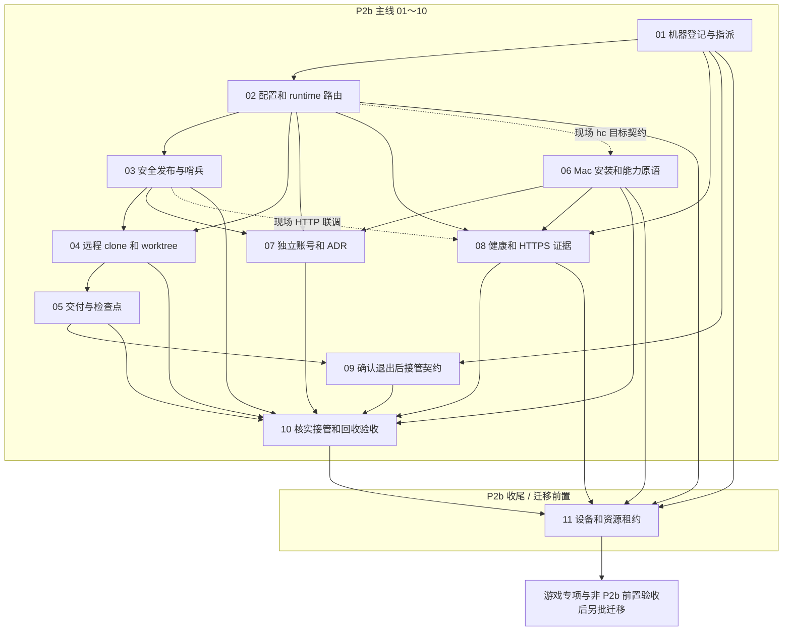

# P2b：控制主机与 macOS 原生远程 worker

- 状态：2026-11-14 方案定稿，Q1=A、Q2=C、Q3=A 已定；实现和现场验收尚未完成。下文的新文件名、命令和字段均为拟议接口，不表示已经存在。
- 来源：PM 已批准的 v2 定稿；本文为去敏后的仓库正文。文档卡 00（C-274）只负责整理与同步，不计入 11 张实现卡。
- 仓库依据：[开发方案](../development-plan.md) §4、§6、§9–§14、§16、§20；[Phase 2](phase-2.md) §4；[ADR 0001](../adr/0001-runtime-baseline.md)、[ADR 0002](../adr/0002-agent-account-isolation.md)；[P2a-12](p2a-12-remote-merge-check-host.md)、[P2a-14](p2a-14-independent-reviewer.md)。§3 是定稿时的代码盘点，后续实现须以各卡基线复核，不是生产环境探测结果。
- 范围：只更新本计划、阶段计划与开发方案正文；真实机器、账号、网络、路径、工具组合和部署证据留在仓库外。现场动作按后续卡片的人工待办执行。

## 1. 背景与已拍板事项

2026-11-14 用户确定采用“方案 1”：控制主机（Linux x64）继续承载 DB、Workbench、Card MCP、中心 bare 仓库、自动部署和常驻 PM；macOS worker（macOS arm64）成为第一台原生远程 runtime worker。`local` 继续代表 控制主机 这台合法机器；领域 `machine_id=local` 不等于使用无账号隔离的 `ExecutionConfig.mode=local`，生产仍应走隔离执行账号。

合并检查继续在已接入的独立 Linux CI executor 上执行，沿用 P2a-12 的 executor、容量、候选和失败处理。P2b 只补开发 runtime 的机器维度，不重新设计 CI。

2026-11-14 三项决定已定：**Q1=A**，每 `(项目,机器)` 一个独立非管理员执行账号，卡 07 写隔离 ADR 并更新 ADR 0002；**Q2=C**，必须取得旧进程退出确认才允许跨机继续，确认可来自系统定向核实或 human-only 现场 HumanAction，随后新建 Assignment/worktree/Session，原 machine_id 不改；**Q3=A**，tailnet 内专用 HTTPS 代理，只允许指定 worker 和 `/mcp` 必需路径，保留 Token 鉴权，Workbench 入口不变。后文不再把它们当成待拍板问题。

既有游戏项目继续由 macOS worker 现有 herdr + Plane 管理，等 P2b 完成后另立迁移计划；2026-11-28 前不切换或启动迁移试点；之后仍须全部门槛通过并获用户批准具体窗口，不按日期自动启动。本阶段不得接管它的仓库、进程、账号或现有会话。通用 Mac 能力检查进入 06，设备/资源租约进入收尾卡 11；游戏工具链实测、唯一合并权威、历史/附件、大制品及正式项目身份等仍是后续迁入门槛，见 §7。

## 2. 目标与不做的范围

目标是把“登记机器 → 手动或按能力约束选机 → SSH 准备源码和启动材料 → 远程 coder → HTTP MCP 交付 → 主机拉取并固定 SHA → 异机验证 → 原 CI 检查和中心合并 → 远程回收”打通，并完成真实 Mac 小卡与断网接管验收。

包括机器登记、os/arch/tags/健康与状态、Assignment 固定机器、runtime/Git 按机器路由、无共享磁盘的安全发布、Mac 初始化与工具链、HTTP 附件、断线接管，以及 B8 的同 worker 跨项目文件隔离。标签用于筛选并校验目标；首期仍由 PM/人明确选定机器，不做按负载自动调度。

拆为 **P2b 主线 01～10** 与 **P2b 收尾 / 迁移前置 11（设备/资源租约）**：先验通普通 Git/小卡的多机闭环，再补独占设备和重活资源合同。11 不阻塞主线两条基础验收，但必须在既有游戏项目 迁移前完成；主线完成不能被记作“游戏项目已可迁移”。

不做：迁移既有游戏项目；改合并检查架构或其账号配置；Gitea/GitHub runner；跨项目平台管理员；macOS 控制面/DB/自动部署移植；通用资源发布系统；LFS/大资源包管线；iOS 签名、钥匙串和真机自动化。Godot/Blender/Android/iOS 的项目专用工具链与验收列入 P2b 之后，安装器保留按项目声明工具链的入口。

## 3. 现状与可复用底座

### 3.1 已有能力和具体缺口

| 事实 | 当前证据 | 对本计划的影响 |
|---|---|---|
| Machine 已有 id/label/herdr_machine/os/arch/tags/max_assignments/status/last_seen | `packages/domain/src/entities.ts`；状态枚举 online/degraded/offline/draining 在 `packages/domain/src/states.ts` | 复用模型，区分管理员 drain 与观测健康，不另外发明 unknown/lost 的机器状态 |
| machines 表和 Repository 已有，按项目复合键保存 | `packages/store/migrations/0001_initial.sql`；`packages/store/src/repositories.ts`；`packages/domain/src/ports.ts` | 真正接入登记、查询、命令快照和审计；不是只新建一份机器 YAML |
| 命令快照目前没有 machines 集合 | `packages/domain/src/commands/core.ts` | assign 的机器校验需要补 domain 状态、store 加载/增量缓存/失效，不能从 domain 读配置或 SSH |
| assign 参数虽有 machine_id，仍拒绝非 local，创建也写死 local | `packages/domain/src/commands/pm.ts` | B3 必须改领域命令、CLI/MCP 入参和重复 assign 的固定机器校验 |
| 每工作项只有一个持久 Assignment，释放后不能重派 | `packages/domain/src/commands/pm.ts`；`docs/development-plan.md` | Q2=C 仍需显式后继链和当前身份校验，但新身份只能在旧进程退出确认后创建/生效；不是 restart 换机器参数 |
| 主机伪造 Linux/x64 local Machine，并总传给 provision | `packages/host/src/launch.ts` | 启动统一取得真实登记机器与执行目标；保留旧 local 的兼容注册 |
| runtime 的 ref 校验和 provision 都限 local；一个适配器绑定单一 execution | `packages/runtime-herdr/src/index.ts`；`packages/runtime-herdr/src/execution.ts` | 新增受信任目标解析/多适配器路由，不是简单删 if |
| 启动文件、start 哨兵仍由主机本地文件 API 写入 | `packages/host/src/launch.ts`；`packages/runtime-herdr/src/agent-files.ts` | 分离主机私有目录与 worker 文件发布；保持 dispatch 事务先于 start 的顺序 |
| Pi 信任路径、Agent Git 叶子和来源元数据仍假设共享磁盘 | `packages/host/src/launch.ts`；`packages/host/src/pi-trust.ts`；`packages/host/src/agent-git.ts` | 远程 realpath/stat/mkdir/rename/source 绑定必须在 worker 执行，不能遗漏这些隐藏调用 |
| 写/只读 worktree 与验证构建目录都限 local；清单用本机扫描 | `packages/git-service/src/index.ts` | coder、tester/reviewer、builds 和清理一起纳入目标维度 |
| 交付校验和分支备份限 local；服务只持有一个 agentSource | `packages/git-service/src/delivery.ts`；`packages/git-service/src/central.ts`；`apps/server/src/git.ts` | 按持久 Assignment 选源，按所有已绑定机器备份；保留中心固定 ref |
| fetchRefs 即使传 uploadPack 也先对 source 做主机 realpath | `packages/git-transport/src/central.ts` | 远端路径必须成为显式远程地址类型，不能在 控制主机 磁盘上解析 Mac 路径 |
| 跨项目容量已按 machine_id 汇总，并兼容无机器行的旧 local | `packages/host/src/run-capacity.ts`；`packages/store/migrations/0020_run_capacity_limits.sql` | 保留机器编号的全实例含义，不能以每项目账号另造物理容量桶 |
| HTTP 附件已有摘要校验、10 MiB 限制和主机存储 | `packages/mcp-server/src/attachments.ts` | B5 以跨机契约与验收为主，不另做文件共享或大文件协议 |
| MCP URL 默认是主机 loopback；可由可信主机配置显式指定 | `packages/host/src/mcp-url.ts`；`docs/development-plan.md` | Mac 不能使用默认 localhost；必须完成 Q3 的可达性与访问范围配置 |
| 失联、重连、lost 与 Needs You 已实现 | `apps/server/src/dispatch-monitor.ts`；`packages/domain/src/commands/runtime-incident.ts` | 复用计时与事件，不重写失联阈值；只补多目标订阅和人工接管 |
| unknown 的 finish 请求会暂存，并绑定原 Token 与 RuntimeRef | `packages/domain/src/commands/runtime.ts` | 接管后旧 pending_finish 不得结算到新身份或被当作存活证明 |

上述代码盘点不代表当前生产机器登记或启用状态。仅注册 hc machine、或合并过远程 CI 的卡，均不能证明上表中的开发路径已经可用。

### 3.2 P2a-12 复用边界

| 底座 | 证据 | 复用方式 |
|---|---|---|
| 固定 SSH 目标、严格 host key、专用凭据、禁转发、流式 stdin | `packages/runtime-herdr/src/agent-ssh.ts` | 原样保留安全参数，目标来自主机配置；扩展 worker PATH，不放宽 host key |
| hc machine 注册时核对 endpoint/session/version | `packages/runtime-herdr/src/agent-ssh.ts` | 每个项目执行账号独立映射，禁止覆盖同名的不同目标 |
| upload-pack/receive-pack 双向二进制流 | `packages/runtime-herdr/src/agent-ssh.ts`；`packages/git-transport/src/central.ts` | 基线分发、交付拉取、备份复用 Git pack 协商，不把 pack 转成文本/base64，不整仓打 bundle |
| 候选分发已支持 execution override | `apps/server/src/git.ts` | 抽取目标传输胶水供 runtime Git 使用；不改 CI 调用方的配置和选择规则 |
| 远程目录准备、相对定位、防链接与空目录清理 | `packages/runtime-herdr/src/agent-ssh.ts` | 借鉴固定脚本/位置参数/完整结束标记；开发启动材料另有内容发布协议，不能直接照搬 checks 目录权限 |
| 不可达不等于空目录 | `packages/git-service/src/index.ts`；`apps/server/src/git.ts` | 扩展至开发 worktrees/builds/repos；扫描失败保留该目标历史发现，不据此删目录 |
| 按执行目标计容量 | `docs/plans/p2a-12-remote-merge-check-host.md`；`packages/host/src/run-capacity.ts` | runtime 仍用物理 machine_id 的 Agent 桶；CI 保持原 executor 桶及其并发上限 |

P2a-12 计划中的调查行号与“尚未实现”文字是历史记录；其一目标一项目规则仍有效，不可把 runtime 多项目映射当成允许共用既有 Linux CI executor 执行账号。

### 3.3 macOS 的实际边界

ADR 0001 `docs/adr/0001-runtime-baseline.md` 已记载 hc 0.1.18 的 Linux core → macOS arm64：exec/run/send/read、标签和事件通过。Mac 必须本地安装签名 App，`machine add --install` 不能代装，首次局域网授权须现场确认。反向 macOS core → Linux 的历史缺测不阻塞本次已拍板拓扑，列后续补测。

需要补的是 Cardigan 的 worker 路径：Linux 安装器在 `deploy/install-agent.py` 使用 Linux 归档和 useradd/setfacl 等；SSH PATH 在 `packages/runtime-herdr/src/agent-ssh.ts` 没有 `/opt/homebrew/bin`；共享文件安全实现依赖 `/proc/self/fd`（`agent-files.ts`）；测试限流依赖 flock 命令（`packages/roles/src/test-worker-limit.ts`）；CLI 包装器使用 sg（`deploy/install-cli.sh`）。

`agent-ssh.ts` 的 Linux 检查、`packages/host/src/repository-lock.ts` 的主机锁、`packages/host/src/process-identity.ts` 的 Linux 进程身份、部署核对 `/proc` 都在 控制主机的控制面，保留 Linux 实现即可。本阶段另做 worker 锁/身份接口，避免把“支持 Mac worker”扩大成“在 Mac 上跑控制面”。Linux 的临时检查监督器（`packages/host/src/checkout-worker.ts`）也不能当成可在 Mac 完整复用的进程回收器。

## 4. 关键设计

### 4.1 机器模型、登记和选机

复用 `machines(project_id,id,doc)` 作为某项目可用机器的登记/授权投影，暂不迁成全局表。主机私有机器清单以稳定物理 machine_id 为键，是 endpoint、OS、账号映射的唯一来源；同一物理机在各项目行使用同一编号与一致的 os/arch/label，不允许用别名重复获得容量。项目行表达该项目是否允许使用此机器、能力和健康，不能存 SSH 密钥内容。

建议主机配置新增独立的 runtime worker 配置（拟名 `runtime-workers.yaml`）：物理机器的连接及身份文件引用、固定 host key 别名、规范工作根、PATH、工具链，以及 project → execution-account/hc-machine/session 的绑定。它不塞进 merge-gate.yaml；P2a-12 当时“不新增第二份配置”针对的是合并检查 executor，本次对象是开发 runtime。配置由 host 解析校验，机器表只保存非敏感描述和观测。真实地址、账号映射、安装参数归私有 `cardigan-deploy`。

Q3=A 的 MCP URL 也由该可信配置提供：tailnet 专用 HTTPS 代理转发既有 loopback MCP，仅开放 `/mcp` 及其确需的子路径/方法（以现有 MCP/附件路由核实清单，不作 `/` 通配转发），来源 ACL 只允许指定 worker。TLS 证书与 worker 信任链须验证；代理不注入身份、不记录 Authorization 或正文，Assignment Token/项目/工具鉴权仍由 MCP 执行。Workbench 保持原监听、来源和鉴权入口。此配置由 H-HUB-1 落地，不能把现有 Workbench 代理当成已开放 MCP。

先提供 human-only 的 CLI 登记/查看/更新/drain/check 入口，不扩看板为机器管理后台，也不赋予 PM 建账号、写 SSH endpoint 或扩大授权的权限。PM 仍可用现有 assign 权限在本项目已登记的机器集合中选机。domain 得到可信机器快照，纯函数检查存在、项目可用、非 draining/offline、标签和固定机器；IO 由 host 完成。

新实例注册真实 local；旧实例保留兼容 local，但首次迁移/启动只幂等补行，不改 Assignment/Run/ref，不静默把旧 hc 别名换掉。增加与员工不可变字段同类的存储保护：Assignment 的 machine_id 创建后不可改，列与 JSON 必须一致；旧 local 行兼容，不批量重写历史。远程机无登记、配置不一致或探测失败均拒绝新启动，不回退 local。

手动指定 `machine_id` 为主；按标签提供候选过滤，多个候选要求明确选定，零候选给出缺少能力原因。标签不是权限，也不是物理设备独占锁。重复 assign 不得修改机器；已绑定机器的后续 Run 不因标签或负载变化迁走。现有系统自动指派验证项遇到标签不能满足或目标不明确时交 PM/人，不能继续硬写 local。

健康至少分别表达 SSH/hc 可达、os/arch/工具链检查、MCP 从 worker 可达和 last_seen；探测不输出环境变量值。行政 draining 不被后续 online 观测覆盖；MCP 活跃也不能证明 hc/SSH 可控。机器检查在启动前执行，后台复用既有调度周期和超时，不引入未经拍板的新计时默认值。各目标外部探测有截止时间，失联目标不得串行占住所有机器的派发热路径。

`max_assignments` 不另启一套并发规则：登记时作为已有有效 Run 上限的展示/兼容值，派发仍只由 `run_capacity_limits` + run-capacity.yaml 的既有规则决定，避免两把上限互相矛盾。若未来要限制常驻/空闲 Assignment 数，应另立数值规则。Mac 初期按现有配置机制由人设容量，不在实现中新增“Mac 默认值”。

### 4.2 runtime 与执行目标路由

host 统一解析 `(project_id, machine_id)` 为受信任目标；所有操作都通过这一入口，底层实际选择该项目账号的 hc alias。复用现有 RuntimeAdapter 实现，增加路由外层；不能让卡片、Agent 入参或 RuntimeRef 自带 host/user/path 决定 SSH。

provision 取登记机器；get/wake/read/events/interrupt/release/resume_or_replace 从持久 ref 反查配置并核对 machine_id、项目绑定、hc alias、session 和 terminal 前缀。主机持久记录每个在用 ref 对应的非敏感目标绑定指纹/代次，以识别同名 alias 被重新配置，不能只比较当前配置的字符串。run/exec 用 `--on`，send/get/events/kill 等用 `<hc-machine>/<terminal>`（ADR 0002）。未知映射、旧配置目标变化、跨机器 ref 一律关闭该操作；仍保留旧 ref 供人工核对，不能误杀新目标的同名终端。

Agent 名保留 32 字符限制，用项目、Assignment 和目标执行身份派生确定性短摘要；不能只截长字符串末尾。现有 `packages/host/src/naming.ts` 提供共用入口，需补跨项目同号/长 ID/不同机器测试，并在注册时拒绝实际碰撞。同机不同项目的 hc core/socket/session 必须按系统账号隔离，不能只有不同 session 名。

CLI、Dispatcher、beforeWake、版本探测、attention、清理和有限运维工具必须使用同一解析器。host_ops 仍只处理本项目已有白名单动作；跨机接管是 human-only，不增加它的任意远程 shell/平台管理能力。旧 local 行为作为回归基准；远程 target 未准备齐全时只允许 check，不放行真实启动。

### 4.3 启动材料经 SSH 安全发布

主机只在内存编译角色提示、Harness/MCP 配置和本次所需凭据，发送到固定 SSH 入口的 stdin。传输携带有界 manifest（协议版本、project/assignment/run、启动代次、允许文件名、长度及非敏感文件摘要），worker 返回结构化确认；不使用 shell `echo`、命令行参数、scp 默认覆盖或不受控 tar 解包发布凭据，不打印 payload。含凭据文件不在日志里记录内容或摘要。

worker 的小型文件 helper 用 Python 3 标准库 `dir_fd/openat`、`O_NOFOLLOW`、`fstat`、独占临时文件和相对 rename 实现 Linux/macOS 共用的安全操作，不依赖 `/proc` 路径或 GNU 命令；ACL 元数据校验使用各系统原生接口，不把 mode 当作 ACL 的替代。必须按固定工作根逐级打开，核对每级真实目录、预期 UID/GID/mode/ACL，拒绝软链接、硬链接目标、特殊文件、越界/重复路径、属主或权限异常。先写普通材料再写凭据，确认长度和完成标记后才报告 published；中断无完整确认不得启动。包装脚本仅从该代次受控文件读取本次凭据并立即 unlink，避免留下持久副本；不读取项目提供的凭据路径。不能把主机 UID/GID 数值带到 Mac 当作权限依据。

根及不可替换的项目命名空间由操作员/root 预置；项目账号只能写自己的 run/worktree/build/cache 叶子。远程材料目录一般 0700、文件 0600、脚本 0700，异常额外 ACL 也要拒绝；不照搬本机共享组的 2770/0660。按 Q1=A，Linux 需要共享组的本机路径也必须每项目独立，不能沿用跨项目共享组。

每次启动使用独占代次子目录保存配置和哨兵，Harness 的会话数据另留 Assignment 私有持久目录以便恢复。顺序固定：领取持久投递意图 → 准备 Git/运行材料 → provision 包装进程等待哨兵 → 重查当前目标/机器/租约 → `dispatchRun` 与 RuntimeRef 落库 → 发布绑定该 Run/代次的 start → CLI 调 whoami/get_updates/ACK。旧 start 不得复用；哨兵只保证正常编排顺序，不替代 MCP 的服务端授权。

目标在准备期间撤回，沿用 C-88：尚未放行 start 就回到等待，保持 queued Run 与通知；不记代码失败。发布失败或 SSH 断开需记录阶段，先撤销本次身份/阻止迟到 start，再尝试停止准确终端及清理准确代次凭据。不能把 SSH 返回错误当成“文件未写/进程未起”。未知退出保留停止记录与容量预留，后续恢复继续；不得清空整个 Assignment 目录以免删新一代会话。

本机路径和远程路径用不同类型/端口表达。Pi realpath、trust、CLI 版本、工具安装路径都从 worker 返回的受控结果取得；Codex/Pi/Claude 的信任只覆盖本 Assignment 的仓库/worktree，不信任上层目录或 `*`。

### 4.4 Git 远程化与恢复检查点

中心仓库始终只在 控制主机私有目录。主机上的 Git 只读可信源/中心，不以主机身份在 Agent 可写仓库运行 Git。worker 的 clone/worktree/status/diff/清理都由主机经 SSH 发起、在对应项目执行账号运行。worker 不持有到 控制主机、其他 worker 或外部 Git 服务的登录凭据。

1. 每 `(project,machine)` 一个基础 clone：worker helper 独占创建临时 clone，主机从中心通过受限 receive-pack 推送 refs，校验来源绑定和对象格式后原子发布。来源绑定用主机中心的逻辑身份，不把 控制主机 本地路径当成 Mac 可以 fetch 的远程。失败非空临时目录留待受控清理。
2. 每次写 Run 启动/唤醒前，主机增量推中心基线到 worker `refs/remotes/origin/*`；只同步所需项目的基线与固定交付/候选，不移动工作分支、HEAD、未提交文件或原 base_sha。失败不唤醒。
3. 主机根据持久 Assignment 创建对应 worktree。异机 reviewer/tester 从中心固定交付 SHA 检出 detached 只读 worktree，并准备同目标上的可写 builds 目录；不从 coder 的可变分支或旧门铃取目标。
4. Agent 只做本地检查点 commit，然后经 MCP 报完整 SHA。主机按 Assignment 的机器/项目账号/记录分支，经 upload-pack 拉入中心 incoming，验证对象格式、commit 类型及位于该分支的祖先关系，再建不可变 candidate ref。事务提交后固定 delivery ref；失败继续现有修复对账。Agent 不提交网络地址或可任选的仓库路径。
5. 主机枚举项目所有已绑定机器，按已有备份周期（默认 10 分钟）拉取 agent 分支到机器命名空间；成功后记录 assignment/branch/SHA/时间，并固定该检查点 ref 供接管选取。滚动备份 ref 可以前进，已供接管使用的检查点不可被后续备份改写或回收。失败不覆盖最后成功 ref，不 prune。默认周期沿用已有批准值，本阶段不新增更短自动备份或自动 commit。
6. 清理前再次主机拉取，确认准确终端退出、分支已备份以及脏目录处置，再经目标 helper 删除 worktree 登记和目录。保留现有 dirty/未备份 → data_deletion 人工决定；不靠通配符/mtime 自动删除。

`CentralGitTransport.fetchRefs` 及 `agentSource` 必须显式区分 host-local 与 worker-remote。远端仓库路径仅作经目标绑定的 POSIX 路径，主机不得 realpath/lstat/access；相同字符串在两台机器出现不是同一目录。锁键至少包含物理目标、项目和基础 clone；中心发布锁独立保留。控制主机 的跨进程锁继续用已有 Linux 实现，worker 的跨进程写操作使用 §4.5 的本机内核锁。

Git 环境继续禁系统/全局配置、hook/替换对象，明确 refspec，开启 fsck，固定 PATH/locale。可执行仓库配置、过滤器和 symlink 不得在主机执行。LFS/子模块的额外网络拉取本阶段不放行；验收仓库使用普通 Git，未来资产传输另案。

### 4.5 macOS worker、工具链与主机待办

安装器保留/薄封装 Linux 入口，新增 macOS worker 入口；两者都支持只读 preflight、dry-run 和幂等应用，拒绝接管不匹配的既有账号。通用安装器/helper 放主仓库 deploy，机器清单、实际下载与部署参数放私有 `cardigan-deploy`。所有 sudo、签名 App 首装、系统许可和本人登录均由人完成。以下区分 **P2b 必须**（卡 06 的通用合同）与 **迁移既有游戏项目时再做**（§7 迁移计划及后续专项卡），不会现在改动游戏环境。

**P2b 必须：能力与版本证据。** 最低环境仍为原生 arm64 Node 24（根 package.json 的 `^24.0.0`）、pnpm 11.7.0、Git、Python 3、签名 hc 0.1.18 App 和任务声明的 harness CLI。Python 3 需显式检查/由人安装，不假设系统自带。每个项目由主机可信清单声明需要的工具/版本组合；安装器不执行项目仓库内任意 sudo 脚本。机器有 `macOS` 标签不能替代版本与任务前置校验。

卡 06 输出脱敏 capability manifest，至少有 OS 产品版本/build、Darwin 版本、arch、工具绝对路径/实际解析路径/精确版本，按声明增加 SDK、runtime+架构、导出模板、renderer 与 GUI 能力；记录实际执行 UID、采样时间和证据来源，不采硬件序列号或环境变量全集。每个能力分别保存 `installed`（存在且识别到版本）、`configured`（该项目账号/PATH/配置已指向它）、`last_verified`（时间、账号、精确组合、用例与证据；未验证留空），失败/unknown 给原因。三者不能折叠为一个 ready：已装 SDK 不等于已配置或已成功构建。任务组合与证据不符就阻塞，不能静默换“最新版”。

非交互 SSH 与 hc 使用管理员选定且预检的 PATH，含项目账号 CLI 目录、`/opt/homebrew/bin` 和必要系统目录；HOME 从目标账号目录服务取得，不复制 Linux home、不 source shell rc。Node 原生依赖在 arm64 重建；项目间不共享可写 pnpm/harness/构建缓存。允许管理员管理的只读 SDK/工具安装，但项目配置与写缓存分开。Rosetta 作为独立可选能力记录 installed/configured/last_verified 和目标架构；P2b 基础小卡不依赖它。任务明确需要 x86_64 而 Rosetta/runtime 未验证时阻塞，由人补齐，不能透明降级或自动安装。

**P2b 必须：路径、磁盘与证据归属。** 每个目标声明工作根所在 volume/mount 身份与 realpath，以及 repos/worktrees/builds、可复建缓存、需锁的生成工程、不可丢的日志/制品和系统暂存目录。记录 common-dir、Assignment、完整 SHA、dirty 状态和属主，不从 pane 标题/cwd 猜 worktree；名称含 tmp 也不代表可删。启动前核挂载身份、属主/ACL 和根盘/工作盘可用空间；容量阈值来自显式配置，不把历史快照当默认值。外置盘未挂载、身份变化、空间不足或目录不匹配即停止，不在空的同名 `<外置盘路径>` 目录落盘、不回退系统盘。缓存可重建不等于可以自动删除证据，跨项目可写缓存仍禁止。

原生工具可声明获准暂存目录，再按“结束写入 → 哈希 → 复制到证据目录 → 回读校验 → HTTP 上传”处理；P2b 只验证小制品与既有 10 MiB 附件合同，不新增大文件协议。卡 03/05 的持久启动意图、Run 与恢复点复用为 journal，补记 worker 阶段、完整 SHA、目标/配置摘要、已知进程身份、日志 offset 和小制品 hash；重连先查进程/阶段再续读，不因 SSH 失败就重跑整个任务。签名上传、安装、发布等副作用步骤不在 P2b 实现，迁移时须另定幂等或人工确认，不能由消息重投重复执行。

**P2b 必须：原生 CLI、GUI 与人工边界。** manifest 分开声明无头 CLI 和交互桌面能力；对实际执行账号探测登录/锁屏、WindowServer、图形会话归属、Metal、截屏/辅助功能 TCC 与 Keychain 可用性，仅返回状态/unknown，不枚举钥匙条目。没有 GUI/TCC 或截图不可见时明确阻塞/“未观察”，不能从日志宣布画面通过，也不以 root、Full Disk Access 或关闭 SIP/Gatekeeper 解决。P2b 交付可用的专用账号 hc/CLI；GUI 代理仅预留受控 IPC/能力接口，不强行用个人登录桌面冒充项目账号。LaunchAgent/LaunchDaemon 以及重启/锁屏后的 hc 行为由 H-MAC-4 实测；游戏窗口、模拟器、Organizer 的代理实现与实测在迁移专项里完成，失败就继续阻塞这些能力。

凭据只登记类别、负责人、非敏感 credential-ref、用途/授权范围与可用性错误；不要复制旧 home/config/env、钥匙串、认证目录或含秘密文件名的路径。P2b 必须验证缺少/不可访问时停止并进入适当的 HumanAction，以及 Token 不进入仓库、argv、日志或附件。分类边界如下：

| 凭据类别 | P2b 必须保留的边界 | 迁移既有游戏项目时再做 |
|---|---|---|
| 模型/harness、SSH、MCP Token | 最小注入与引用分离；SSH 仅主机持有，无转发/反向凭据；本人登录由人完成 | 各岗位模型与工具认证/scope 清单逐项核对，不整份复制个人配置 |
| Apple 开发者、Xcode 签名/Provisioning、App Store Connect | 本地受控引用和人工等待；CLI No Accounts 不等于 GUI 未登录 | 实测 Keychain ACL、登录/2FA、Organizer 回退；上传/处理/TestFlight/安装/提审/发布各自留证 |
| Apple 登录私钥、账号加密 key | 控制面只收引用和结果，不收秘密；正式玩家数据不进 控制主机 索引 | 由人确定原地使用与备份方案，测试临时 key 与正式 key 分开 |
| Play 上传/应用/debug 签名 | 用途和引用分开；缺签名拒绝，不随机生成替代 debug 签名 | 保持 debug 签名与 Google OAuth 的绑定，确认上传/应用签名不同职责 |
| Apple/Google 测试账号、测试邮箱 | 负责人、人工等待和脱敏结果；密码/验证码/令牌不回传 | 本人输入、收件与完整登录实测；TestFlight、测试设备装包/真机操作仍由人完成 |
| Mapbox、语音、邮件、存储、GitHub/Plane/飞书工具认证 | 只按所需角色引用与检查，不复制配置正文、不触发无关重新授权 | 逐岗位最小权限与作者映射；外发、生产迁移、强更、发布保留各自批准链 |

**迁移既有游戏项目时再做：把精确环境填进上述通用合同并验收。** 迁移计划须记录实际 macOS/build/Darwin、Xcode/SDK、Godot 完整版本与导出模板、iOS runtime 与架构组合；已验证的 x86_64 + Rosetta 组合不能被仅安装的 arm64 runtime 静默替换。桌面 Metal、模拟器 GLES、Android GPU 和真机证据分别标记，不把一种环境的通过结论移给另一种。

Android 须明确实际 JDK/JBR 路径和版本、compile/target/min SDK、build-tools、Gradle/AGP/Kotlin 与 Java 编译级别，以及 NDK/cmdline-tools 是否真实可用。已装更高版本、缓存存在或预编译导包成功均不能冒充本项目配置验证。镜像、AVD/私有 ADB、UI 尺寸、端口和设备所有者另验；不跑裸 adb，不接管用户 USB 真机，不将旧端口台账当作可直接占用的常量。

迁移路径盘点须纳入真实 volume/mount、现有工位和临时集成 worktree、引擎/构建/SDK 缓存、生成工程、输出、AVD 与验收资料；先登记/对账，不移动、不覆盖、不清空。磁盘余量须现场复核，不使用历史快照作阈值。原生录屏等写入失败时，只能选经验证的获准暂存目录，结束写入并哈希后复制、回读校验，不能改权限后声称等价。迁移计划再做真实 Godot Metal、iOS 冷启动、隔离 Android 和 GUI/TCC/Keychain 的组合验收，依赖卡 11 的资源排队；大制品传输见 §7，不扩大 P2b 附件上限。

worker 公共锁仍采用 Python `fcntl.flock` 对预置且不可被账号替换的锁文件加锁，覆盖 Git/helper 和员工测试串行；无需系统 flock 命令。保留既有预算、嵌套命令立即失败和 FD 生命周期，实测父子退出/SIGKILL 后释放；缺有效锁即拒绝，不退为进程内锁。该内核锁只保护本机短操作，不能替代卡 11 的持久设备/资源租约。

worker 进程身份由平台实现返回机器、boot incarnation、UID、PID、启动时刻及受控进程组/终端关联。Linux 用已有 `/proc`，Mac 用 boot session 和 libproc 原生开始时间等接口（Python ctypes 可薄封装），不凭 PID、kill(0)、进程名或 ps 文本猜身份。观测不全返回 unknown，禁止杀进程/删工作区；只回收能证明属于该终端代次的进程，不读取 cmdline/environ。控制主机 部署和 CI SSH 客户端身份保持原实现。

以下是未来 HumanAction 待办，本次不执行；请求均写完整步骤、人必须参与的原因、影响和回传要求：

| 待办 | 必须人做的部分及原因 | 回传内容与放行条件 |
|---|---|---|
| H-MAC-1 预检现有 Mac 环境 | 人核现有 herdr + Plane 的账号/目录/端口，选独立根/磁盘/hc session，保持游戏管理继续运行 | 脱敏冲突清单、volume/mount 和根盘/工作盘空间结果；不读取或复制既有凭据 |
| H-MAC-2 创建隔离账号 | 按 Q1=A，每 `(项目,机器)` 建独立非管理员账号，不加入 admin/sudo/其它项目组；首项目可叫 agent，其余另建 | UID/组/无 sudo、root 管理 home/授权入口/命名空间检查通过；不回传密码或密钥 |
| H-MAC-3 SSH 和网络授权 | 仅主机可连 worker 的 SSH 端口，禁止 worker 访问主机/其它 worker 的 shell；带外核对 host key，专用私钥留主机，无转发 | 严格 host key、身份/方向检查结论；无反向凭据；失败只给非敏感类别 |
| H-MAC-4 签名 App 与系统许可 | 人本地安装核验 hc App，在每个实际项目账号完成首次局域网弹窗/必要会话初始化，核重启/锁屏行为 | arm64/version/签名、Linux→Mac exec/run/send/read/events；GUI/TCC/Keychain 分项状态，未验证不写 ready；不关闭系统保护 |
| H-MAC-5 工具链/CLI 首次设置 | 人安装固定系统工具并完成订阅/付费/本人登录；项目账号预检非交互首启 | manifest 的 installed/configured/last_verified、PATH/arm64/空间/缓存权限结论；不复制个人 CLI 认证目录 |
| H-HUB-1 HTTPS MCP 入口 | 按 Q3=A 配 tailnet 专用 HTTPS 代理与指定 worker ACL，只放行实际必需 `/mcp` 路径/方法，Workbench 入口不变 | TLS 信任、whoami/HTTP 附件成功；未认证/跨项目/未允许来源或路径拒绝；证据无 Token |
| H-ISO-1 第二项目与 local 隔离 | 在 Mac 和验收用 控制主机 local 各预置两个合成项目账号、根/缓存/hc socket；不改生产账号归属 | 两 OS 双向文件/执行/hc 负向测试；同物理机仍一个容量桶 |
| H-ACC-1 现场断网/恢复 | 人另选维护窗口，只断 Mac 网络；选系统重连核实或现场关机/结束准确进程作为退出确认 | §6 的退出来源、身份、方法、证据、S1/事件及旧机恢复核实/清理记录；普通“批准接管”不算退出确认 |

H-MAC-4 若证明专用账号下签名 hc/无 PTY --via 无法支持本拓扑，应阻塞 06/B1 并修订方案，不能用个人账号历史记录或 Mac Linux VM 替代。游戏 GUI 专项尚未 verified 不阻塞无头基础小卡，但阻塞声明这些能力的任务和游戏迁移。

### 4.6 失联、人工接管与旧机恢复

沿用当前已拍板参数：45 秒有效静默窗口、连续失败默认3次（含首次，合法2–10）、failures 类型 unknown 对人延迟展示默认60秒（合法1–299秒）、首次确认失联起5分钟后 lost。明确退出及时进入 unknown 并展示；lost 不自动恢复。slow tick 会延长确认失联的实际时间，不保证从拔线起固定 N 分钟触发。5分钟从持久 `runtime_disconnected` 起算（开发方案 §13.9；`apps/server/src/dispatch-monitor.ts`），不新增默认阈值。

**Q2=C 的硬前置：旧进程/会话确认退出之后，才允许在另一台机器创建并启用后继 Assignment/Run/worktree/Session。** 断网、unknown/lost、超时、逻辑取消、撤销 Token 或人的“同意接管”都不是退出证明。没有证明就保持 Needs You 等待，不转移执行资格，也没有例外审批通道。

unknown 时等待/核实，不自动换机；没有接管意图时，仍仅由原 RuntimeRef 的新 alive 观察恢复，MCP 决定业务结果。lost 进入 Needs You，展示机器/工作项/完整旧 ref、最后成功拉取并固定的 SHA/时间、可能缺失的未提交/未拉取内容，提供“继续等”或“申请停止并接管”。申请只保存 human-only 幂等意图、目标机器和停止/恢复栅栏，**不创建后继身份**。意图存在后旧目标不能自动唤醒/重启，重连先核实退出；晚到 heartbeat/finish/alive 不得解除栅栏，pending_finish 不能当退出证明。

退出确认只接受以下两种来源，持久绑定 project/work item/旧 Assignment、完整 RuntimeRef、执行目标绑定代次、记录的进程身份和接管意图，另存来源、确认时间及证据；Agent 自报不能成为系统观察，普通 HumanAction done 也不能替代对应核验：

| 来源 | 核对方法与证据 | 失败时的行为 |
|---|---|---|
| 系统定向核实 | 旧机重连后，经可信 worker 通道按 boot incarnation、UID、PID+启动时间、终端/进程组关联查询目标会话及已登记子进程；如需停止，仅走已有准确目标 release，再独立核实 exited/原进程消失 | 查询失败、只收到 kill 返回、权限拒绝或身份不完整都维持 unknown/等待；PID 被复用时不杀新进程，也不能忽略仍属旧会话的子进程 |
| 人在现场确认 | 专门的 HumanAction，triage=human，仅实际 human Actor 可完成，拒绝 PM/Office/host_ops 代结。完整列出“确认哪台机器/哪个账号/哪一会话 → 在现场结束准确进程并复核，或确认该机确实关机 → 防止旧会话自动拉起 → 回传结果”。result 写确认人/时间/机器与会话身份、核对方法（关机或结束进程及复查）、已退出结论和脱敏附件/现场记录 | 只有意愿、猜测断电、锁屏、拔网线、空结果/无核对方法，或错误目标均拒绝；未收到合格证据持续等待，不因时长代批 |

合格人工确认允许旧机仍离线时继续后续正常流程，但不免除恢复时系统补核。这里的 HumanAction 是“已实际确认退出”的事实凭据，不是授权一个可能仍存活的旧进程与新执行并行。可复用 C-152（开发方案 §4.4）的人专属退出确认模式，补齐本次身份绑定/证据校验，不另设离线切换例外。

接管流程如下：

1. 人在 lost 后发起上述意图。主机展示并预固定当时最后成功拉取的恢复 commit/分支/时间与缺失范围；若从未拉到远端检查点，只能明示损失后由人选中心已知基线。目标机登记/标签/工具链/容量可预检，但不提前创建执行资源；实际恢复点以退出确认后的最终固定记录为准。
2. 等待任一合法来源确认退出。系统来源在最终提交前重新核对目标绑定与退出观察；人工来源校验专门 HumanAction 的 human 完成事件、方法/证据和完整身份绑定。意图撤销、旧 ref 或目标绑定代次变化使证据失效，必须重新核实；不能把 SSH 错误或失联计时包装成成功。确认后再次读取该旧 Assignment 在主机的最后成功拉取记录并固定本次恢复 SHA/时间；等待期若新增已拉取检查点，更新恢复点并在交接/审计中展示，不能拿可变分支代替固定 commit。
3. 证据齐备后，同一新鲜事务核对 human 接管意图、当前工作项/旧 ref、退出证据、固定恢复 SHA、目标可用且无其它接管。事务内撤销旧 Assignment 全部 Token、封存 pending_finish、按既有失败/取消规则结算未结束 Run并释放旧业务身份，写后继链/恢复点/待清理记录，创建同角色固定版本、同权限上限的新 Assignment 和一个 queued Run。原 Assignment.machine_id 永不改；旧作者/员工历史、审核预算与未完成验收保留，不能靠新身份自审或重置轮次。并发/重复请求只落一次，事务回滚不留下可执行后继。
4. 事务成功后走正常 Dispatcher/启动流程，在 控制主机 新建 worktree/Session，从第2步确认后主机最终固定的最后拉取 SHA 继续；新分支带新 Assignment 后缀。仍重查容量/当前目标/工具链，启动失败仅重试该后继身份，绝不复活旧身份。不复制 CLI session、node_modules 或运行凭据；新交付照常审核/CI/中心合并，新 SHA 使旧审核失效。新机不能仅凭“人已确认”跳过这些检查。
5. 系统确认路径也保留旧 worktree 的独立清理待办；人工确认路径在 Mac 恢复后必须补做系统核实、准确代次凭据清理和分支拉取。旧机只进入待核实/回收，旧 ACK/finish/迟到事件不恢复旧 Run，也不完成后继。若发现目标进程/子进程仍在运行，立即进入 human-only Needs You，冻结进一步启动/唤醒、保留现场和目录，交人处理；不能沿用人工退出结论继续自动清理或误杀其它进程。
6. 再次证明退出后，把旧分支补拉到隔离恢复 ref，不能悄悄前移后继的 S1 或合并新发现提交。clean 且已备份按原流程清 worktree/登记；dirty/未备份则保留并创建 data_deletion 人工决定，force_clean 前保存补丁与未跟踪清单。不可达不当作不存在；权限/路径/进程身份未知均保留。停止/清理记录及未核销的旧目标预留在证据/清理收尾落库后解除，迟到清理不能碰新代次。

现有“一个工作项一个持久 Assignment”仍须改为“一个当前执行 Assignment，允许已退出并释放的历史后继链”，且普通 assign 不能借此重派已释放身份。卡 09 负责退出证据硬门、后继事务与历史不变量；10 负责两种来源接线及补核/清理。普通 restart、host_ops、失活回收同样遵守原退出要求；Q2=C 没有增加任何未停即切的通道。

### 4.7 B8：每项目、每机器独立执行账号（Q1=A）

已拍板每 `(project,machine)` 一个独立非管理员系统账号。第一个项目可叫 agent，新增项目另建账号；通用文档中的 agent 是执行账号角色，不代表全机只允许一个 UID。主机按项目绑定解析账号/hc alias，物理 machine_id 和容量桶仍唯一。同项目多个 Assignment 共享该项目 UID 是本期接受的边界，不保证项目内互不可见。

卡 07 除实现配置/安装校验，还须定稿拟议 `docs/adr/NNNN-project-worker-isolation.md`（编号实施时分配）与 ADR 0002 的修订。本计划登记以下 ADR 要点，卡 07 实现时定稿并同步：

- 决定与威胁边界：Linux/macOS 都以项目 UID 隔离项目私有内容与执行控制；禁止跨项目复用 UID、可写根/缓存、hc core/socket/session 或认证目录，不给 admin/sudo/其它项目组。
- 权限布局：root/操作员持有账号授权入口和不可替换父命名空间；项目 home、run、clone、worktree、build、cache、会话归该项目，0700/0600 并检查额外 ACL；Linux 如需主机共享组也每项目独立，不能通过默认 ACL/共享临时目录绕回跨项目访问。只读公共工具与项目可写状态分开。
- 可信映射：账号/SSH 授权/hc alias 由主机配置解析，不来自卡片或 RuntimeRef 自报；同机不同项目有独立 hc core/socket，测试同名终端不能跨账号控制。项目授权变化不能静默接管既有账号或改变历史目标。
- 安装与代价：每账号单独 App/局域网/TCC/CLI 首启、缓存与磁盘预算；已有 agent 只能显式认领一个项目，其它项目新建，不自动重归属生产目录。local 的域编号仍合法，但无隔离的 ExecutionConfig.mode=local 只供开发。
- ADR 0002 必须更新三处：把“唯一 agent@localhost/不开放远程机”扩为受信 project+machine 映射；把“同 UID Assignment 可互访、不同 Agent 后续隔离”明确收窄为**同项目内**接受、**跨项目**强制不同 UID；把单共享组/本机共享文件与 hc socket 边界改为按项目分开、远程材料经 helper 发布。保留主机独占 DB/中心/Git与SSH凭据、无转发和系统账号不等于网络沙箱等原约束。
- 验收与兼容：同一 Mac 与同一 Linux worker 上各用两个合成项目双向尝试读/枚举/写源码、clone、运行材料、缓存、会话、连接另一 hc socket、访问凭据及 SSH/HTTP 越权；发现同 UID、共享可写目录或额外授权即拒绝启用。旧单项目路径兼容，不批量改变历史归属。

为何不选其它方案：单账号目录 ACL 无法可靠区分同 UID 的项目进程，不能满足 B8；单账号强制沙箱尚无覆盖 Linux/macOS 全子进程与 hc 控制入口的可靠实现，首期兼容与验证成本过高。

项目隔离不承诺隐藏全机所有进程名或世界可读系统文件。文件/执行负向测试只能使用合成秘密，不读取真实凭据；也不改变 P2a-12 的 CI 一目标一项目账号规则。

### 4.8 设备/资源租约（卡 11，P2b 收尾 / 迁移前置）

资源标签表示机器提供什么能力；卡 11 再把需要独占的资源实例登记为 `(physical_machine_id, resource_key)`，如 android-emulator、godot-gpu-window、xcode，并允许配置这些资源共同依赖一个重活互斥组。资源声明由主机可信配置管理，项目只能申请已授权实例；同机多项目必须竞争同一物理资源，不能因账号/标签别名多发一份。它与 Run 容量、Git 内核锁、派发意图的内部租约分别校验，不能互相替代。

Run/工作项声明本机所需资源集合，持久申请关联 project/work item/Assignment/Run（排队前无 Run 时先关联工作项，授予时唯一绑定 Run）、holder/目标代次、开始/预计结束、心跳/到期、允许中止条件、已登记进程身份/PID、端口所有者及设备/窗口归属。控制面以事务唯一约束原子授予全套资源；缺任一项就保持排队且不放行 start，不边持有边等待其它资源。队列按同资源请求的持久入队次序处理，提供位置/原因，首期无优先级抢占；没有租约或 holder 不匹配的资源步骤不得启动。

等待超时只撤销尚未授予的申请并通知；持有者可在有效身份/心跳和原代次匹配时续租。等待/持有时长和续租策略来自显式配置，卡 11 建卡时列出数值供人确定，不在实现暗加默认。持有超时、Run 完成/取消或 lost 只触发释放核验/Needs You，不直接使资源空闲。worker 失联时租约占用按同一 RuntimeRef 的 unknown/lost 事实标为不确定并保留，控制面重启从持久记录重建；不能因 TTL 到期、旧业务 Run 结束或租约过期就让另一 Run 抢占。无 runtime 的设备监督步骤按其可信 worker 观测记 unknown，不借机释放。

释放必须有可信核验：匹配的 PID+启动时间/boot/UID/会话及登记子进程已退出，端口无该 holder 残留监听且所有者已核对，设备/窗口/临时配置按任务声明收尾。无端口的任务明确记“不适用”，不能把探测失败写成空闲；只杀本人准确进程，不用 pkill/killall、不关闭其它 AVD/设备。释放证明绑定 lease_id/holder代次，落库后才可授予下一 Run，晚到 release/renew 不影响新 holder。断线期间保留占用，即使有 §4.6 的现场退出确认，旧机恢复后仍须补核资源释放再重新授予；发现仍占用或身份未知交人。新机器要单独申请自己的租约；不自动迁移租约或任务，也不以资源排队绕开 Q2 退出门。

既有游戏项目的重活容量、模拟器与导包互斥、控制主机负载和温度、端口台账属于迁移配置输入，不能提前替代原管理流程或占用既有设备。卡 11 用合成资源/端口验证合同；迁移时再把 Godot/Xcode/模拟器归到重活组，配置内存/swap 门槛和实际设备 owner，完成真实冲突排队/释放验收，不把机器内存当静态并发许可。

## 5. 拆卡、依赖与测试

### 5.1 交付约定

共 **11 张**可独立合并卡：01～10 为 P2b 主线，11 单列“P2b 收尾 / 迁移前置”。一卡一分支/PR；建议 Codex 实现、另一实现者交叉验收、Claude 审核。计划编号与卡号映射见下表；所有实现卡的文档前置均为 00，表内另列实现依赖。业务净增量通常约200–450行（不含机械移动）；06 因增加通用 manifest/路径/能力边界预估400–550行，11 为明确新增的最小租约子系统预估450–650行，单独列预算，测试/文档也须保持可审。超过预算先返规划调整拆分，不挤掉安全检查或扩成通用调度平台。接口先合并、远程启用后置；未配置 remote 保留 local 行为，未完成组合不能启动远程 Agent。11 可在主线通过后独立交付，游戏迁移必须等它完成。

测试命令缩写（下表引用即该卡必跑要求）：

- **T-D**：该卡新增/受影响 domain 契约测试 + `pnpm --filter @cardigan/domain test:types`。凡修改 domain（包括其测试文件）都执行，不能只跑 vitest。
- **T-P(paths)**：`pnpm exec vitest run <明确的受影响测试文件>`；实现卡须把 paths 展开写入卡片/PR，不以根目录全量测试代替范围约束。新测试文件跟随实现模块。
- **T-L**：按改动文件跑 Biome；变更包边界/导入时另跑 `pnpm check:deps`；类型/接口改动跑受影响包的 TypeScript 构建。
- 涉及 Web 时按 Phase 2 工作方式跑 `apps/web` 全部测试；本拆分优先 CLI 和既有 Needs You/执行视图，不要求新建机器管理页。
- 合并前继续由 既有 Linux CI executor 按现有闸门执行适用检查/批次全量检查；真实 SSH、账号权限与 macOS 行为另有现场验收，不拿 mock 充数。本计划入库不表示产品测试或现场验收已完成。

风险标签由 PM/human 最终设置；下表均需同卡必需 independent_reviewer 项，目标指向本卡产出，不显式写 max_review_rounds，按项目偏好（当前默认独立复核 3）取值。实现者、普通验证者、独立复核者员工隔离。标签不覆盖 account/permission/data_deletion 等 D12 业务拍板和新的架构决定；涉及这些决定的合并仍交人。

### 5.2 任务表

文档前置：00 = C-274（本卡，不计入实现卡）。01～11 的对应卡为 C-275～C-285：

| 计划卡 | 项目卡 | 合并前置（含文档卡） |
|---|---|---|
| 01 | C-275 | 00 |
| 02 | C-276 | 00、01 |
| 03 | C-277 | 00、02 |
| 04 | C-278 | 00、02、03 |
| 05 | C-279 | 00、04 |
| 06 | C-280 | 00；软件可先行，现场 B1 使用 02 目标契约 |
| 07 | C-281 | 00、02、03、06 |
| 08 | C-282 | 00、01、02、03（现场联调）、06 |
| 09 | C-283 | 00、01、05 |
| 10 | C-284 | 00、03、04、05、06、07、08、09 |
| 11 | C-285 | 00、01、02、06、08、10 |

01、06 可依据已批准定稿先开展软件工作，合并仍在 00 之后；现场依赖不等于提前要求人安装或启用。

| 卡 / 分支 | 改动范围（既有位置；新增文件为建议） | 可独立验收标准 | 测试要求 | 风险标签建议与理由 | 建议实现者 / 依赖 / 规模 |
|---|---|---|---|---|---|
| 01 机器登记与 assign 约束；`feat/p2b-machines` | domain `entities.ts`、`commands/core.ts`、`commands/pm.ts`、拟 `commands/machines.ts`；store `repositories.ts`/`command-snapshots.ts` 及 machine_id 不可变保护迁移；MCP `commands/execute.ts` 的状态加载/持久化及 management-tools 参数；CLI workflow/command-access | machines 真正进入命令快照和审计；human 登记/drain；PM 只能选本项目机器；os/arch/tags/状态校验；重复 assign 不换机器；自动验证指派无合适目标交 PM；幂等补 local | T-D：无登记/跨项目/缺标签/draining/重复换机/并发登记回滚；store 跨连接缓存失效、机器列/JSON 不可变保护、旧库兼容；T-P(domain+store+CLI+MCP)，T-L | `permission`（登记与选机边界）、`security`（快照/迁移一致性）、`numeric_rule`（上限沿用与校验，不新增默认） | Codex；无；约 350–450 行 |
| 02 目标配置与 runtime 路由；`feat/p2b-runtime-routing` | host 拟 `runtime-targets.ts`/`runtime-workers-config.ts`、`launch.ts`/`naming.ts`；runtime-herdr `index.ts`/`execution.ts`/`agent-ssh.ts`；store/host 的目标绑定指纹记录；server/CLI 组装 | 从 project+machine 解析账号/alias/PATH；多目标 runtime 实际按 ref 路由；真实 Machine 传给 provision；未知/错绑 target 拒绝；长名字不碰撞；未配置沿用 local，remote 尚不放行真实启动 | T-P(runtime contract/agent-ssh/host launch/CLI dispatch)，覆盖全部 7 个 runtime 方法、多机同号、跨目标 ref、同名 alias 改绑、配置拒绝、SSH 安全参数和 local 回归；若绑定元数据触 domain 则 T-D；T-L | `security`（SSH/ref/目标固定）、`permission`（账号映射） | Codex；01；约 300–400 行 |
| 03 远程文件发布与启动哨兵；`feat/p2b-launch-publish` | runtime-herdr 拟 `worker-files.ts`；通用 worker 文件 helper；host `launch.ts`/`pi-trust.ts`；roles `assignment.ts` 的代次路径/信任参数 | 无共享磁盘也能安全 publish/commit/clear 精确代次；保存启动阶段/目标代次与已知进程、日志offset，不另建通用工作流；dispatch落库后才start；远程realpath/权限检查；C-88撤回返回等待；SSH中断先核进程/阶段再补偿 | T-P(helper 文件安全+host startup failure+Pi/三 Harness 编译)：逐层 symlink/硬链/特殊文件/错误 owner/ACL/权限、半包/缺 trailer、start 前后崩溃、迟到发布不能清新代次；T-L。新增 domain 效果时补 T-D | `security`（凭据/竞态/原子发布）、`permission`（UID/ACL） | Codex；02；约 300–450 行 |
| 04 基础 clone/基线/worktree 远程化；`feat/p2b-git-workspaces` | host `agent-git.ts`；git-service `index.ts` 的 ensureWorktree/ensureBuildCheckout；git-transport `central.ts` 的远程地址；server `git.ts` 目标实例工厂 | worker 初始化/发布 clone、基线增量推送、写 worktree 和验证 builds 全走目标；无任何 控制主机 对 Mac 路径的 fs 访问；不改工作 HEAD/未提交内容；来源和对象格式绑定 | T-P(Git worktree contract/agent-git/central/baseline launch)：独立磁盘模型、同路径双机、只读与 build、并发锁、SSH 半途失败/旧 clone 兼容；T-L | `security`（Git 执行身份/pack/锁）、`permission`（路径边界） | Codex；02、03；约 350–450 行 |
| 05 远程交付与检查点拉取；`feat/p2b-git-deliveries` | git-service `delivery.ts`/`central.ts`；git-transport `central.ts`；server `git.ts`、既有备份循环/evidence 接线 | 从 Assignment 正确机器拉取交付，保留 SHA/branch/对象格式检查、candidate→delivery 固定；按项目全部已绑定机器备份；保存最后成功SHA/时间/固定ref并关联已有小制品hash，作为恢复journal；失联不覆盖备份、不记交付成功 | T-P(delivery/central/M4 acceptance)：同 A-n 多项目、同路径多机、错误分支/任意 SHA、fetch/DB/pin 各崩溃点、失败不 prune、CI distribute 回归；若证据/命令字段触 domain 则 T-D；T-L | `security`（交付可信性/恢复点）、`permission`（项目源固定） | Codex；04；约 250–350 行 |
| 06 macOS worker 安装、能力清单与系统原语；`feat/p2b-macos-worker` | deploy 两 OS 安装/preflight；拟 capability manifest/路径检查；平台锁/进程 helper；roles `test-worker-limit.ts`；worker 工具链/GUI/凭据引用状态检查（不移植控制面） | 专用账号签名 hc/arm64 CLI；installed/configured/last_verified 分列，版本/SDK/runtime+架构组合不替换；Rosetta 可选且缺项阻塞；挂载身份/根盘与工作盘空间/缓存与证据路径校验；CLI 与 GUI/TCC/Keychain 状态分开；凭据只记类别/引用、人工步骤明确；不安装或验收游戏全栈 | dry-run 无副作用；T-P(manifest/preflight/helper/测试限流)：已装未配/未验、版本/架构不符、无 Rosetta、盘未挂/身份变更/空间不足不回退、GUI/TCC/凭据不可访问准确阻塞与脱敏；两进程争锁/嵌套失败/崩溃解锁、PID重用/重启/权限拒绝 unknown；真实 Mac B1 exec/run/send/read/events/wait；T-L；MCP 联调在08，游戏实测另案 | `security`（供应链/误杀/锁/秘密）、`permission`（账号/App/GUI/凭据访问）、`numeric_rule`（既有预算与显式空间阈值） | Codex 编码，人做 sudo/GUI/登录；软件可先行，现场 B1 用02目标契约；约400–550行 |
| 07 项目账号隔离与 ADR；`feat/p2b-project-isolation` | 拟隔离 ADR 草稿定稿及 ADR0002 边界更新（§4.7）；02的 project→account 绑定；06两安装入口项目参数；根/缓存/hc权限自检 | 按已定 Q1=A，每(项目,机器)独立非管理员 UID；根/cache/socket不共享；已有agent只显式绑定一个项目；物理容量桶不拆；ADR0002 的同UID互访限定同项目、跨项目必须隔离，CI规则不变 | T-P(config/installer/security preflight)；Linux+Mac两项目双向真实负向测试；同UID/共享可写目录/组或额外ACL拒绝；T-L，机器授权域变化补T-D | `permission`（项目文件/控制边界）、`security`（凭据/缓存/IPC） | Codex；02、03、06；约200–350行；Q1已定，无备选方案实施 |
| 08 多机健康、监控与 HTTPS 证据；`feat/p2b-worker-health` | host worker preflight；server `dispatch-monitor.ts`/`dispatch.ts`、CLI attention；MCP现有附件与网络契约；Needs You投影 | machine健康/last_seen与完整ref独立；单机失联不误伤local/CI；unknown/lost时序不变；按Q3=A经指定worker专用HTTPS `/mcp`做whoami/附件，Token鉴权不变、Workbench入口不变；保留10 MiB | T-P(monitor/runtime-incident/dispatch/HTTP attachment)：假时钟重启/短连/迟到/slow tick；真实Mac上传/摘要、TLS信任、未认证/跨项目/非允许来源与路径拒绝；T-D（状态投影/queries），T-L | `numeric_rule`（既有时序）、`security`（TLS/去重/内容）、`permission`（来源与Token身份） | Codex；01、02、06；现场联调另需03、H-HUB-1；约250–350行 |
| 09 退出确认后接管的领域契约；`feat/p2b-takeover-domain` | domain拟`commands/takeover.ts`、pm/runtime当前身份与历史作者检查、human-completion/triage的人专属核验；host/CLI命令契约；store证据/Token/后继事务；拟接管ADR | Q2=C：先保存不具执行资格的意图，未确认退出不能创建后继；系统观察或专门human-only HumanAction结果绑定准确旧身份/代次/方法/证据；确认后才原身份失权、Run结算/后继/恢复SHA/清理记录同事务；原machine_id不改，角色/作者历史/预算保留 | T-D：lost但未证实退出时新Assignment/Run数为零；超时/撤Token/普通同意不算证明；两种来源、缺证据/错ref/旧代次/非human代结拒绝；并发幂等/回滚、普通assign不能任意重派；旧Token/pending_finish拒绝、旧作者不能自审、新SHA审核失效/轮次不重置；store跨连接测试，T-L | `permission`（人专属事实/授权）、`security`（退出门/事务）、`numeric_rule`（唯一执行与预算） | Codex；01、05；约250–350行，不实现离线并行资格或例外审批 |
| 10 退出核实、接管编排与回收验收；`feat/p2b-takeover-recovery` | host接管/退出核实/回收编排，复用03/04/06原语；git-service目标清单/清理；server cleanup/reconcile；CLI与e2e/验收文档 | 确认来源接线：重连定向查退出，或现场human确认后允许正常流程；确认前始终等待；确认后控制主机从最后拉取SHA新建并启动；Mac恢复必须补核，仍运行交人，随后备份/clean或dirty人工清理；重试幂等；收齐§6两条真实证据 | T-P(takeover/cleanup/reconcile)及故障注入e2e：等待期/每阶段崩溃、PID复用不误杀、错误/不完整退出证据不启动、人确认但恢复仍存活交人不删、旧pending_finish/迟到事件不复活、失败扫描不清空台账；T-D按改动补，T-L；§6真实验收，两来源至少一条实机、另一条确定性集成夹具 | `security`（定向核实/删除/竞态）、`permission`（人确认/删数据）、`numeric_rule`（容量与收尾） | Codex；03～09及全部现场人工前置；约250–350行 |

01～10 为主线。06 可先合并并完成裸 hc 预研；签名 App/专用账号不可用则立即阻止原生 worker 放行。09 未接完整入口前可单测合并，但不能对生产暴露部分接管。10 只组合03文件、04 Git、06身份/锁和09事务，不新建进程扫描或离线授权子系统。

**09/10 规模复核：Q2=C 使两张卡都变小，仍保留分卡。** 删除旧机未停就转移资格的领域分支、两边可能同时执行的编排与例外审批，09减至约250–350行，10约250–350行；退出事实/人工证据与后继不变量仍是独立可测的领域契约，现场核实/故障补偿/删除则是IO编排。合并仍约500–700行业务改动并混合两类验收，不符合小PR目标；因此不合并，也不把人工确认做成弱化门槛。两张卡各自仍须同卡独立复核，拆分不替代复核。

**P2b 收尾 / 迁移前置（主线验通后交付，迁移前必须）：**

| 卡 / 分支 | 改动范围（既有位置；新增文件为建议） | 可独立验收标准 | 测试要求 | 风险标签建议与理由 | 建议实现者 / 依赖 / 规模 |
|---|---|---|---|---|---|
| 11 设备/资源租约；`feat/p2b-resource-leases` | domain拟resource request/lease实体与纯命令；store持久表/唯一占用约束/快照失效；host可信资源声明、授予/续租/释放核验；Run/工作项资源需求参数及既有CLI/attention/Needs You投影；开发方案/资源ADR | 按机器标签声明可独占android-emulator/godot-gpu-window/xcode及共同重活组，授权范围内申请；同物理资源跨项目唯一；集合原子获取、持久排队/取消与等待超时；原holder续租；PID/端口/设备释放证明才放行下一Run；断线unknown/lost保留占用，TTL/Run结束不等于释放；不抢占、不自动跨机迁移 | T-D：并发跨项目争同资源仅一获准、多资源原子/队序、重复申请/取消、排队超时、续租身份与代次/迟到释放、资源授权；store多连接竞争/回滚/重启；T-P(host/monitor/cleanup)：断网或held超时仍占用、Q2人确认后资源仍待补核、PID复用/端口换主/查询失败不误释放，正确退出与端口清理后下一Run启动；两OS用合成进程/端口实测排队→续租→取消/释放，无现有模拟器/游戏进程；T-L | `security`（并发占用/进程回收/持久恢复）、`permission`（资源归属/项目授权）、`numeric_rule`（排队/超时/续租规则，配置数值建卡时明确） | Codex；01、02、06、08、10（09由10传递）；约450–650行，新增最小子系统单列预算，超过则返规划重拆；真实游戏设备验收归迁移计划 |

11 不回头扩大10的小卡验收，不用“P2b已支持多worker”替代游戏独占资源验收。Cardigan普通Git小卡可先在未声明设备资源的模式通过01～10；任何声明独占设备/重活资源的任务必须等11启用并拿到租约，不能静默忽略需求。

### 5.3 依赖图与 B1–B8 对照

| Phase 2 原项 | 本计划落点与完成条件 |
|---|---|
| B1 预研落地 | 06 的真实 Linux→Mac 专用账号 hc 测试，02/03 的命令/哨兵，08/10 的断线；反向 Mac 控制 Linux 不作本拓扑前置 |
| B2 机器维度 | 02 的全部 runtime 方法与全局唯一名字，01 的 Assignment 固定机器 |
| B3 登记与标签 | 01 登记/筛选/授权，08 健康；手动确认候选，不实现负载自动分配 |
| B4 Git 远程化 | 04 clone/基线/worktree/build，05 交付/定期拉取，10 清理与对账 |
| B5 附件上传 | 08 的 Mac HTTP 实证和原权限/摘要/10 MiB 契约；03 发布不替代附件 HTTP |
| B6 初始化 | 06的两OS入口、版本/installed/configured/last_verified、磁盘/GUI/凭据引用边界与人工待办，07的项目账号实例；不等于游戏工具链已验 |
| B7 故障 | 08沿用监控，09确认旧进程退出后才创建后继的硬门，10两种确认来源/跨机继续/旧机补核清理 |
| B8 安全收口 | 02/03/05 的 SSH/ref/凭据边界、07 跨项目真实隔离，10 删除与迟到操作防护 |

11 补设备/资源合同，属于B1～B8之外的收尾/迁移门槛；01～10通过不代表独占资源已可使用。

## 6. 验收、启用与回退

### 6.1 两条必须完成的真实多机验收

现场前置：Q1=A/Q2=C/Q3=A按已拍板结论落地，H-MAC/H-HUB/H-ISO待办通过；使用独立hc session/根/账号和可丢弃合成数据，确认既有游戏项目管理不受影响。真实账号/网络测试由主机操作员组织；开发Agent不自行sudo、断网或调整生产服务。A/B均用无独占设备需求的小卡，不抢现有模拟器/窗口；资源合同另按6.4验收。

**验收 A：Mac coder 完成真实小卡并中心合并。** 建议在 Cardigan 项目选择一张不涉及部署/账号/密钥、可自动验证的真实小修复（如已有 CLI 非敏感错误提示的边界处理），明确验收用例。人也可指定一个已经配置独立检查账号的测试仓库；不得让测试项目借用 既有 Linux CI executor 的同名 executor。

1. PM Office/Ops 常驻 控制主机；coder 指定 macOS worker 的原生 macOS arm64 账号，tester 或 reviewer 在 控制主机 local，并要求一个已实测的能力标签。记录机器/角色/CLI 版本和路径归属，证明不是 Mac 上的 Linux VM 或 控制主机 本地进程。
2. 主机经 SSH 建 clone/worktree、推基线和发布材料，start 之前无 MCP 业务执行。Mac coder 非交互调用 whoami/get_updates/ACK，完成小修复和相关测试、本地 commit，上传一份小型测试报告附件（HTTP，摘要在主机一致）。
3. coder 经 MCP 报 SHA；主机从 Mac 拉取并固定 delivery，异机验证方只审该 SHA，工作项/审核绑定版本正确。Mac 没有执行网络 push/fetch，也没有访问主机 shell 的凭据。
4. 当前项目合并检查仍在原 既有 Linux CI executor executor，中心 main 只在检查通过和既有审核/确认规则满足后前进，记录 card_merged/merge SHA。检查失败反例不得推进 main。外部 push 沿用原配置，不是本阶段新增发布许可。
5. 证据保存卡号、Run/Assignment/机器、基线/交付/合并 SHA、测试结果、附件摘要、执行目标和清理结果。成功标准是一次完整真实交付与合并，不是仅 hc echo、文档占位卡或 Agent 自述。

**验收 B：断网 → Needs You → 确认旧进程退出（任一来源）→ 控制主机 继续 → Mac 恢复后清理旧 worktree。** PM=控制主机、coder A=macOS worker、带标签tester/reviewer B=控制主机 local、接管机器C=控制主机 local（B/C是同一物理机，正常容量排队，不虚构第三台机器）。

1. Mac coder commit检查点S1；等待主机实际拉取、校验并固定S1，记SHA/分支/时间。Mac再留可识别的未交付合成修改，区分最后备份与未保存工作；记录准确RuntimeRef、boot/UID/PID+启动时间及会话/子进程关联。
2. 人断Mac网络，证明控制主机 PM、MCP/Workbench与既有 Linux CI executor继续工作。观察原ref的runtime_disconnected→unknown→既有宽限→lost与去重Needs You；短重连/主机重启夹具不重置持久失联起点，失联期间不自动另起coder。人申请接管只写意图与栅栏；在尚未证明退出时，即使已lost、超时或点了同意，仍无新Assignment/Run/worktree/Session。
3. 取得§4.6任一合法确认：**系统来源**让Mac重连，按记录身份定向核实旧会话/子进程已退出（需要停止时先准确release再独立核实）；**现场来源**可在网络仍断时，由人在Mac结束准确进程/复核或确认关机，完成专门human-only HumanAction，写方法、时间、目标身份和证据。保存该来源与确认记录；普通同意接管、PM代结、只拔网/锁屏都不放行。两来源至少一条完成实机全链，另一条以确定性集成夹具覆盖；现场条件允许时两条都演练。
4. 只有确认退出后才提交接管事务并走正常Dispatcher：控制主机从主机已固定的S1新建Assignment/worktree/Session继续；旧Assignment.machine_id仍为Mac。目标容量/工具链/当前审核目标照常检查，旧Token失效、pending_finish封存；新分支/SHA不继承旧审核通过结论。若目标启动失败，不能复活旧身份或另建第二个后继。
5. 接管后Mac恢复/进入回收时，**不论确认来源**都按准确旧身份补核，清理准确代次凭据、补拉旧分支到隔离ref。人确认但补核发现旧进程仍在的反例必须进入Needs You交人，保留目录并冻结进一步启动/唤醒，不自动删或继续忽略冲突；PID复用不能误杀。旧ACK/finish/迟到hc事件不能完成后继。
6. 旧worktree clean且备份齐则清理；合成dirty内容先进入既有data_deletion人专属Decision流程，由人决定保存/删除，force_clean前保存补丁与未跟踪清单，再清旧worktree，证明确实保住未提交工作。重复回收/主机重启夹具不重复接管、不误删新代次、不丢待清理记录；完成后才核销旧目标未清预留。

系统确认路径须先重连Mac才能核实，不能声称离线时系统已确认；现场确认路径可先关机/结束进程，在仍离线时允许控制主机继续。两条都遵守“确认退出在先、控制主机继续在后”，旧worktree在之后补核并清理。证据需包含退出来源/方法/身份/时点、接管提交与控制主机启动时点、S1、后继ID及Mac补核/清理结果。真实生产server不为本文或自动测试启停，现场维护演练由人另排。

### 6.2 安全与兼容验收

同一个 Mac、同一个 Linux worker 的两项目账号双向不能互读/改/控制 hc；Agent 看不到中心 bare、DB、主机 SSH/Git 凭据；SSH 无转发、host key 错误关闭；MCP 未认证/跨项目/旧身份写被拒；Token 不进入仓库、argv、日志或验收附件。用合成标记验证泄漏和拒绝，不读取真实秘密。

local单机启动/复用、常驻PM、C-88目标等待、C-219 pending_finish、人工stop、运维停止栅栏、容量与原CI executor回归均通过。Q2负向验收必须证明“未退出不新建后继”，人工确认只接受human，恢复仍存活交人；不存在普通restart/host_ops绕行。Mac锁竞争/PID重用/崩溃回收有实证；B8不能仅凭目录mode通过。06另用合成配置验证已装未验、挂载缺失、空间不足、Rosetta/架构不符、GUI/TCC/凭据不可用都准确阻塞，且不会偷偷改路径/生成签名/请求无关授权。

### 6.3 启用、观察与回退

01～09可逐卡合并，准备不齐时远程启动关闭。完成10和A/B两条现场验收后，操作员才启用指定项目/角色的普通Git小卡；PM/CI保持既定拓扑。首批记录启动失败阶段、传输量/耗时、备份年龄、unknown/lost、退出证据来源与等待时长、待回收数和拒绝原因。需要独占资源的任务还须11通过；既有游戏项目须再过§7专项前置和具体迁移窗口批准，不随主线启用自动接管。

回退先 drain Mac，停止新指派，已有远程身份由人选择等待、正常停止或受控接管；保留中心备份/ref、墓碑和历史运行记录。只有确认远程任务已收尾后才移除目标配置。已经固定到 Mac 的 Assignment 不能通过把配置改成 local 原地迁移；不回滚/篡改历史机器编号，不自动把 CI 切回 控制主机，不删除旧 worktree 掩盖问题。

### 6.4 卡 11 的独立验收门槛

在Mac与Linux用两个合成Run/项目争同一资源/端口，证明只授予一个、另一个可查询排队；多资源不能部分占有互等。验证续租与排队超时、cancel后准确进程退出和端口owner释放证明，再让下一Run启动。中途断线/主机重启/租约过期、Run先finish或人工先确认进程退出，均不把未补核的资源变空闲；迟到renew/release与PID复用/端口换主不能伤到新holder。正常Run容量仍独立生效，不用资源标签增加并行上限。只用合成进程/设备记录，不启动现有游戏工具或占其端口。真实Godot/Xcode/模拟器互斥、内存/swap拒绝与设备收尾在迁移计划另验。

## 7. 风险、开放问题与开工门槛

### 7.1 已拍板与实施前置

Q1/Q2/Q3 已于 2026-11-14 拍板，结论见 §1 和下表；实施不得重新打开备选方案或暗加规则。

| 已拍板 | 实施结果 | 开工/启用门槛 |
|---|---|---|
| Q1=A | 每(项目,机器)独立非管理员执行账号，卡07隔离ADR与ADR0002边界更新 | 07及B8按两OS双向实测通过；账号/授权仍由人执行 |
| Q2=C | 旧进程退出确认后才新建后继；系统定向核实或现场human-only HumanAction，两者均留身份/方法/证据，旧机恢复补核/清理 | 09/10与§6.1 验收 B严格时序；未确认持续等，发现仍运行交人，无未停即切的例外 |
| Q3=A | tailnet专用HTTPS，指定worker及必需`/mcp`路径/方法，保留Token，Workbench入口不变 | H-HUB-1、08与真实remote启动的TLS/ACL/鉴权实测 |

App专用账号行为、GUI代理、重启/锁屏后的权限、磁盘容量及工具组合是否verified都是现场工程检查，不把已定产品决策重新列成问题。11的资源实例、互斥组、队列等待/持有/续租数值及空间/内存阈值须在建卡和部署配置明确，由人按项目窗口确认；未配置就不放行相关资源，不在代码暗加默认值。

建账号、权限变更、GUI授权、本人登录、断网与脏数据删除仍走明确HumanAction/Decision；risk_tags和独立复核不能代人执行。本计划入库不代表这些现场事项已执行；到达对应卡片执行时机后再按明确步骤交人。

### 7.2 主要风险与处理

- 新账号hc与历史个人账号实测可能不同：06/B1前置验证，失败阻塞原生worker；GUI/游戏能力单列verified，不用VM或个人桌面替代。
- 文件发布、磁盘挂载、锁/身份移植有竞态：03/06用双进程攻击与真实系统验证；权限/身份/挂载未知均停止危险操作，不能回退路径或把探测失败算不存在。
- Git/启动仍有隐藏主机fs假设：用远程路径类型及控制主机同名路径不存在/内容不同的夹具验证，Git网络仍只由主机发起。
- 退出确认可能需要现场人，恢复时长因此不可保证：未取得任一来源的合格确认就等Needs You，不以超时、撤Token或仅授权代替进程退出；人工确认若与恢复观察矛盾，冻结进一步启动/唤醒并交人。
- 接管不能追回最后备份后的未提交/未拉取内容；10分钟备份周期也会因失败变长：展示实际SHA/年龄/损失边界，恢复后新发现提交只入隔离ref，不悄悄合并或替换S1。
- 每项目账号增加App/CLI授权、缓存与磁盘成本；只读SDK可复用，所有可写状态按项目分开，不借个人认证或给agent管理员权限省步骤。
- 资源租约有跨项目竞争、TTL误回收和端口误杀风险：11按物理资源事务唯一占用，unknown/lost不释放，续租/释放绑定holder代次并核PID/端口；普通容量、内核锁和设备租约分别生效。
- 06能力合同与11租约是主要新增工作量，09/10虽缩小仍需退出证据/历史后继改造：按§5预算评审，超出先重拆；不沿用Phase2“2～3周”为承诺工期，先做06实测再估时。游戏迁移的专用工具、数据和主账切换不挤进P2b卡。

### 7.3 迁移既有游戏项目前的非 P2b 前置（不进 P2b 卡）

以下是迁移门槛清单，仅记录现状与建议归属，不在本轮建卡或实施。通用能力声明已经进入06，资源合同进入11；下面的项目专用工作另立ADR/新卡/迁移计划，不能因为01～11通过就标作完成。

| 非 P2b 前置 | 迁移要求与归属 |
|---|---|
| 唯一合并权威 | 既有项目的 PR/集成分支流程与 Cardigan 中心基线须另写合并权威 ADR 和迁移计划，明确唯一合并/基线发布入口、镜像/审阅证据映射及回退，禁止两边同时独立合并，不在切看板时悄悄换 Git 托管。 |
| 历史、作者与附件可追溯 | 另建可追溯导入卡并纳入迁移计划，保留来源编号、作者、时间、批准、设计/PR 链接、原图视频、哈希与权限；核数量和网页呈现，普通任务、界面视频、批准到发布链三类样本对账，旧系统至少只读保留且可回退。 |
| 已审/已合/已测/已交付/已发布独立状态 | 另建状态/证据模型卡与 ADR，按完整 SHA、包 hash、环境和批准分别表达状态；已合仅证明相应代码已合，不能覆盖账号、真机和发布门槛，不把提审当发布。 |
| 大制品存储与传输 | 商店包、视频、原图和日志可能超过 MCP 10 MiB；另建制品存储/传输卡与 ADR，确定原尺寸预览、分块续传、hash 回读、访问控制/保留与容量。资产/LFS 盘点单独做，不扩大本期附件限制或顺手重写 Git 历史。 |
| 更多机器与数据边界 | 迁移计划按 macOS worker、Linux worker 和其它工具/设备批次盘点，必要时另建适配卡；复用 P2b 登记与卡 11 租约，补工具/显示/端口 owner/回传验收。正式玩家数据只在获准环境处理，不复制到控制面或索引。 |
| Mac 游戏工具链、GUI 与本人步骤 | 另建原生工具、GUI 代理和签名专项卡并纳入迁移计划；按 §4.5 逐项实测精确版本、架构、磁盘、installed/configured/last_verified。真机、登录、2FA、商店步骤留人；资源须先过 11，不接管旧 AVD、钥匙串或工位。 |
| 人员身份、派工与副作用恢复 | 身份、持久派工与提醒另建卡；迁移计划做交接/重投演练，保留原作者映射并与人类批准分离，处理回执、去重和阶段证据；发布、安装、删号等副作用须幂等或重新人工确认。 |
| 在途卡、唯一写入主账与退路 | 迁移计划逐卡指定唯一写入主源，另一边只读镜像；在途卡在原处收口，接管记录携最后事件、完整 SHA、未完成验收和资源，保留附件及旧入口，试点失败可退回。 |
| 迁移窗口与批准 | 既有游戏项目继续原管理流程，2026-11-28 前不切换或启动试点；之后仍须 P2b 主线、11、Mac 专项和导入对账通过，再由用户批准具体低风险窗口。避开现有联调、提审、审核往返与真机操作窗口，不按日期自动迁入或启动试点。 |

P2b 现场合成验收与未来迁移分别安排，不占用既有游戏项目的账号、联调或发布窗口。本计划不授权搬迁附件、修改 Git 历史或开启迁移试点。

## 8. 实现时需同步修改的开发方案章节

| 章节/文档 | 要同步的正文内容 | 对应卡 |
|---|---|---|
| §4.3 | Machine登记/健康/行政状态与项目投影；Assignment已退出历史后继链、两来源退出证据、恢复点/清理记录；收尾再加资源申请/租约及物理唯一键 | 01、08、09、11 |
| §4.4/4.5 | 固定机器、一个当前执行身份；确认旧进程退出后才建后继，普通assign不重派；历史作者/三方隔离/预算不重置；旧Token/pending_finish不复活；资源未证明释放不再授予 | 01、09～11 |
| §6 | 多目标门铃/订阅、启动哨兵与目标撤回；停止/退出确认接管栅栏、两来源与重连补核；既有unknown/lost参数；收尾再接资源排队与start门 | 02、03、08～11 |
| §9.1/9.2/9.3 | worker 可达的 HTTPS MCP 入口、附件既有协议、机器参数的可信来源；不暴露任意 SSH/路径参数 | 01、08、09 |
| §10.2 | worker路径/安全发布/代次与跨Run状态；三Harness信任/PATH/工具链、manifest三种证据边界、journal与小制品；GUI/人工步骤不自动跳过 | 02、03、06 |
| §11 | runtime 按 project+machine 解析受信目标；hc 命令两种寻址语法、ref 核对/名字/多机事件 | 02、08 |
| §12.1～12.4 | 控制主机 中心权威；host-local/worker-remote 地址；基础 clone/基线/交付/定期拉取和异机验证构建目录 | 04、05 |
| §12.6/12.8 | 多机扫描/墓碑/旧机回收、失败不当空目录、脏目录人工决定、目标级锁和远程内核锁 | 04、06、10 |
| §13.1/13.2/13.3 | 本机现实拓扑与 local 语义；runtime worker 配置；MCP HTTPS/SSH 方向；既有 Linux CI executor 独立保持 | 01、02、08 |
| §13.4～13.8 | 两OS安装/每项目账号与App授权、精确版本/SDK/runtime/架构/Rosetta、installed/configured/last_verified、磁盘/缓存/GUI/凭据引用；单一容量与手动标签选机；资源租约另节 | 01、06～08、11 |
| §13.9 | 沿用已批时序；Needs You等待退出事实，系统定向核实/现场human-only证据后正常接管，旧机恢复仍运行交人、补核清理；无未停即切通道 | 08～10 |
| §14/14.1 | 跨项目UID/hc边界、远端材料/非管理员/凭据引用、tailnet HTTPS指定worker与路径；host_ops不扩权；资源owner核实与人专属退出事实 | 02、03、07～11 |
| §16 | 控制主机 PM/Mac coder/控制主机验证接管；真实小卡中心合并；断网→Needs You→确认退出→控制主机继续→Mac补核清理，两来源覆盖；B8双OS与资源合成验收 | 10、11 |
| §20.1～20.3 | 机器/工具链/账号真实配置归 cardigan-deploy；公共 helper 与安装器归代码；domain 无 IO，host 统一编排。`.cardigan/project.yaml` 目前不是已验证加载入口，工具链声明不能假装已有自动接入 | 01～07 |
| phase-2 §4、ADR 0001/0002及新ADR | B1～B8证据映射与已定拓扑；0002的同UID边界限同项目，跨项目账号/共享组/socket隔离；新隔离ADR、先退出再接管ADR；11资源最小合同另记，游戏迁移ADR独立 | 06、07、09～11 |

文档卡 00 将已定设计同步到阶段计划和开发方案正文；上表责任卡在实现时继续校准对应章节并补实证，在 PR 描述列出。ADR 0001 的原生能力复核由 06 更新，ADR 0002 与隔离 ADR 由 07 定稿，接管 ADR 由 09 定稿、10 补编排与实机证据，资源 ADR 由 11 定稿；迁移 ADR 另案。开发方案顶部版本号和变更记录由里程碑收尾统一维护，遵守 AGENTS.md。
